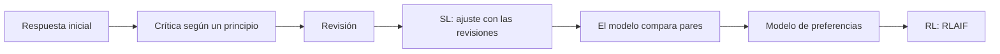

*Constitutional AI: Harmlessness from AI Feedback* es un paper de Anthropic que plantea una pregunta práctica: si los modelos son cada vez más capaces, ¿pueden ayudar a supervisar a otros modelos? Proponen entrenar un asistente inofensivo **sin etiquetas humanas que marquen qué respuestas son dañinas**. La única supervisión humana para la parte de inocuidad es una lista de principios escritos en lenguaje natural: la «constitución».

## La idea clave

El método tiene dos fases, que la figura 1 del paper resume:

1. **Fase supervisada.** Partes de un modelo entrenado para ser útil. Le das prompts problemáticos y generas respuestas. Después le pides al propio modelo que **critique** su respuesta según un principio de la constitución elegido al azar y que la **revise**. Repites crítica y revisión, y ajustas el modelo original con las respuestas revisadas.
2. **Fase de refuerzo.** El modelo de la fase anterior genera dos respuestas por prompt y otro modelo decide, guiado por un principio, cuál es mejor. Con esas preferencias generadas por IA se entrena un modelo de preferencias, que hace de recompensa en el aprendizaje por refuerzo. Es el mismo esquema de [[biblioteca/instructgpt|InstructGPT]] con una diferencia: las comparaciones de inocuidad no las hacen personas. Los autores lo llaman RL from AI Feedback (RLAIF). Las preferencias de utilidad, en cambio, siguen viniendo de etiquetadores humanos.

En la fase de refuerzo, el modelo puede razonar paso a paso antes de elegir, y los autores observan que eso mejora el resultado. Las críticas escritas y ese razonamiento hacen además el proceso más transparente. El objetivo declarado es un asistente **inofensivo pero no evasivo**: que ante una petición dañina explique sus objeciones en lugar de esquivar la conversación.

## Por qué importa hoy

Aunque no vayas a entrenar modelos, tres ideas del paper aparecen en lo que construyes:

- **Principios explícitos en lenguaje natural.** La constitución es un documento corto y legible que decide el comportamiento. Es la misma apuesta que haces al escribir un [[glosario/prompt-de-sistema|prompt de sistema]] o una spec: reglas claras, revisables y versionables.
- **Criticar y revisar.** La fase supervisada es un bucle de generar, criticar según un criterio y mejorar. Es el patrón [[patrones/07-evaluador-optimizador|evaluador-optimizador]], que puedes montar con dos llamadas a la API.
- **Un modelo que evalúa a otro.** La fase de refuerzo usa un modelo como juez guiado por un principio. Cuando montas un [[glosario/modelo-juez|modelo juez]] con rúbrica para tus evals, haces algo parecido, y te enfrentas al mismo riesgo: el juez puede equivocarse de forma sistemática y hay que validarlo.

## Qué leer primero

1. **La sección 1**, con la motivación (1.1), el resumen del método (1.2) y la figura 1.
2. **La sección 3**, sobre crítica, revisión y ajuste supervisado. Incluye ejemplos de crítica y revisión que ayudan a entenderlo.
3. **La sección 4**, sobre RLAIF, incluido el uso del razonamiento paso a paso al comparar respuestas.
4. **Los principios en los apéndices.** Leer la lista real ayuda a ver lo concretos (y lo improvisados) que son.

Puedes pasar rápido por la sección 2, que mide si los modelos ya son capaces de evaluar respuestas, y por las gráficas de comparación entre tamaños.

## Qué ha envejecido

- **Solo inocuidad.** El paper usa feedback de IA para que el modelo sea inofensivo. La idea de que un modelo genere la señal de entrenamiento de otro se ha extendido después a otros aspectos.
- **Una constitución de laboratorio.** Los autores reconocen que eligieron los principios de forma bastante improvisada y con fines de investigación. Qué principios usar, y quién debería escribirlos, queda abierto.
- **Solo la mitad sin humanos.** La utilidad sigue dependiendo de etiquetas humanas, así que el método reduce el etiquetado, pero no lo elimina.
- **Los modelos y las métricas.** Los resultados comparan modelos de 2022 con valoraciones de preferencia de la época. Las cifras no te dicen nada sobre los modelos actuales; el método sí.

## Dónde lo ves en MoreContext

- [[roadmap/00-fundamentos/06-como-se-entrena-un-llm]]: dónde encaja el alineamiento con preferencias.
- [[glosario/rlhf]] y [[glosario/aprendizaje-por-refuerzo]].
- [[patrones/07-evaluador-optimizador]]: crítica y revisión en tu propio flujo.
- [[recetas/modelo-juez-con-rubrica]]: un modelo que evalúa con criterios escritos.
- [[disciplinas/seguridad]]: por qué el entrenamiento no sustituye a las defensas del sistema.
