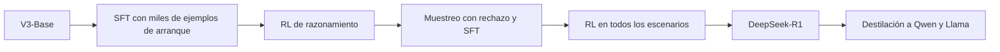

*DeepSeek-R1: Incentivizing Reasoning Capability in LLMs via Reinforcement Learning* apareció en arXiv en enero de 2025, y una versión revisada se publicó en *Nature* en septiembre de 2025. Su tesis: un LLM puede aprender a razonar con [[glosario/aprendizaje-por-refuerzo|aprendizaje por refuerzo]] puro, premiando solo que la respuesta final sea correcta, sin ejemplos humanos de cómo razonar. Lo acompañaron de los pesos de los modelos, así que cualquiera con el hardware necesario podía estudiar y ejecutar un [[glosario/modelo-de-razonamiento|modelo de razonamiento]] de ese nivel.

## La idea clave

El paper describe dos modelos.

**DeepSeek-R1-Zero** parte del modelo base DeepSeek-V3-Base y se salta el ajuste supervisado. Solo hay refuerzo con GRPO, una variante de PPO que no necesita un modelo de valor: genera un grupo de respuestas por pregunta y compara la recompensa de cada una con la media del grupo. Las recompensas son **reglas**, no modelos: una de exactitud (la respuesta matemática coincide, el código pasa los tests) y otra de formato (razonar dentro de etiquetas `<think>` antes de responder).

Con eso basta para que el razonamiento mejore mucho. En [la versión actual del paper](https://arxiv.org/abs/2501.12948), la tasa de acierto a la primera de R1-Zero en AIME 2024 pasa del 15,6 % al 77,9 % durante el entrenamiento, y al 86,7 % con autoconsistencia sobre 16 muestras. Sin que nadie lo programe, el modelo aprende a pensar durante más tokens, a revisar lo que ha hecho y a cambiar de estrategia. El paper recoge el momento en que una versión intermedia escribe «Wait, wait. Wait. That's an aha moment I can flag here».

R1-Zero tenía problemas: se leía mal y mezclaba idiomas dentro del razonamiento. **DeepSeek-R1** los corrige con un proceso en varias etapas:

Añaden una recompensa por mantener un solo idioma, que según los autores cuesta algo de rendimiento a cambio de legibilidad, y una última fase de refuerzo con modelos de recompensa para utilidad e inocuidad. Por último, destilan el razonamiento en modelos más pequeños de las familias Qwen y Llama ajustándolos con muestras de R1.

## Por qué importa hoy

- **El razonamiento se entrena.** La [[biblioteca/chain-of-thought|cadena de pensamiento]] de 2022 se provocaba con ejemplos. Aquí se aprende con refuerzo, y el modelo decide cuánto pensar. Ese es el gasto que regulas con el [[glosario/esfuerzo|esfuerzo]] en los modelos actuales.
- **Las recompensas verificables son tus tests.** El método funciona donde se puede comprobar el resultado con una regla: tests que pasan, respuestas que coinciden. Es la misma idea que la [[glosario/aceptacion-ejecutable|aceptación ejecutable]] en un harness: si puedes verificarlo con código, el agente puede iterar contra ello.
- **Los jueces aprendidos se dejan engañar.** El apéndice B.5 documenta *reward hacking* con el modelo de recompensa de utilidad. Si usas un [[glosario/modelo-juez|modelo juez]] para decidir si un agente lo ha hecho bien, valídalo antes de optimizar contra él.
- **Cómo pedirle las cosas.** Los autores recomiendan zero-shot, describiendo el problema y el formato, porque el few-shot degrada el rendimiento.

## Qué leer primero

1. **La sección 1**, con el planteamiento y la figura 1 (la curva de AIME).
2. **La sección 2**: GRPO (2.1), el diseño de recompensas (2.2) y el comportamiento que emerge (2.3), con la tabla del «aha moment».
3. **La figura 2 de la sección 3**, con el proceso completo de R1.
4. **La sección 6**, con conclusiones y limitaciones.

Si vienes de [[biblioteca/instructgpt|InstructGPT]], el apéndice A.3 compara GRPO con PPO. El B.5 sobre *reward hacking* es corto y útil. Sáltate la infraestructura, los hiperparámetros y las tablas de benchmarks salvo que compares modelos.

## Qué ha envejecido

Es reciente, pero sus propias limitaciones ya marcan dónde ha avanzado el campo:

- **Sin herramientas.** R1 no usa herramientas y su salida estructurada es mejorable, según la sección 6. Los modelos de razonamiento actuales razonan entre llamadas a herramientas, que es lo que necesita un agente.
- **Piensa de más.** Los autores reconocen que a veces razona demasiado en preguntas simples. Ajusta el esfuerzo a la tarea.
- **Idiomas.** Está optimizado para chino e inglés y puede mezclarlos con otros.
- **Ingeniería de software.** Aplicaron poco refuerzo a esas tareas y la mejora sobre V3 fue limitada.
- **Dos versiones.** La v1 de enero de 2025 y la v2 de arXiv (enero de 2026, revisada tras la publicación en *Nature*) no tienen la misma estructura. Las secciones y cifras de esta ficha son las de la v2.

## Dónde lo ves en MoreContext

- [[docs/prompting/04-razonamiento]] y [[modelos/04-dejar-pensar-al-modelo]]: razonamiento y esfuerzo en la práctica.
- [[glosario/modelo-de-razonamiento]], [[glosario/razonamiento-extendido]] y [[glosario/destilacion]].
- [[cursos/agentes-con-modelos-abiertos/01-pesos-abiertos-y-licencias]]: qué significa que publiquen los pesos y qué revisar de la licencia.
- [[recetas/validar-un-modelo-juez]]: antes de confiar en un juez, mide sus errores.
