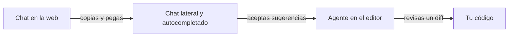

Hace un año, si me preguntabas por herramientas de IA para programar, te habría hablado de un editor con un chat a un lado y un autocompletado que te sugería la siguiente línea. Hoy esas mismas herramientas son, sobre todo, agentes. Les das una tarea y ellas solas piensan, planifican y usan sus propias herramientas para leer archivos, editarlos y lanzar comandos. En este análisis cuento qué ha cambiado y por qué afecta a cómo aprendes.

## Tres escalones

Lo veo como tres escalones:

| Escalón | Dónde ocurre | Quién actúa | Qué te toca a ti |
|---|---|---|---|
| Chat en la web | Una pestaña del navegador | Nadie: el modelo responde | Copiar, pegar, adaptar y probar a mano |
| Asistencia en el editor | Chat lateral y autocompletado | Tú, con sugerencias | Aceptar o rechazar cada sugerencia |
| Agente en el editor | Una tarea en lenguaje natural | El agente, con herramientas | Especificar, vigilar y revisar el resultado |

El segundo escalón fue un salto de comodidad. Por detrás, el autocompletado y el chat lateral eran una petición a una API con contexto de tu código: el editor recogía el archivo abierto y lo que hubiera alrededor, se lo mandaba al modelo y te enseñaba la respuesta. La IA ayudaba, pero no actuaba. No te creaba archivos ni ejecutaba nada.

El tercer escalón cambia quién hace el trabajo. Un [[glosario/agente|agente]] recibe la tarea, entra en su [[glosario/bucle-agentico|bucle agéntico]] (piensa, actúa con una herramienta, observa el resultado) y repite hasta que cree que ha terminado. El contexto ya no lo elige el editor por ti: lo busca el agente, listando carpetas, leyendo archivos y ejecutando tests. Lo cuento por dentro en [[cursos/agentes-de-codigo/01-como-trabaja-un-agente-de-codigo]].

## Lo que esto cambia en la práctica

**La unidad de trabajo.** Antes pedías una línea o una función. Ahora pides una tarea: «añade validación al formulario de registro, con sus tests». El tamaño de lo que delegas crece, y con él lo que puede salir mal.

**El tipo de revisión.** Una sugerencia de autocompletado la revisas en un segundo, porque la tienes delante mientras escribes. Un agente te devuelve un diff de varios archivos que no has visto nacer. Revisar se convierte en una habilidad propia, y le dedico una lección: [[cursos/agentes-de-codigo/04-revisar-y-confiar]].

**Lo que tienes que saber.** BettaTech lo defiende en el vídeo que enlazo en la fase 4: la IA no sustituye entender qué hace tu código. Con autocompletado, si no entendías la sugerencia, podías rechazarla antes de que existiera. Con un agente, el código ya está escrito cuando lo miras, y sin criterio acabas aceptándolo.

**Los permisos.** Un chat no puede borrarte nada. Un agente que ejecuta comandos sí. Lo que antes era una cuestión de productividad ahora también es una cuestión de [[glosario/minimo-privilegio|mínimo privilegio]] y de [[glosario/sandbox|sandbox]].

**El contexto del proyecto.** Un agente que trabaja en tu repositorio necesita saber cosas que no están en el código: cómo se ejecutan los tests, qué convenciones sigues, qué no debe tocar. De ahí vienen archivos como [[glosario/claude-md|CLAUDE.md]] y [[glosario/agents-md|AGENTS.md]], que con el autocompletado apenas hacían falta.

## Por qué los tutoriales ya no sirven igual

Esto es lo que más confunde a quien empieza, y por eso lo dejé como nota en la ruta. Si buscas hoy el tutorial de un editor como Cursor, acabas viendo cosas de agentes: [[glosario/mcp|MCP]], [[glosario/skill|skills]], subagentes. Si encuentras uno de hace un año, te enseñará el chat lateral y el autocompletado. Puede ser el mismo producto en dos momentos distintos.

Mi consejo es mirar siempre la fecha del tutorial. Y no saltarse la parte de asistencia aunque parezca antigua. Entender cómo se pasó de un chat en la web a herramientas que ayudan dentro del editor explica qué contexto recibe el modelo y por qué. Esa intuición la vas a necesitar cuando el agente haga algo raro y tengas que averiguar qué vio.

En la ruta separo dos cosas a propósito. En la fase 4 están los editores que cruzan el desarrollo con la IA: Visual Studio Code con extensiones, Cursor, Windsurf y otros. Las apps de agentes, como la de Codex o la de Claude con Claude Code y Cowork, las dejo para la fase 5, porque ahí lo importante es entender el agente y no el editor.

## Lo que no ha cambiado

El modelo de debajo sigue dando la respuesta más probable ([[blog/2026-10-15-la-respuesta-mas-probable]]). Un agente equivoca un paso con la misma seguridad con la que acierta. La diferencia es que ahora ese paso se ejecuta. Por eso las instrucciones importan más que antes ([[blog/2026-10-19-haz-que-funcione-no-es-una-instruccion]]), y por eso acabé construyendo un [[glosario/harness|harness]] alrededor del agente que uso.

Ese harness es la consecuencia lógica del tercer escalón. Si el agente escribe el código, alguien tiene que comprobar que hace lo pedido y nada más. En el mío lo hace otro agente, el revisor: compara contra el commit de partida con `git diff` y ejecuta la aceptación él mismo, sin fiarse del agente que construyó. Y la última palabra sobre qué se construye la tengo yo, antes de que se escriba una línea.

Si estás empezando, mi recomendación es recorrer los tres escalones en orden aunque el primero te parezca superado. Cada uno te enseña algo que el siguiente da por supuesto.

## Para seguir

- [[cursos/ruta-en-video/07-fase-4-herramientas-para-programar]]: los vídeos de esta fase y la nota completa.
- [[cursos/agentes-de-codigo/index]]: el curso sobre cómo trabaja, se guía y se revisa un agente de código.
- [[sistemas/agente-de-codigo]]: cómo se construye uno.
- [[herramientas/index]]: el catálogo, con [[herramientas/claude-code]], [[herramientas/opencode]], [[herramientas/cline]] y [[herramientas/aider]].

*Borrador inicial: pendiente de reescribir con la voz del autor.*
