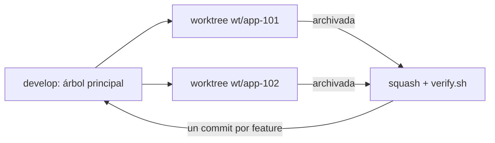

Cuando el harness empezó a funcionar bien, la tentación era obvia. Si una feature avanza sola hasta GATE#1 y, después de aprobarla, se construye y se verifica sin mí, ¿por qué no tener tres en marcha a la vez? Abrir tres sesiones de Claude Code en la misma carpeta parece lo más sencillo. Lo es, y rompe tres cosas. Las analizo porque van más allá de mi harness: le pasan a cualquier flujo con agentes que dependa de git y de un estado compartido.

## 1. El diff del revisor se mezcla

Al aprobar GATE#1, el harness guarda el HEAD de git como `base_commit`, junto con una foto de lo que ya estaba modificado antes de empezar. Después, el reviewer revisa `git diff <base_commit>`, es decir, todo lo que ha cambiado desde que aprobé. Los especialistas posteriores a la implementación usan ese mismo diff para decidir si les toca intervenir.

Con dos features en el mismo árbol, ese diff contiene el trabajo de las dos. El reviewer de la feature A ve código de la B que no aparece en su especificación. Tiene dos salidas y las dos son malas: marcarlo como fuera de alcance y bloquear una feature correcta, o darlo por bueno y revisar algo que no le corresponde. La premisa de toda la revisión, «esto es lo que hizo el builder de esta feature», deja de ser cierta.

## 2. La regresión falla por código ajeno

La aceptación de cada feature incluye la regresión del proyecto, `verify.sh`, y tiene que pasar antes de archivar. En el mismo árbol, la regresión de A se ejecuta sobre el código a medias de B. Si B está en mitad de un cambio, la regresión de A falla. Y el reviewer de A no tiene forma de saber que el fallo no es suyo: ve un check obligatorio en rojo y emite su veredicto. La feature acaba en un repair que no arregla nada o directamente bloqueada.

Lo peor de este fallo es que es intermitente. Depende de en qué punto esté la otra feature cuando se ejecuta la regresión. Cuesta reproducirlo, y en mi harness un fallo solo es reparable si es reproducible. Así que un fallo ajeno e intermitente casi siempre termina en una decisión humana que no debería haber hecho falta.

## 3. El motor de estado puede perder transiciones

Esta es la más silenciosa. `feature.py`, el motor de estado, es el único que escribe el estado de cada feature, y además mantiene la cola común de features, `feature_list.json`. En cada transición la lee, cambia la entrada de su feature y la vuelve a escribir entera. La escritura es atómica (archivo temporal y reemplazo), así que el archivo nunca queda a medias. Pero no hay bloqueo entre procesos.

Con dos sesiones transicionando a la vez, las dos leen la misma versión, cada una cambia su entrada y la segunda en guardar pisa a la primera. Una transición desaparece de la cola aunque el `state.yaml` de su feature diga otra cosa. El validador lo detecta después como una deriva entre la cola y el estado, pero el daño ya está hecho y alguien tiene que entender qué pasó.

Las tres tienen la misma raíz: el harness está diseñado para que **cada sesión crea que es la única que toca el repositorio**. En serie esa suposición se cumple sola. En paralelo hay que hacerla cumplir.

## Cómo lo resuelven las olas

La variante con olas de mi harness hace cumplir esa suposición sin tocar el harness:

- **Un [[glosario/worktree|worktree]] de git por feature**, con su propia carpeta y una rama temporal `wt/<id>`, y **una sesión de Claude Code por worktree**. Cada sesión lleva una sola feature y tiene su propio `base_commit`, su propio `verify.sh` y su propio `feature_list.json`. Las tres cosas funcionan exactamente igual que en serie.
- **El árbol principal solo integra.** Está en la rama de integración (`develop` por defecto), limpio, y mientras haya worktrees abiertos no se construye nada en él.
- **Se integra de una en una.** Cuando una feature queda archivada, se lleva a la rama de integración con un squash: un commit por feature, con el mensaje que propuso el reviewer. `verify.sh` tiene que quedar en verde antes de integrar la siguiente. Si dos features pasaron su verificación por separado pero juntas fallan, se aborta la integración y se registra el fallo; nada de arreglarlo a mano encima.
- **Lo mecánico se resuelve solo.** En `feature_list.json` cada feature añade o cambia sus entradas, así que el script de olas une las dos versiones por ID. El resto de conflictos esperables, como registros donde cada feature añade su línea, se resuelven conservando los dos lados.



La mecánica de abrir, vigilar, integrar y cerrar la hace un script, `ola.sh`. Abrir también instala dependencias y lanza la sesión, pero su núcleo es una orden de git:

```bash
git worktree add -b wt/app-102 ~/app-wt/app-102 develop
```

Hoy Claude Code trae además worktrees nativos: puedes arrancar una sesión en un worktree propio (`--worktree`) o pedir que un subagente trabaje aislado en uno (`isolation: worktree`). Las olas nacieron antes de que yo pudiera contar con eso, y aun así siguen teniendo sentido, porque el trabajo que más ahorran está alrededor del worktree: comprobar dependencias, integrar en orden y no dejar pasar una integración sin la regresión en verde.

## Lo que no resuelven los worktrees

Los worktrees separan el código, pero no las dependencias entre features ni los recursos de tu máquina. Por eso una ola tiene reglas además de carpetas:

- **Dependencias primero.** Una feature arranca solo cuando todas sus dependencias están integradas, incluidas las implícitas: código que usa de otra feature sin declararlo.
- **Una por módulo.** Dos features que tocan el mismo módulo, el mismo registro central o el mismo formato de datos del usuario no van en la misma ola.
- **Pocas a la vez.** Como mucho cuatro abiertas por defecto, y menos si la máquina va justa. Cada worktree es una copia del árbol con sus dependencias y sus compilados; con 16 GB de RAM, dos o tres builds a la vez como mucho.
- **Ojo con la carga.** Si un comando de aceptación supera su tiempo límite por culpa de las otras sesiones, el reviewer devuelve `BLOCKED_TOOLING`. Se baja a dos sesiones y se reintenta la verificación.

Y el límite real soy yo. Cada feature tiene su GATE#1 y cada integración pide atención. Las olas reparten el trabajo de los agentes; el mío sigue siendo secuencial.

## Para seguir

- [[sistemas/harness-sdd-olas]]: la variante con olas completa.
- [[cursos/harness-engineering/13-features-en-paralelo-con-olas]]: reglas, ciclo y conflictos, paso a paso.
- [[recetas/features-en-paralelo-con-worktrees]] y [[recetas/integrar-features-en-paralelo]]: las dos mitades, abrir e integrar, como recetas.
- [[problemas/conflictos-al-integrar-en-paralelo]]: qué hacer cuando el squash deja conflictos.

*Borrador inicial: pendiente de reescribir con la voz del autor.*
