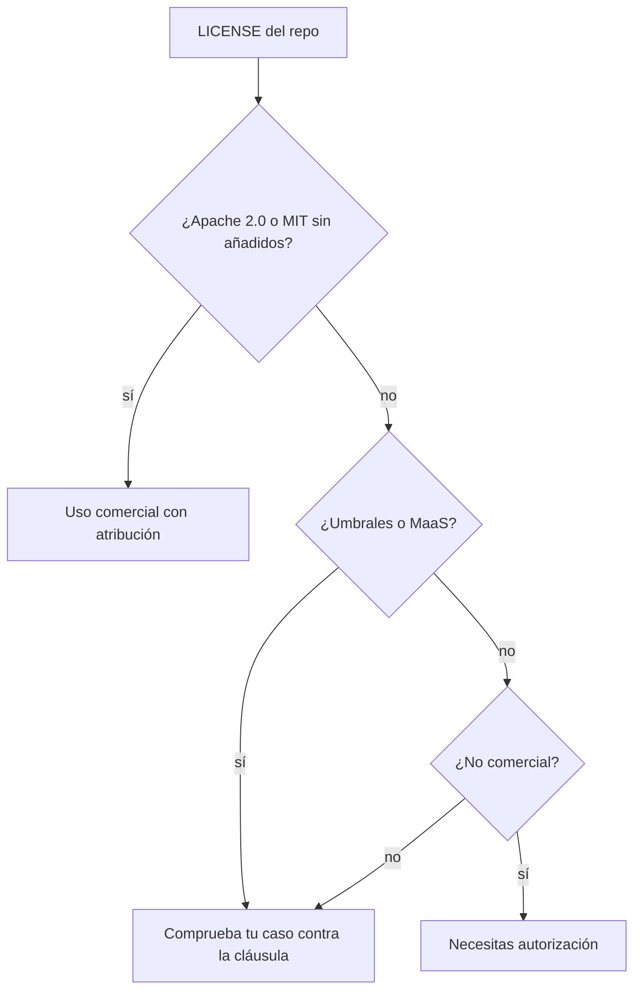

Antes de descargar un modelo hay que saber qué te deja hacer con él. Al terminar esta lección sabrás distinguir «pesos abiertos» de «open source», clasificar cualquier licencia de modelo en cuatro preguntas y sacar de una *model card* lo que necesitas para un agente.

## La idea

Un modelo de **[[glosario/pesos-abiertos|pesos abiertos]]** publica los parámetros entrenados para que los descargues y los ejecutes donde quieras. Eso es todo lo que garantiza. No implica que se publiquen los datos de entrenamiento, ni el código que lo entrenó, ni que la licencia sea de las aprobadas por la OSI.

La **Open Source AI Definition** de la OSI (versión 1.0, octubre de 2024) pide más: libertad para usar el sistema con cualquier fin y acceso a la información sobre los datos, al código y a los parámetros. La propia OSI dice que los *open weights* «se quedan cortos» porque no dan el proceso de entrenamiento. Por eso en MoreContext escribimos **«de pesos abiertos»** por defecto y reservamos [[glosario/open-source-ai|open source AI]] para los casos que cumplen la definición.

De lo revisado en octubre de 2026, solo **OLMo 3** (Ai2) publica datos (Dolma 3, Dolci), código y *checkpoints* con Apache 2.0. NVIDIA Nemotron 3 publica parte de los datos. El resto son pesos abiertos con licencias muy distintas entre sí.

Hay un tercer término que conviene separar: **fuente disponible**. Puedes leer el código o descargar los pesos, pero la licencia no es OSI porque limita usos (por ejemplo, ofrecerlo como servicio). Pasa con modelos y también con herramientas: el servidor de Phoenix usa Elastic 2.0 y n8n la Sustainable Use License, aunque ambos se presenten como abiertos.

## Tres regímenes de licencia

En octubre de 2026 conviven tres familias de licencias. La etiqueta de la web del proveedor no siempre coincide con el archivo `LICENSE` del repositorio: manda el `LICENSE`.

| Régimen | Ejemplos (licencia exacta) | Qué implica |
|---|---|---|
| Permisivas OSI | Qwen 3.5 y 3.6, Qwen3.8-27B, Gemma 4, gpt-oss, Mistral Small 4, Granite 4.2, OLMo 3 (Apache 2.0); DeepSeek V4 y Phi-4 (MIT) | Uso comercial, modificación y redistribución con atribución. gpt-oss añade una política de uso |
| MIT modificadas | Kimi K3 License, GLM-5.3 License, Qwen3.8-Max License (para Qwen3.8-2.4T-A95B), Mistral Ecosystem Open-Weight License (Mistral Large 4), Modified MIT de Mistral Medium 3.5 | Base MIT con umbrales de ingresos o usuarios, o restricciones a vender el modelo como servicio |
| Comunitarias | Llama 4 Community License, MiniMax Community License (MiniMax M3) | Condiciones propias: Llama 4 obliga a pedir licencia por encima de 700 M de usuarios activos mensuales; la concesión base de MiniMax M3 es no comercial |

Dos detalles que confunden. Gemma 4 pasó a Apache 2.0, cuando Gemma 3 usaba los términos propios de Gemma. Y Mistral documenta GLM 5.3 como «MIT», pero su `LICENSE` en Hugging Face es una licencia propia con condiciones.

## Las cuatro preguntas

Lee la licencia con estas preguntas, en este orden. Si una responde «sí», sigue leyendo esa cláusula entera.

1. **¿Es OSI sin añadidos?** Apache 2.0 o MIT tal cual: puedes usarlo en casi cualquier producto respetando la atribución.
2. **¿Hay umbral de usuarios o ingresos?** Llama 4: más de 700 M de usuarios activos al mes. Qwen3.8-Max y Kimi K3: atribución visible por encima de 100 M de usuarios al mes o 20 M$ de ingresos mensuales. Mistral Medium 3.5: sin derechos si tu empresa factura más de 20 M$ al mes.
3. **¿Restringe ofrecerlo como servicio (Model as a Service)?** Mistral Large 4, Kimi K3, GLM-5.3 y Qwen3.8-Max. Suelen excluir el uso interno y el modelo integrado en una función de tu producto, pero no la API que revende el modelo.
4. **¿La concesión base es no comercial?** MiniMax M3: el uso comercial exige atribución «Built with MiniMax M3» y aviso, o autorización por encima de 20 M$ al año.

> [!peligro] La licencia es del modelo, no del motor
> Que Ollama sea MIT o vLLM Apache 2.0 no dice nada del modelo que sirven. Cada modelo trae su `LICENSE`, y un *fine-tune* hereda la licencia del modelo base.

## Familias vigentes y para qué se usan

Una foto de octubre de 2026, sin benchmarks (los de agentes tienen ruido de varios puntos y cambian cada mes). Lo que importa para un agente es si documenta *tool calling*, cuánto contexto tiene y cómo se controla el razonamiento.

| Familia | Tamaños | Contexto | Tool calling | Uso típico en agentes |
|---|---|---|---|---|
| Qwen 3.6 / 3.8 | 27B denso; 35B-A3B MoE | 262 144 nativo | Sí (*parser* `qwen3_coder`) | Agente local generalista; el 27B cabe en una GPU de consumo cuantizado |
| Gemma 4 | E2B, E4B, 12B, 26B-A4B, 31B | 128K–256K | Sí, nativo | Modelos pequeños y con visión; E2B/E4B para dispositivos |
| gpt-oss | 20b (21B-A3.6B), 120b (117B-A5.1B) | 128k | Sí (formato *harmony* obligatorio) | Razonamiento con niveles `low`/`medium`/`high` |
| Mistral Small 4 | 119B-A6.5B MoE | 256k | Sí (*parser* `mistral`) | Servidor con varias GPU |
| Granite 4.2 | 3B, 8B, 30B | 128K | Sí | Tareas acotadas con modelos densos pequeños |
| DeepSeek V4 | V4-Flash 284B-A13B, V4-Pro 1.6T-A49B | 1 M | Sí | Centros de datos; sin plantilla Jinja, necesita soporte específico del motor |
| OLMo 3 | 7B, 32B | sin confirmar | No documentado | Investigación y el único open source completo de la lista |

Sobre Llama: el modelo más reciente en la organización `meta-llama` de Hugging Face sigue siendo **Llama 4** (2025). Hay fuentes secundarias que hablan de una versión nueva, pero no está confirmada en la fuente primaria; no planifiques sobre ella.

## Cómo leer una model card

La *model card* es el README del repositorio del modelo. Para un agente, busca estos seis datos y apúntalos:

- **Parámetros totales y activos.** En una [[glosario/mezcla-de-expertos|mezcla de expertos]] (MoE) como Qwen3.6-35B-A3B, el coste por token depende de los ~3B activos, pero **la memoria depende de los 35B totales**. Ollama lo descarga en Q4_K_M ocupando 24 GB.
- **Contexto nativo y extendido.** «262 144 nativo, hasta 1 M con YaRN» significa que el extendido necesita configuración y suele rendir peor.
- ***Tool calling* y su *parser*.** Si la card da el comando de vLLM, copia el `--tool-call-parser`. Si no menciona herramientas, no lo uses para un agente sin probarlo.
- **[[glosario/plantilla-de-chat|Plantilla de chat]].** Casi todos traen una plantilla Jinja; DeepSeek V4 no, y gpt-oss exige *harmony*. Un motor con la plantilla mal configurada degrada el modelo sin dar error.
- **Razonamiento por defecto.** Casi todos lo traen activado y gastan tokens antes de responder. Se apaga o regula con parámetros distintos: `enable_thinking` en Qwen, `reasoning_effort` en Mistral Small 4 (`"none"`/`"high"`), `<|think|>` en el *prompt* de sistema de Gemma 4.
- **Muestreo recomendado.** DeepSeek V4 recomienda temperatura 1.0 y top_p 1.0. Si copias `temperature=0` de otro proyecto con un modelo de razonamiento, puedes empeorarlo. A diferencia de la API de Claude (que ya no acepta `temperature`), aquí estos parámetros existen y la card dice qué valores usar.

## Errores frecuentes

- Decir «uso Llama porque es open source». Llama 4 tiene una licencia comunitaria con umbral, y no cumple la definición de la OSI.
- Fiarse de la etiqueta de la web del proveedor en lugar del `LICENSE`.
- Calcular la memoria con los parámetros activos de un MoE.
- Dar por hecho que el razonamiento está apagado y quedarte sin `max_tokens` para la respuesta.

## Ejercicio

> [!ejercicio] Ficha de dos modelos
> Elige dos modelos de la tabla con licencias de régimen distinto (por ejemplo, Qwen3.6-27B y Kimi K3). Abre el `LICENSE` y la *model card* de cada uno en Hugging Face y rellena una ficha con: licencia exacta, respuesta a las cuatro preguntas, parámetros totales y activos, contexto nativo, *parser* de herramientas y cómo se controla el razonamiento.
>
> Está bien si cada respuesta cita la frase del `LICENSE` o de la card de la que sale, y si la ficha dice explícitamente si puedes usar el modelo en un producto SaaS con más de 50 M$ de ingresos anuales.

> [!ejercicio]- Pistas
> Busca en el `LICENSE` las palabras «service», «revenue», «monthly active users» y «non-commercial». En la card, la sección de despliegue suele traer el comando de vLLM o SGLang con los *parsers*.

## Resumen

- Pesos abiertos significa que puedes descargar los parámetros; no dice nada de datos, código ni licencia.
- Open source AI (OSI) exige datos, código y parámetros con libertad de uso: hoy lo cumplen muy pocos modelos, como OLMo 3.
- Lee siempre el `LICENSE` con las cuatro preguntas: OSI, umbrales, Model as a Service y no comercial.
- En un MoE, la memoria la marcan los parámetros totales.
- La card te dice el *parser* de herramientas, la plantilla, el razonamiento por defecto y el muestreo recomendado.

## Para seguir

- [[cursos/agentes-con-modelos-abiertos/02-tu-primer-modelo-en-local]]: descarga y sirve uno de estos modelos.
- [[modelos/11-modelos-abiertos]]: cómo cambia el *prompting* con modelos abiertos.
- [[glosario/open-source-ai]] y [[glosario/pesos-abiertos]].
