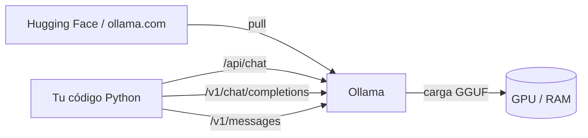

Al terminar esta lección tendrás un modelo de pesos abiertos respondiendo en tu máquina, sabrás llamarlo desde Python de dos formas y sabrás calcular, antes de descargar nada, si un modelo cabe en tu memoria. También aprenderás a evitar el fallo más traicionero de la inferencia local: el contexto que se trunca sin avisar.

## La idea

Servir un modelo en local es tener un proceso que carga los pesos en memoria (GPU, memoria unificada de un Mac o RAM) y expone una API HTTP. [[herramientas/ollama|Ollama]] (v0.40.12, octubre de 2026) hace las tres cosas difíciles por ti: descarga el modelo ya cuantizado, decide cuánto va a la GPU y cuánto a la CPU, y ofrece tres APIs: la nativa (`/api/chat`), una compatible con OpenAI (`/v1`) y una compatible con Anthropic (`/v1/messages`).

Por debajo, Ollama usa modelos en formato [[glosario/gguf|GGUF]], el mismo de [[herramientas/llama-cpp|llama.cpp]]. Un GGUF guarda los pesos [[glosario/cuantizacion|cuantizados]]: en lugar de 16 bits por parámetro, unos 4 u 8. Así un modelo de 27B pasa de 54 GB a unos 16,5 GB.



## Instalar y descargar

Ollama tiene instalador para macOS y Windows en ollama.com y un script para Linux. Estos comandos siguen la documentación oficial; no se han ejecutado en el entorno de prueba de esta web (no hay GPU).

```bash
curl -fsSL https://ollama.com/install.sh | sh   # Linux; en macOS y Windows, el instalador de ollama.com
ollama pull qwen3.6:27b                          # unos 17 GB en Q4_K_M
ollama run qwen3.6:27b "Di hola en una frase"    # prueba rápida en la terminal
ollama ps                                        # modelo cargado, PROCESSOR (GPU/CPU) y CONTEXT
```

Si tu máquina tiene 16 GB o menos, empieza por `gemma4:e4b` o `gemma4:12b`. Más abajo calculas por qué.

El servidor escucha en `127.0.0.1:11434`. La variable `OLLAMA_HOST` lo cambia; con `0.0.0.0:11434` lo expones a la red, y Ollama no valida claves: pon delante un proxy con autenticación si lo haces.

## Llamarlo desde Python

### API nativa

El cliente `ollama` (0.6.3) habla con `/api/chat`. Es la API que más controla: contexto, razonamiento (`think`) y salidas con esquema (`format`).

```python title="hola_ollama.py"
from ollama import chat

MODEL = "qwen3.6:27b"

r = chat(model=MODEL, think=False,
         messages=[{"role": "user", "content": "Explica qué es un token en dos frases."}],
         options={"num_ctx": 32768,       # contexto explícito: el de por defecto es pequeño
                  "num_predict": 512})    # tope de salida: por defecto es -1 (sin límite)
print(r.message.content)
print("tokens de entrada:", r.prompt_eval_count, "· de salida:", r.eval_count)
```

`think=False` apaga el razonamiento en los modelos que lo traen activado. Si lo dejas, el modelo puede gastar cientos de tokens pensando antes de responder.

### API compatible con OpenAI

Cualquier código escrito para el SDK `openai` funciona cambiando `base_url`. La clave es obligatoria para el SDK, pero Ollama la ignora.

```python title="hola_openai.py"
from openai import OpenAI

MODEL = "qwen3.6:27b"
client = OpenAI(base_url="http://localhost:11434/v1", api_key="ollama")

r = client.chat.completions.create(model=MODEL, max_tokens=512,
    messages=[{"role": "user", "content": "Explica qué es un token en dos frases."}])
print(r.choices[0].message.content, r.usage.prompt_tokens, r.usage.completion_tokens)
```

Esta API **no tiene campo para el contexto**. Si la usas, fija `num_ctx` en el modelo con un Modelfile (siguiente sección). Tampoco acepta `tool_choice`, `logit_bias`, `n` ni imágenes por URL.

## El contexto que trunca en silencio

`num_ctx` es la [[glosario/ventana-de-contexto|ventana de contexto]] que Ollama reserva para el modelo, independiente de lo que el modelo soporte. Si tu conversación la supera, Ollama descarta el principio **sin dar error**. En un agente eso significa perder el *prompt* de sistema o la definición de las herramientas, y el modelo empieza a comportarse raro sin motivo aparente.

La propia documentación de Ollama da tres valores por defecto distintos: la página de contexto dice que depende de la VRAM (4k con menos de 24 GiB, 32k de 24 a 48 GiB, 256k con 48 GiB o más), la FAQ dice 4096 y la referencia del Modelfile, 2048. No adivines: **compruébalo con `ollama ps`** (columna `CONTEXT`). Para agentes y herramientas de código, Ollama recomienda al menos 64 000 tokens.

Tres formas de fijarlo, de más local a más global:

```text title="Modelfile"
FROM qwen3.6:27b
PARAMETER num_ctx 65536
```

```bash
ollama create qwen3.6-64k -f Modelfile     # un modelo nuevo con el contexto fijado (sirve para /v1)
OLLAMA_CONTEXT_LENGTH=65536 ollama serve   # valor por defecto para todo el servidor
```

La tercera es por petición, con `options={"num_ctx": …}` en la API nativa, como en el ejemplo anterior. Más contexto ocupa más memoria (la [[glosario/kv-cache|KV cache]] crece con cada token), así que súbelo a lo que necesitas, no al máximo del modelo.

## Cuánta memoria necesitas

La regla que cuadra con la realidad tiene tres términos:

- **Pesos** ≈ parámetros × bits por peso / 8.
- **KV cache** = 2 (K y V) × capas × (cabezas KV × dimensión de cabeza) × bytes por valor × tokens × usuarios en paralelo.
- **Margen**: deja 1 o 2 GB más para activaciones y el sistema (orientativo; no cuentes con toda la VRAM).

Los bits por peso de cada cuantización están medidos en el README de `llama-quantize` (sobre Llama-3.1-8B): Q4_K_M 4,89 · Q5_K_M 5,70 · Q6_K 6,56 · Q8_0 8,50 · F16 16,0.

```python title="memoria.py"
BPW = {"Q4_K_M": 4.89, "Q5_K_M": 5.70, "Q6_K": 6.56, "Q8_0": 8.50, "F16": 16.0}   # bits por peso (README de llama-quantize)

def pesos_gb(parametros: float, cuant: str) -> float:
    return parametros * BPW[cuant] / 8 / 1e9

def kv_cache_gb(capas: int, kv_heads: int, dim_cabeza: int, tokens: int, bytes_=2, usuarios=1) -> float:
    # 2 (K y V) × capas × (cabezas KV × dimensión de cabeza) × bytes × tokens × usuarios en paralelo
    return 2 * capas * kv_heads * dim_cabeza * bytes_ * tokens * usuarios / 1024**3

for q in ("Q4_K_M", "Q8_0", "F16"):
    print(f"27B denso en {q}: {pesos_gb(27e9, q):.1f} GB de pesos")
print(f"35B-A3B (MoE) en Q4_K_M: {pesos_gb(35e9, 'Q4_K_M'):.1f} GB: cuentan los 35B, no los 3B activos")
# Llama 2 7B: 32 capas, 32 cabezas de 128 dimensiones, sin GQA; el ejemplo de NVIDIA (4096 tokens, FP16)
print(f"KV cache Llama 2 7B, 4096 tokens: {kv_cache_gb(32, 32, 128, 4096):.1f} GiB")
print(f"Lo mismo con 4 usuarios en paralelo: {kv_cache_gb(32, 32, 128, 4096, usuarios=4):.1f} GiB")
```

```text
27B denso en Q4_K_M: 16.5 GB de pesos
27B denso en Q8_0: 28.7 GB de pesos
27B denso en F16: 54.0 GB de pesos
35B-A3B (MoE) en Q4_K_M: 21.4 GB: cuentan los 35B, no los 3B activos
KV cache Llama 2 7B, 4096 tokens: 2.0 GiB
Lo mismo con 4 usuarios en paralelo: 8.0 GiB
```

La cuenta cuadra con lo publicado. Ollama anuncia 17 GB para `qwen3.6:27b` en Q4_K_M (calculado: 16,5), 30 GB en Q8_0 (28,7) y 56 GB en BF16 (54); la diferencia son la parte de visión, la tabla de *embeddings* y los metadatos. El MoE 35B-A3B ocupa 24 GB en Ollama: la memoria la marcan los parámetros totales. Y el ejemplo de KV cache reproduce el de NVIDIA (unos 2 GB para Llama 2 7B con 4096 tokens en FP16).

Para modelos con *grouped-query attention* (casi todos los actuales), usa `num_key_value_heads` del `config.json` en lugar del total de cabezas: la KV cache sale varias veces menor. Las arquitecturas híbridas (Qwen 3.5/3.6 intercalan capas de atención con otras que no la usan) solo guardan caché en las capas de atención. La guía [[modelos/12-inferencia-local]] desarrolla estos casos.

## Elegir tamaño para tu máquina

Con la fórmula, una tabla de partida (pesos en Q4_K_M; súmale KV cache y margen):

| Memoria libre para el modelo | Qué cabe en Q4_K_M | Ejemplos |
|---|---|---|
| 8 GB | hasta ~8B | Gemma 4 E4B, Granite 4.2 8B |
| 16 GB | hasta ~14B (12B ≈ 7,3 GB de pesos) | Gemma 4 12B |
| 24 GB | 27B denso (≈ 16,5 GB) con contexto moderado | Qwen 3.6 27B |
| 32 GB o más | MoE de 26–35B totales o 27B en Q8_0 | Gemma 4 26B-A4B, Qwen 3.6 35B-A3B |

Si `ollama ps` muestra parte del modelo en `CPU`, no cabe entero en la GPU: funcionará, pero mucho más lento. Antes de bajar a Q3 o menos, prueba un modelo más pequeño en Q4_K_M; las cuantizaciones agresivas degradan antes la calidad, y en especial el *tool calling*.

## llama.cpp sin Ollama

Ollama es cómodo; [[herramientas/llama-cpp|llama.cpp]] da más control y es lo que hay debajo. Desde la v0.7.0 (15 de octubre de 2026) usa versiones semánticas y **cambió el puerto por defecto de `llama-server` de 8080 a 9931** (las imágenes Docker mantienen 8080). Muchos tutoriales siguen diciendo `localhost:8080`.

```bash
# descarga el GGUF de Hugging Face (Q4_K_M si no indicas cuantización) y sirve una API compatible con OpenAI
llama-server -hf ggml-org/Qwen3.8-27B-GGUF:Q4_K_M -c 65536 --port 8080
```

`-c` fija el contexto (0 = el del modelo) y `--jinja`, necesario para herramientas, viene activado por defecto. El mismo cliente `openai` de antes funciona con `base_url="http://localhost:8080/v1"`. La referencia completa está en [[docs/modelos-abiertos/02-vllm-y-llama-cpp]].

## Errores frecuentes

- **Agente que «olvida» las instrucciones a mitad de conversación.** Es `num_ctx` truncando. Mira `ollama ps`.
- **Respuestas que no terminan nunca.** `num_predict` vale -1 por defecto: pon siempre `num_predict` o `max_tokens`.
- **Elegir modelo por parámetros activos.** Un 35B-A3B no cabe donde cabe un 3B.
- **Usar etiquetas `:cloud` creyendo que son locales.** Envían los datos a ollama.com.

## Ejercicio

> [!ejercicio] Mide tu máquina
> Calcula con `memoria.py` qué modelo de la tabla debería caber en tu memoria con 32 768 tokens de contexto. Descárgalo, fija `num_ctx` con un Modelfile y comprueba con `ollama ps` que el `CONTEXT` es el que pediste y que el `PROCESSOR` es 100 % GPU (o memoria unificada). Después llama al modelo por la API compatible con OpenAI y apunta los tokens de `usage`.
>
> Está bien si tu cálculo de pesos se aleja menos de un 15 % del tamaño que muestra `ollama list` y si explicas en una frase de dónde sale la diferencia.

> [!ejercicio]- Pistas
> Si el modelo tiene visión, parte de la diferencia es el proyector multimodal. Para la KV cache, busca `num_hidden_layers`, `num_key_value_heads` y `head_dim` en el `config.json` del repositorio original del modelo.

## Resumen

- Ollama descarga GGUF cuantizados y expone APIs nativa, OpenAI y Anthropic en `localhost:11434`.
- `num_ctx` trunca en silencio: fíjalo por petición, con un Modelfile o con `OLLAMA_CONTEXT_LENGTH`, y compruébalo con `ollama ps`.
- Memoria ≈ parámetros × bits por peso / 8 + KV cache + margen; en MoE cuentan los totales.
- Pon siempre un tope de salida: `num_predict` es ilimitado por defecto.
- llama.cpp da más control; desde v0.7.0 su puerto por defecto es 9931.

## Para seguir

- [[cursos/agentes-con-modelos-abiertos/03-servir-modelos-en-produccion]]: cuando un portátil no basta.
- [[docs/modelos-abiertos/01-ollama]]: la referencia completa de Ollama.
- [[recetas/agente-local-con-ollama]]: un agente con herramientas en local, paso a paso.
