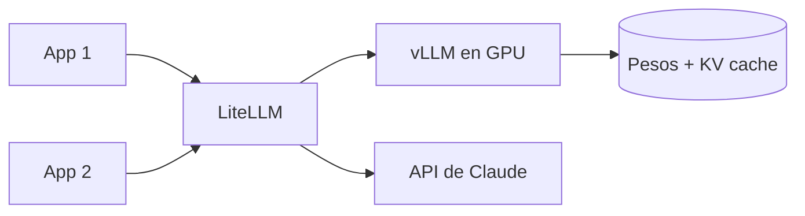

Ollama es perfecto para un equipo. Cuando el agente lo usan decenas de personas a la vez, necesitas un servidor que reparta una GPU entre muchas peticiones. Al terminar esta lección sabrás arrancar [[herramientas/vllm|vLLM]] con herramientas, entenderás qué limita su capacidad y tendrás una pasarela con [[herramientas/litellm|LiteLLM]] para que tus aplicaciones no sepan qué modelo hay detrás.

## La idea

Un servidor de inferencia para producción resuelve un problema distinto al de Ollama. Ollama procesa unas pocas peticiones por modelo (`OLLAMA_NUM_PARALLEL`, 1 por defecto) y encola el resto. vLLM y SGLang hacen ***continuous batching***: en cada paso de generación meten en la GPU los tokens de todas las peticiones activas, y una petición nueva entra en cuanto otra termina, sin esperar a que acabe el lote.

Esto funciona porque generar un token apenas usa la capacidad de cálculo de la GPU; lo que manda es leer los pesos de memoria. Si los lees una vez para 30 peticiones en lugar de para una, el coste por token baja mucho. El límite pasa a ser la memoria que queda para la **[[glosario/kv-cache|KV cache]]**: los vectores de atención de cada token ya procesado, por cada petición activa. vLLM gestiona esa caché en bloques (lo que su proyecto llama *PagedAttention*) para no reservar el contexto máximo a cada usuario.



La consecuencia práctica: **la memoria de la GPU se reparte entre pesos fijos y KV cache variable**. Más contexto por petición o más usuarios a la vez significa más KV cache. La fórmula de la lección 2 te dice cuánto ocupa cada token.

## Arrancar vLLM

vLLM 0.32.0 (18 de octubre de 2026, Apache 2.0) necesita Python 3.11 o superior y una GPU. Los comandos siguen las *model cards* y la documentación oficial; no se han ejecutado en el entorno de prueba de esta web, que no tiene GPU.

```bash
pip install vllm

# Qwen3.6-35B-A3B con herramientas y razonamiento (flags de la model card)
vllm serve Qwen/Qwen3.6-35B-A3B --max-model-len 262144 \
  --reasoning-parser qwen3 --enable-auto-tool-choice --tool-call-parser qwen3_coder

# gpt-oss-20b: el parser "openai" entiende el formato harmony
vllm serve openai/gpt-oss-20b --enable-auto-tool-choice --tool-call-parser openai
```

Las opciones que más vas a tocar:

| Opción | Qué hace | Cuándo tocarla |
|---|---|---|
| `--enable-auto-tool-choice` | Permite que el modelo decida llamar herramientas | Siempre que haya agente; sin ella no hay *tool calling* |
| `--tool-call-parser <nombre>` | Convierte el texto del modelo en `tool_calls` | Copia el de la card (`qwen3_coder`, `mistral`, `openai`, `llama4_pythonic`…) |
| `--reasoning-parser <nombre>` | Separa el razonamiento de la respuesta | Modelos con razonamiento |
| `--max-model-len` | Contexto máximo por petición | Bájalo si el arranque falla por memoria |
| `--tensor-parallel-size` | Reparte el modelo entre varias GPU | Modelos que no caben en una |
| `--gpu-memory-utilization` | Fracción de VRAM que usa vLLM | Si compartes la GPU con otro proceso |
| `--allowed-origins` | Orígenes CORS permitidos | Desde 0.32 el CORS está cerrado: llamadas desde navegador |
| `--enable-prefix-caching` | Reutiliza la KV cache de prefijos repetidos | Agentes con el mismo *prompt* de sistema y herramientas |

Un *parser* equivocado no da error: el modelo devuelve las llamadas como texto y tu agente cree que respondió. Es la causa número uno de [[problemas/modelo-local-no-llama-herramientas]].

## Llamarlo con el mismo cliente

vLLM expone `/v1/chat/completions`, `/v1/responses`, `/v1/embeddings` y también `/v1/messages` (compatible con Anthropic, con lagunas). El código de la lección 2 vale cambiando el puerto a 8000:

```python title="cliente_vllm.py"
from openai import OpenAI

MODEL = "Qwen/Qwen3.6-35B-A3B"          # el nombre del repo con el que arrancaste vllm serve
client = OpenAI(base_url="http://localhost:8000/v1", api_key="local")

TICKET = {"type": "object", "additionalProperties": False,
          "properties": {"categoria": {"type": "string", "enum": ["facturacion", "envio", "devolucion", "otro"]},
                         "urgente": {"type": "boolean"}},
          "required": ["categoria", "urgente"]}

r = client.chat.completions.create(
    model=MODEL, max_tokens=256,
    messages=[{"role": "user", "content": "Clasifica: 'Me cobrasteis dos veces, lo necesito hoy'"}],
    response_format={"type": "json_schema", "json_schema": {"name": "ticket", "schema": TICKET}},
)
print(r.choices[0].message.content)
```

Con `response_format` vLLM restringe la generación al esquema ([[glosario/decodificacion-restringida|decodificación restringida]]). A diferencia de Ollama, vLLM sí acepta `tool_choice`: `auto`, `required`, `none` o una función concreta. Con `required` o una función concreta usa también salidas estructuradas, y la documentación lo resume bien: garantiza una llamada parseable, no una buena.

## SGLang y los demás

- **SGLang** 0.5.22 (Apache 2.0) es la alternativa a vLLM, con los mismos conceptos y *parsers* propios. Funciona también en Apple Silicon. Arranque según las cards: `python3 -m sglang.launch_server --model-path <repo> --host 0.0.0.0 --port 30000`, con `--tool-call-parser` y `--reasoning-parser`.
- **TGI** (Hugging Face) está en modo mantenimiento y su repositorio se archivó el 21 de marzo de 2026. No lo uses en proyectos nuevos.
- **KServe** 0.21 (Apache 2.0) sirve modelos en Kubernetes si ya operas un clúster.

## GPU y coste operativo

No hay una cifra que valga para todos, así que aquí no la encontrarás. Lo que sí puedes hacer es calcular el tuyo con estas piezas:

- **Coste fijo**: GPU (compradas o alquiladas por hora), aunque estén ociosas. Una GPU alquilada al 10 % de uso es cara; al 80 %, puede no serlo.
- **Capacidad**: mide tú los tokens por segundo agregados con tu modelo, tu contexto típico y tu número de usuarios simultáneos. Cambia mucho con el tamaño de la KV cache por petición.
- **Operación**: drivers, versiones de vLLM (la 0.32 rompió el CORS por defecto), *parsers*, actualizaciones de modelo, monitorización y guardias. Es tiempo de personas.
- **Comparación**: divide el coste mensual total entre los tokens que procesaste y compáralo con el precio por token de la API para tus mismas tareas, con *prompt caching* incluido. La lección 6 lo convierte en decisión.

> [!aviso] Mide antes de comprar
> Alquila una GPU por horas, sirve tu modelo con tu carga real (por ejemplo, reproduciendo trazas de producción) y mide. Las cifras de capacidad publicadas por terceros usan otros modelos, otros contextos y otra concurrencia.

## LiteLLM como pasarela

Cuando conviven un modelo local y una API, no quieres que cada aplicación sepa de ambos. [[herramientas/litellm|LiteLLM]] (MIT; 1.106.6 en octubre de 2026) es un SDK y un *proxy* que expone una API compatible con OpenAI (y también `/v1/messages`) y traduce a más de cien proveedores, incluidos `ollama_chat`, `hosted_vllm` y `anthropic`.

```yaml title="litellm.yaml"
model_list:
  - model_name: local                       # el nombre que usan tus aplicaciones
    litellm_params:
      model: hosted_vllm/Qwen/Qwen3.6-35B-A3B
      api_base: http://vllm:8000/v1
  - model_name: claude
    litellm_params:
      model: anthropic/claude-sonnet-5-5
      api_key: os.environ/ANTHROPIC_API_KEY
```

```bash
litellm --config litellm.yaml          # escucha en el puerto 4000 por defecto
```

Tus aplicaciones apuntan a `http://litellm:4000` con el cliente OpenAI (o Anthropic) y piden `model="local"` o `model="claude"`. Cambiar el modelo de detrás es editar el YAML. El formato de `model_list` está comprobado en los ejemplos que trae el paquete; ejecutarlo de verdad necesita el extra del *proxy* (`pip install "litellm[proxy]"`). Más detalle, y el SDK ejecutado contra un servidor simulado, en [[docs/modelos-abiertos/03-apis-compatibles-y-litellm]].

## Errores frecuentes

- **Arranque que muere por memoria.** `--max-model-len` por encima de lo que cabe: bájalo o añade GPU con `--tensor-parallel-size`.
- **Herramientas como texto.** *Parser* equivocado o falta `--enable-auto-tool-choice`.
- **Front-end que falla tras actualizar.** CORS cerrado desde 0.32: `--allowed-origins`.
- **Exponer vLLM directamente.** Ponle delante una pasarela o un *proxy* con autenticación y límites de uso.

## Ejercicio

> [!ejercicio] Una pasarela, dos modelos
> Escribe un `litellm.yaml` con dos entradas: `local` apuntando a tu Ollama (`ollama_chat/<modelo>` con `api_base: http://localhost:11434`) y `claude` apuntando a la API. Arranca el *proxy* y llama a ambos con el mismo script del cliente OpenAI cambiando solo `model`. Si tienes GPU, sustituye Ollama por vLLM con el *parser* de la card.
>
> Está bien si el script no contiene ninguna URL de proveedor ni clave de API, y si la respuesta de cada modelo trae `usage` con tokens de entrada y salida.

> [!ejercicio]- Pistas
> El cliente OpenAI apunta a `http://localhost:4000/v1`; si no configuraste autenticación en el *proxy*, cualquier clave vale. Si `local` responde vacío, mira el `num_ctx` del modelo en Ollama.

## Resumen

- vLLM y SGLang reparten la GPU entre peticiones con *continuous batching*; el límite real es la KV cache.
- El *tool calling* en vLLM exige `--enable-auto-tool-choice` y el `--tool-call-parser` de la *model card*.
- vLLM acepta `tool_choice` y `response_format` con esquema; Ollama no acepta `tool_choice`.
- El coste de autoalojar es fijo más operación: compáralo con tus tokens reales, no con cifras ajenas.
- LiteLLM da un único endpoint para modelos locales y de API.

## Para seguir

- [[recetas/servir-un-modelo-con-vllm]]: el despliegue paso a paso.
- [[docs/modelos-abiertos/02-vllm-y-llama-cpp]]: la referencia de opciones.
- [[cursos/agentes-con-modelos-abiertos/04-herramientas-con-modelos-abiertos]]: el agente encima.
