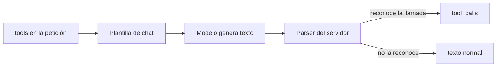

El ciclo de herramientas es el mismo con un modelo abierto que con Claude: el modelo pide una llamada, tu código la ejecuta y le devuelve el resultado. Lo que cambia es cuánto puedes fiarte de cada paso. Al terminar esta lección tendrás el bucle funcionando contra un modelo local de tres formas y sabrás blindarlo para cuando el modelo se equivoque de argumentos, de herramienta o de formato.

## La idea

Un modelo no «llama» a nada: genera texto. Lo que convierte ese texto en una llamada es la **[[glosario/plantilla-de-chat|plantilla de chat]]**, que define con tokens especiales dónde va el *prompt* de sistema, dónde la lista de herramientas y cómo debe escribir el modelo una llamada, y el ***parser*** del servidor, que reconoce esas llamadas en la salida y las devuelve como `tool_calls` estructurados.



Si la plantilla o el *parser* no encajan con el modelo, no hay error: la llamada llega como texto y tu bucle cree que el modelo ha terminado. Por eso con modelos abiertos importan dos cosas que con una API casi no se notan:

- **Que el modelo documente *tool calling*.** En la [[cursos/agentes-con-modelos-abiertos/01-pesos-abiertos-y-licencias|lección 1]] lo viste: Qwen 3.5/3.6/3.8, Gemma 4, gpt-oss, Mistral Small 4, Granite 4.2, DeepSeek V4, Kimi K3 y Llama 4 lo documentan; OLMo 3 y Phi-4-reasoning-vision, no. En Ollama, la biblioteca marca los modelos con la capacidad `tools`.
- **Que el motor tenga la plantilla y el *parser* correctos.** Ollama los trae en el modelo descargado; en vLLM los eliges con `--tool-call-parser`; en llama.cpp hace falta `--jinja` (activado por defecto desde v0.7.0).

Y una diferencia de capacidad: los modelos pequeños fallan más en bucles largos de herramientas. Un modelo que acierta la primera llamada puede perderse en la quinta.

## El bucle por la API compatible con OpenAI

Es la forma más portable: el mismo código sirve para Ollama, vLLM, llama.cpp o LM Studio cambiando `base_url`. Esta versión añade lo que la hace fiable: **cada herramienta tiene un modelo Pydantic** que genera su esquema y valida los argumentos, los errores vuelven al modelo como resultado y hay un tope de errores además del de pasos.

```python title="agente_validado.py"
import json
from openai import OpenAI
from pydantic import BaseModel, Field, ValidationError

MODEL = "qwen3.6:27b"
client = OpenAI(base_url="http://localhost:11434/v1", api_key="ollama")

class BuscarPedido(BaseModel):
    """Devuelve el estado de un pedido a partir de su identificador."""
    pedido_id: str = Field(pattern=r"^A-\d{3,}$", description="Identificador con formato A-123")

def buscar_pedido(args: BuscarPedido) -> dict:
    return {"pedido_id": args.pedido_id, "estado": "enviado"}       # tu sistema real

HERRAMIENTAS = {"buscar_pedido": (BuscarPedido, buscar_pedido)}
TOOLS = [{"type": "function", "function": {"name": n, "description": m.__doc__,
          "parameters": m.model_json_schema()}} for n, (m, _) in HERRAMIENTAS.items()]

def ejecutar(call) -> tuple[str, bool]:
    """Devuelve (contenido para el modelo, es_error)."""
    if call.function.name not in HERRAMIENTAS:
        return f"Error: la herramienta {call.function.name} no existe. Usa: {', '.join(HERRAMIENTAS)}.", True
    modelo, funcion = HERRAMIENTAS[call.function.name]
    try:
        args = modelo.model_validate_json(call.function.arguments)  # JSON roto o tipos incorrectos
    except ValidationError as e:
        return f"Error: argumentos no válidos: {e.errors(include_url=False)}. Corrígelos y vuelve a llamar.", True
    return json.dumps(funcion(args), ensure_ascii=False), False

def agente(pregunta: str, max_pasos: int = 6, max_errores: int = 2) -> str:
    messages = [{"role": "system", "content": "Eres un agente de soporte. Usa herramientas cuando necesites datos."},
                {"role": "user", "content": pregunta}]
    errores = 0
    for _ in range(max_pasos):
        msg = client.chat.completions.create(model=MODEL, messages=messages, tools=TOOLS,
                                             max_tokens=1024).choices[0].message
        if not msg.tool_calls:
            return msg.content
        messages.append(msg.model_dump(exclude_none=True))
        for call in msg.tool_calls:
            contenido, es_error = ejecutar(call)
            errores += es_error
            messages.append({"role": "tool", "tool_call_id": call.id, "content": contenido})
        if errores > max_errores:                                    # no dejes que reintente sin fin
            return "No he podido consultar el pedido. Te paso con una persona."
    return "No he podido terminar en el número de pasos permitido."
```

Ejecutado contra un servidor que imita `/v1/chat/completions` de Ollama, con un guion en el que el modelo primero pasa `"123"` y después corrige a `"A-123"`:

```text
Tu pedido A-123 está enviado.
Lo que recibió el modelo tras el primer intento:
Error: argumentos no válidos: [{'type': 'string_pattern_mismatch', 'loc': ('pedido_id',), 'msg': "String should match pattern '^A-\\d{3,}$'", 'input': '123', 'ctx': {'pattern': '^A-\\d{3,}$'}}]. Corrígelos y vuelve a llamar.
```

Tres decisiones del código que importan más con modelos abiertos:

- **El error explica cómo arreglarlo.** «Formato A-123» le da al modelo lo que necesita para el segundo intento. Un «error» a secas suele producir la misma llamada.
- **El esquema sale del mismo modelo Pydantic que valida.** No pueden divergir. La validación del servidor no existe: Ollama no garantiza que los argumentos cumplan el esquema.
- **Hay un tope de errores**, distinto del de pasos. Un modelo pequeño puede repetir la misma llamada mala indefinidamente.

En formato OpenAI, el resultado va en un mensaje `role: "tool"` por cada llamada, con su `tool_call_id`. Es el equivalente al `tool_result` de Anthropic que viste en [[roadmap/20-herramientas/03-errores-e-is-error]].

## El mismo bucle con el SDK de Anthropic

Ollama expone `/v1/messages`, compatible con la API de Mensajes. El bucle que escribiste en el roadmap funciona cambiando `base_url` y el nombre del modelo:

```python title="agente_anthropic_local.py"
import anthropic

MODEL = "qwen3.6:27b"     # en local, el nombre del modelo de Ollama; en la nube, "claude-sonnet-5-5"
client = anthropic.Anthropic(base_url="http://localhost:11434", api_key="ollama")

TOOLS = [{"name": "buscar_pedido",
          "description": "Devuelve el estado de un pedido a partir de su identificador.",
          "input_schema": {"type": "object",
                           "properties": {"pedido_id": {"type": "string"}},
                           "required": ["pedido_id"]}}]

def buscar_pedido(pedido_id: str) -> str:
    return f"El pedido {pedido_id} está enviado"

def agente(pregunta: str, max_pasos: int = 5) -> str:
    messages = [{"role": "user", "content": pregunta}]
    for _ in range(max_pasos):
        resp = client.messages.create(model=MODEL, max_tokens=1024, tools=TOOLS, messages=messages)
        if resp.stop_reason != "tool_use":          # end_turn, max_tokens…
            return "".join(b.text for b in resp.content if b.type == "text")
        messages.append({"role": "assistant", "content": resp.content})
        resultados = [{"type": "tool_result", "tool_use_id": b.id, "content": buscar_pedido(**b.input)}
                      for b in resp.content if b.type == "tool_use"]
        messages.append({"role": "user", "content": resultados})
    return "Sin respuesta tras el límite de pasos."

if __name__ == "__main__":
    print(agente("¿Cómo va mi pedido A-123?"))
```

Probado con el simulador de la API de Mensajes: el SDK envía las dos peticiones a `http://localhost:11434/v1/messages`, solo con `model`, `max_tokens`, `tools` y `messages`, y el segundo mensaje `user` lleva el `tool_result` emparejado con su `tool_use_id`. Lo que **no** tendrás en local: `tool_choice`, *prompt caching*, `count_tokens`, *batches*, citas ni PDF; `budget_tokens` se acepta pero no se aplica y los recuentos de `usage` son aproximados.

## Con LangChain

`ChatOllama` (paquete `langchain-ollama` 1.1.0, MIT) usa la API nativa de Ollama. Con `create_agent` el bucle lo pone LangChain; tú pones las herramientas y los límites.

```python title="agente_langchain_ollama.py"
from langchain.agents import create_agent
from langchain.agents.middleware import ModelCallLimitMiddleware, ToolErrorMiddleware
from langchain.tools import tool
from langchain_ollama import ChatOllama

MODEL = "qwen3.6:27b"

@tool(parse_docstring=True)
def buscar_pedido(pedido_id: str) -> str:
    """Devuelve el estado de un pedido a partir de su identificador.

    Args:
        pedido_id: Identificador del pedido, p. ej. A-123.
    """
    if not pedido_id.startswith("A-"):
        raise ValueError(f"Formato de id no válido: {pedido_id}. Usa A-NNN.")
    return f"El pedido {pedido_id} está enviado"

llm = ChatOllama(model=MODEL, num_ctx=32768, num_predict=1024, temperature=0, reasoning=False)
agente = create_agent(
    model=llm,                               # o el string "ollama:qwen3.6:27b"
    tools=[buscar_pedido],
    system_prompt="Eres un agente de soporte. Usa las herramientas; no inventes datos.",
    middleware=[
        ToolErrorMiddleware(on_error=lambda exc, req: f"Error: {exc}"),   # el error vuelve al modelo
        ModelCallLimitMiddleware(run_limit=6, exit_behavior="end"),       # tope de llamadas al modelo
    ],
)

if __name__ == "__main__":
    salida = agente.invoke({"messages": [{"role": "user", "content": "¿Cómo va mi pedido 123?"}]})
    for m in salida["messages"]:
        print(type(m).__name__, "·", (m.content or m.tool_calls))
```

Salida real con el mismo servidor simulado (esta vez por `/api/chat`, la API nativa):

```text
HumanMessage · ¿Cómo va mi pedido 123?
AIMessage · [{'name': 'buscar_pedido', 'args': {'pedido_id': '123'}, 'id': '0a0d7c96-8fb6-4cbf-9e86-613d4d2c4753', 'type': 'tool_call'}]
ToolMessage · Error: Formato de id no válido: 123. Usa A-NNN.
AIMessage · [{'name': 'buscar_pedido', 'args': {'pedido_id': 'A-123'}, 'id': 'd6d21a71-68fe-43fe-a123-aa14dc21cd0b', 'type': 'tool_call'}]
ToolMessage · El pedido A-123 está enviado
AIMessage · Tu pedido A-123 está enviado.
```

Lo que esconde: `ChatOllama` mete `num_ctx`, `num_predict` y `temperature` en `options` y `reasoning=False` en `think`, convierte las herramientas a esquema (con `parse_docstring=True` la descripción de `Args:` llega a cada campo) y traduce las respuestas a `AIMessage.tool_calls`. Sin `ToolErrorMiddleware`, la excepción de la herramienta rompería el agente en lugar de volver al modelo. Y LangChain admite `bind_tools(..., tool_choice=...)`, pero Ollama no implementa `tool_choice`: no confíes en forzar una herramienta. La versión con un grafo explícito en LangGraph está en [[sistemas/asistente-100-local]].

## Salidas estructuradas sin forzar herramientas

Para el paso final («devuélveme un JSON con esta forma») no uses una herramienta forzada: usa el esquema del servidor. En la API nativa de Ollama es el campo `format`; en LangChain, `with_structured_output(..., method="json_schema")`, que lo rellena por ti.

```python tab="Ollama" title="salida_estructurada.py"
from ollama import chat
from pydantic import BaseModel

MODEL = "qwen3.6:27b"

class Ticket(BaseModel):
    categoria: str
    urgente: bool

r = chat(model=MODEL,
         messages=[{"role": "user", "content": "Clasifica: 'Me cobrasteis dos veces, lo necesito hoy'"}],
         format=Ticket.model_json_schema(), options={"temperature": 0})
ticket = Ticket.model_validate_json(r.message.content)    # valida siempre
print(ticket)
```

```python tab="LangChain" title="estructurada_langchain.py"
from typing import Literal
from langchain_ollama import ChatOllama
from pydantic import BaseModel

class Ticket(BaseModel):
    categoria: Literal["facturacion", "envio", "devolucion", "otro"]
    urgente: bool

llm = ChatOllama(model="qwen3.6:27b", num_ctx=16384, num_predict=256, temperature=0, reasoning=False)
clasificador = llm.with_structured_output(Ticket, method="json_schema")   # usa el campo format de Ollama
print(clasificador.invoke("Clasifica: 'Me cobrasteis dos veces, lo necesito hoy'"))
```

```text
categoria='facturacion' urgente=True
```

Las dos versiones envían el JSON Schema de Pydantic en `format` (con el `enum` de las categorías en la segunda). El servidor restringe la generación a ese esquema, pero **valida siempre en tu código**: un `max_tokens` corto puede cortar el JSON a la mitad. Aquí `temperature=0` es legítimo porque los modelos abiertos sí aceptan muestreo; si el modelo es de razonamiento y su card recomienda otro valor, sigue la card.

## Errores frecuentes

- **El modelo «responde» con un JSON de llamada en el texto.** *Parser* o plantilla que no encajan, o modelo sin *tool calling*. Ver [[problemas/modelo-local-no-llama-herramientas]].
- **Funciona en la primera llamada y se pierde después.** Contexto truncado por `num_ctx`: en un agente, el historial crece con cada resultado.
- **Reintentos infinitos con la misma llamada mala.** Falta el tope de errores, o el mensaje de error no dice cómo corregir.
- **Esperar que `tool_choice` funcione en Ollama.** No lo implementa; vLLM sí.

## Ejercicio

> [!ejercicio] Herramienta que se defiende
> Añade a `agente_validado.py` una herramienta `reembolsar(pedido_id, importe_eur)` con un modelo Pydantic que exija `importe_eur` positivo y menor de 500. Pruébala contra tu Ollama con tres preguntas: una válida, una con importe negativo y una con un pedido mal escrito. Registra cuántas llamadas hace el modelo en cada caso.
>
> Está bien si ningún argumento inválido llega a ejecutar `reembolsar`, si el modelo recibe en cada error una instrucción de cómo corregirlo y si el agente se rinde con un mensaje claro tras superar `max_errores`.

> [!ejercicio]- Pistas
> `Field(gt=0, lt=500)` impone el rango. Para contar llamadas, guarda los `tool_calls` de cada paso en una lista. Si el modelo no llama a la herramienta, comprueba antes con `ollama show <modelo>` que tiene la capacidad `tools`.

## Resumen

- Plantilla de chat y *parser* convierten texto en `tool_calls`; si no encajan, la llamada llega como texto sin error.
- Valida los argumentos con el mismo modelo que genera el esquema y devuelve errores que expliquen cómo corregir.
- Limita pasos y errores por separado.
- El SDK de Anthropic funciona contra Ollama cambiando `base_url`, sin `tool_choice` ni caché.
- Para el resultado final, usa `format` o `with_structured_output(method="json_schema")` y valida igualmente.

## Para seguir

- [[cursos/agentes-con-modelos-abiertos/05-rag-cien-por-cien-local]]: la herramienta de búsqueda local.
- [[recetas/agente-local-con-ollama]]: el agente completo en una receta.
- [[docs/modelos-abiertos/03-apis-compatibles-y-litellm]]: qué cambia entre APIs «compatibles».
