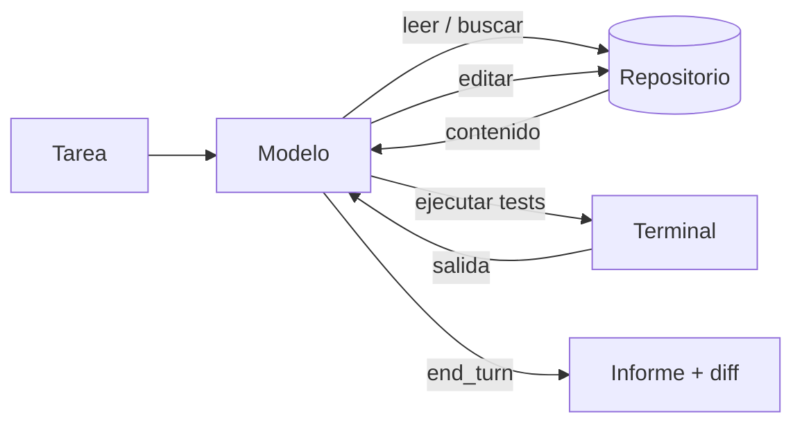

Al terminar esta lección tendrás un agente de código mínimo que lee un repositorio, busca en él, edita archivos y ejecuta los tests. Entenderás por qué esas cuatro herramientas bastan para la mayoría de tareas y qué decisiones de diseño evitan los fallos más caros.

## La idea

Un agente de código es el [[glosario/bucle-agentico|bucle agéntico]] de siempre con un entorno concreto: una carpeta con código. El modelo no ve el repositorio. Solo ve lo que tus herramientas le devuelven. Cada paso sigue el mismo ciclo: el modelo pide una acción con un bloque `tool_use`, tu código la ejecuta y devuelve un [[glosario/tool-result|tool_result]], y el modelo decide el siguiente paso.



Lo que diferencia a un agente de código de otros agentes es la **retroalimentación objetiva**. Un test que falla es una señal clara y barata. Por eso los agentes de código funcionan bien en la práctica: el entorno les dice si lo han hecho mal, y pueden corregir sin que intervengas.

## Las cuatro herramientas

| Herramienta | Para qué | Decisión de diseño clave |
|---|---|---|
| `leer_archivo` | Ver el contenido de un archivo | Devolver números de línea y permitir leer un rango, para no inundar el contexto con archivos enormes |
| `buscar` | Encontrar dónde se define o usa algo | Búsqueda por texto o regex (estilo `grep`) con límite de resultados |
| `editar_archivo` | Cambiar código | Reemplazo de un fragmento exacto que aparece una sola vez |
| `ejecutar` | Tests, linter, compilador | Lista de comandos permitidos, tiempo máximo y salida recortada |

Muchos agentes añaden listar archivos por patrón (`glob`) y crear archivos nuevos. Con las cuatro de la tabla ya puedes resolver tareas reales.

### Por qué editar por reemplazo exacto

La alternativa ingenua es una herramienta `escribir_archivo` que reescribe el archivo entero. Funciona con archivos pequeños y falla con los grandes: el modelo tiene que reproducir cientos de líneas sin tocar, gasta tokens de salida y a veces altera algo que no debía.

El reemplazo exacto pide dos cadenas: el fragmento actual y su sustituto. Si el fragmento no aparece, o aparece más de una vez, la herramienta devuelve un error y el modelo amplía el fragmento con más contexto. Esto tiene tres ventajas: el cambio es pequeño y fácil de revisar, el modelo tiene que haber leído el archivo para citar el fragmento, y un error de edición se detecta al instante en lugar de corromper el archivo.

### Ejecutar comandos sin abrir la puerta a todo

`ejecutar` es la herramienta más útil y la más peligrosa. Tres reglas mínimas: una lista de comandos permitidos (prefijos como `pytest` o `npm test`), un tiempo máximo y la salida recortada a los últimos miles de caracteres, que es donde suelen estar los errores. Para ir más allá (red, sistema de archivos) ejecuta el agente dentro de un [[glosario/sandbox|sandbox]] y aplica [[glosario/minimo-privilegio|mínimo privilegio]]; lo tienes en [[docs/seguridad/02-permisos-y-minimo-privilegio]].

## Un agente mínimo

El código central. Las rutas se resuelven siempre dentro de la raíz del repositorio, los errores se devuelven con `is_error` para que el modelo los vea y corrija, y cada `tool_use` recibe su `tool_result` en el mismo mensaje.

```python tab="Python" title="agente_codigo.py"
import pathlib, re, shlex, subprocess
import anthropic

MODEL = "claude-sonnet-5-5"
client = anthropic.Anthropic()
RAIZ = pathlib.Path(".").resolve()
PERMITIDOS = ("pytest", "ruff", "python -m pytest")

def ruta_segura(ruta: str) -> pathlib.Path:
    p = (RAIZ / ruta).resolve()
    if not p.is_relative_to(RAIZ):
        raise ValueError(f"{ruta} está fuera del repositorio")
    return p

def leer_archivo(ruta: str, desde: int = 1, hasta: int = 400) -> str:
    lineas = ruta_segura(ruta).read_text(encoding="utf-8").splitlines()
    return "\n".join(f"{i:>5}  {l}" for i, l in enumerate(lineas, 1) if desde <= i <= hasta)

def buscar(patron: str, max_resultados: int = 50) -> str:
    rx, hallazgos = re.compile(patron), []
    for f in RAIZ.rglob("*.py"):
        for i, linea in enumerate(f.read_text(encoding="utf-8", errors="ignore").splitlines(), 1):
            if rx.search(linea):
                hallazgos.append(f"{f.relative_to(RAIZ)}:{i}: {linea.strip()}")
                if len(hallazgos) >= max_resultados:
                    return "\n".join(hallazgos) + "\n[resultados recortados]"
    return "\n".join(hallazgos) or "Sin resultados."

def editar_archivo(ruta: str, actual: str, nuevo: str) -> str:
    p = ruta_segura(ruta)
    texto = p.read_text(encoding="utf-8")
    n = texto.count(actual)
    if n != 1:
        raise ValueError(f"el fragmento aparece {n} veces; debe aparecer exactamente una")
    p.write_text(texto.replace(actual, nuevo), encoding="utf-8")
    return f"Editado {ruta}."

def ejecutar(comando: str) -> str:
    if not comando.startswith(PERMITIDOS):
        raise ValueError(f"comando no permitido; usa uno de {PERMITIDOS}")
    r = subprocess.run(shlex.split(comando), cwd=RAIZ, capture_output=True, text=True, timeout=300)
    return f"código de salida {r.returncode}\n{(r.stdout + r.stderr)[-8000:]}"

HANDLERS = {"leer_archivo": leer_archivo, "buscar": buscar,
            "editar_archivo": editar_archivo, "ejecutar": ejecutar}

def esquema(props: dict, requeridos: list) -> dict:
    return {"type": "object", "properties": props, "required": requeridos}

S = {"type": "string"}
TOOLS = [
    {"name": "leer_archivo", "description": "Lee un archivo del repositorio con números de línea. Usa desde/hasta para archivos largos.",
     "input_schema": esquema({"ruta": S, "desde": {"type": "integer"}, "hasta": {"type": "integer"}}, ["ruta"])},
    {"name": "buscar", "description": "Busca una expresión regular en los .py del repositorio. Devuelve archivo:línea.",
     "input_schema": esquema({"patron": S}, ["patron"])},
    {"name": "editar_archivo", "description": "Sustituye un fragmento exacto, que debe aparecer una sola vez, por otro. Lee el archivo antes.",
     "input_schema": esquema({"ruta": S, "actual": S, "nuevo": S}, ["ruta", "actual", "nuevo"])},
    {"name": "ejecutar", "description": f"Ejecuta tests o el linter. Comandos permitidos: {', '.join(PERMITIDOS)}.",
     "input_schema": esquema({"comando": S}, ["comando"])},
]

SYSTEM = ("Eres un agente de código. Lee antes de editar. Haz cambios pequeños. "
          "Ejecuta los tests tras cada cambio y no termines si fallan. "
          "Al acabar, resume qué cambiaste y cómo lo verificaste.")

def agente(tarea: str, max_pasos: int = 40) -> str:
    messages = [{"role": "user", "content": tarea}]
    for _ in range(max_pasos):
        resp = client.messages.create(model=MODEL, max_tokens=4096, system=SYSTEM,
                                      tools=TOOLS, messages=messages)
        messages.append({"role": "assistant", "content": resp.content})
        if resp.stop_reason == "end_turn":
            return "".join(b.text for b in resp.content if b.type == "text")
        if resp.stop_reason == "pause_turn":
            continue
        if resp.stop_reason != "tool_use":
            raise RuntimeError(f"stop_reason inesperado: {resp.stop_reason}")
        resultados = []
        for b in resp.content:
            if b.type != "tool_use":
                continue
            try:
                salida, error = HANDLERS[b.name](**b.input), False
            except Exception as e:
                salida, error = f"Error: {e}", True
            resultados.append({"type": "tool_result", "tool_use_id": b.id,
                               "content": salida, "is_error": error})
        messages.append({"role": "user", "content": resultados})
    raise RuntimeError("Se alcanzó el límite de pasos sin terminar.")

if __name__ == "__main__":
    print(agente("La función slugify falla con tildes. Arréglala y añade un test."))
```

```ts tab="TypeScript" title="agente_codigo.ts"
import Anthropic from "@anthropic-ai/sdk";

const MODEL = "claude-sonnet-5-5";
const client = new Anthropic();

// TOOLS, SYSTEM y las funciones de cada herramienta son equivalentes a la versión en Python.
declare const TOOLS: Anthropic.Tool[];
declare const SYSTEM: string;
declare const HANDLERS: Record<string, (input: any) => Promise<string>>;

export async function agente(tarea: string, maxPasos = 40): Promise<string> {
  const messages: Anthropic.MessageParam[] = [{ role: "user", content: tarea }];
  for (let paso = 0; paso < maxPasos; paso++) {
    const resp = await client.messages.create({
      model: MODEL, max_tokens: 4096, system: SYSTEM, tools: TOOLS, messages,
    });
    messages.push({ role: "assistant", content: resp.content });
    if (resp.stop_reason === "end_turn") {
      return resp.content.flatMap((b) => (b.type === "text" ? [b.text] : [])).join("");
    }
    if (resp.stop_reason === "pause_turn") continue;
    if (resp.stop_reason !== "tool_use") throw new Error(`stop_reason inesperado: ${resp.stop_reason}`);
    const resultados: Anthropic.ToolResultBlockParam[] = [];
    for (const b of resp.content) {
      if (b.type !== "tool_use") continue;
      try {
        resultados.push({ type: "tool_result", tool_use_id: b.id, content: await HANDLERS[b.name](b.input) });
      } catch (e) {
        resultados.push({ type: "tool_result", tool_use_id: b.id, content: `Error: ${e}`, is_error: true });
      }
    }
    messages.push({ role: "user", content: resultados });
  }
  throw new Error("Se alcanzó el límite de pasos sin terminar.");
}
```

Fíjate en tres detalles. Las descripciones de las herramientas dicen cuándo usarlas («Lee el archivo antes»), porque el modelo las lee como instrucciones; lo tienes desarrollado en [[disciplinas/diseno-de-herramientas]]. Los errores no rompen el bucle: vuelven al modelo, que suele corregirse solo. Y el [[glosario/stop-reason|stop_reason]] se trata caso por caso, con un límite de pasos como red de seguridad ([[roadmap/40-primer-agente/03-condiciones-de-parada]]).

## Errores frecuentes

- **Devolver archivos enteros siempre.** Un archivo de 3.000 líneas en cada lectura llena la [[glosario/ventana-de-contexto|ventana de contexto]] en pocos pasos. Lee por rangos y busca primero.
- **Salida de tests sin recortar.** Mil líneas de log ocultan el único error que importa. Quédate con el final y con las líneas que contienen `FAILED` o `Error`.
- **Dejar que `ejecutar` acepte cualquier cosa.** Un `rm -rf` o un `curl` a un dominio desconocido tienen que estar bloqueados por diseño. Confiar en que el modelo no los pedirá no es una defensa.
- **Tragarse las excepciones.** Si una herramienta falla en silencio, el modelo cree que el cambio se aplicó y construye sobre algo que no existe.

## Ejercicio

> [!ejercicio] Tu primer agente de código
> Ejecuta el agente sobre un repositorio pequeño tuyo con un bug real (o introduce uno). Añade una quinta herramienta `listar_archivos(patron)` que devuelva rutas por patrón *glob* con un máximo de 200 resultados.
> Está bien si: el agente encuentra el archivo sin que le digas la ruta, arregla el bug con uno o dos `editar_archivo`, ejecuta los tests y termina solo cuando pasan. La traza no debe contener ninguna lectura de archivo completo de más de 400 líneas.

> [!ejercicio]- Pistas
> Usa `RAIZ.glob(patron)` y filtra carpetas como `.git` o `node_modules`. Si el agente lee archivos enteros, ajusta la descripción de `leer_archivo` para que pida usar `buscar` primero.

## Resumen

- Un agente de código es el bucle agéntico con un repositorio como entorno y los tests como señal objetiva.
- Cuatro herramientas cubren casi todo: leer, buscar, editar y ejecutar.
- Editar por reemplazo exacto produce cambios pequeños, obliga a leer antes y detecta errores al momento.
- Confina rutas y comandos por diseño; recorta salidas para cuidar el contexto.
- Devuelve los errores con `is_error` y un `tool_result` por cada `tool_use`.

## Para seguir

- [[cursos/agentes-de-codigo/02-contexto-del-repositorio]]
- [[sistemas/agente-de-codigo]]
- [[roadmap/40-primer-agente/05-agente-con-varias-herramientas]]
