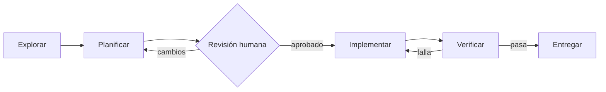

Al terminar esta lección tendrás un agente de código que no toca un archivo hasta haber entendido el problema y tener un plan aprobado. Verás cómo forzar las fases con herramientas, no solo con instrucciones, y qué debe contener un plan para que puedas revisarlo en dos minutos.

## La idea

El fallo más común de un agente de código es empezar a editar demasiado pronto. Lee un archivo, cree entender el problema, cambia algo y luego encadena parches para arreglar lo que rompió. El resultado funciona a veces, pero el diff es grande y difícil de revisar.

El flujo **explorar → planificar → implementar → verificar** separa las decisiones en cuatro momentos con una salida clara cada uno:

| Fase | Pregunta | Herramientas | Salida |
|---|---|---|---|
| Explorar | ¿Qué hay y dónde? | Leer, buscar, listar | Notas: archivos implicados, cómo funciona hoy |
| Planificar | ¿Qué voy a cambiar? | Ninguna nueva | Plan con pasos y cómo verificar cada uno |
| Implementar | Hacer el cambio | Leer, buscar, editar, ejecutar | Diff |
| Verificar | ¿Funciona y no rompe nada? | Ejecutar tests, lint, tipos | Evidencia: salidas de comandos |



Es la misma idea que [[roadmap/40-primer-agente/04-planificar-antes-de-actuar]] aplicada al código, y la forma de trabajar descrita en [[disciplinas/explorar-planificar-implementar-verificar]]. La diferencia aquí es que lo construyes dentro del agente.

## Explorar: solo lectura

En la exploración el agente debe poder leer todo y modificar nada. Pedirle «no edites todavía» funciona casi siempre. Quitarle la herramienta de edición funciona siempre. **Restringe por herramientas lo que no puedes permitirte que falle.**

Una buena exploración termina con notas concretas: qué archivos están implicados, qué función hace qué, qué tests cubren la zona y qué dudas quedan. Si la tarea es ambigua, este es el momento de preguntar, antes de que haya código que deshacer.

## Planificar: un artefacto que puedas revisar

El plan es lo que revisas en lugar de revisar código a ciegas. Un buen plan es corto y verificable:

```text title="plan.md"
Objetivo: slugify debe convertir tildes y ñ a ASCII ("Año Ñu" → "ano-nu").

1. Añadir test que falla en tests/test_texto.py con 4 casos (tildes, ñ, mayúsculas, espacios dobles).
   Verificar: `uv run pytest tests/test_texto.py` falla en los 4 casos.
2. En src/app/texto.py, normalizar con unicodedata.normalize("NFKD") y descartar marcas combinantes.
   Verificar: los 4 casos pasan.
3. Ejecutar la suite completa y el linter.
   Verificar: todo en verde; ningún otro archivo modificado.

Fuera de alcance: transliterar alfabetos no latinos.
Riesgo: otros módulos dependen de slugify (api/rutas.py); la suite los cubre.
```

Cada paso dice cómo se comprueba. «Fuera de alcance» evita que el agente se extienda. La línea de riesgo te dice dónde mirar al revisar. Si el plan no cabe en una pantalla, la tarea es demasiado grande: divídela ([[disciplinas/cambios-pequenos-y-revisables]]).

## Implementar y verificar

Con el plan aprobado, el agente implementa paso a paso y verifica cada uno con el comando que el propio plan indica. La verificación final ejecuta la suite completa: el agente tiene que leer la salida, no suponerla. Un test escrito antes del arreglo que primero falla y luego pasa es la mejor evidencia de que el cambio hace lo que dice.

## El agente por fases

Este código reutiliza las herramientas de [[cursos/agentes-de-codigo/01-como-trabaja-un-agente-de-codigo]]. Cada fase recibe solo las herramientas que necesita, y el plan pasa por tu aprobación antes de implementar.

```python tab="Python" title="agente_fases.py"
import anthropic
from agente_codigo import HANDLERS, TOOLS, MODEL

client = anthropic.Anthropic()
LECTURA = {"leer_archivo", "buscar"}

def bucle(system: str, prompt: str, permitidas: set[str], max_pasos: int = 30) -> str:
    tools = [t for t in TOOLS if t["name"] in permitidas]
    messages = [{"role": "user", "content": prompt}]
    for _ in range(max_pasos):
        kwargs = {"tools": tools} if tools else {}
        resp = client.messages.create(model=MODEL, max_tokens=4096, system=system,
                                      messages=messages, **kwargs)
        messages.append({"role": "assistant", "content": resp.content})
        if resp.stop_reason == "end_turn":
            return "".join(b.text for b in resp.content if b.type == "text")
        if resp.stop_reason == "pause_turn":
            continue
        if resp.stop_reason != "tool_use":
            raise RuntimeError(f"stop_reason inesperado: {resp.stop_reason}")
        resultados = []
        for b in resp.content:
            if b.type != "tool_use":
                continue
            try:
                salida, error = HANDLERS[b.name](**b.input), False
            except Exception as e:
                salida, error = f"Error: {e}", True
            resultados.append({"type": "tool_result", "tool_use_id": b.id,
                               "content": salida, "is_error": error})
        messages.append({"role": "user", "content": resultados})
    raise RuntimeError("Límite de pasos alcanzado.")

def resolver(tarea: str) -> str:
    notas = bucle(
        "Fase EXPLORAR. Investiga el repositorio. No propongas soluciones todavía. "
        "Termina con notas: archivos implicados, comportamiento actual, tests relevantes, dudas.",
        tarea, LECTURA)
    plan = bucle(
        "Fase PLANIFICAR. Escribe un plan de 3 a 7 pasos. Cada paso indica el cambio y el comando "
        "que lo verifica. Incluye 'Fuera de alcance' y 'Riesgo'.",
        f"<tarea>{tarea}</tarea>\n<notas>{notas}</notas>", set())
    print(plan)
    if input("¿Apruebas el plan? [s/N] ").strip().lower() != "s":
        return "Plan rechazado."
    return bucle(
        "Fase IMPLEMENTAR Y VERIFICAR. Sigue el plan paso a paso. Tras cada paso ejecuta su "
        "verificación. No hagas cambios fuera del plan. Termina solo con todo en verde y "
        "resume qué cambiaste y la salida de los comandos de verificación.",
        f"<tarea>{tarea}</tarea>\n<plan>{plan}</plan>", set(HANDLERS))

if __name__ == "__main__":
    print(resolver("slugify no convierte tildes ni la ñ. Arréglalo."))
```

Dos decisiones merecen explicación. Cada fase arranca con un historial nuevo y recibe solo el resultado de la anterior (notas, plan). Eso mantiene el contexto limpio: los cuarenta resultados de búsqueda de la exploración no viajan a la implementación, solo su resumen. Y la planificación no tiene herramientas: no hace falta, y así no puede «planificar» editando.

Los agentes de código de uso diario traen estas fases de serie. En Claude Code, el modo de permisos `plan` deja al agente leer y proponer sin tocar nada hasta que apruebas, y los subagentes integrados `Explore` y `Plan` exploran con herramientas de solo lectura en un contexto aparte y devuelven solo el resumen. Tus propios subagentes en `.claude/agents/` declaran en `tools` qué pueden usar, que es exactamente el `permitidas` de este código ([[docs/claude-code/02-subagentes]], [[plantillas/subagente]]). Para pedir el plan con un formato fijo tienes [[plantillas/prompt-plan-de-implementacion]].

> [!aviso] Cuándo saltarse fases
> Para un cambio de una línea con causa obvia, el plan formal es ceremonia. El flujo completo compensa cuando la tarea toca varios archivos, la causa no está clara o el área es delicada. Si dudas, explora siempre; planifica cuando el cambio pase de unas pocas líneas.

## Errores frecuentes

- **Exploración sin salida.** Si la fase no termina con notas, la planificación trabaja a ciegas. Pide un formato concreto.
- **Planes sin verificación.** «Arreglar el parser» no se puede comprobar. «El test X pasa» sí.
- **Verificar solo el test nuevo.** El cambio puede romper otra cosa. La última verificación es siempre la suite completa.
- **Aprobar sin leer.** El plan existe para que lo revises. Si lo apruebas por inercia, has añadido un paso sin beneficio.

## Ejercicio

> [!ejercicio] Fases forzadas por herramientas
> Ejecuta `resolver` con una tarea que toque al menos dos archivos de tu repositorio. Después, modifica `bucle` para que la fase de implementación rechace con `is_error` cualquier `editar_archivo` sobre un archivo que no aparezca en el plan.
> Está bien si: la fase de exploración no contiene ningún `editar_archivo` en la traza, el plan incluye un comando de verificación por paso y un intento de editar fuera del plan devuelve un error que el agente respeta.

> [!ejercicio]- Pistas
> Extrae las rutas del plan con una expresión regular sobre patrones como `src/.../*.py`. Pasa ese conjunto a un *handler* envuelto que compruebe `b.input["ruta"]` antes de llamar a `editar_archivo`.

## Resumen

- Separar fases evita editar antes de entender y produce diffs más pequeños.
- Fuerza la exploración de solo lectura quitando herramientas, no solo pidiéndolo.
- Un buen plan es corto, dice cómo verificar cada paso y marca qué queda fuera.
- Pasa entre fases resúmenes, no historiales completos.
- Verifica con la suite completa y exige la salida real de los comandos.

## Para seguir

- [[cursos/agentes-de-codigo/04-revisar-y-confiar]]
- [[disciplinas/spec-primero]]
- [[patrones/03-encadenado]]
- [[cursos/harness-engineering/07-spec-congelada-y-aceptacion]]
