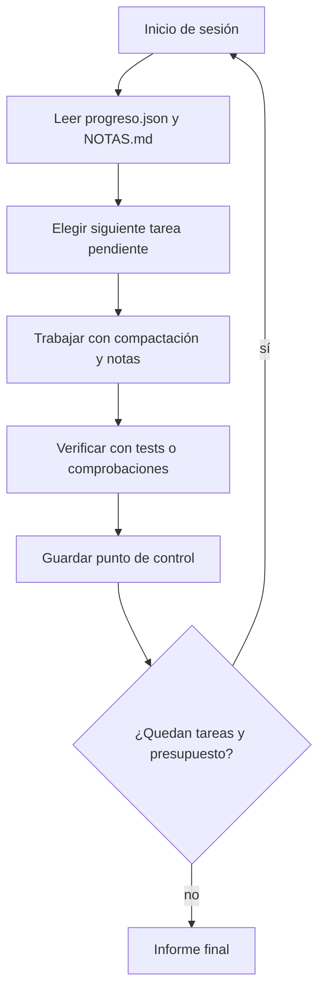

Al terminar esta lección tendrás un agente capaz de trabajar en una tarea que no cabe en una sola ventana de contexto: trabaja por sesiones, guarda su progreso en disco y cada sesión nueva arranca limpia a partir de ese progreso. Es la lección de proyecto del curso y reúne todo lo anterior.

## La idea

Una tarea larga (migrar un módulo entero, procesar cientos de documentos, investigar a fondo un tema) genera más información de la que cabe en un contexto, y además lo hace durante tanto tiempo que algo fallará por el camino: un error de red, un límite de tasa, un reinicio. Necesitas dos propiedades:

- **Contexto acotado**: en cada momento, el agente ve solo lo que necesita para el siguiente paso.
- **Progreso duradero**: si el proceso muere, se pierde como mucho el trabajo desde el último punto de control.

*[Effective context engineering for AI agents](https://www.anthropic.com/engineering/effective-context-engineering-for-ai-agents)* (Anthropic, 2025) propone tres técnicas para tareas de largo horizonte: **compactación**, **toma de notas estructurada** y **arquitecturas de subagentes**. Ya conoces las dos primeras ([[cursos/context-engineering/03-compactacion-y-memoria]]). Aquí las combinas con la tercera y con puntos de control.

## Las tres técnicas juntas

| Técnica | Resuelve | Úsala cuando |
|---|---|---|
| Compactación | El historial crece dentro de una sesión | Hay mucho ida y vuelta sobre el mismo problema |
| Notas estructuradas | Lo importante se pierde entre sesiones o al compactar | La tarea tiene hitos y decisiones que deben durar |
| Subagentes | Una subtarea necesita explorar mucho y devolver poco | Hay investigación o lectura masiva que se puede aislar |

El artículo de Anthropic describe cuándo encaja cada una: la compactación mantiene el flujo en tareas con mucha conversación; las notas, en desarrollo iterativo con hitos claros; y los subagentes, en investigación compleja donde la exploración en paralelo compensa. Un subagente puede gastar muchos tokens explorando y devolver un resumen condensado; el agente principal solo ve el resumen ([[cursos/sistemas-multiagente/02-disenar-subagentes]]).

## Sesiones con punto de control

El patrón más robusto para tareas muy largas evita depender de un único contexto que se compacta una y otra vez. En su lugar, divide el trabajo en **sesiones**. Cada sesión empieza con contexto limpio, lee el estado del disco, avanza un trozo, guarda el estado y termina.



El estado vive en tres sitios, cada uno con un propósito:

- **`progreso.json`**: lista de tareas con estado (`pendiente`, `hecha`, `bloqueada`). Estructurado, para que tu código lo lea sin el modelo.
- **`NOTAS.md`**: decisiones, contexto y avisos para la siguiente sesión. Texto libre, para el modelo.
- **El propio entorno**: commits de git, archivos generados, tests. Es la fuente de verdad más fiable, porque se puede comprobar.

## El agente por sesiones

```python title="agente_largo.py"
import json, pathlib
import anthropic
from compactacion import gestionar
from notas import TOOLS_NOTAS, leer_notas, anotar

MODEL = "claude-sonnet-5-5"
client = anthropic.Anthropic()
PROGRESO = pathlib.Path("progreso.json")
UMBRAL_TOKENS = 80_000
PASOS_POR_SESION = 40

def cargar() -> dict:
    return json.loads(PROGRESO.read_text(encoding="utf-8"))

def guardar(estado: dict) -> None:
    tmp = PROGRESO.with_suffix(".tmp")
    tmp.write_text(json.dumps(estado, ensure_ascii=False, indent=2), encoding="utf-8")
    tmp.replace(PROGRESO)  # escritura atómica: el punto de control nunca queda a medias

def marcar(estado: dict, tarea_id: str, nuevo: str, motivo: str = "") -> str:
    tarea = next(t for t in estado["tareas"] if t["id"] == tarea_id)
    tarea["estado"], tarea["motivo"] = nuevo, motivo
    guardar(estado)
    return f"{tarea_id} → {nuevo}"

TOOL_MARCAR = {"name": "marcar_tarea",
               "description": "Marca una tarea como hecha (solo tras verificarla) o bloqueada (con motivo).",
               "input_schema": {"type": "object", "properties": {
                   "tarea_id": {"type": "string"},
                   "nuevo": {"type": "string", "enum": ["hecha", "bloqueada"]},
                   "motivo": {"type": "string"}}, "required": ["tarea_id", "nuevo"]}}

SYSTEM = ("Trabajas en una tarea larga dividida en sesiones. Cada sesión empieza sin memoria: "
          "tu progreso está en <progreso> y tus notas en <notas>. Elige la primera tarea pendiente, "
          "complétala, verifícala y márcala. Anota decisiones y avisos para la siguiente sesión. "
          "Si ves un resumen del trabajo previo, lee tus notas antes de seguir.")

def sesion(herramientas: list[dict], handlers: dict) -> bool:
    estado = cargar()
    pendientes = [t for t in estado["tareas"] if t["estado"] == "pendiente"]
    if not pendientes:
        return False
    tools = herramientas + TOOLS_NOTAS + [TOOL_MARCAR]
    todos = {**handlers, "leer_notas": leer_notas, "anotar": anotar,
             "marcar_tarea": lambda **k: marcar(cargar(), **k)}
    inicio = (f"<progreso>{json.dumps(estado, ensure_ascii=False)}</progreso>\n"
              f"<notas>{leer_notas()}</notas>\nContinúa.")
    messages = [{"role": "user", "content": inicio}]
    for _ in range(PASOS_POR_SESION):
        messages = gestionar(SYSTEM, tools, messages, UMBRAL_TOKENS)
        resp = client.messages.create(model=MODEL, max_tokens=4096, system=SYSTEM,
                                      tools=tools, messages=messages)
        messages.append({"role": "assistant", "content": resp.content})
        if resp.stop_reason == "end_turn":
            break
        if resp.stop_reason == "pause_turn":
            continue
        if resp.stop_reason != "tool_use":
            raise RuntimeError(f"stop_reason inesperado: {resp.stop_reason}")
        resultados = []
        for b in resp.content:
            if b.type != "tool_use":
                continue
            try:
                salida, err = str(todos[b.name](**b.input)), False
            except Exception as e:
                salida, err = f"Error: {e}", True
            resultados.append({"type": "tool_result", "tool_use_id": b.id,
                               "content": salida, "is_error": err})
        messages.append({"role": "user", "content": resultados})
    return True

def ejecutar(herramientas: list[dict], handlers: dict, max_sesiones: int = 20) -> None:
    for n in range(max_sesiones):
        if not sesion(herramientas, handlers):
            print("Todas las tareas terminadas o bloqueadas.")
            return
        hechas = sum(t["estado"] == "hecha" for t in cargar()["tareas"])
        print(f"Sesión {n + 1} terminada · {hechas} tareas hechas")
    print("Presupuesto de sesiones agotado; revisa progreso.json y NOTAS.md.")
```

Un `progreso.json` inicial puede ser tan simple como:

```json title="progreso.json"
{"objetivo": "Migrar src/informes/ de requests a httpx",
 "tareas": [
   {"id": "t1", "descripcion": "Migrar informes/clientes.py y sus tests", "estado": "pendiente"},
   {"id": "t2", "descripcion": "Migrar informes/ventas.py y sus tests", "estado": "pendiente"},
   {"id": "t3", "descripcion": "Eliminar requests de las dependencias", "estado": "pendiente"}]}
```

Cuatro decisiones del diseño. Cada sesión arranca con contexto limpio y solo el estado relevante, así que el contexto nunca arrastra basura de horas atrás. El estado estructurado lo escribe una herramienta, no el modelo editando JSON a mano. Hay dos límites (pasos por sesión y número de sesiones) para que el coste total esté acotado ([[roadmap/40-primer-agente/03-condiciones-de-parada]]). Y el agente puede marcar una tarea como `bloqueada` con motivo, en lugar de insistir sin fin.

> [!consejo] El entorno es el mejor punto de control
> Siempre que puedas, haz que «hecha» signifique algo comprobable: un test en verde, un commit, un archivo validado contra un esquema. Así puedes verificar el progreso sin creer al agente, y la sesión siguiente puede comprobar el estado real en lugar de fiarse de las notas.

## Prefijo estable, caché barata

En una tarea larga harás cientos de llamadas con el mismo prompt de sistema y las mismas herramientas. Mantén ese prefijo idéntico entre llamadas y sesiones para aprovechar el [[glosario/prompt-caching|prompt caching]]: nada de fechas, contadores o estado dentro del prompt de sistema. El estado cambiante va en el primer mensaje del usuario, después del prefijo cacheado ([[recetas/recortar-costes-con-prompt-caching]]).

## Errores frecuentes

- **Una única sesión gigante.** Tras varias compactaciones, el resumen del resumen pierde detalles críticos.
- **Notas como única fuente de verdad.** El agente puede anotar «hecho» sin estarlo. Verifica contra el entorno.
- **Tareas demasiado grandes.** Si una tarea no cabe en una sesión, divídela en el `progreso.json`.
- **Sin límite de sesiones.** Un agente atascado en una tarea imposible gasta toda la noche.
- **Estado en el prompt de sistema.** Rompe la caché en cada llamada.

## Ejercicio

> [!ejercicio] Proyecto: una tarea de varias sesiones
> Prepara un `progreso.json` con al menos cinco tareas verificables (por ejemplo, documentar cinco módulos o migrar cinco archivos con sus tests). Ejecuta `ejecutar` con `PASOS_POR_SESION` bajo para forzar varias sesiones. A mitad de una sesión, mata el proceso y vuelve a lanzarlo.
> Está bien si: la tarea completa termina en varias sesiones; tras la interrupción, ninguna tarea `hecha` se repite; cada tarea `hecha` se puede comprobar en el entorno (test o archivo); y `NOTAS.md` contiene al menos una decisión que una sesión posterior usó.

> [!ejercicio]- Pistas
> Para comprobar que no se repite trabajo, registra en la traza el `tarea_id` de cada `marcar_tarea`. Si una sesión empieza tarea ya hecha, revisa que el primer mensaje incluya el progreso actualizado y que el prompt diga «la primera tarea pendiente».

## Resumen

- Las tareas largas necesitan contexto acotado y progreso duradero.
- Combina compactación, notas estructuradas y subagentes según la forma de la tarea.
- Trabaja por sesiones con contexto limpio y un punto de control atómico en disco.
- Haz que «hecha» sea comprobable en el entorno.
- Prefijo estable para la caché, límites de pasos y de sesiones para el coste.

## Para seguir

- [[blog/2026-08-22-dejar-un-agente-trabajando-horas]]
- [[cursos/sistemas-multiagente/index]]
- [[roadmap/100-produccion/02-costes-y-prompt-caching]]
