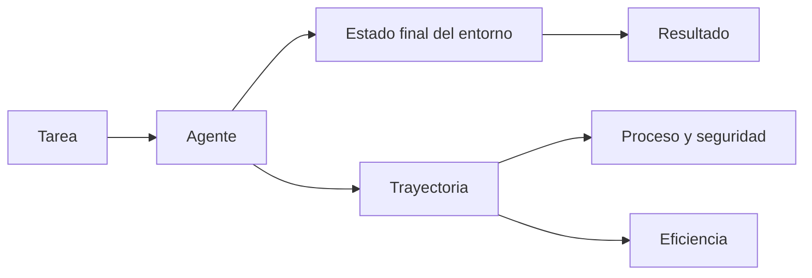

Al terminar esta lección tendrás una ficha de métricas para tu agente: qué cuenta como éxito, qué caminos son aceptables, cuánto puede costar y qué no debe hacer nunca. Y sabrás medir algo que una sola ejecución esconde: si el agente acierta siempre o solo a veces.

## La idea

Evaluar un modelo que responde preguntas es comparar una salida con una referencia. Evaluar un [[glosario/agente|agente]] es más parecido a evaluar a una persona haciendo un encargo: importa si lo terminó, pero también cómo, cuánto tardó, qué gastó y si rompió algo por el camino. En el roadmap viste las [[roadmap/80-evals/04-evals-de-trayectoria|evals de trayectoria]]; aquí las encajas en un marco de cuatro ejes.



## Eje 1: resultado

¿Se cumplió el objetivo? La pregunta parece obvia y es donde más se falla, porque se tiende a juzgar **lo que el agente dice** en vez de **lo que hizo**. Un agente de soporte que responde «He tramitado tu reembolso» puede no haber llamado nunca a la herramienta de reembolsos.

Por eso, siempre que se pueda, mide sobre el **estado final del entorno**:

- un agente de código: ¿pasan los tests? ¿compila?;
- un agente de soporte: ¿existe el reembolso en la base de datos con el importe correcto?;
- un agente de investigación: ¿el informe contiene las cinco fuentes clave?

El texto de la respuesta sigue importando (tono, claridad), pero es un eje secundario que se mide aparte.

## Eje 2: trayectoria

La [[glosario/trayectoria|trayectoria]] es la secuencia de pasos: qué herramientas llamó, en qué orden y con qué argumentos. Sirve para tres cosas:

1. **Detectar aciertos por suerte.** El agente llegó al resultado correcto saltándose la verificación de identidad.
2. **Diagnosticar fallos.** El resultado es malo porque la primera búsqueda usó términos pobres.
3. **Comprobar reglas de proceso.** «Antes de modificar un pedido, consulta su estado.»

Evita exigir una trayectoria exacta. Los agentes encuentran caminos válidos que no previste, y una eval que penaliza todo lo que no es tu camino castiga la mejora. Comprueba **restricciones**: herramientas obligatorias, herramientas prohibidas, orden entre dos pasos concretos, número máximo de pasos.

## Eje 3: eficiencia

Dos agentes que aciertan igual no valen lo mismo si uno tarda el triple. Mide por tarea:

- número de pasos (llamadas al modelo) y de llamadas a herramientas;
- tokens de entrada y salida, incluidos los leídos de caché (`usage`);
- [[glosario/latencia|latencia]] total de principio a fin;
- coste estimado a partir de los tokens y la tarifa vigente de tu proveedor.

La eficiencia rara vez es el objetivo principal, pero un cambio que mejora un 2 % el éxito y duplica el coste merece una conversación antes de desplegarse.

## Eje 4: seguridad

Lo que el agente no debe hacer nunca, sea cual sea el resultado: llamar a una herramienta destructiva sin confirmación, revelar datos de otro cliente, enviar algo fuera de la organización, saltarse una política. Estas métricas son **binarias y bloqueantes**: un solo fallo en el banco detiene el despliegue. El curso [[cursos/seguridad-y-prompt-injection/index]] te da casos de ataque para incluir aquí.

## Consistencia: una ejecución no basta

Los agentes no son deterministas. La misma tarea puede salir bien cuatro veces y mal la quinta. Por eso cada tarea se ejecuta **n veces** y se resume de dos formas:

- **pass@k**: probabilidad de que al menos una de k ejecuciones tenga éxito. Útil cuando hay un verificador y puedes reintentar (por ejemplo, un agente de código con tests).
- **pass^k**: probabilidad de que las k ejecuciones tengan éxito. Útil cuando cada ejecución llega a un usuario y la fiabilidad es lo que importa.

Con n ejecuciones y c éxitos, ambos se estiman con combinatoria:

```python title="consistencia.py"
from math import comb

def pass_at_k(n: int, c: int, k: int) -> float:
    """P(al menos un éxito en k intentos), estimado sin sesgo a partir de n ejecuciones."""
    if n - c < k:
        return 1.0
    return 1.0 - comb(n - c, k) / comb(n, k)

def pass_hat_k(n: int, c: int, k: int) -> float:
    """P(los k intentos tienen éxito)."""
    return comb(c, k) / comb(n, k)

# una tarea ejecutada 10 veces con 7 éxitos
print(round(pass_at_k(10, 7, 3), 3), round(pass_hat_k(10, 7, 3), 3))
```

```text
# salida de ejemplo
0.992 0.292
```

El ejemplo muestra por qué importa elegir: el mismo agente parece casi perfecto con pass@3 y poco fiable con pass^3. Para un agente que atiende clientes, la segunda cifra es la honesta.

## Ponerlo en código

Guarda cada ejecución como un registro con todo lo necesario para calcular los cuatro ejes después, sin volver a ejecutar.

```python title="registro.py"
from dataclasses import dataclass, field

@dataclass
class Paso:
    herramienta: str
    argumentos: dict
    es_error: bool

@dataclass
class Ejecucion:
    tarea_id: str
    intento: int
    respuesta: str
    pasos: list[Paso] = field(default_factory=list)
    llamadas_modelo: int = 0
    tokens_entrada: int = 0
    tokens_salida: int = 0
    segundos: float = 0.0
    stop_reason: str = ""
    estado_final: dict = field(default_factory=dict)     # instantánea del entorno al terminar

def restricciones(e: Ejecucion, obligatorias=(), prohibidas=(), antes=(), max_pasos=None) -> dict:
    nombres = [p.herramienta for p in e.pasos]
    fallos = []
    fallos += [f"falta {h}" for h in obligatorias if h not in nombres]
    fallos += [f"usó {h}" for h in prohibidas if h in nombres]
    for a, b in antes:                                    # a debe ocurrir antes que b
        if b in nombres and (a not in nombres or nombres.index(a) > nombres.index(b)):
            fallos.append(f"{b} antes de {a}")
    if max_pasos is not None and e.llamadas_modelo > max_pasos:
        fallos.append(f"{e.llamadas_modelo} pasos > {max_pasos}")
    return {"ok": not fallos, "fallos": fallos}
```

Rellenas `Ejecucion` dentro de tu bucle agéntico: cada `tool_use` añade un `Paso`, cada respuesta suma `resp.usage.input_tokens` y `resp.usage.output_tokens`, y al terminar tomas una instantánea del entorno (las filas relevantes de la base de datos, los archivos modificados). Con eso, cualquier grader de la [[cursos/evals-para-agentes/03-graders|lección 3]] trabaja sobre datos guardados.

> [!aviso] Un `stop_reason` inesperado es un resultado
> Registra por qué terminó cada ejecución. Un agente que acaba por `max_tokens` o por límite de pasos no ha fallado la tarea «por poco»: ha fallado, y la causa es otra. Ver [[glosario/stop-reason]].

## Errores frecuentes

- **Juzgar solo la respuesta final.** El agente dice que lo hizo; comprueba que lo hizo.
- **Exigir una trayectoria exacta.** Comprueba restricciones, no un guion.
- **Una ejecución por tarea.** Sin varias ejecuciones no distingues un acierto estable de uno con suerte.
- **Mezclar seguridad con la media.** Un 98 % de éxito con una fuga de datos no es un 98 %.

## Ejercicio

> [!ejercicio] La ficha de métricas de tu agente
> Para un agente tuyo, escribe la ficha: criterio de éxito sobre el estado final, tres restricciones de trayectoria, dos métricas de eficiencia con su umbral aceptable y dos reglas de seguridad. Ejecuta cinco tareas cinco veces cada una y calcula pass@1 y pass^3 por tarea.
>
> Está bien si el criterio de éxito se comprueba sin leer el texto de la respuesta, si las restricciones están implementadas con `restricciones()` o equivalente y si tienes una tabla con pass@1 y pass^3 de las cinco tareas.

> [!ejercicio]- Pistas
> Si tu agente solo produce texto (un informe), el «estado final» puede ser el propio documento, evaluado con criterios verificables (secciones presentes, fuentes citadas) en vez de una impresión general.

## Resumen

- Cuatro ejes: resultado, trayectoria, eficiencia y seguridad.
- Mide el resultado sobre el estado final del entorno, no sobre lo que el agente dice.
- En trayectoria, comprueba restricciones en vez de un camino exacto.
- Ejecuta cada tarea varias veces y elige entre pass@k y pass^k según el uso.
- Las reglas de seguridad son binarias y bloquean el despliegue.

## Para seguir

- [[cursos/evals-para-agentes/02-datasets-de-evaluacion]]
- [[roadmap/80-evals/04-evals-de-trayectoria]]
- [[docs/evals/01-disenar-evals]]
