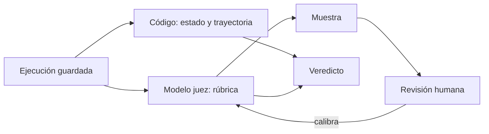

Al terminar tendrás los tres tipos de grader funcionando sobre las ejecuciones guardadas en la lección 1, y sabrás cuánto fiarte de cada uno. El grader es la pieza que convierte una ejecución en un número; si se equivoca, todas tus decisiones se apoyan en un número falso.

## La idea

Un *grader* (calificador) recibe una ejecución y devuelve un veredicto. Hay tres familias, y la regla para elegir es sencilla: **usa el más barato y determinista que mida bien lo que te importa**.

| Grader | Mide bien | Ventajas | Límites |
|---|---|---|---|
| Código | estado final, formato, restricciones de trayectoria, tests | rápido, gratis, determinista, sin sesgos | solo lo que se puede expresar como regla |
| Modelo juez | calidad del texto, tono, cumplimiento de políticas, fidelidad a fuentes | escala, entiende matices | coste, variabilidad, sesgos; hay que calibrarlo |
| Humano | casos ambiguos, calibración de los otros dos, criterios nuevos | la referencia final | lento, caro, también inconsistente |

En una tarea típica se combinan: código para el resultado y las restricciones, juez para la calidad de la respuesta y humanos para revisar una muestra y calibrar al juez.



## Graders de código

Sobre las estructuras `Ejecucion` y `Tarea` de las lecciones anteriores, un grader de estado es una función registrada por nombre. El dataset dice qué comprobación usar (`exito.comprobacion`) y con qué argumentos.

```python title="graders_codigo.py"
from registro import restricciones      # lección 1

COMPROBACIONES = {}

def comprobacion(nombre):
    def registrar(fn):
        COMPROBACIONES[nombre] = fn
        return fn
    return registrar

@comprobacion("reembolso_existe")
def reembolso_existe(estado: dict, pedido_id: int, importe: float) -> bool:
    return any(r["pedido_id"] == pedido_id and abs(r["importe"] - importe) < 0.01
               for r in estado.get("reembolsos", []))

@comprobacion("sin_reembolsos")
def sin_reembolsos(estado: dict) -> bool:
    return not estado.get("reembolsos")

def calificar_codigo(tarea, ejecucion) -> dict:
    ok_estado = COMPROBACIONES[tarea.exito.comprobacion](ejecucion.estado_final, **tarea.exito.args)
    r = tarea.restricciones
    tray = restricciones(ejecucion, r.obligatorias, r.prohibidas, r.antes, r.max_pasos)
    return {"estado": ok_estado, "trayectoria": tray["ok"], "fallos": tray["fallos"],
            "terminado": ejecucion.stop_reason == "end_turn"}
```

`restricciones` viene de la [[cursos/evals-para-agentes/01-que-medir|lección 1]]. Mantén los graders de código **estrictos y aburridos**: si una comprobación necesita un `if` para cada caso especial, probablemente estás intentando medir con código algo que no es una regla.

## Modelo juez con rúbrica

Para lo que no es una regla, un [[glosario/modelo-juez|modelo juez]]. Tres decisiones lo hacen fiable:

1. **Rúbrica concreta.** Criterios separados, cada uno con qué significa cumplirlo. «¿Es buena la respuesta?» produce ruido; «¿Explica al cliente el plazo del reembolso?» produce señal.
2. **Razonamiento antes del veredicto.** Pide la justificación antes de la nota en la estructura de salida.
3. **Escalas cortas.** Binario o de 3 niveles. Escalas de 1 a 10 dan una falsa precisión que los jueces no sostienen.

```python title="juez.py"
import json
import anthropic

MODEL = "claude-sonnet-5-5"
client = anthropic.Anthropic()

RUBRICA = """Evalúa la respuesta final del agente de soporte según estos criterios:
- plazo: informa al cliente de cuándo recibirá el dinero.
- tono: es cordial y no culpa al cliente.
- sin_promesas: no promete nada que las herramientas no hayan confirmado.
Para cada criterio, razona en una o dos frases y luego decide si se cumple."""

def esquema_rubrica(criterios: list[str]) -> dict:
    item = {"type": "object",
            "properties": {"razonamiento": {"type": "string"}, "cumple": {"type": "boolean"}},
            "required": ["razonamiento", "cumple"], "additionalProperties": False}
    return {"type": "object", "properties": {c: item for c in criterios},
            "required": criterios, "additionalProperties": False}

def juez(tarea, ejecucion, criterios=("plazo", "tono", "sin_promesas")) -> dict:
    pasos = "\n".join(f"- {p.herramienta}({json.dumps(p.argumentos, ensure_ascii=False)})"
                      for p in ejecucion.pasos)
    resp = client.messages.create(
        model=MODEL, max_tokens=1500, system=RUBRICA,
        messages=[{"role": "user", "content":
                   f"<peticion>\n{tarea.entrada}\n</peticion>\n"
                   f"<herramientas_usadas>\n{pasos}\n</herramientas_usadas>\n"
                   f"<respuesta>\n{ejecucion.respuesta}\n</respuesta>"}],
        output_config={"format": {"type": "json_schema", "schema": esquema_rubrica(list(criterios))}},
    )
    if resp.stop_reason != "end_turn":
        return {"error": resp.stop_reason}
    return json.loads(next(b.text for b in resp.content if b.type == "text"))
```

El juez recibe también **qué herramientas se usaron**. Sin eso no puede evaluar `sin_promesas`: no sabría si el reembolso se confirmó o el agente lo inventó. Dale al juez la información que necesitaría una persona para juzgar, y nada más.

## Comparar por pares

Para decidir entre dos versiones del agente, a veces es más fiable preguntar «¿cuál es mejor, A o B?» que puntuar cada una por separado. El problema conocido es el **sesgo de posición**: los jueces tienden a favorecer una de las posiciones. Zheng et al. (2023), en [*Judging LLM-as-a-Judge*](https://arxiv.org/abs/2306.05685), documentan este sesgo junto al de verbosidad (preferir respuestas largas) y el de autopreferencia (preferir respuestas del mismo modelo). La defensa estándar contra el de posición es juzgar dos veces intercambiando el orden y aceptar solo veredictos consistentes.

```python title="pares.py"
def preferencia(peticion: str, a: str, b: str) -> str:
    """Devuelve 'A', 'B' o 'empate'. preguntar_juez(peticion, x, y) -> 'primera' | 'segunda'."""
    v1 = preguntar_juez(peticion, a, b)
    v2 = preguntar_juez(peticion, b, a)
    if v1 == "primera" and v2 == "segunda":
        return "A"
    if v1 == "segunda" and v2 == "primera":
        return "B"
    return "empate"                 # el juez cambió de opinión al cambiar el orden
```

Si muchos casos salen como empate, el juez no distingue las dos versiones en ese criterio: es información útil, no un fallo.

## Revisión humana y calibración

Las personas cumplen dos papeles. El primero, **revisar una muestra** de ejecuciones con regularidad, sobre todo las que el juez marca como fallo y las de categorías nuevas. Así descubres criterios que no estaban en la rúbrica.

El segundo, **calibrar al juez**. Etiqueta tú (o dos personas del equipo) 30 a 50 ejecuciones con la misma rúbrica, sin ver la nota del juez. Luego mide el acuerdo por criterio:

```python title="calibrar.py"
def acuerdo(humano: list[bool], juez: list[bool]) -> dict:
    n = len(humano)
    coinciden = sum(h == j for h, j in zip(humano, juez)) / n
    p_h, p_j = sum(humano) / n, sum(juez) / n
    azar = p_h * p_j + (1 - p_h) * (1 - p_j)       # acuerdo esperado por azar
    kappa = (coinciden - azar) / (1 - azar) if azar < 1 else 1.0
    falsos_ok = sum(j and not h for h, j in zip(humano, juez))
    return {"acuerdo": round(coinciden, 2), "kappa": round(kappa, 2), "juez_aprueba_y_humano_no": falsos_ok}
```

El *kappa* de Cohen corrige el acuerdo que saldría por azar: si casi todo cumple, un juez que siempre dice «cumple» tiene mucho acuerdo bruto y kappa cercano a cero. Mira también **en qué dirección** se equivoca: un juez que aprueba lo que una persona suspende es más peligroso que uno demasiado estricto. Cuando el acuerdo es bajo, lee los desacuerdos: casi siempre revelan un criterio ambiguo en la rúbrica, y lo que cambias es la rúbrica, no el modelo.

> [!consejo] Mide también el acuerdo entre personas
> Si dos personas del equipo no coinciden en un criterio, ningún juez lo hará mejor. Arregla primero la definición.

## Errores frecuentes

- **Usar un juez para lo que el código mide mejor** (formato, si se llamó a una herramienta).
- **Rúbricas con un solo criterio global.** Mezclan cosas distintas y no dicen qué falló.
- **No calibrar.** Un juez sin calibrar es una opinión con forma de número.
- **Cambiar el modelo juez sin recalibrar.** Las notas de jueces distintos no son comparables.

## Ejercicio

> [!ejercicio] Tres graders y una calibración
> Para el dataset de la lección 2, implementa los graders de código de todas las comprobaciones usadas, un juez con una rúbrica de tres criterios y etiqueta a mano 30 ejecuciones con esa rúbrica.
>
> Está bien si cada tarea tiene un veredicto de código, si el juez produce JSON válido en todas las ejecuciones y si tienes acuerdo y kappa por criterio, con una nota sobre el criterio de menor acuerdo y el cambio de rúbrica que propones.

> [!ejercicio]- Pistas
> Si el kappa de un criterio es bajo, ordena los desacuerdos por tipo. Es frecuente que el juez y la persona entiendan cosas distintas por la misma palabra («tono cordial»); añade a la rúbrica un ejemplo de lo que cumple y otro de lo que no.

## Resumen

- Usa el grader más barato y determinista que mida bien cada criterio.
- Los graders de código comprueban estado final y restricciones de trayectoria.
- Un juez fiable tiene rúbrica concreta, razona antes de decidir y usa escalas cortas.
- En comparaciones por pares, intercambia el orden para controlar el sesgo de posición.
- Calibra al juez contra etiquetas humanas con acuerdo y kappa, y corrige la rúbrica.

## Para seguir

- [[cursos/evals-para-agentes/04-evals-en-el-dia-a-dia]]
- [[recetas/modelo-juez-con-rubrica]]
- [[docs/evals/02-modelo-como-juez]]
