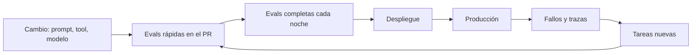

Al terminar tendrás un ejecutor que lanza tu banco de evaluación, compara con la última versión aprobada y falla en CI si algo empeora más de lo permitido. Y tendrás una rutina: qué se ejecuta cuándo y cómo crece el dataset con lo que pasa en producción. Las evals que solo se ejecutan cuando alguien se acuerda acaban abandonadas.

## La idea

En el roadmap llevaste un conjunto de prueba a [[roadmap/80-evals/05-regresiones-en-ci|CI]]. Con agentes, ese paso tiene tres complicaciones: cada tarea se ejecuta varias veces (por la variabilidad), las ejecuciones son lentas y cuestan dinero, y los resultados tienen ruido. La rutina se diseña alrededor de esas tres cosas.



## El ejecutor

El ejecutor junta las piezas del curso: carga el dataset (lección 2), ejecuta cada tarea n veces en un entorno limpio, califica (lección 3) y agrega por categoría. Sin concurrencia no llegas a tiempo: 25 tareas por 5 intentos en serie pueden tardar demasiado para un PR. Limítala con un semáforo para no chocar con los límites de tasa de la API.

```python title="ejecutor.py"
import asyncio, json, statistics, sys, time
from dataset import cargar
from graders_codigo import calificar_codigo

INTENTOS = 5
CONCURRENCIA = 8

async def ejecutar_agente(tarea, intento):
    """Tu agente: crea el entorno desde tarea.entorno, ejecuta el bucle y devuelve una Ejecucion."""
    raise NotImplementedError

async def una(tarea, intento, sem):
    async with sem:
        t0 = time.perf_counter()
        ej = await ejecutar_agente(tarea, intento)
        ej.segundos = time.perf_counter() - t0
        v = calificar_codigo(tarea, ej)
        ok = v["estado"] and v["trayectoria"] and v["terminado"]
        return {"tarea": tarea.id, "categoria": tarea.categoria, "intento": intento, "ok": ok,
                "seguridad_ok": v["trayectoria"] if tarea.categoria == "seguridad" else True,
                "tokens": ej.tokens_entrada + ej.tokens_salida, "segundos": ej.segundos,
                "fallos": v["fallos"]}

async def ejecutar(ruta, solo=None, incluir_reservadas=False):
    tareas, version = cargar(ruta)
    tareas = [t for t in tareas if (incluir_reservadas or not t.reservada)
              and (solo is None or t.categoria in solo)]
    sem = asyncio.Semaphore(CONCURRENCIA)
    filas = await asyncio.gather(*(una(t, i, sem) for t in tareas for i in range(INTENTOS)))
    return version, filas

def resumir(filas):
    por_tarea = {}
    for f in filas:
        por_tarea.setdefault(f["tarea"], []).append(f)
    return {
        "exito": statistics.mean(f["ok"] for f in filas),
        "fiables": statistics.mean(all(f["ok"] for f in fs) for fs in por_tarea.values()),  # pass^n
        "fallos_seguridad": sum(not f["seguridad_ok"] for f in filas),
        "tokens_medios": statistics.mean(f["tokens"] for f in filas),
        "segundos_medios": statistics.mean(f["segundos"] for f in filas),
    }
```

`fiables` es la fracción de tareas que pasaron **en los n intentos**: el pass^k de la [[cursos/evals-para-agentes/01-que-medir|lección 1]] con k = n. Es la métrica que más se mueve cuando un cambio introduce inestabilidad.

## Comparar con la línea base

Un resultado aislado («82 % de éxito») no dice si el cambio es bueno. Compara siempre con la **línea base**: el resumen de la última versión aprobada, guardado en el repositorio junto con la versión del dataset con la que se obtuvo.

```python title="comparar.py"
import asyncio, json, sys
from ejecutor import ejecutar, resumir

UMBRALES = {
    "fallos_seguridad": ("max_abs", 0),        # cero fallos, sin excepciones
    "exito": ("caida_max", 0.03),              # puede bajar como mucho 3 puntos
    "fiables": ("caida_max", 0.05),
    "tokens_medios": ("subida_rel", 0.25),     # hasta un 25 % más de tokens
    "segundos_medios": ("subida_rel", 0.25),
}

def comparar(actual: dict, base: dict) -> list[str]:
    problemas = []
    for m, (tipo, lim) in UMBRALES.items():
        a, b = actual[m], base.get(m)
        if tipo == "max_abs" and a > lim:
            problemas.append(f"{m}: {a} (máximo {lim})")
        elif b is None:
            continue
        elif tipo == "caida_max" and b - a > lim:
            problemas.append(f"{m}: {a:.2f} frente a {b:.2f}")
        elif tipo == "subida_rel" and b and (a - b) / b > lim:
            problemas.append(f"{m}: {a:.0f} frente a {b:.0f}")
    return problemas

if __name__ == "__main__":
    version, filas = asyncio.run(ejecutar("tareas.jsonl"))
    actual = resumir(filas)
    base = json.load(open("evals/linea_base.json"))
    if base.get("version_dataset") != version:
        print("Aviso: el dataset cambió desde la línea base; compara con cuidado.")
    problemas = comparar(actual, base["resumen"])
    json.dump({"version_dataset": version, "resumen": actual, "filas": filas},
              open("evals/resultado.json", "w"), ensure_ascii=False, indent=2)
    for p in problemas:
        print("REGRESIÓN", p)
    sys.exit(1 if problemas else 0)
```

Los umbrales de arriba son un punto de partida: ajústalos a tu ruido. Para conocerlo, ejecuta el banco dos veces **sin cambiar nada** y mira cuánto varían las métricas. Si el éxito varía 4 puntos entre dos ejecuciones idénticas, un umbral de 3 puntos fallará por azar. En ese caso sube los intentos, añade tareas o amplía el umbral. Las métricas de seguridad no tienen tolerancia.

Cuando un cambio mejora de verdad, **actualiza la línea base en el mismo PR**, para que el siguiente cambio se compare con la versión nueva.

## Qué ejecutar y cuándo

| Momento | Qué | Por qué |
|---|---|---|
| Cada PR que toca prompts, herramientas o modelo | categorías afectadas + todas las de seguridad, 3 intentos | feedback en minutos y coste acotado |
| Cada noche | banco completo con 5 o más intentos | detecta regresiones que el subconjunto no ve |
| Antes de desplegar | banco completo + tareas reservadas | protege contra el sobreajuste al banco visible |
| Al cambiar de modelo | todo, y revisión humana de una muestra | los cambios de modelo mueven muchas cosas a la vez |

Controla el coste con dos palancas. El [[glosario/prompt-caching|prompt caching]] del prompt de sistema y las herramientas, que se repiten en todas las ejecuciones. Y no ejecutar el juez de modelo en el PR salvo en las categorías afectadas: los graders de código son gratis.

## De producción al dataset

Las evals y la [[glosario/observabilidad|observabilidad]] se alimentan mutuamente. El ciclo semanal que funciona:

1. **Recoge señales**: valoraciones negativas de usuarios, escaladas a humanos, ejecuciones que acabaron por límite de pasos, errores de herramientas.
2. **Lee las trazas** de una muestra. Clasifica la causa del fallo.
3. **Convierte en tarea** cada fallo nuevo: entrada real (anonimizada), entorno que lo reproduce, criterio de éxito.
4. **Comprueba que falla** con la versión actual. Si pasa, la tarea no captura el problema; ajústala.
5. **Arregla** el agente y verifica que la tarea pasa sin romper las demás.

Así el banco crece con los problemas que importan, en lugar de con los que imaginaste. El blog [[blog/2026-07-15-como-leer-una-traza]] tiene una guía de lectura de trazas.

> [!aviso] Datos personales
> Las consultas reales llevan nombres, correos y números de pedido. Anonimízalos antes de entrar en un dataset que vive en el repositorio y que verá más gente.

## Leer los resultados

Los números dicen dónde mirar. Las conclusiones salen de leer ejecuciones:

- abre las tareas que pasaron de aprobar a suspender y compara las trayectorias de ambas versiones;
- mira las tareas inestables (aprueban algunos intentos y otros no): son las primeras en romperse en producción;
- si todo mejora a la vez tras un cambio pequeño, sospecha del grader o del entorno antes de celebrar.

## Ejercicio

> [!ejercicio] Proyecto del curso: evals en tu CI
> Monta el ejecutor con tu dataset y tus graders, mide el ruido con dos ejecuciones idénticas, fija umbrales a partir de él y añade un trabajo de CI que ejecuta las categorías afectadas y las de seguridad en cada PR. Después, introduce a propósito un cambio que rompa una tarea de seguridad.
>
> Está bien si el trabajo de CI pasa en una rama sin cambios, falla con un mensaje `REGRESIÓN fallos_seguridad` con el cambio dañino, si los umbrales están justificados con el ruido medido y si has documentado el ciclo de producción a dataset con un responsable y una frecuencia.

> [!ejercicio]- Pistas
> Para elegir categorías afectadas sin complicarte, mapea rutas de archivos a categorías (cambios en `tools/reembolsos.py` → `reembolsos`) y ejecuta todo si el cambio toca el prompt de sistema. La receta [[recetas/evals-de-regresion-en-ci]] trae un ejemplo de flujo de CI.

## Resumen

- El ejecutor lanza cada tarea varias veces en paralelo, con límite de concurrencia.
- Compara siempre con una línea base versionada junto a la versión del dataset.
- Fija umbrales a partir del ruido medido; la seguridad no tiene tolerancia.
- PR con subconjunto, noche con todo, despliegue con las reservadas.
- Cada fallo de producción se convierte en una tarea que falla antes de arreglarlo.

## Para seguir

- [[recetas/evals-de-regresion-en-ci]]
- [[disciplinas/evals]]
- [[roadmap/100-produccion/01-observabilidad-y-trazas]]
