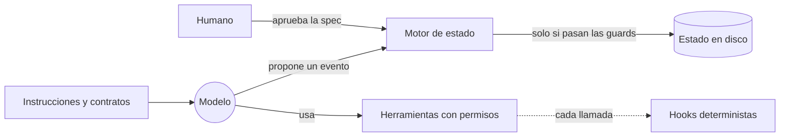

Al terminar esta lección sabrás separar lo que hace el modelo de lo que hace el entorno que lo rodea, y podrás señalar en el harness del curso el archivo exacto donde se decide qué ve cada agente, cuántas vueltas de corrección se permiten y qué caminos puede seguir el trabajo.

## La idea

Un [[glosario/agente|agente]] de IA es **modelo + harness**. El modelo aporta razonamiento y lenguaje. El harness (arnés) es todo lo demás: las instrucciones que recibe, las herramientas que puede usar y con qué permisos, cómo se reparte el trabajo entre agentes, dónde se guarda lo aprendido, cómo se comprueba el resultado, cuándo decide una persona, cuánto cuesta y qué pasa cuando algo falla.

La fórmula se popularizó en 2026. LangChain la resume en [The Anatomy of an Agent Harness](https://www.langchain.com/blog/the-anatomy-of-an-agent-harness) (marzo de 2026): si no eres el modelo, eres el harness. Anthropic ya hablaba de harnesses para agentes de larga duración en noviembre de 2025 ([[biblioteca/effective-harnesses]]) y OpenAI publicó su artículo sobre la disciplina en febrero de 2026 ([[biblioteca/harness-engineering-openai]]).

**[[glosario/harness-engineering|Harness engineering]] es diseñar ese entorno para que un modelo no determinista produzca trabajo fiable, verificable, reanudable, seguro y con coste controlado.** No intenta sustituir el juicio del modelo. Delimita dónde actúa, con qué información, qué evidencia debe dejar y quién tiene la última palabra.



## Del prompt al harness, con la misma petición

Imagina que pides: «añade validación de email al formulario de registro».

- **Solo prompt.** Escribes la petición y el agente edita. Funciona o no, y te enteras al revisar.
- **Prompt con contexto.** Le das las convenciones del proyecto en un `CLAUDE.md` y los archivos relevantes. Acierta más, pero sigue declarando «hecho» cuando le parece.
- **Harness.** Un explorer mapea el código y escribe `context.md`. Un designer produce requisitos, diseño, tareas y criterios de aceptación ejecutables. Tú apruebas eso. Un builder implementa sin poder tocar la spec. Un reviewer ejecuta la aceptación por su cuenta y emite un [[glosario/veredicto|veredicto]]. Un motor en Python decide si cada paso es legal y lo deja registrado.

Cada salto añade una capa. El *prompt engineering* trabaja la redacción. El [[disciplinas/context-engineering|context engineering]] decide qué tokens ve el modelo en cada llamada. El harness añade el entorno y los controles: herramientas, permisos, verificadores, estado y orquestación. Birgitta Böckeler lo ordena en [[glosario/guias-y-sensores|guías y sensores]]: lo que orienta al modelo antes de actuar y lo que le devuelve feedback después.

## Cuatro disciplinas dentro de un harness

El harness del curso aplica a la vez cuatro formas de ingeniería. Esta tabla es el mapa de toda la parte técnica:

| Disciplina | Pregunta que responde | En el harness del curso |
| --- | --- | --- |
| Context engineering | ¿Qué información ve cada modelo en cada momento? | Cada subagente arranca sin `CLAUDE.md` (`omitClaudeMd: true`), lee su contrato, `AGENTS.md` y los artefactos de su fase; el orquestador trabaja con informes de retorno |
| Loop engineering | ¿Cuántas vueltas de autocorrección y cuándo se para? | Builder → reviewer → `PASS`, **un** repair o humano |
| Graph engineering | ¿Qué caminos puede recorrer el trabajo? | `workflow.toml` es el grafo (9 fases, 15 eventos); `feature.py` rechaza las aristas ilegales |
| Harness engineering | Todo lo anterior más permisos, estado, verificación, coste y seguridad | La carpeta `.claude/` completa |

### El bucle: corto a propósito

El bucle de corrección tiene una sola vuelta automática. Está escrito en el contrato, no en un prompt:

```toml title=".claude/contracts/workflow.toml"
[workflow]
# Repairs automaticos permitidos tras la primera verificacion. Mas vueltas = decision humana.
max_repair_attempts = 1

[[transitions]]
from = "verification"
event = "repairable_failure"
to = "implementation"
actor = "orchestrator"
guards = [
  "reviewer_runtime_recorded",
  "verdict_fail_repairable",
  "repair_budget_available",
  "repair_request_valid",
  "spec_unchanged",
  "within_budget",
]
```

Por qué una: un bucle abierto de «revisa y corrige» oscila, deriva de alcance y gasta sin límite. Una vuelta da corrección autónoma para el fallo pequeño y obvio; cualquier otra cosa vuelve a ti. El validador del harness exige `max_repair_attempts == 1`: si quieres más vueltas, cambias el código y sus tests, no una frase. La lección [[cursos/harness-engineering/08-veredictos-y-reparacion-acotada]] lo desarrolla.

### El grafo: el modelo propone, el código decide

El orquestador (la sesión principal de Claude Code) elige qué evento aplicar leyendo el informe de un subagente. Quien decide si ese evento es legal desde la fase actual es `feature.py`:

```python nocheck title=".claude/tools/feature.py"
    transition = hl.find_transition(workflow, phase, args.event)
    if transition is None:
        allowed = ", ".join(t["event"] for t in hl.transitions_from(workflow, phase)) or "ninguno"
        print(f"RECHAZADA: '{args.event}' no existe desde '{phase}'. Eventos validos: {allowed}", file=sys.stderr)
        return 1
    problems = []
    if transition["actor"] == "human":
        if args.by == "yolo-mode" and args.event != "approved":
            problems.append("yolo-mode solo puede aprobar GATE#1; el resto de decisiones humanas no se delegan")
    elif args.by not in (None, "orchestrator"):
        problems.append(f"'{args.event}' es una transicion del orquestador; no uses --by {args.by}")
    problems += vh.run_guards(ctx, transition.get("guards", []))
    # … si hay problemas, imprime RECHAZADA y sale con 1 sin escribir nada
```

Así se ve desde fuera. En una copia del harness, si el orquestador intenta cerrar la exploración sin haber lanzado al explorer:

```text
$ python3 .claude/tools/feature.py transition DEMO-001 exploration_complete
RECHAZADA DEMO-001: exploration --exploration_complete--> design
  - [explorer_runtime_recorded] no hay ejecucion real de 'explorer' en esta fase verificable en su transcript (¿se lanzo como subagente con la cabecera FEATURE_ID? ¿esta activo el hook SubagentStop?). Si acaba de terminar, reintenta.
  - [context_present] falta SDD/context.md o esta vacio
```

Es el primer principio del harness: **IA en lo semántico, código en los bordes**. El modelo entiende qué toca hacer; el código comprueba que se puede hacer. Las [[glosario/guardrails|guardrails]] escritas como reglas en un prompt se olvidan con el contexto largo; una función que devuelve una lista de problemas no.

### Por qué no un motor de grafos

La referencia original del harness (versión 0.4.0, nativa de Codex) ya lo razonaba: un archivo TOML de transiciones y un orquestador nativo cubren el problema con menos coste operativo que un motor de grafos externo. Aquella versión tenía nueve transiciones; la 0.8.0 tiene quince eventos, y la conclusión sigue en pie. La referencia fijaba además cuándo cambiar de idea: cuando aparezcan muchas transiciones condicionales difíciles de mantener. En la 0.8.0 ese punto quedó como límite deliberado en `.claude/docs/architecture.md`. Si algún día necesitas ese motor, [[docs/frameworks/05-langgraph]] es la opción abierta más extendida para modelar agentes como grafos de estado.

## Lo que cambia cuando piensas en harness

- Dejas de preguntar «¿qué prompt lo arregla?» y preguntas «¿qué control determinista lo impide?».
- Cada fallo repetido se convierte en una pieza: una guard, un check de aceptación, una regla del hook.
- El estado vive en disco (`.claude/state/<ID>/`), no en la conversación. Puedes cerrar la sesión y seguir mañana.
- Mides. El coste de cada subagente sale de sus transcripts reales, no de lo que el modelo cree haber gastado.

## Errores frecuentes

- **Confundir harness con framework.** Un framework te da piezas para construir el bucle; el harness es el entorno concreto en el que trabaja tu agente. Este no importa ningún framework: Claude Code más seis herramientas en Python con la biblioteca estándar.
- **Meter las reglas críticas en el prompt.** Si una regla no puede fallar (no aprobar sin humano, no tocar la spec), va en código.
- **Añadir piezas sin evidencia.** Cada pieza cuesta tokens, tiempo y mantenimiento. El harness solo crece cuando una necesidad medida lo pide.

## Ejercicio

> [!ejercicio] Mapa de tu entorno actual
> Toma el agente con el que trabajas hoy (Claude Code con tu `CLAUDE.md`, un bucle propio o un framework) y rellena la tabla de las cuatro disciplinas con lo que tienes de verdad: archivo, configuración o «nada». Marca una celda donde una regla vive solo en un prompt y propón el control determinista que la sustituiría.
> Está bien si: cada celda cita un archivo o dice «nada», hay al menos una regla de prompt identificada y el control propuesto se puede comprobar con un comando o una función que devuelva verdadero o falso.

> [!ejercicio]- Pistas
> Busca frases en tu `CLAUDE.md` con «nunca», «siempre» o «antes de». Cada una es candidata a hook o a check. «Nunca hagas push» se convierte en una regla `deny` de permisos; «pasa los tests antes de terminar» se convierte en un comando con código de salida que alguien distinto del agente ejecuta.

## Resumen

- Agente = modelo + harness: el harness es todo lo que no es el modelo.
- Harness engineering busca trabajo fiable, verificable, reanudable, seguro y con coste controlado.
- En el harness del curso, el contexto lo decide `omitClaudeMd` y los contratos; el bucle, `max_repair_attempts = 1`; el grafo, `workflow.toml`.
- El modelo propone el evento; `feature.py` y sus guards deciden si es legal.

## Para seguir

- [[cursos/harness-engineering/02-los-problemas-que-resuelve]]
- [[disciplinas/harness-engineering]]
- [[roadmap/90-harness/02-las-piezas-de-un-harness]]
