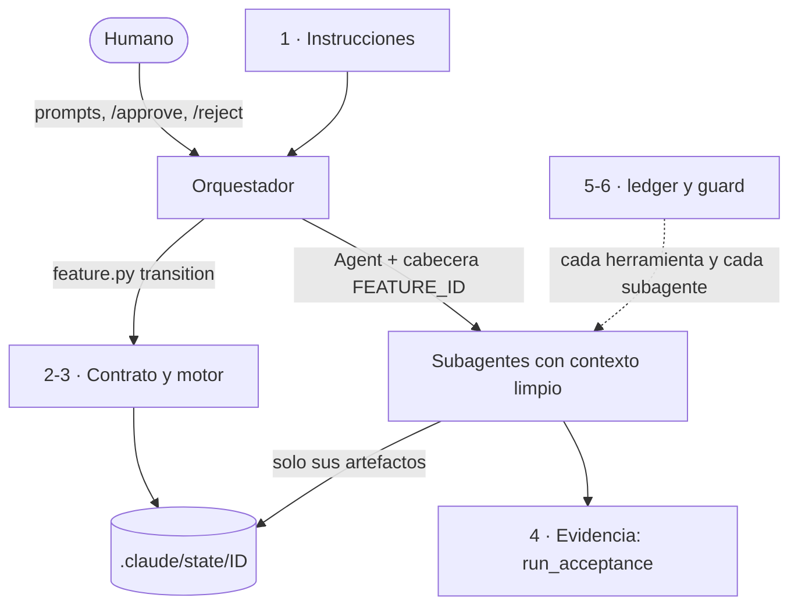

Al terminar esta lección tendrás el mapa completo del harness: qué piezas lo forman, en qué archivo está cada una y cómo se apilan en capas. Es la lección de referencia del curso; vuelve a ella cuando una lección posterior cite un archivo y no recuerdes dónde encaja.

## La idea

Un harness completo tiene, como mínimo, quince piezas. Puedes construirlas de muchas formas; lo que no puedes es saltártelas sin aceptar el fallo que cada una evita. Esta es la tabla, con la ubicación de cada pieza en el bundle 0.8.0 del autor (las rutas `.claude/…` son relativas a la raíz de tu repositorio):

| # | Pieza | Qué es | Dónde vive |
| --- | --- | --- | --- |
| 1 | Instrucciones | Lo que el modelo trata como órdenes | `CLAUDE.md` → `@HARNESS.md` + `@AGENTS.md`; contratos `.claude/agents/*.md` |
| 2 | Topología de agentes | Quién hace qué, con qué modelo y esfuerzo | Orquestador + explorer, designer, builder, reviewer; especialistas opcionales |
| 3 | Herramientas y permisos | Qué puede tocar cada agente | `tools:` de cada agente, `settings.json`, `guard.py` |
| 4 | Contrato de flujo | Fases, eventos, actores y guards | `.claude/contracts/workflow.toml` |
| 5 | Motor de estado | Único componente que cambia el estado | `.claude/tools/feature.py` |
| 6 | Memoria persistente | Lo aprendido, fuera de la ventana | `.claude/state/<ID>/` |
| 7 | Especificación | Qué se construye y cómo se demuestra | `proposal`, `requirements`, `design`, `tasks`, `acceptance.yaml` |
| 8 | Verificación | Comprobación con evidencia | `run_acceptance.py`, `verification-result.yaml`, guard `required_checks_passed` |
| 9 | Puertas humanas | Donde decide una persona | GATE#1 (`/approve`, `/reject`), salidas de `blocked`, presupuesto |
| 10 | Guardrails | Fronteras deterministas | `guard.py` en `PreToolUse`, permisos, validación de comandos, runner sin secretos |
| 11 | Observabilidad y coste | Qué pasó, quién, con qué modelo, cuánto costó | `event.log`, `ledger.py` en `SubagentStop`, `cost.json`, `feature.py metrics` |
| 12 | Recuperación | Reanudar sin reconstruir la conversación | `feature.py status`, skill `feature-resume`, lock, `/new-session` |
| 13 | Procedimientos reutilizables | Saber hacer cargado bajo demanda | 16 [[glosario/skill|skills]] en `.claude/skills/` |
| 14 | Autoverificación | Que el harness no se rompa al evolucionar | `validate_harness.py` y 95 tests |
| 15 | Evolución con evidencia | Cuándo añadir complejidad | `HARNESS.md` §14, `feature.py metrics`, skills `eval-driven-development` y `plugin-eval` |

Lo que no está en la tabla también es una decisión. `.claude/docs/architecture.md` enumera los límites deliberados: un orquestador, un gate obligatorio, un repair, sin base de datos de memoria ni [[glosario/vector-store|vector store]], sin motor de grafos, sin router de modelos y sin dependencias externas de Python. Se revisan solo ante una necesidad medida.

## Ficha técnica, comprobada contra el código

La guía completa del autor describe la versión 0.5.0. El bundle actual es la 0.8.0 y algunas cifras cambiaron. Esta ficha sale del código, y la tercera columna te dice cómo comprobar cada dato en tu copia:

| Campo | Valor en 0.8.0 | Cómo comprobarlo |
| --- | --- | --- |
| Versión | `0.8.0` | `[harness].bundle_version`; el validador exige que coincida con el `CHANGELOG.md` |
| Perfil y flujo | `clean`, `simple` | `[project]` de `harness.toml` |
| Modo de orquestación | `manual` | `[orchestration].mode` |
| Gates humanos obligatorios | 1 (GATE#1) | eventos con `actor = "human"` en `workflow.toml` |
| Repairs automáticos | 1 | `max_repair_attempts`; el validador exige exactamente 1 |
| Agentes | 4 canónicos, 0 especialistas | `agent-registry.yaml` |
| Contrato | 9 fases, 15 eventos, 24 guards | `workflow.toml` y el diccionario `GUARDS` de `validate_harness.py` |
| Skills | 16: 13 activables por el modelo y 3 solo humanas (`caveman`, `ponytail`, `new-session`) | `disable-model-invocation: true` en su frontmatter |
| Comandos humanos | 2 (`/approve`, `/reject`) | `.claude/commands/` |
| Hooks | `PreToolUse` → `guard.py` con dos matchers; `SubagentStop` → `ledger.py` | `settings.json` |
| Herramientas | 6 módulos Python, solo biblioteca estándar | `.claude/tools/` |
| Tests | 95 en 11 archivos (`unittest`) | `python3 -m unittest discover -s .claude/tests` |
| Presupuesto por defecto | aviso a 5 USD, límite a 20 USD por feature | `[cost]` de `harness.toml` |

> [!nota] Cuando la guía y el código no coinciden, manda el código
> Frente a la 0.5.0 que describe la guía, la 0.8.0 pasa de 58 a 95 tests, retira la copia local de `skill-creator` (se usa la integrada en Claude Code), añade la skill `/new-session`, cubre también `Read|Grep|Glob` con el hook de seguridad, fija el ID completo del modelo en cada agente y deja a todos los subagentes salvo el builder en solo lectura por Bash.

## Mapa de archivos

Esto es lo que copias a tu repositorio desde la carpeta `HARNESS/` del repositorio del harness:

```text title="HARNESS/"
CLAUDE.md                  entrada de Claude Code: rol de orquestador, canario, @HARNESS.md, @AGENTS.md
HARNESS.md                 contrato del harness (14 secciones, 10 invariantes)
AGENTS.md                  reglas del proyecto destino (plantilla que rellenas)
.gitignore
.claude/
├── README.md              qué hay en cada carpeta y si se puede editar
├── CHANGELOG.md           su última versión debe ser bundle_version
├── harness.toml           modo, tags de gate humano, presupuesto, precios
├── settings.json          permisos, env y hooks: la capa de seguridad
├── feature_list.json      cola de features
├── contracts/workflow.toml     máquina de estados
├── agents/                explorer, designer, builder, reviewer + agent-registry.yaml
├── commands/              approve.md, reject.md
├── skills/                16 skills + README (catálogo, procedencia, auditoría)
├── templates/             state, acceptance, verification-result, repair-request, agent, skill
├── tools/                 harness_lib, feature, validate_harness, run_acceptance, ledger, guard
├── tests/                 support.py + 11 archivos de test
├── bootstrap/             init.sh, verify.sh
├── docs/                  architecture.md, extending.md
├── mcp/                   README.md y un ejemplo de .mcp.json
├── state/                 aquí nace .claude/state/<ID>/ de cada feature
└── handoff/               prompts de /new-session (fuera de git)
```

Dos detalles de diseño. Las plantillas de agente y de skill viven en `templates/` y no en `agents/` o `skills/` para que Claude Code no las descubra como agente o skill reales. Y los manuales humanos (`INSTRUCCIONES/`) se quedan fuera del bundle: en la 0.5.0 estaban en la raíz y el orquestador y el explorer podían gastar tokens leyendo unos 200 KB de documentación del propio harness.

## Arquitectura por capas

Las quince piezas se apilan en seis capas. Cada una tiene una responsabilidad y no invade la de otra:



| Capa | Componentes | Responsabilidad |
| --- | --- | --- |
| 1. Instrucciones | `CLAUDE.md`, `HARNESS.md`, `AGENTS.md`, contratos de agente | Qué debe hacer cada actor y con qué precedencia |
| 2. Contrato | `contracts/workflow.toml` | Qué transiciones existen y qué exigen |
| 3. Motor | `feature.py` y las guards de `validate_harness.py` | Aplicar solo transiciones legales y mantener coherentes estado, cola y eventos |
| 4. Evidencia | `run_acceptance.py`, `verification-result.yaml` | Demostrar con comandos que la feature cumple |
| 5. Observabilidad | `ledger.py`, `event.log`, `cost.json` | Ejecuciones reales, tokens, coste y presupuesto |
| 6. Seguridad | `guard.py`, `settings.json`, validación de la aceptación | Fronteras deterministas frente a errores e inyecciones |

Las capas 5 y 6 se enganchan a Claude Code con [[glosario/hook|hooks]]. Este es el bloque real de `settings.json`:

```json title=".claude/settings.json"
{
  "hooks": {
    "PreToolUse": [
      {
        "matcher": "Bash|Edit|Write|MultiEdit|NotebookEdit",
        "hooks": [
          {
            "type": "command",
            "command": "python3 \"$CLAUDE_PROJECT_DIR/.claude/tools/guard.py\" || exit 2",
            "timeout": 10
          }
        ]
      },
      {
        "matcher": "Read|Grep|Glob",
        "hooks": [
          {
            "type": "command",
            "command": "python3 \"$CLAUDE_PROJECT_DIR/.claude/tools/guard.py\" || exit 2",
            "timeout": 10
          }
        ]
      }
    ],
    "SubagentStop": [
      {
        "hooks": [
          {
            "type": "command",
            "command": "python3 \"$CLAUDE_PROJECT_DIR/.claude/tools/ledger.py\" hook",
            "timeout": 30
          }
        ]
      }
    ]
  }
}
```

Fíjate en el `|| exit 2` del guard. En Claude Code, un hook que sale con código 2 bloquea la acción; cualquier otro código distinto de 0 es un error que no bloquea. Dentro de `guard.py`, toda excepción ya se convierte en un `deny`. La cola cubre lo que el script no puede capturar (que falte `python3`, que un import falle): el proceso sale con un código distinto de 0, `|| exit 2` lo convierte en bloqueo y la herramienta no se ejecuta. El guard [[glosario/fallo-en-cerrado|falla en cerrado]]. El hook del `ledger.py` no lleva esa cola a propósito: medir el coste nunca debe romper la sesión, así que ante cualquier error registra el problema y sale con 0. Cada hook falla del lado seguro para su función. Los detalles de la API de hooks están en [[docs/claude-code/04-hooks]].

## El validador sabe qué piezas debe haber

La capa de autoverificación no confía en que copies bien el bundle. El validador empieza comprobando que existen los archivos sin los que el harness no funciona:

```python title=".claude/tools/validate_harness.py"
REQUIRED_FILES = (
    "CLAUDE.md", "AGENTS.md", "HARNESS.md",
    ".claude/harness.toml", ".claude/settings.json", ".claude/feature_list.json", ".claude/CHANGELOG.md",
    ".claude/contracts/workflow.toml", ".claude/agents/agent-registry.yaml",
    ".claude/templates/state.yaml", ".claude/templates/acceptance.yaml",
    ".claude/templates/verification-result.yaml", ".claude/templates/repair-request.yaml",
    ".claude/tools/harness_lib.py", ".claude/tools/feature.py", ".claude/tools/run_acceptance.py",
    ".claude/tools/ledger.py", ".claude/tools/guard.py", ".claude/bootstrap/verify.sh",
)
```

Después valida la configuración, el contrato (fases únicas, guards implementadas, veredictos exactos), los agentes (nombre, modelo, sin herramienta `Agent`), las skills, los hooks y cada feature con estado. En una copia recién instalada:

```text
$ python3 .claude/tools/validate_harness.py
WARNING verify_placeholder .claude/bootstrap/verify.sh: verify.sh sin configurar: añade lint/tests del proyecto (skill project-bootstrap)
Harness validation passed (0 errores, 1 avisos)
$ python3 -m unittest discover -s .claude/tests
...............................................................................................
----------------------------------------------------------------------
Ran 95 tests in 1.494s

OK
```

## Errores frecuentes

- **Copiar el bundle sin los archivos ocultos.** `cp -r HARNESS/*` no copia `.claude/` ni `.gitignore`. Usa `cp -r HARNESS/. destino/`.
- **Tratar `state/` como basura.** Salvo `hook-errors.log`, todo `.claude/state/` se versiona: es la memoria auditable de cada feature.
- **Editar `tools/` sin pasar los tests.** El `.claude/README.md` lo dice en su tabla: las herramientas se editan solo con tests.

## Ejercicio

> [!ejercicio] Rompe una pieza y mira quién lo detecta
> En una copia del harness (nunca en tu repositorio de trabajo), haz tres cambios por separado: quita el segundo matcher de `PreToolUse` en `settings.json`; pon `max_repair_attempts = 2` en `workflow.toml`; y añade una guard inventada (`"tests_green"`) a una transición. Ejecuta el validador tras cada cambio y anota el código de error.
> Está bien si: identificas las tres capas afectadas, el validador falla las tres veces con exit 1 y puedes explicar por qué cada cambio rompería una pieza de la tabla.

> [!ejercicio]- Pistas
> Los códigos que verás son `hook_guard_tools`, `repair_budget` y `transition_guard`. El primero importa más de lo que parece: sin el matcher de lectura, `guard.py` deja de impedir que un agente lea un `.env` con `Read`.

## Resumen

- Un harness completo tiene quince piezas; cada una vive en un archivo concreto del bundle.
- La 0.8.0 tiene 9 fases, 15 eventos, 24 guards, 16 skills, 6 herramientas y 95 tests.
- Seis capas: instrucciones, contrato, motor, evidencia, observabilidad y seguridad.
- Los hooks enganchan guard y ledger; el guard falla en cerrado y el ledger nunca rompe la sesión.
- El validador comprueba que las piezas existen y encajan antes de que las uses.

## Para seguir

- [[cursos/harness-engineering/04-patrones-y-principios]]
- [[roadmap/90-harness/03-permisos-y-hooks]]
- [[sistemas/harness-sdd-claude-code]]
