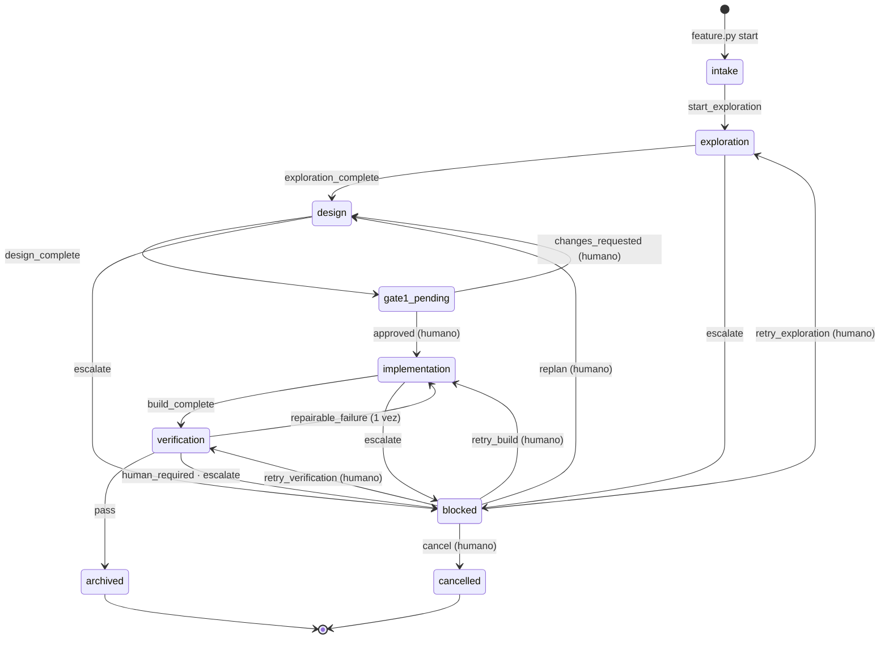

Al terminar esta lección sabrás leer el contrato del flujo como lee un compilador una gramática: qué caminos existen, quién puede recorrerlos y qué condiciones exige cada uno. Y habrás llevado una feature real de `intake` a `implementation` en una copia del harness, viendo cómo el motor rechaza los atajos.

## La idea

El flujo de trabajo del harness es una [[glosario/grafo-de-estado|máquina de estados]] escrita en TOML (`.claude/contracts/workflow.toml`). Cada fase es un nodo; cada evento, una arista con un actor (orquestador o humano) y una lista de guards. Una guard es una función de Python que devuelve una lista de problemas: vacía significa que pasa. **Si cualquier guard falla, la transición no escribe nada.** Y solo un programa escribe el estado: `feature.py`.

## Las 9 fases

| Fase | Tipo | Agente | `status` | Lock |
| --- | --- | --- | --- | --- |
| `intake` | inicial | orquestador | `in_progress` | activo |
| `exploration` | trabajo | explorer | `in_progress` | activo |
| `design` | trabajo | designer | `in_progress` | activo |
| `gate1_pending` | espera humana | ninguno | `in_progress` | liberado |
| `implementation` | trabajo | builder | `in_progress` | activo |
| `verification` | trabajo | reviewer | `in_progress` | activo |
| `blocked` | espera humana | ninguno | `blocked` | liberado |
| `archived` | terminal | ninguno | `archived` | liberado |
| `cancelled` | terminal | ninguno | `cancelled` | liberado |

El contrato declara también `terminal_phases`, `human_wait_phases` (donde se libera el lock porque nadie trabaja) y `phase_agents`, que liga cada fase de trabajo con su subagente. El `status` no se guarda a mano: lo calcula `expected_status(phase)` y `feature.py` lo sincroniza en `feature_list.json`.



`cancel` sale de cualquier fase no terminal; en el diagrama solo se dibuja desde `blocked` para no taparlo.

## Los 15 eventos

| Evento | Desde → hacia | Actor | Guards, en orden |
| --- | --- | --- | --- |
| `start_exploration` | intake → exploration | orquestador | `feature_registered`, `within_budget` |
| `exploration_complete` | exploration → design | orquestador | `explorer_runtime_recorded`, `context_present`, `within_budget` |
| `design_complete` | design → gate1_pending | orquestador | `designer_runtime_recorded`, `context_present`, `sdd_valid` |
| `approved` | gate1_pending → implementation | humano | `decision_recorded`, `approver_authorized`, `sdd_valid`, `spec_as_presented`, `within_budget` |
| `changes_requested` | gate1_pending → design | humano | `decision_recorded`, `within_budget` |
| `build_complete` | implementation → verification | orquestador | `builder_runtime_recorded`, `implementation_report_present`, `spec_unchanged`, `within_budget` |
| `pass` | verification → archived | orquestador | `reviewer_runtime_recorded`, `verdict_pass`, `required_checks_passed`, `archive_present`, `spec_unchanged` |
| `repairable_failure` | verification → implementation | orquestador | `reviewer_runtime_recorded`, `verdict_fail_repairable`, `repair_budget_available`, `repair_request_valid`, `spec_unchanged`, `within_budget` |
| `human_required` | verification → blocked | orquestador | `reviewer_runtime_recorded`, `verdict_requires_human`, `reason_recorded` |
| `escalate` | 4 fases de trabajo → blocked | orquestador | `reason_recorded` |
| `retry_exploration` | blocked → exploration | humano | `decision_recorded`, `within_budget` |
| `replan` | blocked → design | humano | `decision_recorded`, `context_present`, `within_budget` |
| `retry_build` | blocked → implementation | humano | `decision_recorded`, `gate1_was_approved`, `spec_unchanged`, `within_budget` |
| `retry_verification` | blocked → verification | humano | `decision_recorded`, `gate1_was_approved`, `implementation_report_present`, `spec_unchanged`, `within_budget` |
| `cancel` | cualquier no terminal → cancelled | humano | `decision_recorded` |

Además de las guards, `feature.py` aplica dos reglas de actor: una transición del orquestador con `--by` distinto de vacío u `orchestrator` se rechaza, y `--by yolo-mode` solo vale para `approved`. Fíjate en qué eventos llevan `within_budget`: los que lanzan trabajo nuevo. `design_complete`, `pass`, `human_required`, `escalate` y `cancel` no la llevan, porque presentar el gate, cerrar o pedir ayuda nunca debe quedar bloqueado por el presupuesto.

## Las 24 guards

Están en el diccionario `GUARDS` de `validate_harness.py`. El validador rechaza un contrato que cite una guard sin implementación, y el motor las ejecuta así:

```python title=".claude/tools/validate_harness.py"
def run_guards(ctx: Context, names: list[str]) -> list[str]:
    problems = []
    for name in names:
        guard = GUARDS.get(name)
        if guard is None:
            problems.append(f"guard desconocida en el contrato: {name}")
            continue
        problems += [f"[{name}] {item}" for item in guard(ctx)]
    return problems
```

Se agrupan en familias:

| Familia | Guards | Qué comprueban |
| --- | --- | --- |
| Registro y decisiones | `feature_registered`, `decision_recorded`, `approver_authorized`, `reason_recorded`, `gate1_was_approved` | La feature existe; `--by human` y respuesta literal; quién puede aprobar; motivo escrito; GATE#1 aprobado con quién, cuándo y qué |
| Especificación | `context_present`, `sdd_valid`, `spec_as_presented`, `spec_unchanged` | `context.md` con secciones; los 5 artefactos válidos y trazables; lo aprobado es lo presentado; la spec no cambió desde el gate |
| Ejecuciones reales | `explorer_runtime_recorded` y sus equivalentes para designer, builder y reviewer | Hay un `subagent_stop` cuyo transcript existe, lleva la cabecera de esta feature y terminó después de entrar en la fase |
| Implementación y veredicto | `implementation_report_present`, `verdict_pass`, `verdict_fail_repairable`, `verdict_requires_human`, `archive_present` | `## Build N` del intento actual; veredicto del build y la verificación actuales; `archive.md` |
| Repair | `repair_budget_available`, `repair_request_valid` | `attempts.repair < 1`; `repair-request.yaml` coherente con los contadores |
| Evidencia | `required_checks_passed` | Aceptación ejecutada en esta verificación, con el hash aprobado y los obligatorios en verde |
| Presupuesto | `within_budget` | Coste de subagentes por debajo del límite y ningún modelo sin precio |
| Invariantes de fase | `runtime_history_complete`, `blocked_reason_present` | Las cuatro ejecuciones canónicas registradas; motivo de bloqueo presente |

Las 22 primeras aparecen en transiciones. Las dos últimas no: solo se usan como invariantes en reposo. El validador comprueba que el estado guardado es coherente con su fase aunque nadie esté transicionando:

```python title=".claude/tools/validate_harness.py"
PHASE_REQUIREMENTS = {
    "intake": [],
    "exploration": [],
    "design": ["context_present"],
    "gate1_pending": ["context_present", "sdd_valid"],
    "implementation": ["context_present", "sdd_valid", "gate1_was_approved", "spec_unchanged"],
    "verification": ["context_present", "sdd_valid", "gate1_was_approved", "spec_unchanged",
                     "implementation_report_present"],
    "archived": ["context_present", "sdd_valid", "gate1_was_approved", "spec_unchanged",
                 "implementation_report_present", "verdict_pass", "required_checks_passed", "archive_present",
                 "runtime_history_complete"],
    "blocked": ["blocked_reason_present"],
    "cancelled": [],
}
```

## `feature.py`, el único escritor

`feature.py` tiene seis subcomandos: `add`, `start`, `status` y `transition` cambian o muestran el estado; `specialists` y `metrics` solo leen. Sale con 0 si todo va bien, 1 si rechaza o hay un error de datos, 2 con un ID o un presupuesto inválidos en `add` y 3 ante un error interno («ejecuta la skill harness-doctor»).

Que sea el único escritor se aplica por tres lados: `CLAUDE.md` lo exige, `guard.py` deniega cualquier Edit o Write sobre `state.yaml`, `event.log`, `cost.json`, `acceptance-results.json` y `spec.lock.json`, y la sesión principal solo usa el motor sin confirmación para consultar, registrar y arrancar features o aplicar eventos del orquestador; cualquier decisión humana pide confirmación. Y cuando escribe, lo hace sin dejar estados a medias:

```python title=".claude/tools/harness_lib.py"
def write_text_atomic(path: Path, text: str) -> None:
    path.parent.mkdir(parents=True, exist_ok=True)
    fd, tmp = tempfile.mkstemp(dir=path.parent, prefix=f".{path.name}.")
    try:
        with os.fdopen(fd, "w", encoding="utf-8", newline="\n") as handle:
            handle.write(text)
        os.replace(tmp, path)
    except BaseException:
        if os.path.exists(tmp):
            os.unlink(tmp)
        raise


def dump_yaml(path: Path, data: Any, header: str = "") -> None:
    text = dumps_yaml(data)
    if loads_yaml(text) != data:  # nunca escribir estado que luego no se pueda leer
        raise YamlError(f"{path.as_posix()}: el volcado YAML no es reversible")
    write_text_atomic(path, header + text + "\n")
```

Archivo temporal más `os.replace`: o se escribe entero o no se escribe. Y antes de escribir, el YAML se vuelve a leer y se compara: el motor nunca deja un estado que luego no pueda cargar. El YAML lo parsea un subconjunto estricto propio (sin anclas, etiquetas ni documentos múltiples) para comportarse igual en cualquier máquina sin PyYAML.

### Qué hace cada evento al estado

| Evento | Efecto |
| --- | --- |
| `approved` | `gate1` aprobado con quién, cuándo y la respuesta; `attempts` a build 1 y el resto a 0; foto de git (`base_commit` y `base_dirty`); crea `SDD/spec.lock.json` |
| `changes_requested` | `gate1` pasa a `changes_requested` con la respuesta literal, que el designer leerá |
| `build_complete`, `retry_verification` | `attempts.verification += 1` |
| `repairable_failure` | `attempts.repair += 1` y `attempts.build += 1` |
| `retry_build` | `attempts.human_retries += 1` y `attempts.build += 1` |
| `replan`, `retry_exploration` | Gate a `pending`, contadores a 0, borra la foto de git y `spec.lock.json` |
| `pass`, `repairable_failure`, `human_required` | `last_verdict` copia el veredicto de `verification-result.yaml` |
| `design_complete` | Guarda en el evento la huella de la spec e imprime los comandos de aceptación literales |
| hacia `archived` o `cancelled` | Congela el coste en `cost.json` |
| siempre | `phase`, `status`, fechas y `next_action`; sincroniza la cola; añade una línea a `event.log` |

En la guía 0.5.0, `retry_exploration` no reiniciaba el gate: una feature podía volver a `gate1_pending` con la aprobación antigua. La 0.8.0 lo trata como `replan` (hallazgo H-02 de la auditoría del autor). Como siempre en este curso, manda el código.

El validador vigila un invariante de contadores en `implementation`, `verification` y `archived`: `build = 1 + repair + human_retries`.

## Quién escribe cada artefacto

```text title=".claude/state/<ID>/"
state.yaml                 feature.py (deny para todos los demás)
event.log                  feature.py + ledger.py (JSON Lines, solo se añade)
SDD/context.md             explorer
SDD/proposal.md            designer
SDD/requirements.md        designer
SDD/design.md              designer
SDD/tasks.md               designer
SDD/acceptance.yaml        designer
SDD/spec.lock.json         feature.py (al aprobar)
implementation.md          builder (una sección ## Build N por intento)
acceptance-results.json    run_acceptance.py
verification.md            reviewer
verification-result.yaml   reviewer
repair-request.yaml        reviewer (solo FAIL_REPAIRABLE)
archive.md                 reviewer (solo PASS)
cost.json                  feature.py vía ledger.py (al cerrar)
<especialista>.md          especialista
```

Todo `.claude/state/` se versiona salvo `hook-errors.log`: es la memoria auditable de cada feature. En `event.log` hay tres tipos de evento, todos con `ts` y `feature_id`: `feature_started` (lo escribe `start`), `transition` (lo escribe `transition`, con `from`, `to`, `by`, la respuesta y, en `design_complete`, la huella de la spec) y `subagent_stop` (lo escribe el hook `ledger.py`, con agente, fase, intento, transcript, fechas, tokens por categoría y coste).

## Práctica: una feature paso a paso

No necesitas Claude Code para ver el motor en acción. Los tests del harness simulan subagentes escribiendo transcripts con el mismo formato que Claude Code y disparando el hook `SubagentStop`. Puedes usar sus helpers:

```python nocheck title=".claude/tests/support.py"
def fake_subagent(paths: hl.Paths, transcripts: Path, agent_id: str, agent_type: str, feature_id: str | None,
                  phase: str = "exploration", model: str = "claude-sonnet-5", session: str = "s-1",
                  prompt_prefix: str = "") -> None:
    """Escribe un transcript de subagente como los de Claude Code y dispara el hook SubagentStop."""
    # … escribe el transcript con la cabecera FEATURE_ID/PHASE y llama a ledger.cmd_hook(...)
```

Copia el bundle a una carpeta de prueba, guarda este script en su raíz y ejecútalo con `python3 recorrer_feature.py`:

```python title="recorrer_feature.py"
"""Lleva DEMO-001 hasta implementation en una COPIA del harness, simulando los subagentes como los tests."""
import subprocess
import sys
import tempfile
from pathlib import Path

ROOT = Path.cwd()
sys.path.insert(0, str(ROOT / ".claude" / "tests"))
import support  # los mismos helpers que usan los tests: fake_subagent, write_sdd, write
import harness_lib as hl

FID = "DEMO-001"
paths = hl.Paths(ROOT)
transcripts = Path(tempfile.mkdtemp()) / "transcripts"  # transcripts simulados, fuera del repo


def feature(*args: str) -> int:
    cmd = ["python3", ".claude/tools/feature.py", *args]
    print("$", " ".join(cmd))
    r = subprocess.run(cmd, cwd=ROOT, capture_output=True, text=True)
    print((r.stdout + r.stderr).rstrip(), f"\n[exit {r.returncode}]\n")
    return r.returncode


feature("add", FID, "Saludo en espanol", "--tags", "demo")
feature("start", FID)
feature("transition", FID, "start_exploration")
feature("transition", FID, "exploration_complete")  # rechazada: no hubo explorer

support.write(paths.feature(FID) / "SDD" / "context.md", "## Resumen\nDemo.\n")
support.fake_subagent(paths, transcripts, "a-exp", "explorer", FID)
feature("transition", FID, "exploration_complete")

support.write_sdd(paths, FID)
support.fake_subagent(paths, transcripts, "a-des", "designer", FID, phase="design")
feature("transition", FID, "design_complete")
feature("transition", FID, "approved", "--response", "ok")  # rechazada: falta --by human
feature("transition", FID, "approved", "--by", "human", "--response", "approve: adelante")
feature("status", FID)
```

Estas son las partes interesantes de la salida real. Al cerrar el diseño, el motor guarda la huella de la spec y te enseña los comandos que se ejecutarán sin más confirmación:

```text
$ python3 .claude/tools/feature.py transition DEMO-001 design_complete
OK DEMO-001: design --design_complete--> gate1_pending
Comandos de aceptacion que se ejecutaran sin mas confirmacion tras GATE#1 (muestralos al humano):
  AC-002 (cwd .): grep -q hola src/app.py
Siguiente: PARA. GATE#1: el humano decide con /approve DEMO-001 o /reject DEMO-001 <cambios>
```

Una aprobación sin `--by human` se rechaza por dos guards a la vez:

```text
$ python3 .claude/tools/feature.py transition DEMO-001 approved --response ok
RECHAZADA DEMO-001: gate1_pending --approved--> implementation
  - [decision_recorded] decision humana: indica --by human (o --by yolo-mode solo para approved)
  - [approver_authorized] GATE#1 solo lo aprueba el humano o, por delegacion explicita, yolo-mode
```

En Claude Code real, la versión con `--by human` no se ejecuta sin más: `guard.py` responde `ask` a cualquier decisión humana y Claude Code te pide confirmar el comando. Esa confirmación es tu firma (receta: [[recetas/puerta-humana-con-comandos]]). Tras aprobar, `status` resume todo lo que el orquestador necesita:

```text
$ python3 .claude/tools/feature.py status DEMO-001
DEMO-001 - Saludo en espanol
  fase: implementation (in_progress) desde 2026-10-29T20:07:28Z
  intentos: build 1 | verificacion 0 | repair 0/1 | reintentos humanos 0
  GATE#1: approved por human
  lock activo desde 2026-10-29T20:07:28Z, sin actividad desde hace 0 min
  eventos validos: build_complete (orchestrator), escalate (orchestrator), cancel (human)
  coste estimado: $0.0300 (BUDGET_OK)
  runtime explorer a-exp fin 2026-10-29T20:07:27Z
  runtime designer a-des fin 2026-10-29T20:07:27Z
  siguiente: Lanza el subagente builder (PHASE: implementation, ATTEMPT: 1, MODE: build)
```

> [!consejo] Ejecútalo siempre en una copia
> El script registra una feature, crea `.claude/state/DEMO-001/` y modifica `feature_list.json`. Hazlo en una carpeta desechable, nunca en el repositorio donde usas el harness de verdad. Y guarda otra copia limpia para los ejercicios que pasan la suite del harness (lecciones 8 y 9): los tests también usan `DEMO-001` y, si esa feature ya existe en la copia, fallan.

## Errores frecuentes

- **Editar `state.yaml` «solo para desbloquear».** El guard lo deniega, y aunque lo consiguieras, el validador detectaría la incoherencia. Si algo está mal, `escalate` y decisión humana.
- **Leer un rechazo como un fallo del harness.** Un `RECHAZADA` con la lista de guards es el harness funcionando: te dice exactamente qué falta.
- **Añadir un evento al TOML y olvidar sus efectos.** Las guards se declaran en el contrato, pero los efectos (contadores, locks) viven en `cmd_transition`. Cambiar el flujo es cambiar los dos y sus tests.

## Ejercicio

> [!ejercicio] La rama de repair y el reintento humano
> Continúa el script desde `implementation`: simula un build con un defecto, haz que el reviewer emita `FAIL_REPAIRABLE` con su `repair-request.yaml`, aplica `repairable_failure`, simula un segundo build que vuelve a fallar, intenta un segundo `repairable_failure`, lleva la feature a `blocked` con `human_required` y sácala con `retry_build`. Imprime `attempts` tras cada transición.
> Está bien si: el segundo `repairable_failure` se rechaza, los contadores siguen esta secuencia (build/verification/repair/human_retries) 1/1/0/0 → 2/1/1/0 → 2/2/1/0 → 2/2/1/0 en `blocked` → 3/2/1/1, y el validador termina sin errores.

> [!ejercicio]- Pistas
> Mira `test_happy_path_with_one_repair` en `.claude/tests/test_feature_flow.py`: usa `support.verification_result(paths, FID, "FAIL_REPAIRABLE", 1, 1, repairable=True)` y escribe `repair-request.yaml` con `hl.dump_yaml`. Cada build necesita su sección `## Build N` en `implementation.md` y su propio `fake_subagent` del builder; cada veredicto, un `fake_subagent` del reviewer. `human_required` exige `--reason`; `retry_build`, `--by human --response '…'`.

## Resumen

- `workflow.toml` define 9 fases y 15 eventos con actor y guards; `feature.py` los aplica.
- Hay 24 guards: 22 en transiciones y 2 solo como invariantes de fase.
- Una transición rechazada no escribe nada; las escrituras son atómicas y el YAML se comprueba reversible.
- Cada artefacto de `.claude/state/<ID>/` tiene un único escritor y `event.log` registra todo lo que pasó.
- Puedes recorrer el flujo sin Claude Code con los helpers de los tests.

## Para seguir

- [[cursos/harness-engineering/07-spec-congelada-y-aceptacion]]
- [[recetas/maquina-de-estados-con-guards]]
- [[docs/frameworks/05-langgraph]]
