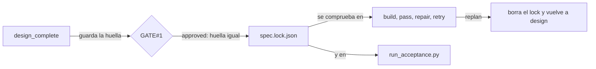

Al terminar esta lección sabrás convertir dos promesas habituales («el builder no rediseña» y «los criterios no cambiaron») en hechos que una máquina comprueba. Escribirás criterios de aceptación que el validador acepta, los ejecutarás sobre una spec congelada y verás cómo el motor rechaza evidencia antigua.

## La idea

En [[glosario/sdd|SDD]], lo que el humano aprueba es la especificación: requisitos, diseño, tareas y criterios de aceptación. Si cualquiera de esas piezas puede cambiar después sin que nadie lo note, la aprobación vale poco. El harness lo resuelve con **dos huellas SHA-256 de los cinco archivos de la spec** y con una **aceptación que solo se ejecuta sobre la spec congelada y cuya evidencia caduca al entrar en verificación**.



## Dos huellas, la misma spec

La huella se calcula siempre igual, sobre los bytes de los cinco archivos:

```python title=".claude/tools/validate_harness.py"
def spec_fingerprint(paths: hl.Paths, feature_id: str) -> dict:
    sdd = paths.feature(feature_id) / "SDD"
    return {f"SDD/{name}": hl.sha256_file(sdd / name) for name in hl.SPEC_FILES if (sdd / name).is_file()}
```

**Primera huella: lo aprobado es lo presentado.** Al aplicar `design_complete`, el motor guarda la huella dentro del evento en `event.log`. Al aprobar, la guard `spec_as_presented` la compara con la actual. Si alguien (un agente, un hook, tú mismo) toca la spec entre que el orquestador te la enseña y que tú la apruebas, la aprobación se rechaza. Salida real, tras cambiar una línea de `requirements.md` después de `design_complete`:

```text
$ python3 .claude/tools/feature.py transition DEMO-001 approved --by human --response 'approve: ok'
RECHAZADA DEMO-001: gate1_pending --approved--> implementation
  - [spec_as_presented] la especificacion cambio despues de presentarse en GATE#1: vuelve a design (changes_requested)
```

**Segunda huella: lo aprobado no cambia.** Al aplicar `approved`, `feature.py` escribe `SDD/spec.lock.json`:

```json title=".claude/state/DEMO-001/SDD/spec.lock.json"
{
  "feature_id": "DEMO-001",
  "locked_at": "2026-10-29T19:56:39Z",
  "approved_by": "human",
  "files": {
    "SDD/proposal.md": "9203923dcbbe00f8e1e4933f3418604363696050409f2159f0b754f7409a69e3",
    "SDD/requirements.md": "ed4e493d5059dff0442d946b93bf98bcb2df5438d58f72921e47ccdf26332075",
    "SDD/design.md": "a50c54b35a1ff9e5a55beca4e2e7d9e548252c0b9b8c4769c105798296020f6b",
    "SDD/tasks.md": "3731f778d7eea5a480623dc62b72bc5713a63f8f14a9dc83b40520e14a823f62",
    "SDD/acceptance.yaml": "970e03e4dd48425df0f7465d54a8da8868f4c21dcf627d340634ba876900c3a5"
  }
}
```

## Qué invalida el bloqueo

```python title=".claude/tools/validate_harness.py"
def spec_lock_problems(paths: hl.Paths, feature_id: str) -> list[str]:
    lock = paths.feature(feature_id) / "SDD" / "spec.lock.json"
    if not lock.is_file():
        return ["falta SDD/spec.lock.json (la spec se congela al aprobar GATE#1)"]
    try:
        recorded = hl.load_json(lock).get("files", {})
    except (ValueError, AttributeError):
        return ["SDD/spec.lock.json ilegible"]
    current = spec_fingerprint(paths, feature_id)
    problems = [f"{name} cambio despues de GATE#1" for name, digest in sorted(recorded.items()) if current.get(name) != digest]
    problems += [f"{name} no estaba en la spec aprobada" for name in sorted(set(current) - set(recorded))]
    return problems
```

Lo invalida cualquier cambio de un byte en los cinco archivos (un espacio también cuenta), la aparición de un archivo de la spec que no estaba registrado, o que el lock falte o no se pueda leer. Esa función la usan la guard `spec_unchanged` (en `build_complete`, `pass`, `repairable_failure`, `retry_build` y `retry_verification`), los invariantes de las fases `implementation`, `verification` y `archived`, y el propio runner de aceptación. Así se ve cuando alguien retoca `design.md` en plena implementación:

```text
$ python3 .claude/tools/run_acceptance.py --feature DEMO-001
BLOQUEADO: solo se ejecuta acceptance aprobado en GATE#1 y sin cambios:
  - SDD/design.md cambio despues de GATE#1
$ python3 .claude/tools/feature.py transition DEMO-001 build_complete
RECHAZADA DEMO-001: implementation --build_complete--> verification
  - [spec_unchanged] SDD/design.md cambio despues de GATE#1
```

Las reglas de escritura cierran el resto. `guard.py` solo deja escribir en `SDD/` al designer, y nadie puede escribir `spec.lock.json`: es un archivo gestionado por herramientas, denegado también para la sesión principal. Pero la regla del guard no mira la fase: un designer lanzado por error tras la aprobación podría editar la spec. Por eso el hash es la defensa que no tiene huecos: no importa quién cambió el archivo, el cambio se ve.

Para cambiar una spec aprobada hay un único camino: `escalate` a `blocked` y la decisión humana `replan`, que borra el lock, reinicia el gate y vuelve a `design` para un nuevo GATE#1. Si el cambio es pequeño y separable, mejor registrarlo como feature nueva con `feature.py add`.

## `acceptance.yaml` v1

La aceptación es la definición de «terminado». La escribe el designer con la skill `acceptance-criteria`, la aprueba el humano viendo los comandos literales y queda congelada con el resto de la spec. Esta es la plantilla del bundle, con los tres tipos de check:

```yaml title=".claude/templates/acceptance.yaml"
version: 1
feature_id: FEATURE-001
checks:
  - id: AC-001
    title: La regresion del proyecto sigue pasando
    covers: [NFR-01]
    kind: command
    required: true
    command: bash .claude/bootstrap/verify.sh
    cwd: .
    timeout_seconds: 600
    expected_exit_code: 0
  - id: AC-002
    title: El modulo expone la funcion nueva
    covers: [FR-01]
    kind: file
    required: true
    path: src/modulo.py
    expected: exists
    contains: "def nueva_funcion\\("
  - id: AC-003
    title: El mensaje de error indica el campo invalido
    covers: [FR-02]
    kind: inspection
    required: false
    procedure: Ejecuta el comando con una entrada invalida y lee el mensaje de error.
    expected: El mensaje nombra el campo invalido y como corregirlo.
```

| Campo | Regla que aplica el validador |
| --- | --- |
| `version`, `feature_id` | `1` y el ID de la feature |
| `id` | `AC-NNN`, único |
| `title`, `required` | texto no vacío; booleano |
| `covers` | lista no vacía de `FR-NN` o `NFR-NN` |
| `kind: command` | comando no trivial y sin patrones inseguros ni secretos; `cwd` relativo sin `..`; `timeout_seconds` entre 1 y 3600; `expected_exit_code` entero |
| `kind: file` | `path` relativo y no secreto; `expected` es `exists` o `absent`; `contains` y `not_contains` son regex válidas |
| `kind: inspection` | `procedure` y `expected` no vacíos |
| Global | al menos un check obligatorio ejecutable (`command` o `file`) |

El validador rechaza lo que convertiría un PASS en una mentira o la ejecución en un riesgo. Salida real de `acceptance_problems` con distintos comandos:

```text
'pytest -q || true'                 -> ['AC-001: command inseguro (oculta el codigo de salida)']
'pytest -q | head -n 20'            -> ['AC-001: no encadenes a head/less/more (la evidencia ya se recorta; usa el comando solo)']
'echo ok'                           -> ["AC-001: command trivial ('echo ok') no verifica nada"]
'cat .env'                          -> ['AC-001: command referencia secretos (.env, claves, credenciales)']
'git commit -am wip'                -> ['AC-001: command inseguro (git que altera historial o descarta cambios)']
'pytest -q tests/test_login.py'     -> valido
```

Las dos primeras reglas son de la 0.8.0 y no aparecen en la guía del autor: ocultar el código de salida y cortar la salida con `head` son las dos formas más comunes de que un check pase sin demostrar nada. Hay además comandos **sensibles**, válidos pero marcados: red externa (`curl`, `wget`, `ssh`… hacia algo que no sea localhost) y código en línea (`python -c`, `node -e`, `bash -c`, `eval`). `design_complete` los imprime con `[SENSIBLE]` y el modo que aprueba por delegación nunca puede aprobarlos.

Por último, `sdd_valid` comprueba la trazabilidad: cada FR y NFR de `requirements.md` aparece en algún `covers`, ningún `covers` cita un requisito inexistente y cada FR tiene una tarea en `tasks.md`. Y si `verify.sh` sigue con su marca de plantilla, rechaza cualquier aceptación que lo use: un éxito de un script que hace `exit 0` no demuestra nada ([[recetas/un-verify-para-toda-la-regresion]]).

## `run_acceptance.py`: ejecutar sin heredar secretos

El runner exige el lock intacto y una aceptación válida; si no, sale con 2 (`BLOQUEADO`). Cada `command` se ejecuta con `bash`, `set -o pipefail`, la entrada cerrada y una sesión de proceso nueva, para poder matar el grupo entero si vence el tiempo. Y con un entorno filtrado:

```python title=".claude/tools/run_acceptance.py"
SECRET_ENV = re.compile(r"TOKEN|SECRET|PASSW|API_?KEY|PRIVATE_?KEY|CREDENTIAL|ACCESS_?KEY|(^|_)AUTH(_|$)", re.IGNORECASE)
# Sesion grafica y bus de escritorio (pruebas E2E en Linux): no son secretos y se conservan.
KEEP_ENV = {"XAUTHORITY", "DISPLAY", "WAYLAND_DISPLAY", "XDG_RUNTIME_DIR", "DBUS_SESSION_BUS_ADDRESS"}


def _environment(feature_id: str) -> dict:
    env = {key: value for key, value in os.environ.items() if key in KEEP_ENV or not SECRET_ENV.search(key)}
    env["HARNESS_FEATURE_ID"] = feature_id
    return env
```

Un comando aprobado en GATE#1 se ejecuta sin más confirmación, así que no debe ver tus credenciales aunque estén en tu shell. Lo que guarda como evidencia (las colas de stdout y stderr, 1.500 caracteres) pasa además por un redactor que tapa *bearer tokens*, `token=…` y prefijos de claves conocidos ([[recetas/proteger-secretos-del-agente]]).

| Estado | Cuándo |
| --- | --- |
| `pass` | el código de salida es el esperado, o el archivo cumple |
| `fail` | otro código, tiempo agotado, archivo ausente o regex que no casa |
| `blocked` | código 126 o 127: comando no encontrado o no ejecutable (será `BLOCKED_TOOLING`) |
| `manual` | inspecciones: las resuelve el reviewer con evidencia |

El resultado va a `acceptance-results.json` con `run_at`, el `acceptance_sha256` de la aceptación ejecutada, el `git_head` y los resultados. El runner sale con 0 si pasan todos los obligatorios ejecutables, 1 si alguno falla y 2 si hay bloqueo. Con `--only AC-002` ejecuta un subconjunto para reproducir un fallo, pero **no** sobrescribe el archivo de resultados.

## Evidencia fresca

El builder ejecuta la aceptación como ensayo; el reviewer la vuelve a ejecutar él mismo. La repetición tiene un motivo: la guard `required_checks_passed`, que exige `pass`, comprueba que el hash de los resultados es el de la aceptación aprobada, que **se generaron después de entrar en verificación**, que cada check obligatorio ejecutable está en `pass` y que cada inspección obligatoria tiene `status: pass` y `evidence` en `verification-result.yaml`. Salida real cuando el reviewer intenta archivar con el ensayo del builder, y después de ejecutarlo él:

```text
$ python3 .claude/tools/feature.py transition DEMO-001 pass
RECHAZADA DEMO-001: verification --pass--> archived
  - [required_checks_passed] acceptance-results.json es anterior a esta verificacion: el reviewer debe ejecutarlo de nuevo
$ python3 .claude/tools/run_acceptance.py --feature DEMO-001
PASS     AC-001 (file, obligatorio) 
PASS     AC-002 (command, obligatorio) exit 0
Todos los checks obligatorios ejecutables pasan
$ python3 .claude/tools/feature.py transition DEMO-001 pass
OK DEMO-001: verification --pass--> archived
Coste final estimado: $0.0601 (BUDGET_OK) -> cost.json
Siguiente: Cerrada. Muestra el resumen de archive.md y el coste final
```

Es [[disciplinas/verificar-antes-de-dar-por-hecho]] llevado al motor: «lo comprobé antes» no vale, y no porque lo diga un prompt.

> [!aviso] Los comandos de aceptación se ejecutan sin preguntarte
> Tras GATE#1, `run_acceptance.py` ejecuta los comandos tal cual. El orquestador te los enseña literalmente al presentar el gate y marca los sensibles: léelos como leerías un script que vas a ejecutar con tus permisos.

## Errores frecuentes

- **Checks que pasan hoy.** Un buen check falla antes de implementar y pasa al terminar (salvo la regresión). Comprobar que existe un archivo que el builder puede crear vacío no demuestra nada sin un `contains`.
- **Inspecciones para todo.** Solo cuando no hay alternativa automática (textos, experiencia de uso), con un procedimiento reproducible.
- **«Arreglar» la aceptación durante la implementación.** Si un check parece erróneo, el builder no lo edita: lo informa y para. Cambiarlo es un `replan`.

## Ejercicio

Para la segunda parte del ejercicio, guarda este script en la raíz de tu copia del harness. Es el que produjo la lista de rechazos de arriba:

```python title="probar_checks.py"
import sys
from pathlib import Path

sys.path.insert(0, ".claude/tools")
import harness_lib as hl
import validate_harness as vh

doc = hl.load_yaml(Path(".claude/templates/acceptance.yaml"))
for command in ("pytest -q || true", "pytest -q | head -n 20", "echo ok", "cat .env", "git commit -am wip",
                "pytest -q tests/test_login.py"):
    doc["checks"][0]["command"] = command
    print(f"{command!r:35} -> {vh.acceptance_problems(doc) or 'valido'}")
doc["checks"][0]["command"] = "curl -fsS https://api.example.com/ping"
print("sensibles:", vh.sensitive_commands(doc))
```

> [!ejercicio] Rompe el lock y valida checks
> En la copia donde ejecutaste `recorrer_feature.py` (la feature está en `implementation`), añade una línea de comentario al final de `SDD/acceptance.yaml` y ejecuta `run_acceptance.py`; quítala y vuelve a ejecutarlo. Después ejecuta `probar_checks.py` añadiendo tus propios comandos a la tupla.
> Está bien si: con el comentario el runner sale con 2 citando `SDD/acceptance.yaml`; sin él, ejecuta y sale con 1 porque `src/app.py` aún no existe (los checks fallan antes de implementar, como deben); y tu script muestra al menos un comando rechazado, uno válido y uno sensible.

> [!ejercicio]- Pistas
> Un comentario YAML no cambia el significado del documento, pero sí sus bytes: el hash es sobre bytes, no sobre la semántica. Para el script, prueba también `python3 -c 'import app'` (código en línea) y `curl -fsS http://localhost:8000/health`, que no es sensible porque solo va a localhost.

## Resumen

- Dos huellas SHA-256 de los cinco archivos: una al presentar (`spec_as_presented`) y otra al aprobar (`spec.lock.json`).
- Cualquier cambio de un byte bloquea las transiciones de trabajo y el runner; el único camino para cambiar la spec es `replan` y un nuevo GATE#1.
- `acceptance.yaml` v1 tiene checks `command`, `file` e `inspection`, trazados a requisitos y validados contra patrones inseguros, triviales y secretos.
- `run_acceptance.py` ejecuta sin heredar secretos, redacta la evidencia y distingue `pass`, `fail`, `blocked` y `manual`.
- Para archivar, la evidencia debe ser de esta verificación: el reviewer siempre ejecuta la suya.

## Para seguir

- [[cursos/harness-engineering/08-veredictos-y-reparacion-acotada]]
- [[recetas/congelar-la-spec-con-un-hash]]
- [[plantillas/criterios-de-aceptacion]]
