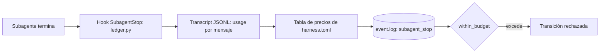

Al terminar esta lección sabrás leer el informe de coste de una feature, entender cada número que contiene y mantener la tabla de precios para que el control de gasto no se rompa cuando cambian los modelos. Verás una feature bloqueada por presupuesto y otra bloqueada por usar un modelo sin precio.

## La idea

Un modelo no sabe cuántos tokens ha gastado, y si se lo preguntas te dará una cifra plausible. El harness no pregunta: **mide**. Claude Code guarda un transcript JSONL por sesión y por subagente con el `usage` real de cada respuesta. Un [[glosario/hook|hook]] lo lee al terminar cada subagente, lo valora con una tabla de precios fechada y lo anota en el `event.log` de la feature. Las transiciones que lanzan trabajo nuevo comprueban ese total contra el presupuesto antes de gastar más.



Es la pieza 11 del harness, observabilidad y coste, en unas 550 líneas de Python sin dependencias (`.claude/tools/ledger.py`).

## Cómo se mide

El hook se registra en `settings.json`:

```json title=".claude/settings.json"
{
  "hooks": {
    "SubagentStop": [
      {
        "hooks": [
          {
            "type": "command",
            "command": "python3 \"$CLAUDE_PROJECT_DIR/.claude/tools/ledger.py\" hook",
            "timeout": 30
          }
        ]
      }
    ]
  }
}
```

Al terminar un subagente, `ledger.py hook` hace cuatro cosas:

1. **Localiza el transcript** del subagente a partir de `agent_id`, `session_id` y `transcript_path` del JSON del hook.
2. **Lee la cabecera** en las 12 primeras líneas del primer prompt: `FEATURE_ID`, `PHASE`, `ATTEMPT`, `MODE` (admite markdown, como `**FEATURE_ID:**`). Sin `FEATURE_ID` válido, el subagente es ajeno al harness y se ignora. Por eso la cabecera que pone el orquestador no es opcional.
3. **Suma el `usage` por mensaje único.** Claude Code escribe una línea por bloque de contenido con el mismo `message.id`, y en *streaming* las intermedias llevan un `output_tokens` parcial. El ledger se queda, por mensaje, con la línea de más salida, para no contar dos veces.
4. **Escribe un evento `subagent_stop`** con modelo, tokens por categoría, coste y la fecha de la tarifa usada.

Las categorías son cinco porque cada una tiene precio propio:

```python title=".claude/tools/ledger.py"
def usage_counters(usage: dict) -> dict:
    """Normaliza `message.usage` a las cinco categorias con precio propio."""
    creation = usage.get("cache_creation") or {}
    written = int(usage.get("cache_creation_input_tokens") or 0)
    one_hour = int(creation.get("ephemeral_1h_input_tokens") or 0)
    return {
        "input": int(usage.get("input_tokens") or 0),
        "output": int(usage.get("output_tokens") or 0),
        "cache_write_5m": max(written - one_hour, 0),
        "cache_write_1h": one_hour,
        "cache_read": int(usage.get("cache_read_input_tokens") or 0),
    }
```

Separar la escritura de caché de 5 minutos y de 1 hora importa: cuestan distinto, y una sesión larga de agente vive sobre todo de lecturas de [[glosario/prompt-caching|caché]]. Este es el evento que deja un explorer (salida real en una copia, con la ruta del transcript acortada):

```json title=".claude/state/DEMO-002/event.log (una línea, formateada)"
{
  "ts": "2026-10-29T19:55:30Z",
  "feature_id": "DEMO-002",
  "event": "subagent_stop",
  "agent": "explorer",
  "agent_id": "a-exp2",
  "phase": "exploration",
  "attempt": null,
  "session_id": "sesion-demo",
  "transcript": "/tmp/.../transcripts/sesion-demo.jsonl",
  "started_at": "2026-10-29T19:55:29Z",
  "finished_at": "2026-10-29T19:55:29Z",
  "usage": {
    "claude-sonnet-5-5": {"input": 20000, "output": 4000, "cache_write_5m": 30000, "cache_write_1h": 0, "cache_read": 150000}
  },
  "cost_usd": 0.17,
  "unpriced_models": [],
  "pricing_as_of": "2026-10-24"
}
```

El hook **nunca rompe la sesión**: cualquier excepción se anota en `hook-errors.log` y sale con 0. Es lo contrario que el guard (lección 9), y es correcto: un fallo al contar no debe parar el trabajo; las guards que dependen de ese registro ya se negarán a avanzar si falta.

Ese registro sirve para algo más que el coste. Las guards `*_runtime_recorded` exigen un `subagent_stop` del agente de la fase **cuyo transcript existe**, lleva la cabecera de esta feature y terminó después de entrar en la fase. Escribir una línea falsa en `event.log` no basta: el validador relee el transcript.

## La tabla de precios, con fecha y fuente

El coste es una estimación a precios de API calculada con la tabla `[cost.pricing]` de `harness.toml`:

```toml title=".claude/harness.toml"
[cost]
enabled = true
# El aviso salta en min(warn_usd, 0.8 x limite), tambien con presupuestos pequenos.
warn_usd = 5.0
limit_usd = 20.0

[cost.pricing]
as_of = "2026-10-24"
source = "https://platform.claude.com/docs/en/about-claude/pricing"
# USD por millon de tokens. Clave = model id del transcript sin sufijo de fecha.
# Un uso sin precio (modelo ausente o fast sin multiplicador) bloquea el trabajo nuevo hasta que anadas la tarifa.
```

Debajo, `[cost.pricing.models]` tiene una fila por modelo con esta forma:

```text title="forma de una fila de [cost.pricing.models]"
"<id-del-modelo>" = { input = <USD/Mtok>, output = <...>, cache_write_5m = <...>, cache_write_1h = <...>, cache_read = <...> }
  opcional: fast_multiplier = <x>                 solo si el precio de fast mode está publicado
  opcional: long_context = { threshold = N, ... } tarifas para peticiones cuya entrada supera N tokens
```

No copies las cifras de ninguna guía, tampoco de esta: los precios cambian y cada modelo tiene sus excepciones (la lectura de caché, por ejemplo, no cuesta la misma fracción de la entrada en todos). **Cópialas de la página oficial de precios de Anthropic** que figura en `source`, el día que las pongas, y actualiza `as_of`. Esa fecha viaja en cada evento (`pricing_as_of`) y en el informe, así sabes con qué tarifa se calculó cada número. El propio archivo trae en comentarios una regla general de multiplicadores de caché; compruébala también en la página oficial antes de fiarte de ella.

La valoración por categoría es una suma ponderada, con los tramos opcionales:

```python title=".claude/tools/ledger.py"
def price(key: str, counters: dict, models: dict) -> float | None:
    base, *flags = key.split("|")
    rates = models.get(base)
    if not rates:
        return None
    if "long" in flags:
        # Tramo de contexto largo: sus tarifas sustituyen a las normales (las que falten, se heredan).
        long_rates = rates.get("long_context") or {}
        rates = {**rates, **{field: long_rates[field] for field in TOKEN_FIELDS if field in long_rates}}
    multiplier = 1.0
    if "fast" in flags:
        multiplier = float(rates.get("fast_multiplier") or 0)
        if not multiplier:
            return None
    total = sum(counters.get(field, 0) * float(rates.get(field, 0)) for field in TOKEN_FIELDS)
    return total * multiplier / 1_000_000
```

La clave del modelo es el ID del transcript sin el sufijo de fecha, con `|fast` si la petición usó fast mode y `|long` si superó el umbral de contexto largo de ese modelo. `None` significa **sin precio**, y eso no se trata como cero.

### Sin precio no hay control

Un modelo que no está en la tabla bloquea el trabajo nuevo. Ocurre, por ejemplo, cuando un alias como `sonnet` empieza a apuntar a un modelo nuevo. Por eso los agentes del harness fijan el ID completo en su frontmatter (`model: claude-sonnet-5-5`, el designer `claude-opus-5-5`) y el validador avisa con `agent_model_alias` y `agent_model_unpriced`. Con un explorer simulado sobre un modelo que no está en la tabla:

```text
$ python3 .claude/tools/feature.py transition DEMO-003 exploration_complete
RECHAZADA DEMO-003: exploration --exploration_complete--> design
  - [within_budget] uso sin precio conocido ['claude-sonnet-6']: anade la tarifa en [cost.pricing.models] de harness.toml para poder controlar el gasto
```

La alternativa, contar ese uso como cero, dejaría pasar features que ya han superado su presupuesto. El harness prefiere pararse y que añadas la tarifa oficial.

## Presupuesto por feature

| Estado | Condición | Acción |
|---|---|---|
| `BUDGET_OK` | por debajo del aviso | continuar |
| `BUDGET_WARN` | por encima de `min(warn_usd, 0,8 × límite)` | continuar y avisar al humano |
| `BUDGET_EXCEEDED` | por encima del límite (`budget_usd` de la feature o, si no tiene, `limit_usd`) | parar el trabajo nuevo; decide el humano |

```python title=".claude/tools/ledger.py"
def budget(config: dict, feature: dict | None) -> tuple[float, float]:
    cost = config.get("cost", {})
    limit = float((feature or {}).get("budget_usd") or cost.get("limit_usd") or 0)
    warn = float(cost.get("warn_usd") or 0)
    if limit:
        # El aviso llega siempre antes que el limite, tambien con budget_usd pequenos (hallazgo H-06).
        ceiling = round(0.8 * limit, 6)
        warn = min(warn, ceiling) if warn else ceiling
    return warn, limit
```

El cálculo del aviso es una corrección de la auditoría de la versión 0.5: con `budget_usd = 3` y `warn_usd = 5`, la feature pasaba de OK a EXCEEDED sin avisar.

**Presupuesto por talla.** El límite global es un valor por defecto; lo útil es dar a cada feature el suyo según su tamaño. Al registrarla: `python3 .claude/tools/feature.py add APP-103 "Listado paginado" --budget 20`, que escribe `budget_usd` en `feature_list.json`. El prompt de plan de implementación de la lección 14 lo hace por tallas: le das un presupuesto para S, M y L, asigna una talla a cada feature y pone `limit_usd` al de la M. Las tallas, y su presupuesto, las decides tú a partir de tus propias métricas.

### Qué se bloquea y qué no

La guard `within_budget` está en las transiciones que **lanzan trabajo nuevo**: `start_exploration`, `exploration_complete`, `approved`, `changes_requested`, `build_complete`, `repairable_failure` y las salidas humanas de `blocked`. No está en `design_complete`, `pass`, `human_required`, `escalate` ni `cancel`: lo ya hecho se puede presentar, cerrar o escalar. Con un presupuesto de 0,10 USD y un explorer que gastó más:

```text
$ python3 .claude/tools/ledger.py cost DEMO-002 --check
BUDGET_EXCEEDED total=$0.1700 warn=$0.08 limit=$0.10

$ python3 .claude/tools/feature.py transition DEMO-002 exploration_complete
RECHAZADA DEMO-002: exploration --exploration_complete--> design
  - [within_budget] BUDGET_EXCEEDED: $0.17 (subagentes) > limite $0.10. Solo el humano puede ampliar el presupuesto (budget_usd en feature_list.json)

$ python3 .claude/tools/feature.py transition DEMO-002 escalate --reason 'presupuesto agotado'
OK DEMO-002: exploration --escalate--> blocked
```

`--check` sale con código 2 cuando se excede, útil en un script. Ampliar `budget_usd` es una decisión humana; el orquestador tiene prohibido hacerlo por su cuenta.

### El orquestador, aparte

La sesión principal también gasta. El ledger la estima recorriendo sus transcripts: imputa a la feature cada turno cuyo prompt humano o llamadas a herramientas mencionan su ID, y reparte si un turno menciona varias. Es una heurística, así que aparece en los informes con asterisco y **no cuenta para el presupuesto**: la guard solo usa los registros de subagentes, que son deterministas. Si tu sesión principal usa un modelo caro o fast mode, revisa su parte en GATE#1 y al cerrar.

## El informe y cost.json

Las cifras salen de la tabla de la copia en la que lo ejecuté (`as_of` 2026-10-24); con la tuya saldrán otras:

```text
$ python3 .claude/tools/ledger.py cost DEMO-001
Feature DEMO-001 - coste estimado a precios API (USD, tarifas a 2026-10-24, fuente live)
  agente         ejec    input  cache_w  cache_r   output      coste
  builder           2    40.0k    60.0k   300.0k     8.0k    $0.3400
  designer          1    20.0k    30.0k   150.0k     4.0k    $0.3400
  explorer          1    20.0k    30.0k   150.0k     4.0k    $0.1700
  reviewer          2    40.0k    60.0k   300.0k     8.0k    $0.3400
  orquestador*      -        0        0        0        0    $0.0000
  TOTAL                                                      $1.1900
  Presupuesto: aviso $5.00 / limite $20.00 -> BUDGET_OK
  * orquestador: turnos de la sesion principal que mencionan la feature (estimacion heuristica)
```

«Fuente live» significa recalculado ahora. Al archivar o cancelar, `feature.py` congela el cálculo en `.claude/state/<ID>/cost.json` y los informes posteriores lo leen de ahí (`--live` recalcula igualmente). `feature.py metrics` agrega los `cost.json` de todas las features: total, media, mediana, percentil 90 y reparto por agente. Esos datos te dicen qué presupuesto poner a cada talla.

Con un plan de suscripción esto no es lo que pagas, pero sigue sirviendo para comparar features y detectar desvíos.

## Palancas para gastar menos

La skill `feature-cost` recoge siete:

1. Features pequeñas y bien delimitadas.
2. `context.md` compacto, para que designer y builder no vuelvan a explorar.
3. Aceptación precisa: cada repair es un build y una verificación más.
4. Modelo y esfuerzo por agente, con el ID completo, midiendo antes y después.
5. Caché caliente: sin pausas largas y sin editar `CLAUDE.md`, `HARNESS.md` ni `AGENTS.md` a mitad de feature (invalida la caché de todos los prompts; ver [[docs/contexto/02-prompt-caching]]).
6. Fast mode solo si la latencia importa: cuesta más.
7. Desactivar las skills que no uses.

## Errores frecuentes

- **Coste 0 con subagentes lanzados.** El prompt no empezaba con `FEATURE_ID` o el hook no está en `settings.json`: mira `hook-errors.log` o usa `/harness-doctor`.
- **Copiar precios de un blog.** Usa la página oficial y actualiza `as_of`.
- **Quitar filas de la tabla.** `test_bundle_extras.py` comprueba que la tabla incluye varios modelos vigentes concretos; si cambias la tabla, actualiza ese test.
- **Subir el presupuesto para «terminar ya».** Si una feature lo supera, suele ser una señal de alcance mal partido.

## Ejercicio

> [!ejercicio] Pon al día la tabla y provoca un aviso
> En una copia del harness, revisa `[cost.pricing.models]` contra la página oficial de precios y corrige lo que haya cambiado, con `as_of` de hoy. Después cambia el `model` de `.claude/agents/explorer.md` por un ID que no esté en la tabla y ejecuta el validador. Añade la fila de ese modelo con su tarifa oficial (o restaura el modelo original) y repite.
> Está bien si: el primer validador muestra `WARNING agent_model_unpriced` para el explorer, el segundo ya no, ninguno da errores y `python3 -m unittest discover -s .claude/tests` pasa entero.

> [!ejercicio]- Pistas
> El validador valida que cada fila tenga los cinco campos numéricos y que `long_context`, si existe, tenga un `threshold` entero positivo. Si inventas un ID para provocar el aviso, que empiece por `claude-`: con otro prefijo el error es `agent_model`, no el aviso de precio.

## Resumen

- El coste se mide en los transcripts de Claude Code con un hook `SubagentStop`, no se pregunta al modelo.
- Cinco categorías de tokens, deduplicadas por mensaje, valoradas con una tabla que lleva fecha (`as_of`) y fuente oficial (`source`).
- Un modelo sin precio bloquea el trabajo nuevo; los agentes fijan el ID completo para evitarlo.
- `within_budget` frena las transiciones que lanzan trabajo; cerrar o escalar sigue siendo posible.
- El orquestador se estima aparte y no cuenta para el presupuesto; `cost.json` congela el coste final.

## Para seguir

- [[cursos/harness-engineering/11-sesiones-largas]]
- [[recetas/coste-por-subagente]]
- [[recetas/recortar-costes-con-prompt-caching]]
- [[roadmap/100-produccion/02-costes-y-prompt-caching]]
