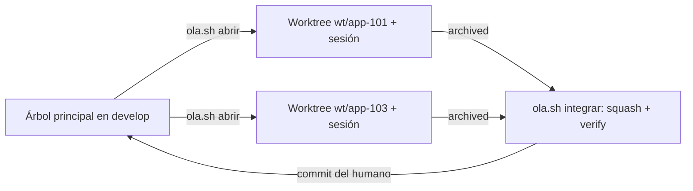

Al terminar esta lección sabrás llevar varias features del harness a la vez sin mezclar sus diffs ni romper la rama de integración. Vas a usar la variante con olas del harness: un script que abre un *worktree* por feature, comprueba sus dependencias, integra con *squash* y regresión, y nunca hace un commit por ti.

## La idea

El harness base lleva una feature cada vez: es lo más simple y basta en la mayoría de repositorios. Con un backlog de decenas de features y dependencias conocidas, muchas podrían construirse a la vez. Una **[[glosario/ola|ola]]** es un grupo de features (cuatro como mucho, por defecto) cuyas dependencias ya están integradas y que no tocan el mismo módulo.



Cada feature va en su propio [[glosario/worktree|worktree]] de git (una carpeta y una rama temporal `wt/<id>`) con **su propia sesión de Claude Code**, que aplica el contrato del harness sin cambios a una sola feature. El árbol principal se queda en la rama de integración (`develop` por defecto) y **solo integra**.

## Las tres cosas que se rompen sin worktree

Si llevas dos features en el mismo árbol, el harness falla en tres sitios (`docs/planes/olas.md` §1):

1. **El diff del reviewer se mezcla.** Al aprobar GATE#1, el motor guarda el HEAD como `base_commit`. El reviewer y los especialistas revisan `git diff <base_commit>`: con dos features en el árbol, cada uno vería también el código del otro y lo juzgaría como propio.
2. **La regresión falla por código ajeno.** `verify.sh` de una feature fallaría por el código a medias de la otra, y el reviewer emitiría un veredicto falso.
3. **`feature.py` puede perder transiciones.** Reescribe `feature_list.json` sin bloqueo entre procesos: dos transiciones a la vez pueden perder una.

Con un worktree por feature, cada sesión ve un repositorio propio y las tres cosas funcionan como en serie. El autor lo cuenta con más detalle en [[blog/2026-10-25-tres-cosas-que-se-rompen-sin-worktrees]].

Claude Code ya crea worktrees por sí mismo (la opción `--worktree` y `isolation: worktree` en un subagente). Lo que añade `ola.sh` encima es lo que el harness necesita: comprobar dependencias antes de abrir, una sesión por feature con el prompt correcto, integración de una en una con *squash*, resolución automática de lo mecánico, `verify.sh` antes del commit y límites de cuántas abrir.

## Qué añade la variante

El núcleo (motor, contratos, agentes, validador, guard y ledger) es idéntico al de la base; el repositorio del harness tiene una comprobación de deriva que lo garantiza. La variante añade:

| Archivo | Para qué |
|---|---|
| `scripts/ola.sh` | `abrir`, `estado`, `integrar` (`--continuar`, `--abortar`), `cerrar` |
| `docs/planes/olas.md` | Reglas, conflictos, las olas del proyecto (§6) y las dependencias implícitas (§8) |
| `docs/planes/guia-olas.md` | Manual del script, con tmux, conflictos y fallos |
| `.claude/skills/olas/` y `/ola` | La sesión del árbol principal lleva la mecánica |
| `AGENTS.md` | Apartado «Paralelo» en Git y la convención `depende de:` |
| `HARNESS.md` §15 | Las reglas de las olas dentro del contrato |
| `.claude/tests/test_ola.py` | El script de punta a punta con worktrees reales (5 tests) |

Con ellos, la suite pasa de 95 a 100 tests.

## Las reglas

De `olas.md` §2, resumidas:

1. Una feature se arranca **solo con todas sus dependencias integradas**, y su worktree se crea desde la rama de integración.
2. **Una feature por worktree y por sesión**, siempre con su ID explícito.
3. **Nada se construye en el árbol principal** mientras haya worktrees abiertos.
4. Como mucho `MAX_ABIERTAS` a la vez (4), y menos si la máquina va justa. El límite real eres tú: cada feature tiene su GATE#1.
5. **Una por módulo**: dos features que tocan el mismo módulo, registro central o formato de datos del usuario no van juntas.
6. **Se integra de una en una**, en el orden de la ola, con `verify.sh` en verde antes de la siguiente.
7. Una sola suite E2E a la vez si usa puertos o recursos fijos.
8. Los cuellos de botella (features de las que dependen muchas) van con compañía ligera.
9. Una ola nunca mezcla versiones del roadmap.
10. **Ritmo continuo**: si una feature de la ola siguiente ya tiene sus dependencias integradas y su módulo libre, puede adelantarse.

## Dependencias declaradas e implícitas

Las **declaradas** van en las notas de `.claude/feature_list.json`, con un formato literal que el script lee:

```text
v1 · orden 3 · tamaño M · plan: docs/planes/02-api.md (sección APP-103) · depende de: APP-101, APP-102
```

`ola.sh` lee desde `depende de:` hasta el siguiente ` · `, así que ese separador no puede aparecer dentro de un campo. `feature-kickoff` ya lo escribe así al registrar. El script lee las notas **de la rama de integración**, no del árbol de trabajo:

```bash title="scripts/ola.sh"
deps_of() {     # dependencias de las notas («depende de: A, B» hasta el siguiente «·») + implícitas
  local id="$1"
  { git show "$RAMA:.claude/feature_list.json" | python3 -c '
import json, re, sys
fid = sys.argv[1]
for f in json.loads(sys.stdin.read()).get("features", []):
    if f.get("id") == fid:
        m = re.search(r"depende de:\s*([^·]*)", f.get("notes") or "")
        print(" ".join(re.findall(r"[A-Z][A-Z0-9]*(?:-[A-Z0-9]+)*-[0-9]+", m.group(1) if m else "")))
' "$id"; } 2>/dev/null || true
  echo "${IMPLICITAS[$id]:-}"
}
```

Las **implícitas** son código que una feature usa de otra sin declararlo. En serie no importan, porque el orden global ya las respeta; en paralelo, sí. Van en la tabla de `olas.md` §8 y en el mapa `IMPLICITAS` de la cabecera del script, que las exige igual que las declaradas. Mejor aún, pásalas a las notas de la feature.

## El ciclo con ola.sh

Todo lo del proyecto está en el bloque de configuración del principio del script; lo demás no se toca:

```bash title="scripts/ola.sh (configuración del proyecto, extracto)"
RAMA="${OLA_RAMA:-develop}"          # rama de integración (el árbol principal vive en ella)
MAX_ABIERTAS="${OLA_MAX:-4}"         # features abiertas a la vez antes de pedir confirmación
INSTALAR=""                          # p. ej. "pnpm install --frozen-lockfile --prefer-offline || pnpm install --prefer-offline"
AUTO_RAMA=(
  # "pnpm-lock.yaml" "*/pnpm-lock.yaml" "src/bindings.ts"
)
TRAS_INTEGRAR=(
  # '(^|/)(package\.json|pnpm-lock\.yaml)$ :: pnpm install --prefer-offline'
)
declare -A IMPLICITAS=(
  # [APP-109]="APP-105"
)
ARRANQUE='Arráncala con la skill sdd-feature-planning ({ID}); si ya estaba empezada, reanúdala con la skill feature-resume.'
```

`AUTO_RAMA` lista lo que se resuelve con el lado de la rama de integración porque se regenera (lockfiles, código generado); `TRAS_INTEGRAR`, los pasos tras el *squash* con el formato `'regex de archivos cambiados :: comando'`. `INSTRUCCIONES/OLAS.md` trae ejemplos para pnpm y para uv. Comprueba siempre con `bash -n scripts/ola.sh && bash scripts/ola.sh ayuda`.

**1. Abrir.** Desde el árbol principal. Antes de tocar nada comprueba que cada feature está en `proposed` y que sus dependencias están `archived` en la rama de integración. En un repositorio de prueba con APP-102 dependiente de APP-101 (rutas acortadas a `~/`):

```text
$ bash scripts/ola.sh abrir APP-102 --sin-tmux
! APP-102 depende de APP-101, que en develop está «proposed» (tiene que estar integrada)
✗ no abro nada. Corrige lo anterior (o usa --forzar si sabes lo que haces).

$ bash scripts/ola.sh abrir APP-101 APP-103 --sin-tmux
→ APP-101: nuevo worktree ~/app-wt/app-101 (rama wt/app-101 desde develop)
Preparing worktree (new branch 'wt/app-101')
→ APP-103: nuevo worktree ~/app-wt/app-103 (rama wt/app-103 desde develop)
Preparing worktree (new branch 'wt/app-103')

Abre una terminal por feature y pega:
  cd ~/app-wt/app-101 && claude $'Esta sesi\303\263n trabaja en el worktree wt/app-101 y solo lleva APP-101 …'
```

Con tmux, el script abre una ventana por feature y lanza ahí `claude` con ese prompt: autoriza el paralelo en ese worktree, limita la sesión a una feature, la arranca con `sdd-feature-planning` (o la reanuda) y le pide que no cree ramas ni haga commits y que pare al archivar. Repetir `abrir` no estropea nada: reutiliza el worktree.

**2. Trabajar.** Cada ventana es una sesión normal: explorer, designer, GATE#1, builder, reviewer. Con `mode = "auto"` solo te espera en GATE#1, que apruebas en esa ventana con `/approve`. La primera vez en cada worktree, Claude Code te pregunta si confías en la carpeta: hasta que aceptes, la sesión no arranca.

**3. Vigilar.** `bash scripts/ola.sh estado` muestra cada worktree con su fase, los commits sin integrar y los cambios sin commit (lo normal mientras el builder trabaja: no hace commits).

**4. Integrar.** De una en una, en el árbol principal, limpio y en la rama de integración. El script commitea el trabajo del worktree si se lo confirmas, hace `git merge --squash`, resuelve lo mecánico, ejecuta los pasos de `TRAS_INTEGRAR`, se niega si quedan marcas de conflicto, pasa `verify.sh` y te propone el commit con el mensaje de `## Commit sugerido` de `archive.md` (por eso el reviewer lo escribe en Conventional Commits con el ID). Lanzado desde Claude Code, con el worktree ya commiteado, se ve así (ruta acortada):

```text
$ CLAUDECODE=1 bash scripts/ola.sh integrar APP-101
→ git merge --squash wt/app-101
→ hay conflictos; resuelvo los mecánicos
→ auto: .claude/feature_list.json (unión de features por ID)
→ verify.sh (regresión completa; puede tardar)
verify.sh sin configurar: añade aquí lint y tests del proyecto (skill project-bootstrap).

✓ APP-101 integrada y en verde. Cambios preparados:
 .claude/feature_list.json        | 10 +++++++++-
 .claude/state/APP-101/archive.md | 11 +++++++++++
 src/pedidos.py                   |  1 +
 3 files changed, 21 insertions(+), 1 deletion(-)

Mensaje de .claude/state/APP-101/archive.md («Commit sugerido»):
   feat(pedidos): APP-101 modelo de pedidos
¿Hago el commit con este mensaje? → no (lanzado desde Claude Code: esto lo decide y lo hace el humano)
Haz tú el commit (mensaje ya preparado):  git commit -F '…/app/.git/ola-commit-msg' && git push
```

Mientras la feature se construía, la rama de integración había registrado otra en `feature_list.json`: el conflicto se resolvió solo, uniendo las features por ID. Si `verify.sh` falla con la feature integrada (cada una pasó su verificación por separado, pero juntas no), no lo arregles encima: `integrar --abortar` deja la rama como estaba y registras un bug con el log.

> [!aviso] Un verify vacío no demuestra nada
> En el ejemplo, `verify.sh` sigue siendo el marcador del harness y sale con 0: «integrada y en verde» no significa nada todavía. Configúralo antes de la primera ola (lección 14).

**5. Cerrar.** Solo lo que ya está integrado: `bash scripts/ola.sh cerrar APP-101` cierra la ventana, borra el worktree y la rama temporal. Con el hueco libre, `abrir APP-102` ya pasa la comprobación de dependencias.

## Conflictos esperables

Casi todos son registros donde cada feature añade una línea (`olas.md` §5; complétala con los archivos compartidos de tu proyecto):

| Dónde | Por qué choca | Cómo se resuelve |
|---|---|---|
| `.claude/feature_list.json` | Seguimientos añadidos y cambios de `status` | Automático: unión por ID |
| Lockfiles (`pnpm-lock.yaml`, `uv.lock`, `Cargo.lock`…) | Dependencias nuevas en dos features | Nunca a mano: lado de la rama de integración y reinstalar (`AUTO_RAMA` + `TRAS_INTEGRAR`) |
| Manifiestos (`package.json`, `pyproject.toml`…) | Dependencias nuevas en dos features | Conservar las dos líneas |
| Código generado | Se regenera en cada feature | Nunca a mano: `AUTO_RAMA` + su generador |
| Registros (rutas, comandos, errores, textos) | Cada feature registra lo suyo | Conservar las dos entradas |
| Migraciones | Dos features añaden «la siguiente» | Primero la de la rama de integración, después la nueva con el número siguiente |
| Documentación de formatos | Dos features documentan el mismo formato | Unir los dos apartados |

Si un conflicto obliga a **elegir comportamiento** (dos features cambian la misma lógica de forma incompatible), no lo resuelve nadie más que tú: `--abortar` y un bug. Más casos en [[recetas/integrar-features-en-paralelo]].

## Lo que el guard prohíbe

Los commits, el push y los descartes son del humano también en paralelo. Tres barreras:

- **El script** detecta que lo lanza Claude Code (variable `CLAUDECODE`) y responde «no» a toda confirmación; en lugar de preguntar, imprime el comando exacto para que lo lances tú con `!` delante en la misma sesión. `--si` (sí a todo) se rechaza desde Claude Code.
- **El guard**, en la sesión principal, deniega `ola.sh` con `--si` o tocando `CLAUDECODE` (`CLAUDECODE= bash …`, `env -u CLAUDECODE …`).
- **El guard**, a cualquier subagente, le deniega ejecutar `ola.sh`: las olas las coordina la sesión del árbol principal.

```text
$ echo '{"tool_name":"Bash","tool_input":{"command":"bash scripts/ola.sh integrar APP-102 --si"}}' | python3 .claude/tools/guard.py
{"hookSpecificOutput": {"hookEventName": "PreToolUse", "permissionDecision": "deny", "permissionDecisionReason": "ola.sh con --si o tocando CLAUDECODE: los commits, el push y los descartes los confirma el humano. Dale el comando para que lo lance el con ! delante."}}
```

La regla vive en el `guard.py` del núcleo, idéntico en los dos perfiles; sin el script no tiene efecto. La skill `olas` añade lo que no se puede hacer cumplir con código: no usar `--forzar` salvo petición explícita, no integrar dos a la vez, no tocar los archivos de un worktree.

## Entre versiones y cuándo no paralelizar

La feature **x98** de cada versión (pruebas E2E, accesibilidad y rendimiento de la versión entera) va sola y con todo integrado. La **x99** (release) también. Mientras dura una release puedes construir la primera ola de la versión siguiente en worktrees, pero **no integres nada** hasta publicar: la release arrastraría código de la siguiente. Al publicar, fusiona la rama de release en la de integración y sigue.

No paralelices:

- cuando el GATE#1 de un cuello de botella pide pensar: esa feature, sola;
- cuando `verify.sh` falla al integrar: arregla la rama de integración antes de la siguiente, o los fallos se acumulan y ya no sabrás de quién son;
- cuando la máquina no da abasto: si un comando de aceptación supera su `timeout` por la carga, el reviewer devuelve `BLOCKED_TOOLING`; baja a dos sesiones y usa `retry_verification` (con 16 GB de RAM, el autor recomienda dos o tres builds a la vez como mucho);
- cuando dos features tocan el mismo formato de datos del usuario.

Ten en cuenta el coste: más atención humana (varios GATE#1 abiertos), más disco (cada worktree lleva sus dependencias; en WSL, en el disco de Linux) y más gasto simultáneo. Las ideas generales están en [[disciplinas/trabajo-en-paralelo-con-agentes]].

## Errores frecuentes

- **Construir en el árbol principal** con worktrees abiertos. Rompe las tres cosas de arriba.
- **Integrar dos a la vez** o empezar la siguiente sin el commit de la anterior.
- **Resolver lockfiles a mano.** Regenéralos.
- **Olvidar una dependencia implícita.** El script no la ve si no está en las notas ni en `IMPLICITAS`.
- **Dar a Claude Code el `--si`** para ir más rápido. El guard lo bloquea, y con razón.

## Ejercicio

> [!ejercicio] Una ola completa en un repositorio de prueba
> Copia `harness-base-olas/HARNESS/` en una carpeta nueva, crea la rama `develop` con un primer commit y registra tres features: APP-101, APP-102 (`depende de: APP-101`) y APP-103. Abre la ola posible con `--sin-tmux` y `--dir`, simula que la sesión de APP-101 la archiva (estado `archived` en su `feature_list.json`, un `archive.md` con `## Commit sugerido` y un archivo de código), intégrala, haz tú el commit, ciérrala y abre APP-102.
> Está bien si: el primer `abrir APP-102` se niega por la dependencia; la integración deja un commit cuyo mensaje es el de `archive.md`; `cerrar` borra el worktree y la rama `wt/app-101`; y el segundo `abrir APP-102` funciona.

> [!ejercicio]- Pistas
> `finish_feature` en `.claude/tests/test_ola.py` muestra exactamente qué deja una sesión al archivar. Si integras desde una terminal sin interacción, el script tomará cada pregunta como «no» y te dará los comandos: es el mismo comportamiento que desde Claude Code.

## Resumen

- Una ola son varias features sin dependencias pendientes, cada una en su worktree y con su sesión; el árbol principal solo integra.
- Sin worktree se rompen el diff del reviewer, la regresión y las escrituras de `feature_list.json`.
- `ola.sh` comprueba dependencias declaradas (`depende de:`) e implícitas (`IMPLICITAS`), integra con *squash* y `verify.sh`, y propone el commit de `archive.md`.
- Los conflictos mecánicos se resuelven solos; los registros conservan los dos lados; lockfiles y generados, nunca a mano.
- Ni el script ni Claude Code confirman commits: `--si` y los subagentes con `ola.sh` están prohibidos por el guard.

## Para seguir

- [[cursos/harness-engineering/14-especializa-el-harness]]
- [[sistemas/harness-sdd-olas]]
- [[recetas/features-en-paralelo-con-worktrees]]
- [[patrones/05-paralelizacion]]
