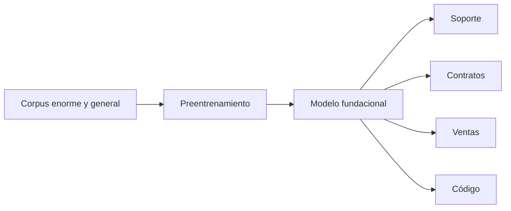

Al terminar esta lección podrás mirar un proceso de tu empresa y separar lo que cualquier modelo general ya sabe hacer de lo que solo tu organización sabe. Esa separación decide casi todo lo que viene después: qué datos hay que conectar, qué hay que construir y dónde está la ventaja.

## La idea

Durante años, usar IA en una empresa significaba entrenar un modelo para cada problema. Es el [[glosario/aprendizaje-automatico|aprendizaje automático]] clásico: reúnes datos etiquetados, entrenas, validas y despliegas un modelo que hace una sola cosa. Detectar fraude, predecir demanda, clasificar clientes y filtrar spam eran cuatro modelos y cuatro proyectos, cada uno con su preparación de datos, su etiquetado y su mantenimiento.

Un [[glosario/modelo-fundacional|modelo fundacional]] invierte el orden. Un proveedor o un laboratorio hace una vez un entrenamiento enorme y general, y el resultado sirve de base para muchas tareas distintas: resumir, clasificar, extraer datos, responder preguntas, traducir o escribir código. Tú no entrenas desde cero. Adaptas y usas.



Los LLM actuales son el ejemplo típico. Cómo se hace ese entrenamiento lo tienes en [[roadmap/00-fundamentos/06-como-se-entrena-un-llm]]; aquí importa la consecuencia de negocio.

## Qué cambia para una empresa

| Aspecto | Aprendizaje automático clásico | Modelo fundacional |
|---|---|---|
| Punto de partida | Tus datos etiquetados | Un modelo ya entrenado, por API o con [[glosario/pesos-abiertos\|pesos abiertos]] |
| Primer resultado | Tarda: hay que reunir y etiquetar datos antes de ver nada | Rápido: un prototipo con un buen prompt se prueba enseguida |
| Tarea nueva | Otro modelo | Otras instrucciones, otro contexto, otras herramientas |
| Dónde está el trabajo | Datos y entrenamiento | Integración con datos, procesos y control de calidad |
| Cómo falla | Predicción errónea con una métrica conocida | Respuesta plausible y falsa si le falta información ([[glosario/alucinacion\|alucinación]]) |

El modelo clásico no ha muerto. Para predecir demanda con datos tabulares, un modelo estadístico sigue siendo más barato, más rápido y más fácil de auditar. El LLM aporta donde hay lenguaje: textos, conversaciones, documentos y conocimiento repartido. Si quieres el mapa completo, está en [[cursos/la-ia-por-dentro/01-ia-machine-learning-y-deep-learning]].

## Lo que un modelo general no sabe

Un modelo general sabe qué es una factura, un contrato, HTTP o un CRM. No sabe cómo apruebas tú una factura.

| Lo sabe | No lo sabe |
|---|---|
| Qué es una devolución | Vuestro plazo de devolución y sus excepciones |
| Qué es un acuerdo de nivel de servicio | Qué nivel tiene el cliente X y qué pasa si se incumple |
| Cómo se escala una incidencia, en general | Quién está de guardia y qué pasos exige vuestro procedimiento |
| Qué es un descuento por volumen | Vuestra política de descuentos y quién los autoriza |
| Python y las arquitecturas habituales | Cómo funciona vuestro módulo de facturación y por qué se hizo así |
| El vocabulario del sector | Vuestras siglas, nombres de producto y códigos de proyecto |

Lo que falta cae en cuatro tipos, y cada tipo llega al modelo por un camino distinto:

| Tipo | Ejemplo | Cómo llega al modelo |
|---|---|---|
| **Procedimientos** | Pasos para abrir una incidencia crítica | Recuperación sobre la wiki y los manuales ([[glosario/rag\|RAG]]) |
| **Documentación privada** | El contrato marco con un cliente | RAG con control de permisos |
| **Reglas de negocio** | Plazos, umbrales, quién aprueba qué | Código que las aplica; el prompt las explica |
| **Datos vivos** | El estado de un pedido, el stock de hoy | Una herramienta que consulta tu sistema ([[glosario/tool-use\|tool use]]) |

Los procedimientos y la documentación cambian poco y se pueden buscar. Las reglas de negocio tienen que cumplirse siempre, así que no se dejan a la interpretación del modelo. Los datos vivos cambian cada minuto: ningún entrenamiento los captura y ningún documento los contiene. Verás cada camino en la [[cursos/ia-en-la-empresa/02-la-piramide-de-personalizacion|lección 2]].

> [!aviso] Lo peligroso: contesta igual aunque no lo sepa
> Si preguntas a un modelo sin contexto «¿cuál es nuestro plazo de devolución?», te dará un plazo verosímil, quizá el habitual en tu sector, sin ninguna relación con el vuestro. Escribir «actúa como experto en nuestra empresa» tampoco ayuda: cambia el tono, no el conocimiento. Una instrucción no sustituye a una fuente de datos.

Ni siquiera lo que el modelo «sabe» del mundo está al día. Su conocimiento termina donde terminan sus datos de entrenamiento; lo que pasó después, incluido el cambio de nombre de tu producto el mes pasado, no existe para él salvo que se lo des.

## Dónde está el valor

Imagina dos empresas que contratan exactamente el mismo modelo.

```text title="Dos empresas, el mismo modelo"
Empresa A: modelo + prompt genérico
Empresa B: modelo + documentación interna + procedimientos + histórico de incidencias
           + datos de clientes + herramientas internas + un proceso que sabe dónde encaja
```

La empresa B construye algo mucho más útil, y la diferencia no está en el modelo. El modelo se compra: tus competidores pueden contratar el mismo mañana. Lo que no se compra es tu conocimiento acumulado, tus datos históricos y la integración con la forma en que trabajáis.

La pregunta útil deja de ser «¿qué modelo usamos?» y pasa a ser «¿qué conocimiento y qué procesos conectamos con él?». Elegir modelo importa ([[modelos/05-elegir-modelo-por-tarea]]), pero es una decisión reversible: con una buena arquitectura, cambias de modelo cambiando un identificador. El conocimiento ordenado y los procesos bien integrados son el activo que se queda.

Hay una trampa: ese conocimiento casi nunca está listo para usarse. Está repartido, duplicado, desactualizado o solo en la cabeza de alguien. Si la wiki tiene tres versiones del procedimiento de devoluciones, un RAG encontrará las tres. Antes de conectar nada, alguien tiene que ser responsable de cada fuente. Lo verás en detalle en [[cursos/rag-a-fondo/06-el-corpus-manda]].

## Lo que pone cada parte, por área

| Área | Lo que aporta el modelo | Lo que aporta tu empresa |
|---|---|---|
| Soporte | Entender la queja, resumir el historial, redactar | Manuales, incidencias resueltas, estado del pedido, política |
| Recursos humanos | Explicar con claridad, adaptar el tono | Convenio, política de vacaciones, procedimiento de solicitudes |
| Ventas | Redactar propuestas, resumir reuniones | Catálogo y precios vigentes, histórico del cliente, condiciones aprobadas |
| Ingeniería | Leer y escribir código, explicar | Repositorio, decisiones de arquitectura, guías de operación |
| Legal | Resumir y comparar textos | Contratos propios, cláusulas aprobadas, criterio interno |

## Errores frecuentes

- Evaluar el modelo con preguntas sobre la empresa sin darle los documentos y concluir que «la IA no sirve».
- Suponer que el asistente corporativo ya conoce la intranet porque lo ha contratado la empresa.
- Empezar por la elección de modelo en vez de por el inventario de conocimiento.
- Conectar documentación desactualizada y culpar al modelo de las respuestas incorrectas.

## Ejercicio

> [!ejercicio] Inventario de conocimiento de un proceso
> Elige un proceso que conozcas bien: gestionar una devolución, dar de alta a un empleado o preparar una oferta. Escribe dos listas. En la primera, lo que un modelo general ya sabe hacer en ese proceso. En la segunda, lo que necesita de tu empresa. Para cada elemento de la segunda lista indica su tipo (procedimiento, documentación privada, regla de negocio o dato vivo), dónde vive hoy y quién es su responsable.
>
> Está bien si la segunda lista tiene al menos seis elementos con tipo, ubicación y responsable, si al menos uno es un dato vivo que ningún documento contiene y si al menos una regla de negocio queda marcada para aplicarse con código.

> [!ejercicio]- Pistas
> Piensa en lo que necesitaría una persona recién incorporada el primer día: qué abre, a quién pregunta, qué no puede hacer sin permiso. Cada «a quién pregunta» es conocimiento que solo está en una cabeza y que tendrás que escribir antes de conectarlo.

## Resumen

- Un modelo fundacional se entrena una vez y se adapta a muchas tareas; ya no entrenas un modelo por problema.
- El modelo sabe del mundo en general, no de tu empresa: procedimientos, documentación, reglas y datos vivos quedan fuera.
- Cada tipo de conocimiento llega por un camino: recuperación, código o herramientas.
- El modelo se compra; el conocimiento propio y la integración con tus procesos son la ventaja.
- Ese conocimiento necesita un responsable y estar al día antes de conectarlo.

## Para seguir

- [[cursos/ia-en-la-empresa/02-la-piramide-de-personalizacion]]: los niveles para aportar ese conocimiento.
- [[glosario/modelo-fundacional]] y [[glosario/alucinacion]].
- [[roadmap/00-fundamentos/01-que-es-un-llm]]: por qué el modelo genera en vez de consultar.
