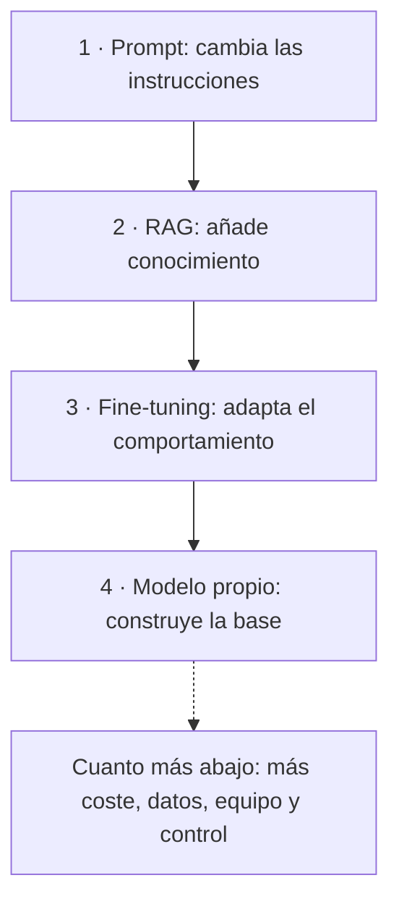
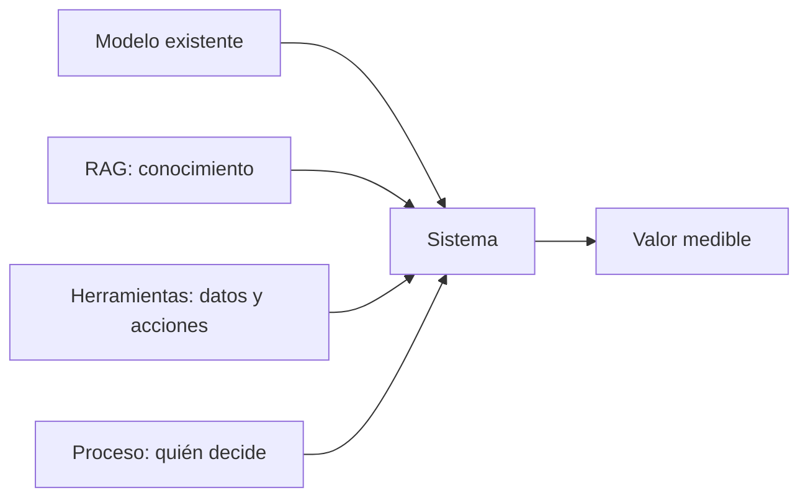

Al terminar esta lección sabrás qué opciones hay para que un modelo general trabaje con el conocimiento de tu empresa, qué exige cada una y cuál elegir primero. También tendrás un vocabulario más fino que «personalizar la IA»: cinco capas que puedes combinar según el problema.

## La idea

Hay cuatro formas de adaptar un modelo a tu organización, y se suelen dibujar como una pirámide. Arriba está lo más ligero: escribir mejores instrucciones. Abajo, lo más pesado: entrenar tu propio modelo desde cero.



Cuanto más bajas, más construyes y entrenas tú: suben el coste, la infraestructura, los datos necesarios, el mantenimiento, lo que tiene que saber el equipo y también el control sobre el modelo. Lo que **no** sube de forma automática es el valor para el negocio.

## Nivel 1: prompt

Usas un modelo existente y le das buenas instrucciones y el contexto que necesita en cada petición. No entrenas nada y no tocas sus [[glosario/parametros|parámetros]].

```text title="Prompt de sistema de un asistente de soporte"
Eres el asistente del equipo de soporte de nivel 1.
Responde en español, con frases cortas y tono profesional.
Usa solo la información del pedido y de la política que te paso.
Si falta algo para responder, dilo y propone escalar el ticket.
Nunca prometas un reembolso: solo un responsable puede aprobarlo.
```

- **Qué necesitas**: acceso a un modelo por API, alguien que sepa escribir prompts ([[roadmap/10-prompting/index]]) y un conjunto pequeño de casos reales para comprobar que funciona.
- **Coste y tiempo**: bajos. Un prototipo se prueba en horas.
- **Datos propios**: pocos; los que pegues en la petición.
- **Límite**: el modelo sigue siendo el mismo modelo general. El prompt cambia **cómo** responde, no **qué sabe**. Si la información que necesita no cabe en la petición o depende de cada pregunta, has llegado al siguiente nivel.

## Nivel 2: RAG

[[glosario/rag|RAG]] (*retrieval-augmented generation*, generación aumentada por recuperación) significa buscar en tus fuentes antes de responder y meter en el contexto solo los fragmentos relevantes ([Lewis et al., 2020](https://arxiv.org/abs/2005.11401)). Ante «¿cuáles son los pasos para abrir una incidencia crítica?», el sistema encuentra el procedimiento, recupera los fragmentos que importan y el modelo responde citando la fuente.

- **Qué necesitas**: ingesta (extraer, limpiar y trocear documentos), un índice ([[glosario/embeddings|embeddings]] y búsqueda por palabras), recuperación, control de permisos, un proceso para mantener el índice al día y evals de recuperación. Todo es trabajo de ingeniería y de operación; no hace falta investigar.
- **Coste y tiempo**: bajo a medio. Hay infraestructura que mantener, pero no entrenas ningún modelo.
- **Datos propios**: sí, tu documentación, y en buen estado.
- **Límite**: si la búsqueda no encuentra el fragmento correcto, la respuesta falla, por bueno que sea el modelo. Tampoco cambia cómo se comporta el modelo. Y no sirve para preguntas que exigen recorrer todo el corpus («¿cuántos contratos vencen este año?»): eso es una consulta a datos estructurados.

**RAG añade conocimiento al contexto, no a los parámetros.** Por eso actualizas un documento sin reentrenar, citas la fuente exacta y filtras por usuario lo que cada uno puede ver. Lo tienes construido en [[sistemas/rag-con-citas]] y a fondo en [[cursos/rag-a-fondo/index]].

> [!consejo] Si tu base es pequeña, quizá no necesites RAG
> Anthropic recomienda que, si tu base de conocimiento ocupa menos de 200.000 tokens (unas 500 páginas), la incluyas entera en el prompt en vez de montar recuperación, y que uses [[glosario/prompt-caching|prompt caching]] para que salga más rápido y más barato ([Contextual Retrieval, sept. 2024](https://www.anthropic.com/news/contextual-retrieval)). Mide antes de construir.

## Nivel 3: fine-tuning

El [[glosario/fine-tuning|fine-tuning]] es entrenar un poco más un modelo existente con tus ejemplos (entrada y salida esperada). A diferencia de RAG, cambia los parámetros del modelo.

- **Qué necesitas**: un conjunto de ejemplos revisados que representen los casos reales (la calidad pesa más que la cantidad), cómputo o el servicio de ajuste del proveedor, evals para comprobar que mejora sin romper otras capacidades, y versionado y despliegue del modelo resultante. Cuando el proveedor publique un modelo base nuevo, toca repetir.
- **Coste y tiempo**: medio a alto. Existen técnicas de ajuste eficiente que entrenan solo una parte pequeña del modelo y abaratan mucho el cómputo, pero preparar y revisar el conjunto de ejemplos sigue siendo trabajo caro.
- **Datos propios**: un conjunto de entrenamiento, que casi nunca existe ya hecho.
- **Para qué sirve**: estilo, formato, clasificación con vuestras categorías, terminología y patrones de respuesta muy repetidos. También para que un modelo pequeño haga a gran volumen lo que antes necesitaba un modelo grande con un prompt largo ([[glosario/destilacion|destilación]]).
- **Límite**: no es una forma fiable de meter documentos; el conocimiento que cambia, que hay que citar o que depende de permisos va mejor con RAG ([[modelos/10-prompting-rag-o-fine-tuning]]). Qué modelos se pueden ajustar depende del proveedor; uno de [[glosario/pesos-abiertos|pesos abiertos]] lo puedes ajustar tú.

## Nivel 4: modelo propio

Entrenar un [[glosario/modelo-fundacional|modelo fundacional]] desde cero o con un preentrenamiento a gran escala. Exige un corpus enorme, clusters de aceleradores, un equipo de investigación e ingeniería de aprendizaje automático, y evaluaciones de calidad, seguridad y sesgos antes de usarlo.

- **Coste y tiempo**: muy altos, en otra escala que el resto de niveles.
- **Cuándo tiene sentido**: cuando el modelo es tu producto, cuando trabajas con un idioma o un dominio que los modelos existentes cubren mal y no hay alternativa, o cuando un requisito estratégico o de soberanía lo exige de verdad. Incluso entonces, conviene comparar con partir de un modelo de pesos abiertos y continuar su entrenamiento.
- **Límite**: casi nunca es la primera estrategia de una empresa que quiere aportar valor con IA.

## Los cuatro niveles, comparados

| Nivel | Coste y tiempo | Qué necesitas | Qué cambia | Límite principal |
|---|---|---|---|---|
| Prompt | Bajo | Acceso a un modelo y casos de prueba | Las instrucciones | No aporta información que el modelo no tiene |
| RAG | Bajo a medio | Documentación, índice, permisos | El conocimiento disponible en cada consulta | Depende de que la recuperación acierte |
| Fine-tuning | Medio a alto | Ejemplos revisados, cómputo, evals | El comportamiento del modelo | Caro de iterar; poco fiable para meter hechos |
| Modelo propio | Muy alto | Corpus, infraestructura, equipo de investigación | La base entera | Rara vez compensa |

Un RAG bien diseñado aporta más valor que un modelo propio mal planteado. El valor depende del problema, no del nivel.

## La pirámide no es una escalera de calidad

La lectura equivocada es «cuanto más abajo, mejor IA tengo». La correcta: **cuanto más abajo, más inversión y más control**. El objetivo es usar el nivel más sencillo que resuelva bien el problema. Es el mismo consejo que da Anthropic para diseñar agentes: busca la solución más simple posible y añade complejidad solo cuando haga falta ([Building effective agents, 2024](https://www.anthropic.com/engineering/building-effective-agents)).

## La regla: empieza arriba y sube con pruebas

1. **Prompt y evals primero.** Escribe el prompt y reúne un conjunto de preguntas reales con su respuesta correcta. La guía de OpenAI [*Optimizing LLM Accuracy*](https://developers.openai.com/api/docs/guides/optimizing-llm-accuracy) propone empezar con al menos una veintena.
2. **Diagnostica cada fallo.** ¿Le falta información (problema de contexto) o tiene la información y responde con mal formato, mal tono o mal criterio (problema de comportamiento)?
3. **Falta información** → RAG, o todo en el contexto si es pequeña. **Faltan datos vivos o acciones** → herramientas.
4. **Falla el comportamiento** → más instrucciones y ejemplos. Solo si sigue fallando de forma sistemática y tienes ejemplos de calidad, valora el fine-tuning.
5. **Nada de lo anterior basta y hay una razón estratégica** → entonces, y solo entonces, discute un modelo propio.

Cada paso se justifica con el resultado de las evals, no con una intuición.

## El punto dulce: modelo existente, conocimiento y herramientas

Para la mayoría de empresas, el mejor equilibrio está en un modelo existente con buen prompt, RAG sobre la documentación propia y [[glosario/tool-use|herramientas]] conectadas a los sistemas internos. Las herramientas quedan fuera de la pirámide, en otro eje: la pirámide trata del conocimiento y del comportamiento, y las herramientas dan acceso a datos vivos (el estado de un pedido) y a acciones (crear un ticket).



La combinación es el patrón de la [[patrones/02-llamada-aumentada|llamada aumentada]]: un modelo con recuperación, herramientas y memoria.

## Capas de personalización, no porcentajes

No existe un porcentaje universal del tipo «personalizado al 30 %» que diga si una IA empresarial será buena. Es más útil hablar de capas:

| Capa | Pregunta | Mecanismo | Ejemplo en soporte |
|---|---|---|---|
| Instrucciones | ¿Cómo debe responder? | Prompt de sistema, ejemplos | Tono, formato, qué no prometer |
| Conocimiento | ¿Qué debe saber? | RAG o contexto | Manuales, política de devoluciones |
| Comportamiento | ¿Cómo hace la tarea, siempre igual? | Ejemplos; fine-tuning si no basta | Clasificar con vuestras categorías |
| Herramientas | ¿Qué puede consultar o hacer? | Tool use, [[glosario/mcp\|MCP]] | Consultar un pedido, abrir un ticket |
| Proceso | ¿En qué paso entra y quién decide? | [[glosario/workflow\|Workflow]], [[glosario/humano-en-el-bucle\|humano en el bucle]] | Propone el reembolso; una persona lo aprueba |

Cada caso de uso es una combinación de capas. Un asistente de políticas internas vive casi entero en instrucciones y conocimiento. Un copiloto de soporte usa las cinco.

## Errores frecuentes

- Saltar al fine-tuning sin un conjunto de evals que demuestre qué falla.
- Montar RAG para un corpus que cabría entero en el contexto.
- Medir solo la respuesta y no la recuperación: si el fragmento correcto no llega, ningún prompt lo arregla.

## Ejercicio

> [!ejercicio] Elige el nivel y las capas
> Para cada caso, indica el nivel de la pirámide que probarías primero, las capas que necesitas y qué resultado de las evals te haría subir de nivel.
>
> 1. Un bufete quiere que su equipo encuentre cláusulas en sus propios contratos.
> 2. Una tienda en línea quiere clasificar reseñas en sus doce categorías internas, con un formato fijo y mucho volumen al mes.
> 3. Una aseguradora quiere contestar a los clientes sobre el estado de su siniestro.
> 4. Un equipo de marketing quiere textos con el tono de la marca.
>
> Está bien si el caso 1 queda en RAG con permisos, el 3 se resuelve con herramientas que consultan el expediente, el 4 empieza con una guía de estilo y ejemplos en el prompt, y el 2 solo llega al fine-tuning si las evals con ejemplos muestran fallos sistemáticos o si el coste a ese volumen lo justifica.

> [!ejercicio]- Pistas
> Pregúntate en cada caso si el modelo falla porque no sabe algo (contexto) o porque no lo hace como quieres (comportamiento). Y si la respuesta cambia de un día para otro, la información tiene que llegar en cada consulta, no en el entrenamiento.

## Resumen

- Prompt cambia las instrucciones, RAG añade conocimiento, el fine-tuning adapta el comportamiento y un modelo propio construye la base.
- Más abajo en la pirámide significa más coste y control, no más valor.
- Empieza por prompt y evals, diagnostica cada fallo como de contexto o de comportamiento y sube solo con pruebas.
- El punto dulce habitual es un modelo existente con RAG y herramientas.
- Piensa en capas (instrucciones, conocimiento, comportamiento, herramientas y proceso), no en porcentajes.

## Para seguir

- [[cursos/ia-en-la-empresa/03-donde-esta-el-valor]]: dónde aplicar todo esto.
- [[modelos/10-prompting-rag-o-fine-tuning]]: la decisión técnica en una página.
- [[roadmap/30-contexto-y-rag/index]] y [[roadmap/20-herramientas/index]] para construirlo.
