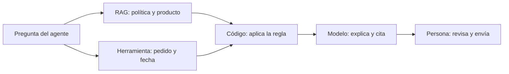

Esta lección junta todo el curso en un caso. Recorrerás una empresa de soporte nivel a nivel, verás el flujo completo que resuelve una pregunta real con código que funciona y terminarás con la ficha de tu propio caso de uso, lista para proponer un piloto.

## La idea

Imagina una empresa que da soporte técnico a sus clientes. Tiene unos 300 manuales técnicos, unas 20.000 incidencias históricas, procedimientos internos, documentación de producto, preguntas frecuentes y una política de soporte. Su equipo de nivel 1 pasa buena parte del día buscando en todo eso para contestar preguntas parecidas. Tiene acceso a un buen modelo de lenguaje. ¿Qué construye?

## Nivel a nivel

### Nivel 1: prompt

«Actúa como técnico de soporte.» El modelo contesta bien preguntas generales, con buen tono, pero no conoce los procedimientos de la casa ni el estado de ningún pedido. El riesgo es concreto: inventará un procedimiento verosímil. **Veredicto**: insuficiente por sí solo, aunque se queda como capa de instrucciones (tono, formato, qué no prometer) y sirve ya para tareas que no necesitan conocimiento propio, como resumir el historial de un ticket o clasificarlo.

### Nivel 2: RAG

Se añaden al índice los manuales, las preguntas frecuentes, los procedimientos, la documentación de producto y las incidencias resueltas. Ahora el sistema responde con el conocimiento interno y cita de dónde lo saca. Hay trabajo de datos: las incidencias históricas hay que anonimizarlas y quedarse solo con las que tienen una solución validada, y hay que separar la documentación interna de la que se puede compartir con el cliente. **Veredicto**: aquí está la mayor parte del valor. El diseño de referencia es [[sistemas/rag-con-citas]].

### Nivel 3: fine-tuning

Con las incidencias resueltas se podría entrenar el modelo con pares «incidencia → respuesta correcta» para que aprenda el estilo y ciertos patrones del equipo. Mejoraría la consistencia del tono y del formato. Pero un buen prompt con cinco ejemplos bien elegidos consigue gran parte de eso, preparar el conjunto de entrenamiento cuesta semanas de revisión y habría que repetirlo con cada modelo nuevo. **Veredicto**: fuera del piloto. Se reconsidera si las evals muestran fallos de formato o tono persistentes a mucho volumen.

### Nivel 4: modelo propio

Una inversión enorme sin ninguna razón estratégica que la justifique: la empresa vende soporte, no modelos. **Veredicto**: descartado.

## Más allá de la pirámide: herramientas y proceso

El valor grande aparece al juntar el conocimiento con los sistemas internos. Un agente del equipo escribe:

> Un cliente quiere devolver el producto X. ¿Puede hacerlo? ¿Qué procedimiento seguimos? Comprueba si sigue dentro del plazo.

Responder bien exige siete pasos, y cada uno lo hace la pieza adecuada:



1. Buscar la política de devoluciones (RAG).
2. Consultar la documentación del producto, por si tiene excepciones (RAG).
3. Consultar los datos del cliente y del pedido (herramienta).
4. Comprobar la fecha de entrega (herramienta).
5. Aplicar las reglas: plazo y excepciones (código).
6. Explicar el resultado citando la política (modelo).
7. Indicar los siguientes pasos; si hay una acción con dinero de por medio, proponerla para que una persona la apruebe (proceso).

Lo que construyes aquí queda muy lejos de «chatear con la IA»: un sistema de decisión asistida conectado con el conocimiento y los procesos de la empresa.

## El flujo en código

Para un piloto, los pasos se conocen de antemano, así que basta un [[glosario/workflow|workflow]]: un camino fijo escrito en código que llama al modelo solo para redactar. Es más barato, más predecible y más fácil de evaluar que un [[glosario/agente|agente]] que decide sus propios pasos ([[patrones/01-workflows-vs-agentes]]). Los datos están en memoria para que puedas ejecutarlo; en el sistema real, `buscar_politica` consulta el índice del RAG y `obtener_pedido`, la API de pedidos.

```python title="devolucion.py"
import json
from datetime import date
import anthropic

MODEL = "claude-sonnet-5-5"
client = anthropic.Anthropic()

# Datos de juguete. En el sistema real: el índice del RAG y la API de pedidos.
POLITICA = [
    {"id": "devoluciones#plazo", "texto": "El cliente puede devolver un producto en los 30 días siguientes a la entrega."},
    {"id": "devoluciones#excepciones", "texto": "No se admiten devoluciones de productos personalizados ni de software activado."},
    {"id": "devoluciones#pasos", "texto": "Para devolver: generar etiqueta en el panel, enviar en 7 días y reembolsar al recibir."},
]
PEDIDOS = {"P-1001": {"cliente_id": "C-7", "producto": "Router wifi (ref. 4471)", "personalizado": False,
                      "entregado": date(2026, 10, 10)}}
PLAZO_DIAS = 30   # la misma regla que el texto de la política, como dato para el código

def buscar_politica(pregunta: str, k: int = 3) -> list[dict]:
    """Nivel RAG: recupera fragmentos. Aquí, solapamiento de palabras; en producción, búsqueda híbrida."""
    palabras = set(pregunta.lower().split())
    puntos = lambda f: len(palabras & set(f["texto"].lower().split()))
    return sorted(POLITICA, key=puntos, reverse=True)[:k]

def obtener_pedido(pedido_id: str, cliente_id: str) -> dict:
    """Herramienta: dato vivo del sistema de pedidos, filtrado por el cliente de la sesión."""
    pedido = PEDIDOS.get(pedido_id)
    if pedido is None or pedido["cliente_id"] != cliente_id:
        raise LookupError("Pedido no encontrado para este cliente.")
    return pedido

def evaluar_devolucion(pedido: dict, hoy: date) -> dict:
    """Regla de negocio en código: el modelo la explica, no la decide."""
    dias = (hoy - pedido["entregado"]).days
    if pedido["personalizado"]:
        return {"admitida": False, "motivo": "producto personalizado", "fuente": "devoluciones#excepciones"}
    if dias > PLAZO_DIAS:
        return {"admitida": False, "motivo": f"fuera de plazo ({dias} días)", "fuente": "devoluciones#plazo"}
    return {"admitida": True, "motivo": f"dentro de plazo ({dias} de {PLAZO_DIAS} días)", "fuente": "devoluciones#plazo"}

SYSTEM = ("Eres el asistente interno del equipo de soporte. Redacta para el agente humano una respuesta "
          "breve: si procede la devolución, por qué y los siguientes pasos. Usa solo los fragmentos y la "
          "decisión que recibes; cita los ids entre corchetes. No cambies la decisión ni prometas reembolsos.")

def preparar_respuesta(pregunta: str, pedido_id: str, cliente_id: str, hoy: date) -> dict:
    fragmentos = buscar_politica(pregunta)
    pedido = obtener_pedido(pedido_id, cliente_id)
    decision = evaluar_devolucion(pedido, hoy)
    contexto = "\n".join(f'<fragmento id="{f["id"]}">{f["texto"]}</fragmento>' for f in fragmentos)
    resp = client.messages.create(
        model=MODEL, max_tokens=2000, system=SYSTEM,
        output_config={"effort": "low"},   # borrador corto: poco razonamiento
        messages=[{"role": "user", "content":
                   f"{contexto}\n<pedido>{pedido['producto']}, entregado el {pedido['entregado']}</pedido>\n"
                   f"<decision>{json.dumps(decision, ensure_ascii=False)}</decision>\n\nPregunta del agente: {pregunta}"}],
    )
    if resp.stop_reason in ("max_tokens", "refusal"):
        return {"decision": decision, "borrador": None, "aviso": f"Revisión manual ({resp.stop_reason})"}
    borrador = "".join(b.text for b in resp.content if b.type == "text")
    return {"decision": decision, "borrador": borrador}

if __name__ == "__main__":
    print(preparar_respuesta("El cliente quiere devolver el router. ¿Está en plazo? ¿Qué pasos sigue?",
                             "P-1001", "C-7", hoy=date(2026, 10, 29)))
```

Las decisiones de diseño importan más que las líneas:

- **La regla vive en código.** El plazo lo calcula `evaluar_devolucion`, no el modelo. El modelo recibe la decisión ya tomada y la explica citando la fuente. Si la política cambia, cambia en un sitio, y las evals lo detectan.
- **El cliente sale de la sesión.** `cliente_id` lo pone tu aplicación; el modelo nunca lo elige. Así nadie consulta pedidos ajenos escribiendo «soy el cliente C-9».
- **El resultado es un borrador.** Lo lee y lo envía una persona. Si el modelo se corta o rechaza la petición, el sistema lo marca para revisión manual en vez de enviar algo a medias.

Cuando los tickets sean tan variados que no puedas escribir el camino de antemano, el siguiente paso es un agente que elige sus herramientas y propone acciones con efectos para que una persona las apruebe. Ese diseño completo, con capa de políticas, cola de aprobación y un ejecutor con clave de idempotencia, está en [[sistemas/soporte-con-aprobacion-humana]].

## El proyecto: la ficha de tu caso de uso

Ahora te toca a ti. Usa el caso que priorizaste en la [[cursos/ia-en-la-empresa/03-donde-esta-el-valor|lección 3]] y la ficha de métricas de la [[cursos/ia-en-la-empresa/04-medir-el-valor|lección 4]].

```markdown title="ficha-caso-de-uso.md"
## Caso de uso: <nombre corto>

**Problema.** Qué tarea es lenta, cara o propensa a errores hoy, y con qué volumen.
**Usuarios.** Quién lo usará y quién es el responsable del resultado.
**Nivel de personalización.** Nivel de la pirámide y capas que usa; por qué no basta uno más sencillo.
**Datos.** Fuentes de conocimiento, dónde viven, quién las mantiene y con qué permisos.
**Herramientas.** Sistemas que consulta (solo lectura) y acciones que propone (con aprobación).
**Reglas en código.** Qué decisiones aplica el código y nunca el modelo.
**Métrica.** Principal, guardarraíles y línea base (enlaza la ficha de métricas).
**Riesgos.** Qué pasa si se equivoca, cómo se detecta y quién lo corrige; datos personales;
regulación aplicable.
**Piloto.** Semanas, usuarios, grupo de control y modo (copiloto, en sombra o con aprobación).
**Criterio de salida.** Seguir si…, ajustar si…, parar si… (decidido antes de empezar).
```

### Un piloto de 4 a 6 semanas

| Semana | Qué haces | Qué sale |
|---|---|---|
| 0 | Línea base, conjunto de evaluación con casos reales, criterios de salida firmados | La ficha de métricas cerrada |
| 1–2 | Versión mínima: prompt, RAG sobre las fuentes principales, herramientas de solo lectura; evals e iteración | Un sistema que pasa las evals mínimas |
| 3–4 | Uso real por un grupo pequeño en modo copiloto; registro de cada borrador, edición y resultado | Datos de negocio y de uso |
| 5–6 | Comparación con la línea base, lectura de los casos que empeoran, revisión de riesgos | La decisión: seguir, ajustar o parar |

Si el caso es sencillo y las fuentes están limpias, cuatro semanas bastan. Si la ingesta de datos es complicada, usa seis y no recortes la semana 0: sin línea base, todo lo demás es opinión.

### El criterio de salida

Decídelo antes de empezar y escríbelo en la ficha:

- **Seguir**: la métrica principal alcanza el objetivo y ningún guardarraíl se rompe.
- **Ajustar**: hay mejora pero no llega, o un guardarraíl se tensa, y sabes por qué (un tipo de ticket, una fuente desactualizada). Fija una segunda iteración corta con la misma medición.
- **Parar**: no hay mejora medible o aparece un riesgo que no puedes controlar. Parar a tiempo también es un buen resultado: has gastado semanas, no un año.

## Errores frecuentes

- Empezar por el agente autónomo cuando un workflow resuelve el caso.
- Dejar que el modelo aplique reglas de negocio que el código puede calcular.
- Hacer el piloto con los casos más fáciles y extrapolar a todos.
- Decidir el criterio de salida después de ver los resultados.

## Ejercicio

> [!ejercicio] Proyecto: la ficha de tu caso de uso
> Rellena la ficha completa para tu caso, con su ficha de métricas adjunta, y dibuja en un diagrama de cinco a siete cajas qué pieza hace cada paso (RAG, herramienta, código, modelo, persona), como en el caso de las devoluciones. Si programas, adapta `devolucion.py` a tu caso con datos de juguete: una búsqueda, una herramienta y una regla en código.
>
> Está bien si la ficha cabe en dos páginas, si el nivel de personalización está justificado frente al nivel más sencillo, si al menos una regla de negocio se aplica en código, si toda acción con efectos pasa por una persona y si el criterio de salida tiene condiciones para seguir, ajustar y parar escritas antes del piloto.

> [!ejercicio]- Pistas
> Si te cuesta decidir el modo del piloto, empieza por «en sombra»: el sistema genera su borrador, la persona trabaja como siempre y comparas ambos. No afecta a ningún cliente y te da datos desde el primer día.

## Resumen

- En el caso de soporte, el valor está en el RAG más las herramientas; el fine-tuning espera y el modelo propio se descarta.
- Cada paso lo hace la pieza adecuada: RAG para conocer, herramientas para consultar, código para decidir, modelo para explicar, persona para aprobar.
- Si conoces los pasos, empieza con un workflow; pasa a un agente cuando la variedad lo exija.
- Un piloto de 4 a 6 semanas empieza por la línea base y termina con una decisión fijada de antemano.

## Para seguir

- [[sistemas/soporte-con-aprobacion-humana]]: el sistema completo con agente y aprobación.
- [[sistemas/rag-con-citas]]: la capa de conocimiento con citas verificables.
- [[recetas/aprobacion-humana-antes-de-actuar]] y [[roadmap/100-produccion/05-humano-en-el-bucle]].
