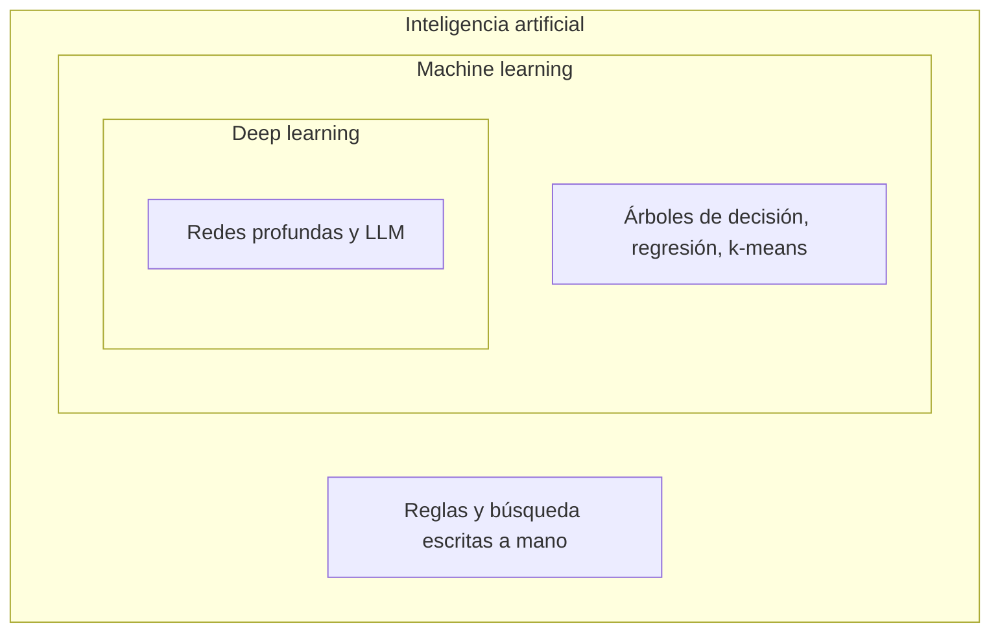

Al terminar esta lección sabrás ordenar los términos que se mezclan en cualquier conversación sobre IA y verás, con una docena de líneas de numpy, qué significa que una máquina «aprenda» una regla en lugar de que alguien se la escriba. Es el marco en el que encaja todo lo demás del curso.

## La idea

Los tres términos son conjuntos, uno dentro de otro.

- **Inteligencia artificial** es el paraguas: cualquier sistema que hace algo que llamaríamos inteligente, como jugar al ajedrez, reconocer voz o planificar una ruta. No importa cómo esté hecho por dentro. Un programa de ajedrez con reglas escritas a mano y búsqueda en un árbol de jugadas es IA, aunque no aprenda nada.
- **[[glosario/aprendizaje-automatico|Machine learning]]** (aprendizaje automático) es la parte de la IA en la que el sistema saca su comportamiento de los datos. Nadie escribe la regla: se le dan ejemplos y un algoritmo la ajusta a partir de ellos. Un filtro de spam que aprende de los correos que marcas es machine learning.
- **[[glosario/aprendizaje-profundo|Deep learning]]** (aprendizaje profundo) es el machine learning hecho con [[glosario/red-neuronal|redes neuronales]] de muchas capas. Los reconocedores de imágenes actuales y los [[glosario/llm|LLM]] están aquí.



Hoy, cuando alguien dice «IA» en una reunión, casi siempre se refiere a un LLM. Conviene saber que el término es mucho más amplio y que buena parte de los sistemas que funcionan en producción mezclan reglas escritas a mano con modelos aprendidos.

## Programar una regla o aprenderla

En la programación de toda la vida, una persona entiende el problema y escribe la regla. Funciona de maravilla cuando la regla se conoce y es exacta: convertir grados Celsius a Fahrenheit, calcular el IVA, validar un IBAN.

Hay problemas donde nadie sabe escribir la regla. ¿Qué combinación exacta de palabras, remitentes y enlaces hace que un correo sea spam? Puedes empezar con «si contiene *gratis*, es spam», pero enseguida aparecen excepciones: el boletín al que te suscribiste, el amigo que te dice que la entrada es gratis. Cada excepción es una regla nueva, y la lista no acaba nunca. El machine learning invierte el trabajo: tú aportas ejemplos con la respuesta correcta y un algoritmo busca la regla que mejor los explica.

El script siguiente hace las dos cosas con un caso en el que sí conocemos la regla, para poder comprobar si la máquina la encuentra. Simulamos 50 lecturas de un termómetro con ruido y dejamos que numpy ajuste una recta.

```python title="reglas_o_datos.py"
import numpy as np

# Programación clásica: una persona escribe la regla.
def a_fahrenheit(celsius):
    return celsius * 1.8 + 32

# Machine learning: das ejemplos y un algoritmo encuentra la regla.
rng = np.random.default_rng(0)
celsius = rng.uniform(-10, 40, size=50)                          # 50 lecturas entre -10 y 40 °C
fahrenheit = a_fahrenheit(celsius) + rng.normal(0, 1.5, size=50)  # termómetro con ruido

# El modelo es «una recta»: F = a·C + b. Entrenar es elegir a y b.
a, b = np.polyfit(celsius, fahrenheit, deg=1)
print(f"regla aprendida: F = {a:.3f}·C + {b:.2f}")
print(f"predicción para 100 °C: {a * 100 + b:.1f} (regla exacta: {a_fahrenheit(100):.1f})")
```

```text
regla aprendida: F = 1.816·C + 31.79
predicción para 100 °C: 213.4 (regla exacta: 212.0)
```

El algoritmo no conocía el 1,8 ni el 32. Ha visto 50 pares de números imperfectos y ha encontrado una regla muy cercana. Además acierta con bastante precisión en 100 °C, un valor que no aparecía entre los ejemplos: eso es **generalizar**, y es lo que de verdad importa de un modelo.

Fíjate también en lo que sí decidimos nosotros: que la relación era una recta. Si la relación real fuera una curva, ninguna cantidad de datos haría que una recta acertara. Lo comprobarás en el ejercicio, y la [[cursos/la-ia-por-dentro/06-sobreajuste-y-generalizacion|lección 6]] trata a fondo ese equilibrio entre un modelo demasiado rígido y uno demasiado flexible.

## Qué es un modelo

Con el ejemplo delante, las palabras clave quedan así:

- **Modelo**: una función con huecos ajustables. Aquí, `F = a·C + b`. Es una simplificación de la realidad, igual que un mapa de metro, que no dibuja las calles pero te lleva a donde quieres.
- **[[glosario/parametros|Parámetros]]**: los huecos, los números que se ajustan. Aquí son dos (`a` y `b`). En un LLM son miles de millones.
- **Entrenamiento**: el proceso de elegir los parámetros para que el modelo se equivoque lo menos posible con los ejemplos. Necesita una medida del error, la [[glosario/funcion-de-perdida|función de pérdida]]; `polyfit` minimiza la media de los errores al cuadrado.
- **Inferencia**: usar el modelo ya entrenado, con los parámetros congelados, sobre datos nuevos.

Datos, parámetros y una medida del error. Esos tres ingredientes están en todo el machine learning, desde esta recta hasta el modelo con el que hablas en un chat.

## Por qué el deep learning despegó cuando lo hizo

Las redes neuronales no son nuevas: el primer modelo de neurona que aprendía sus pesos es de finales de los años cincuenta (lo verás en la [[cursos/la-ia-por-dentro/04-la-neurona-y-la-red|lección 4]]). Durante décadas fueron una curiosidad académica con resultados modestos. Tres cosas cambiaron a la vez.

1. **Datos.** La digitalización, internet y el almacenamiento barato crearon colecciones enormes de texto, imágenes y audio. Una red profunda tiene muchísimos parámetros y necesita muchísimos ejemplos para ajustarlos sin limitarse a memorizar.
2. **Cómputo.** Una red neuronal es, sobre todo, multiplicación de matrices. Las GPU se diseñaron para gráficos, que también son matrices, y resultaron ideales para hacer esas operaciones en paralelo.
3. **Algoritmos.** La backpropagation, popularizada en 1986, permitió entrenar redes de varias capas ([[cursos/la-ia-por-dentro/05-como-aprende-una-red|lección 5]]). Después llegaron más mejoras: funciones de activación que entrenan mejor, técnicas contra el sobreajuste y, en 2017, una arquitectura nueva, el Transformer ([[cursos/la-ia-por-dentro/07-de-las-rnn-al-transformer|lección 7]]).

Ninguno de los tres bastaba por separado. Con los tres juntos, las redes con muchas capas empezaron a superar a los métodos anteriores en visión y en voz durante la década de 2010, y más tarde en lenguaje. La palabra *deep* se refiere a esas capas: cada una transforma lo que recibe de la anterior en algo un poco más abstracto, de bordes a formas y de formas a objetos.

## Qué tiene que ver con los LLM y los agentes

Un LLM es un modelo de deep learning: un Transformer con miles de millones de parámetros, entrenado con los mismos tres ingredientes de la recta de antes. Los datos son texto; el error mide lo mal que predice el siguiente [[glosario/token|token]]; los parámetros se ajustan durante semanas en grandes clústeres de GPU. Todo lo que verás en este curso aplica a él.

Cuando construyes un [[glosario/agente|agente]], no entrenas nada. Usas un modelo que otro ya entrenó y lo rodeas de código normal: el bucle, las herramientas, las validaciones, los permisos. Ese código es programación clásica, reglas escritas por ti. Un buen agente reparte el trabajo con el mismo criterio de esta lección: reglas exactas donde la regla se conoce (validar un importe, comprobar un permiso) y el modelo donde hace falta lenguaje o juicio. La tabla de [[roadmap/00-fundamentos/01-que-es-un-llm]] lo baja a casos concretos.

Y cuando leas noticias, separa los niveles: una empresa, un modelo, un concepto y una herramienta son cosas distintas. Lo tienes ordenado en [[roadmap/00-fundamentos/07-empresa-modelo-herramienta]].

## Ejercicio

> [!ejercicio] Rompe la recta y clasifica sistemas
> 1. En el script, cambia la regla oculta por `return 0.05 * celsius**2 + 32` y vuelve a ejecutarlo. Después cambia `deg=1` por `deg=2` (te devolverá tres coeficientes en lugar de dos).
> 2. Clasifica estos sistemas en «reglas escritas a mano», «machine learning clásico» o «deep learning», con una frase de justificación: un termostato con horario fijo, un detector de fraude que aprende de transacciones etiquetadas, un corrector ortográfico basado en diccionario, un traductor automático actual, un asistente de código.
>
> Está bien si: con la recta, la predicción para 100 °C queda muy lejos de la real (unos 179 frente a 532); con `deg=2` los coeficientes salen cerca de 0,05, 0 y 32; y en la clasificación justificas cada caso por de dónde sale su comportamiento (de una persona o de los datos).

> [!ejercicio]- Pistas
> Con `deg=2`, guarda el resultado en una sola variable (`coefs = np.polyfit(...)`) y predice con `np.polyval(coefs, 100)`. Para clasificar, pregúntate: si cambian los datos, ¿cambia el comportamiento sin que nadie toque el código?

## Resumen

- IA contiene al machine learning, y el machine learning contiene al deep learning; los LLM están en el centro.
- Programar es escribir la regla; el machine learning la ajusta a partir de ejemplos.
- Un modelo es una función con parámetros; entrenar es elegirlos para minimizar el error, e inferir es usarlo con los parámetros fijos.
- El deep learning despegó cuando coincidieron datos masivos, GPU y mejores algoritmos.
- En un agente conviven las dos formas: reglas tuyas alrededor de un modelo aprendido por otros.

## Para seguir

- [[cursos/la-ia-por-dentro/02-aprendizaje-supervisado-y-no-supervisado]]: de dónde sale la señal con la que aprende un modelo.
- [[glosario/aprendizaje-automatico]] y [[glosario/aprendizaje-profundo]].
- [[cursos/ruta-en-video/01-fase-0-que-es-la-ia]]: los vídeos de esta parte.
