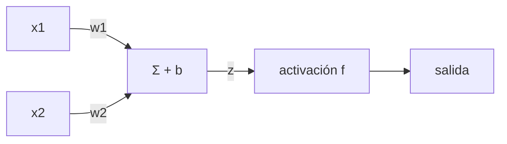

Al terminar esta lección tendrás en numpy un perceptrón que aprende solo, verás el problema que frenó a las redes neuronales durante años y lo resolverás con una segunda capa. También verás que la regresión lineal de toda la vida es una neurona sin activación. Son las piezas con las que está construido cualquier LLM.

## La idea

Una neurona artificial es una cuenta sencilla en dos pasos:

1. **Suma ponderada.** Multiplica cada entrada por su **peso**, suma los resultados y añade un número fijo, el **sesgo**: `z = w1·x1 + w2·x2 + … + b`.
2. **Activación.** Pasa `z` por una función que decide la salida: `salida = f(z)`.

Un ejemplo que conoces: la nota de admisión de una carrera. Pongamos que la nota es `0,6·examen + 0,4·bachillerato` y que te admiten si supera el 7. Eso es una neurona: los pesos son 0,6 y 0,4, el sesgo es −7 y la activación es un escalón que devuelve 1 si `z` es mayor que cero y 0 si no. Con un 8 en el examen y un 6,5 en bachillerato, `z = 4,8 + 2,6 − 7 = 0,4`: admitido.



Los pesos dicen cuánto importa cada entrada. El sesgo mueve el umbral: sin él, la frontera de decisión tendría que pasar siempre por el origen. Pesos y sesgos son los [[glosario/parametros|parámetros]] de la neurona, lo que se aprende.

## El perceptrón: una neurona que aprende sus pesos

En la nota de admisión, alguien eligió los pesos. El [[glosario/perceptron|perceptrón]] de Frank Rosenblatt los aprende a partir de ejemplos. Lo presentó en *The perceptron: A probabilistic model for information storage and organization in the brain* (Psychological Review, 1958). Su regla de aprendizaje es casi de sentido común: si acierta, no toques nada; si se equivoca, mueve un poco los pesos hacia la respuesta correcta.

```python title="perceptron.py"
import numpy as np

X = np.array([[0, 0], [0, 1], [1, 0], [1, 1]])
PUERTAS = {
    "AND": np.array([0, 0, 0, 1]),
    "OR":  np.array([0, 1, 1, 1]),
    "XOR": np.array([0, 1, 1, 0]),
}

def escalon(z):
    return (z > 0).astype(int)   # activación del perceptrón: 1 si supera el umbral

def entrenar_perceptron(X, y, epocas=20, lr=0.1):
    w, b = np.zeros(X.shape[1]), 0.0
    for _ in range(epocas):
        for xi, yi in zip(X, y):
            error = yi - escalon(xi @ w + b)   # 0 si acierta; +1 o -1 si falla
            w += lr * error * xi               # regla de Rosenblatt: corrige solo al fallar
            b += lr * error
    return w, b

for nombre, y in PUERTAS.items():
    w, b = entrenar_perceptron(X, y)
    pred = escalon(X @ w + b)
    print(f"{nombre:<3}  pesos={w.round(1)}  sesgo={b:+.1f}  predice={pred}  aciertos={(pred == y).sum()}/4")
```

```text
AND  pesos=[0.2 0.1]  sesgo=-0.2  predice=[0 0 0 1]  aciertos=4/4
OR   pesos=[0.1 0.1]  sesgo=+0.0  predice=[0 1 1 1]  aciertos=4/4
XOR  pesos=[-0.1  0. ]  sesgo=+0.1  predice=[1 1 0 0]  aciertos=2/4
```

AND y OR, perfectos en 20 pasadas. XOR (1 solo cuando las dos entradas son distintas) se queda en 2 de 4. Y no es cuestión de paciencia: con 1.000 o 5.000 épocas el resultado es exactamente el mismo, porque el perceptrón da vueltas sin encontrar nunca unos pesos que funcionen.

## Por qué falla con XOR

Una neurona con escalón divide el plano de entradas con una línea recta: a un lado devuelve 1 y al otro 0. Aprender es mover y girar esa línea. Dibuja los cuatro casos de XOR:

```text
 x2
  1 |  1     0
  0 |  0     1
    +----------
       0     1   x1
```

Los dos 1 están en esquinas opuestas y los dos 0 en las otras dos. Ninguna recta deja los 1 a un lado y los 0 al otro. Con AND y OR sí existe esa recta: se dice que son **linealmente separables**.

Marvin Minsky y Seymour Papert analizaron estos límites en su libro *Perceptrons: An Introduction to Computational Geometry* (MIT Press, 1969). Demostraron que un perceptrón de una capa no puede representar funciones como XOR. El libro contribuyó a que el interés y la financiación de las redes neuronales cayeran durante años. La salida ya se intuía: usar varias capas. Lo que faltaba era una forma de entrenarlas, y llegó en 1986 ([[cursos/la-ia-por-dentro/05-como-aprende-una-red|lección 5]]).

## Capas ocultas: cambiar el problema de forma

Con dos capas, XOR sale sin dificultad. La primera capa, la **capa oculta**, tiene dos neuronas: una calcula OR y otra NAND (lo contrario de AND). La capa de salida hace AND de las dos. Aquí los pesos los ponemos a mano para ver el mecanismo; en la próxima lección la red los aprenderá sola.

```python title="red.py"
import numpy as np

X = np.array([[0, 0], [0, 1], [1, 0], [1, 1]])

def escalon(z):
    return (z > 0).astype(int)

# Capa oculta con dos neuronas: la primera hace OR y la segunda NAND.
W1 = np.array([[1, -1],
               [1, -1]])
b1 = np.array([-0.5, 1.5])
# Capa de salida: una neurona que hace AND de las dos anteriores.
w2 = np.array([1, 1])
b2 = -1.5

oculta = escalon(X @ W1 + b1)
print("capa oculta:\n", oculta)
print("salida XOR:", escalon(oculta @ w2 + b2))

# Sin activación, dos capas lineales se reducen a una sola matriz.
rng = np.random.default_rng(0)
A, B = rng.normal(size=(2, 3)), rng.normal(size=(3, 1))
x = rng.normal(size=(5, 2))
print("¿(x·A)·B == x·(A·B)?", np.allclose((x @ A) @ B, x @ (A @ B)))
```

```text
capa oculta:
 [[0 1]
 [1 1]
 [1 1]
 [1 0]]
salida XOR: [0 1 1 0]
¿(x·A)·B == x·(A·B)? True
```

Mira la capa oculta. Ha transformado las cuatro entradas en una representación nueva donde los casos con XOR igual a 1 son justo los que tienen las dos columnas a 1. En esa representación el problema sí es separable con una recta, y la neurona de salida lo resuelve. **Esa es la idea central del deep learning: cada capa reescribe los datos para que a la siguiente le resulte más fácil.**

La última línea muestra por qué la activación es obligatoria. Sin ella, cada capa es una multiplicación por una matriz, y multiplicar por `A` y luego por `B` es lo mismo que multiplicar por `A·B`. Cien capas lineales equivalen a una sola. La [[glosario/funcion-de-activacion|función de activación]] rompe esa linealidad. Las más usadas son:

- **Sigmoide**: `1 / (1 + e^(−z))`, aplasta cualquier número entre 0 y 1.
- **Tangente hiperbólica** (tanh): parecida, entre −1 y 1.
- **ReLU**: `max(0, z)`, deja pasar los positivos y anula los negativos. Es barata de calcular y muy común en redes profundas.

El escalón del perceptrón tiene un problema: su pendiente es cero en todas partes salvo en el salto, y el método de entrenamiento de la próxima lección necesita pendientes. Por eso en la práctica se usan las curvas suaves.

Una [[glosario/red-neuronal|red neuronal]] es, por tanto, una composición de funciones: `salida = f3(W3 · f2(W2 · f1(W1 · x + b1) + b2) + b3)`. Con suficientes neuronas y capas, esa composición puede aproximar fronteras de decisión muy complicadas.

## El caso más simple: la regresión lineal

Quita la activación a una neurona y te queda `y = w·x + b`: una regresión lineal. Para ella existe una solución exacta, los **mínimos cuadrados**, que elige los pesos que minimizan la media de los errores al cuadrado. Escrita con matrices, la solución cumple `(Xᵀ·X)·w = Xᵀ·y`.

```python title="regresion.py"
import numpy as np

rng = np.random.default_rng(2)
m2 = rng.uniform(40, 120, size=30)                       # superficie de 30 pisos
precio = 2.5 * m2 + 30 + rng.normal(0, 10, size=30)      # miles de euros, con ruido

Xb = np.column_stack([m2, np.ones_like(m2)])             # columna de unos: el sesgo
w = np.linalg.solve(Xb.T @ Xb, Xb.T @ precio)            # resuelve (XᵀX)·w = Xᵀ·y
print(f"precio ≈ {w[0]:.2f}·m2 + {w[1]:.1f}")
print(f"piso de 80 m2: {w @ [80, 1]:.0f} mil euros")
```

```text
precio ≈ 2.52·m2 + 30.6
piso de 80 m2: 232 mil euros
```

La columna de unos es el truco para tratar el sesgo como un peso más. Es lo mismo que hacía `np.polyfit` en la [[cursos/la-ia-por-dentro/01-ia-machine-learning-y-deep-learning|lección 1]].

¿Por qué no entrenar así todas las redes? Por dos motivos. Resolver ese sistema con millones de parámetros es carísimo en memoria y tiempo. Y en cuanto añades activaciones, ya no hay una fórmula cerrada que despejar. Hace falta un método que se acerque a la solución paso a paso: el descenso del gradiente.

## Errores frecuentes

- **Pensar que «neurona» implica biología.** La inspiración existe, pero lo que hay es una suma ponderada y una función.
- **Olvidar el sesgo.** Sin él, la recta que separa los datos tiene que pasar por el origen y muchos problemas sencillos dejan de tener solución.
- **Apilar capas sin activación.** Más capas lineales no añaden capacidad: se colapsan en una.
- **Confundir parámetros con hiperparámetros.** Pesos y sesgos se aprenden. El número de capas, las neuronas por capa, la tasa de aprendizaje o las épocas los eliges tú.

## Qué tiene que ver con los LLM y los agentes

Cuando una ficha de modelo dice «8B» o «70B», cuenta cuántos pesos y sesgos como los de esta lección tiene la red, en miles de millones. Ese número decide cuánta memoria necesitas para ejecutarla, lo que importa si piensas usar modelos en local ([[cursos/agentes-con-modelos-abiertos/index]], [[glosario/cuantizacion]]).

Dentro de cada bloque de un [[glosario/transformer|Transformer]] hay una red de dos capas con activación, exactamente como la de XOR pero con miles de neuronas. Y la idea de la capa oculta, reescribir los datos para que el siguiente paso sea fácil, es lo que hace un LLM capa tras capa con el texto. Los [[glosario/embeddings|embeddings]] que usas en un RAG son una de esas representaciones intermedias.

Para quien construye agentes, la consecuencia más práctica es esta: cuando usas un modelo, sus pesos están congelados. Es una función fija. No aprende de tu conversación porque nada en la inferencia modifica `w` ni `b`; lo único que cambia de una llamada a otra es la entrada. Por eso la memoria de un agente vive fuera del modelo, en el contexto y en archivos ([[roadmap/00-fundamentos/03-ventana-de-contexto]], [[glosario/memoria]]).

## Ejercicio

> [!ejercicio] Neuronas a mano
> 1. Con la neurona de la nota de admisión (pesos 0,6 y 0,4, sesgo −7), calcula a mano si admite a alguien con un 5 en el examen y un 9 en bachillerato, y a alguien con un 9 y un 6.
> 2. En `red.py`, cambia solo `w2` y `b2` para que la red calcule XNOR (1 cuando las entradas son iguales).
>
> Está bien si: en el primer caso obtienes `z = −0,4` (no admitido) y en el segundo `z = 0,8` (admitido); y tu red imprime `salida XOR: [1 0 0 1]` sin tocar la capa oculta.

> [!ejercicio]- Pistas
> XNOR es lo contrario de XOR. Si la salida actual es AND de las dos neuronas ocultas, lo contrario es NAND de las dos: cambia el signo de los pesos y busca un sesgo que deje el umbral entre 1 y 2.

## Resumen

- Una neurona hace una suma ponderada más un sesgo y la pasa por una activación.
- El perceptrón aprende sus pesos corrigiendo cuando falla, pero solo separa con una recta y no puede aprender XOR.
- Una capa oculta reescribe los datos para que el problema se vuelva separable.
- Sin una activación no lineal, cualquier número de capas equivale a una; sigmoide, tanh y ReLU lo evitan.
- La regresión lineal es una neurona sin activación y tiene solución exacta; las redes de verdad necesitan otro método.

## Para seguir

- [[cursos/la-ia-por-dentro/05-como-aprende-una-red]]: cómo aprende la red los pesos que aquí pusimos a mano.
- [[glosario/perceptron]], [[glosario/funcion-de-activacion]] y [[glosario/red-neuronal]].
- [[cursos/ruta-en-video/02-fase-1-redes-neuronales]]: los vídeos de esta parte.
