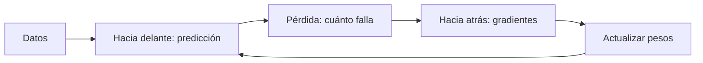

Al terminar esta lección habrás escrito a mano, en unas 40 líneas de numpy, el bucle con el que se entrena cualquier red neuronal, incluido un LLM: predecir, medir el error, calcular hacia atrás de quién es la culpa y corregir. La red aprenderá sola el XOR que en la lección anterior tuvimos que resolver poniendo los pesos a mano.

## La idea

Entrenar una red es repetir cuatro pasos miles de veces:



Cada pieza tiene nombre propio. La **pérdida** mide el error con un solo número. El **descenso del gradiente** decide cómo cambiar cada peso para que ese número baje. La **backpropagation** calcula, de forma eficiente, cuánto afecta cada peso a la pérdida.

## La función de pérdida

La [[glosario/funcion-de-perdida|función de pérdida]] convierte «lo mal que lo hace el modelo» en un número que se puede minimizar. Las dos más comunes son:

- **Error cuadrático medio (MSE)**, para regresión: `media((predicción − real)²)`. Elevar al cuadrado hace que el error sea siempre positivo, castiga mucho más los fallos grandes que los pequeños y da una curva suave, sin saltos.
- **Entropía cruzada**, para clasificación: `−log(probabilidad que el modelo dio a la respuesta correcta)`. Si el modelo dio un 0,9 a la respuesta buena, la pérdida es 0,105; si le dio un 0,01, es 4,6. Es la pérdida con la que se entrena un LLM, aplicada al siguiente token.

## Descenso del gradiente

Imagina que estás en un monte con niebla y quieres bajar al valle. No ves el camino, pero notas la inclinación del suelo bajo los pies. Das un paso cuesta abajo, vuelves a notar la inclinación y repites. Eso es el [[glosario/descenso-del-gradiente|descenso del gradiente]].

La inclinación es el **gradiente**: la lista de derivadas de la pérdida respecto a cada parámetro. Cada derivada dice cuánto sube la pérdida si aumentas un poco ese parámetro. Como queremos bajar, restamos:

```text
peso_nuevo = peso − tasa_de_aprendizaje · derivada_de_la_pérdida_respecto_al_peso
```

La **tasa de aprendizaje** (*learning rate*, `lr`) es el tamaño del paso. El script ajusta una regresión lineal con tres tasas distintas, siempre 100 pasos desde el mismo punto de partida.

```python title="descenso.py"
import numpy as np

rng = np.random.default_rng(0)
x = rng.uniform(0, 1, size=100)
y = 3 * x + 2 + rng.normal(0, 0.1, size=100)    # la regla oculta: w=3, b=2

def descenso(lr, pasos=100):
    w, b = 0.0, 0.0                             # punto de partida arbitrario
    for _ in range(pasos):
        error = (w * x + b) - y
        grad_w = 2 * (error * x).mean()         # ∂MSE/∂w
        grad_b = 2 * error.mean()               # ∂MSE/∂b
        w -= lr * grad_w                        # un paso en contra del gradiente
        b -= lr * grad_b
    return w, b, ((w * x + b - y) ** 2).mean()

for lr in (0.01, 0.5, 1.0):
    w, b, mse = descenso(lr)
    print(f"lr={lr:<4}  w={w:<10.4g}  b={b:<10.4g}  MSE={mse:.4g}")
```

```text
lr=0.01  w=1.706       b=2.497       MSE=0.2022
lr=0.5   w=2.986       b=2           MSE=0.009401
lr=1.0   w=-7.275e+21  b=-1.235e+22  MSE=2.717e+44
```

Los tres comportamientos que verás en cualquier entrenamiento:

- **Demasiado pequeña (0,01)**: avanza, pero tan despacio que tras 100 pasos sigue lejos de `w = 3`.
- **Adecuada (0,5)**: llega a `w ≈ 2,986` y `b ≈ 2`, prácticamente la regla oculta.
- **Demasiado grande (1,0)**: cada paso se pasa del fondo del valle y aterriza más arriba en la otra ladera. El error crece en cada paso hasta números absurdos. Cuando un entrenamiento real «explota» y la pérdida sale `nan`, la tasa de aprendizaje es el primer sospechoso.

La pérdida de una regresión lineal tiene forma de cuenco, con un único fondo. La de una red neuronal es un paisaje con muchos valles, y el descenso puede quedarse en un **mínimo local**, un valle que no es el más profundo. Lo comprobarás en el ejercicio.

En la práctica, el gradiente no se calcula con todos los datos a la vez, sino con lotes pequeños elegidos al azar (descenso del gradiente estocástico), y se usan variantes que adaptan el paso de cada parámetro sobre la marcha; Adam es la más conocida.

## Backpropagation: la regla de la cadena hacia atrás

En la regresión, las derivadas salen con una línea. En una red con capas ocultas, un peso de la primera capa influye en la pérdida a través de todo lo que viene después. ¿Cómo calcular su derivada?

La forma ingenua es la fuerza bruta: mover ese peso una millonésima, recalcular la pérdida y ver cuánto cambió. Funciona, pero exige recorrer la red entera hacia delante por cada parámetro. Con mil millones de parámetros, serían mil millones de pasadas para dar un solo paso de entrenamiento.

La [[glosario/backpropagation|backpropagation]] obtiene todas las derivadas con una pasada hacia delante y una hacia atrás. Se apoya en la **regla de la cadena**: si A depende de B y B depende de C, el efecto de C sobre A es el producto de los efectos intermedios. Como al cambiar divisas: si un euro son 1,1 dólares y un dólar son 150 yenes, un euro son 1,1 · 150 = 165 yenes. Multiplicas las tasas de cada tramo.

En una red, la pérdida depende de la salida, la salida de la suma ponderada de la última capa, esa suma de las activaciones de la capa anterior, y así hasta la entrada. El algoritmo calcula primero el «error» de la neurona de salida y lo propaga hacia atrás: cada neurona oculta recibe una parte proporcional al peso de su conexión con la siguiente capa. Como cada capa reutiliza lo que ya calculó la posterior, no se repite trabajo.

David Rumelhart, Geoffrey Hinton y Ronald Williams publicaron *Learning representations by back-propagating errors* en Nature en 1986. La idea tenía precedentes, pero su artículo mostró que el método entrenaba redes de varias capas y que las capas ocultas aprendían representaciones internas útiles. Era la pieza que faltaba desde el análisis de Minsky y Papert: una forma práctica de entrenar redes con varias capas. Desde entonces es la forma estándar de entrenar redes.

## Una red que aprende XOR

Esta es la red de la lección anterior, con cuatro neuronas ocultas y activación sigmoide en lugar de escalón, porque la sigmoide tiene pendiente en todas partes. Los pesos empiezan al azar y la red tiene que encontrarlos sola. La derivada de la sigmoide es `s·(1 − s)`, y por eso aparece `p * (1 - p)` y `h * (1 - h)` en el código.

```python title="xor_backprop.py"
import numpy as np

X = np.array([[0, 0], [0, 1], [1, 0], [1, 1]], dtype=float)
y = np.array([[0], [1], [1], [0]], dtype=float)   # XOR

def sigmoide(z):
    return 1 / (1 + np.exp(-z))

rng = np.random.default_rng(0)
W1, b1 = rng.normal(size=(2, 4)), np.zeros(4)     # capa oculta: 4 neuronas
W2, b2 = rng.normal(size=(4, 1)), np.zeros(1)     # capa de salida: 1 neurona
lr = 2.0

for paso in range(5001):
    # 1. Hacia delante: de la entrada a la predicción.
    h = sigmoide(X @ W1 + b1)
    p = sigmoide(h @ W2 + b2)
    perdida = ((p - y) ** 2).mean()

    # 2. Hacia atrás: regla de la cadena, de la salida a la entrada.
    d_z2 = 2 * (p - y) / len(X) * p * (1 - p)     # error de la neurona de salida
    d_W2, d_b2 = h.T @ d_z2, d_z2.sum(axis=0)
    d_z1 = (d_z2 @ W2.T) * h * (1 - h)            # el error se reparte por los pesos W2
    d_W1, d_b1 = X.T @ d_z1, d_z1.sum(axis=0)

    # 3. Descenso del gradiente: todos los parámetros a la vez.
    W2 -= lr * d_W2
    b2 -= lr * d_b2
    W1 -= lr * d_W1
    b1 -= lr * d_b1

    if paso % 1000 == 0:
        print(f"paso {paso:>4}  pérdida {perdida:.4f}")

print("predicciones:", p.ravel().round(2))
```

```text
paso    0  pérdida 0.3430
paso 1000  pérdida 0.0033
paso 2000  pérdida 0.0011
paso 3000  pérdida 0.0006
paso 4000  pérdida 0.0004
paso 5000  pérdida 0.0003
predicciones: [0.01 0.98 0.98 0.02]
```

Las predicciones finales son casi 0, 1, 1, 0: la red ha aprendido XOR. Lee el bloque 2 de abajo arriba y verás la regla de la cadena: `d_z2` es el error de la salida; `d_W2` lo multiplica por lo que entró a esa capa; `d_z1` reparte el error hacia atrás a través de `W2` y lo multiplica por la pendiente de la sigmoide oculta. Es lo que hacen PyTorch o JAX por ti con diferenciación automática, sin que escribas una sola derivada.

## Errores frecuentes

- **Confundir backpropagation con descenso del gradiente.** La primera calcula los gradientes; el segundo los usa para mover los pesos.
- **No vigilar la pérdida.** Si no baja, la tasa es pequeña o el modelo no puede representar el problema; si explota, la tasa es grande.
- **Inicializar todos los pesos a cero.** Todas las neuronas ocultas reciben el mismo gradiente y nunca se diferencian. Con los pesos a cero, esta red se queda en una pérdida de 0,25 y predice 0,5 para todo.
- **Mirar solo la pérdida de entrenamiento.** Que baje no significa que el modelo generalice: es el tema de la [[cursos/la-ia-por-dentro/06-sobreajuste-y-generalizacion|lección 6]].

## Qué tiene que ver con los LLM y los agentes

Un LLM se entrena con este mismo bucle. La pasada hacia delante procesa texto, la pérdida es la entropía cruzada del siguiente token, la backpropagation calcula el gradiente de miles de millones de parámetros y un optimizador da el paso. Repetido sobre cantidades enormes de texto en grandes clústeres de GPU. Por eso entrenar un modelo fundacional cuesta lo que cuesta, y por eso casi nadie que construye agentes lo hace: usas el resultado.

El [[glosario/fine-tuning|fine-tuning]] es el mismo bucle empezando desde los pesos ya entrenados y con tus datos. Las lecciones de aquí siguen valiendo: la tasa de aprendizaje importa y con pocos ejemplos es fácil sobreajustar. Antes de llegar ahí, revisa si te basta con prompting o RAG ([[modelos/10-prompting-rag-o-fine-tuning]]).

En un agente en marcha no ocurre nada de esto: los pesos están congelados. Tu agente «aprende» por otra vía, cuando tú cambias su contexto: el prompt, los archivos de memoria, las [[glosario/skill|skills]]. Y hay un paralelo útil. Los [[glosario/evals|evals]] hacen el papel de la función de pérdida de tu agente: un número que mide cuánto falla y que te dice si cada cambio que haces lo mejora o lo empeora ([[roadmap/80-evals/01-por-que-evals]]). Sin ese número, iteras a ciegas.

## Ejercicio

> [!ejercicio] Valles y gradientes
> 1. En `xor_backprop.py`, deja la capa oculta en 2 neuronas (`size=(2, 2)`, `np.zeros(2)` y `size=(2, 1)`) y ejecuta con las semillas de 0 a 19.
> 2. Comprueba el gradiente: con los pesos iniciales, calcula `d_W1[1, 2]` con backpropagation y compáralo con la fuerza bruta, moviendo ese peso `±1e-6` y dividiendo la diferencia de pérdidas entre `2e-6`.
>
> Está bien si: con 2 neuronas ocultas algunas semillas se quedan atascadas con pérdidas alrededor de 0,13 a 0,17 y alguna predicción en 0,33 o 0,5 (en nuestras pruebas, 4 de las 20), mientras que con 4 neuronas las 20 aprenden; y si los dos gradientes coinciden al menos en seis decimales.

> [!ejercicio]- Pistas
> Para la comprobación, escribe una función `perdida(W1)` que haga solo la pasada hacia delante y devuelva el MSE, y calcula `d_W1` una vez antes del bucle de entrenamiento. Si los gradientes no coinciden, revisa que comparas los dos con los mismos pesos: dentro del bucle, `d_W1` se calcula antes de actualizar.

## Resumen

- La pérdida resume el error en un número; MSE para regresión, entropía cruzada para clasificación y para LLM.
- El descenso del gradiente da pasos en contra del gradiente; la tasa de aprendizaje decide si avanza, se estanca o explota.
- La backpropagation aplica la regla de la cadena de la salida a la entrada y obtiene todos los gradientes en una pasada.
- Con ella, una red de dos capas aprende XOR sola a partir de pesos aleatorios.
- Un LLM se entrena con este bucle; un agente en uso no modifica sus pesos y mejora cambiando su contexto, medido con evals.

## Para seguir

- [[cursos/la-ia-por-dentro/06-sobreajuste-y-generalizacion]]: cuándo bajar la pérdida deja de ser buena noticia.
- [[glosario/descenso-del-gradiente]] y [[glosario/backpropagation]].
- [[roadmap/00-fundamentos/06-como-se-entrena-un-llm]]: el bucle aplicado a un LLM, fase a fase.
