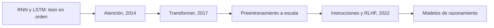

Al terminar esta lección entenderás el salto que llevó de redes que servían para una tarea concreta a los LLM: la atención y el Transformer. Calcularás la atención con numpy sobre tres vectores y verás cómo una palabra ambigua cambia de significado según su contexto. Después recorrerás los pasos que van de ahí a los modelos con los que construyes agentes.

## La idea

El texto es una secuencia: el orden importa y el significado de cada palabra depende de las demás. «Banco» no significa lo mismo en «me senté en el banco del parque» que en «pedí un préstamo al banco». Para procesar lenguaje, una red necesita dos cosas: convertir palabras en números y combinar la información de unas palabras con otras a lo largo de la frase.



## Palabras como vectores

Una red no lee letras: cada [[glosario/token|token]] se convierte en un vector de cientos o miles de números, su **embedding**. Esos vectores se aprenden durante el entrenamiento, y acaban colocando cerca las palabras que aparecen en contextos parecidos: «perro» cerca de «gato», «martes» cerca de «miércoles». Con los primeros embeddings de palabras se hizo famosa una observación: la operación «rey − hombre + mujer» caía cerca de «reina». Las direcciones del espacio capturaban relaciones.

Pero un vector fijo por palabra tiene un límite claro: «banco» tiene el mismo vector en el parque y en la oficina. Hace falta un mecanismo que ajuste la representación de cada palabra según las que la rodean. Los [[glosario/embeddings|embeddings]] que usas en un RAG ya incorporan ese contexto: los calcula un modelo que ha leído la frase entera.

## RNN y LSTM: leer palabra a palabra

Una red recurrente (RNN) lee la secuencia en orden y mantiene un **estado oculto**: un vector que actualiza con cada palabra combinando el estado anterior y la palabra nueva. Es como leer un libro con una sola nota adhesiva en la que reescribes el resumen después de cada palabra.

Tiene dos problemas:

1. **Memoria corta.** La información del principio tiene que sobrevivir a todas las reescrituras. Al entrenar, el gradiente recorre la secuencia hacia atrás multiplicándose en cada paso (la regla de la cadena de la [[cursos/la-ia-por-dentro/05-como-aprende-una-red|lección 5]]), y un producto de muchos factores pequeños tiende a cero. La red apenas aprende relaciones entre palabras lejanas.
2. **No se puede paralelizar.** Para procesar la palabra 100 necesitas el estado de la 99. Las GPU rinden cuando hacen muchas operaciones a la vez, y una RNN las obliga a ir de una en una.

Sepp Hochreiter y Jürgen Schmidhuber propusieron la LSTM en *Long Short-Term Memory* (Neural Computation, 1997). Añade una celda de memoria con **puertas**, pequeñas redes que deciden qué información entra en la celda y qué sale; versiones posteriores añadieron una puerta para olvidar. Así la información y el gradiente sobreviven muchos más pasos. Las LSTM dominaron el procesado de lenguaje y voz durante años, pero seguían leyendo en orden.

## La atención

En traducción automática, el esquema habitual era un codificador que leía la frase entera y la comprimía en un único vector, y un decodificador que generaba la traducción a partir de ese vector. Con frases largas, ese cuello de botella perdía información.

Dzmitry Bahdanau, Kyunghyun Cho y Yoshua Bengio propusieron una salida en *Neural Machine Translation by Jointly Learning to Align and Translate* (2014). En lugar de un solo vector, el decodificador, al generar cada palabra, consulta todas las palabras de la frase original y decide cuánto peso dar a cada una. Es una búsqueda suave: no elige una palabra, hace una media ponderada de todas. A ese mecanismo se le llama [[glosario/atencion|atención]].

## Atención de producto escalar en numpy

La versión que usan los Transformer es la **atención de producto escalar**. Cada token produce tres vectores:

- una **consulta** (`Q`): qué busca;
- una **clave** (`K`): con qué se le puede encontrar;
- un **valor** (`V`): qué aporta si lo eligen.

La puntuación entre dos tokens es el producto escalar de la consulta de uno con la clave del otro: alta si apuntan en la misma dirección. Se divide por la raíz de la dimensión, se pasa por softmax ([[cursos/la-ia-por-dentro/03-de-las-reglas-a-las-probabilidades|lección 3]]) para que los pesos sumen 1 y se usa para mezclar los valores:

```text
Atención(Q, K, V) = softmax(Q · Kᵀ / √d) · V
```

En un modelo que genera texto se añade una **máscara causal**: cada token solo puede mirar a los anteriores, porque al generar los siguientes todavía no existen. El script usa vectores de juguete con tres rasgos legibles y, para simplificar, `Q = K = V`.

```python title="atencion.py"
import numpy as np

def softmax(z):
    e = np.exp(z - z.max(axis=-1, keepdims=True))
    return e / e.sum(axis=-1, keepdims=True)

def atencion(Q, K, V, causal=True):
    puntuaciones = Q @ K.T / np.sqrt(K.shape[-1])     # parecido de cada consulta con cada clave
    if causal:                                         # cada token solo mira hacia atrás
        futuro = np.triu(np.ones_like(puntuaciones, dtype=bool), k=1)
        puntuaciones = np.where(futuro, -np.inf, puntuaciones)
    pesos = softmax(puntuaciones)                      # cada fila suma 1
    return pesos @ V, pesos                            # mezcla de valores según los pesos

# Vectores de juguete con 3 rasgos: [dinero, naturaleza, gramática].
VEC = {
    "río":    np.array([0.0, 2.0, 0.0]),
    "dinero": np.array([2.0, 0.0, 0.0]),
    "el":     np.array([0.0, 0.0, 1.0]),
    "banco":  np.array([1.0, 1.0, 0.0]),   # ambiguo: mitad dinero, mitad naturaleza
}

for frase in (["río", "el", "banco"], ["dinero", "el", "banco"]):
    X = np.stack([VEC[t] for t in frase])
    salida, pesos = atencion(X, X, X)                  # sin proyecciones: Q = K = V = X
    print(" ".join(frase))
    print(pesos.round(2))                              # fila i: a quién mira el token i
    print("«banco» antes:", VEC["banco"], "después:", salida[-1].round(2))
```

```text
río el banco
[[1.   0.   0.  ]
 [0.36 0.64 0.  ]
 [0.43 0.14 0.43]]
«banco» antes: [1. 1. 0.] después: [0.43 1.3  0.14]
dinero el banco
[[1.   0.   0.  ]
 [0.36 0.64 0.  ]
 [0.43 0.14 0.43]]
«banco» antes: [1. 1. 0.] después: [1.3  0.43 0.14]
```

Cómo leer la salida:

- **La matriz de pesos.** La fila 3 dice a quién mira «banco»: un 43 % a la primera palabra, un 14 % a «el» y un 43 % a sí mismo. Por encima de la diagonal todo es 0: es la máscara causal. El primer token solo puede mirarse a sí mismo.
- **El vector de salida.** «Banco» empezaba en `[1, 1, 0]`, a medio camino entre dinero y naturaleza. Después de la atención, junto a «río» se inclina hacia naturaleza (`1.3` frente a `0.43`), y junto a «dinero», hacia dinero. Es la misma palabra con dos representaciones distintas según su contexto: lo que un embedding fijo no podía hacer.
- **Pesos iguales, salidas distintas.** En las dos frases los pesos coinciden porque los vectores de juguete son simétricos. Lo que cambia es el valor que se mezcla. Los pesos deciden a quién mirar; los valores, qué información se trae.

En un modelo real, `Q`, `K` y `V` se obtienen multiplicando cada embedding por tres matrices aprendidas, se calculan muchas atenciones en paralelo (las «cabezas»), cada una especializada en un tipo de relación, y se apilan decenas de capas. La atención por sí sola no sabe el orden de las palabras, así que se añade a cada embedding información sobre su posición.

## El Transformer

Ashish Vaswani y sus coautores presentaron el [[glosario/transformer|Transformer]] en *[Attention Is All You Need](https://arxiv.org/abs/1706.03762)* (2017). Su propuesta: prescindir de la recurrencia y construir la red solo con atención. Cada bloque combina una capa de autoatención (cada token atiende a los demás de su misma secuencia) con una red de dos capas como la de la [[cursos/la-ia-por-dentro/04-la-neurona-y-la-red|lección 4]], más conexiones residuales y normalización para que se puedan apilar muchas.

Lo que ganó:

- **Paralelismo.** Todas las posiciones se calculan a la vez con multiplicaciones de matrices, justo lo que las GPU hacen bien. Entrenar con muchos más datos pasó a ser viable.
- **Distancia uno entre cualquier par de palabras.** La primera y la última palabra de un texto largo se relacionan directamente, sin pasar por cientos de reescrituras de un estado.

Lo que cuesta: cada token se compara con todos los demás, así que el cálculo de la atención crece con el cuadrado de la longitud. Es una de las razones de que exista una [[glosario/ventana-de-contexto|ventana de contexto]] con límite.

## De ahí a los LLM actuales

1. **Preentrenamiento a escala.** Un Transformer con máscara causal entrenado a predecir el siguiente token sobre cantidades enormes de texto: la tarea autosupervisada de la [[cursos/la-ia-por-dentro/02-aprendizaje-supervisado-y-no-supervisado|lección 2]]. Jared Kaplan y sus coautores midieron en *[Scaling Laws for Neural Language Models](https://arxiv.org/abs/2001.08361)* (2020) que la pérdida baja de forma predecible, siguiendo leyes de potencia, al aumentar los parámetros, los datos y el cómputo. Jordan Hoffmann y sus coautores matizaron en *[Training Compute-Optimal Large Language Models](https://arxiv.org/abs/2203.15556)* (2022) que, con un presupuesto de cómputo fijo, parámetros y tokens de entrenamiento deben crecer en la misma proporción, y que muchos modelos de la época eran demasiado grandes para los datos con que se entrenaron. Son las [[glosario/leyes-de-escalado|leyes de escalado]]. Brown et al. (2020) mostraron además con GPT-3 que un modelo así de grande podía hacer tareas nuevas con unos pocos ejemplos en el prompt ([*Language Models are Few-Shot Learners*](https://arxiv.org/abs/2005.14165)).
2. **Ajuste con instrucciones y RLHF.** Un modelo preentrenado continúa textos, pero no sigue órdenes de forma fiable. Long Ouyang y sus coautores lo ajustaron con respuestas escritas por personas y después con [[glosario/rlhf|RLHF]], aprendizaje por refuerzo guiado por un modelo de recompensa entrenado con preferencias humanas, en *[Training language models to follow instructions with human feedback](https://arxiv.org/abs/2203.02155)* (2022). En su evaluación, las personas preferían las respuestas de su modelo de 1.300 millones de parámetros a las de GPT-3, con 175.000 millones. Los asistentes de chat salieron de ahí.
3. **Modelos de razonamiento.** Desde 2024 aparecen [[glosario/modelo-de-razonamiento|modelos de razonamiento]], entrenados con refuerzo para generar una cadena de razonamiento antes de la respuesta final. Piensan más en los problemas difíciles a cambio de más tokens y más latencia.

Por el camino aparecieron más variantes, como la [[glosario/mezcla-de-expertos|mezcla de expertos]], que activa solo una parte de los parámetros para cada token. Pero el corazón sigue siendo el de 2017: embeddings, atención y capas densas, entrenados con descenso del gradiente y backpropagation.

## Qué tiene que ver con los LLM y los agentes

- **La atención es la razón de que el contexto funcione.** Cuando pones un documento en el prompt, cada token de la respuesta puede atender a cualquier parte de él. Pero los pesos de cada fila suman 1: cuanto más texto irrelevante hay, más se reparte la atención. Por eso más contexto no siempre es mejor ([[cursos/context-engineering/01-el-contexto-como-presupuesto]], [[glosario/lost-in-the-middle]]).
- **El coste del contexto sale de aquí.** La atención crece con la longitud, y en un agente el historial se reenvía en cada paso. Los proveedores pueden guardar el cálculo ya hecho de un prefijo que se repite; de ahí sale el [[glosario/prompt-caching|prompt caching]].
- **La generación token a token explica el ritmo de salida.** El modelo genera un token cada vez, cada uno condicionado por todos los anteriores. Con la máscara causal, todos los tokens de la entrada se procesan a la vez; los de la salida, en cambio, salen en serie, porque cada uno necesita el anterior: por eso los tokens de salida tardan más y suelen costar más ([[roadmap/00-fundamentos/05-coste-y-latencia]]).
- **Cada fase de entrenamiento explica un comportamiento.** Que siga instrucciones o rechace peticiones viene del ajuste y del RLHF; que razone antes de contestar, del entrenamiento de razonamiento, que en la API regulas con el esfuerzo ([[docs/prompting/04-razonamiento]]). Saber de dónde viene cada cosa te ayuda a elegir modelo para cada tarea de tu agente ([[modelos/05-elegir-modelo-por-tarea]]).

## Ejercicio

> [!ejercicio] Toca la atención
> 1. En `atencion.py`, llama a `atencion(X, X, X, causal=False)` y compara la primera fila de la matriz de pesos con la de antes.
> 2. Vuelve a `causal=True` y multiplica todos los vectores por 3 (`X = 3 * np.stack(...)`). Mira la fila de «banco».
>
> Está bien si: sin máscara, «río» reparte su atención entre las tres palabras (0,71, 0,07 y 0,22) en lugar de mirarse solo a sí mismo; con los vectores multiplicados por 3, los pesos de «banco» se concentran (0,5, 0 y 0,5) y la fila de «el» casi solo se mira a sí misma (0,99). Y si puedes explicar con eso para qué sirve dividir por `√d`.

> [!ejercicio]- Pistas
> Multiplicar los vectores por 3 multiplica los productos escalares por 9. Softmax de números muy separados se parece a quedarse solo con el máximo. Con vectores de miles de dimensiones, los productos escalares crecen con la dimensión; dividir por su raíz los mantiene en una escala donde softmax todavía reparte.

## Resumen

- Los embeddings convierten tokens en vectores, pero un vector fijo no distingue los sentidos de una palabra.
- Las RNN y LSTM leen en orden: olvidan lo lejano y no aprovechan el paralelismo de las GPU.
- La atención mezcla la información de todos los tokens con pesos calculados por producto escalar y softmax.
- El Transformer se construye solo con atención y capas densas; se entrena en paralelo y escala con datos y cómputo.
- Los LLM actuales son Transformers preentrenados a escala, ajustados con instrucciones y RLHF, y algunos entrenados además para razonar.

## Para seguir

- [[roadmap/00-fundamentos/06-como-se-entrena-un-llm]]: las fases de entrenamiento de un LLM, en detalle.
- [[roadmap/00-fundamentos/03-ventana-de-contexto]]: lo que la atención implica para tus llamadas.
- [[cursos/ruta-en-video/03-fase-2-de-las-rnn-a-los-transformers]]: los vídeos de esta parte.
