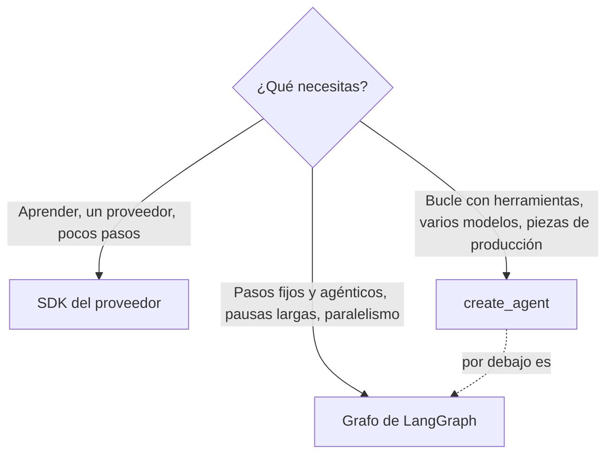

Al terminar esta lección sabrás qué parte de tu bucle a mano sustituye un framework, qué pagas a cambio y con qué criterio eliges entre el SDK del proveedor, LangChain o LangGraph. También tendrás el mapa del ecosistema LangChain con lo que es abierto y lo que es de pago, y el entorno instalado para el resto del curso.

## La idea

Un [[glosario/framework-de-agentes|framework de agentes]] es código que ya resuelve las partes repetitivas de un agente: el bucle, la conversión de herramientas a esquema, el historial, los límites, la persistencia. El bucle que escribiste en [[roadmap/40-primer-agente/02-el-bucle-agentico]], con su `for`, sus ramas por `stop_reason` y su lista de `tool_result`, desaparece de tu código con `create_agent`: queda una llamada con el modelo, las herramientas y el prompt. Esas líneas siguen existiendo, solo que las escribió otro y deciden por ti.

Por eso este curso enseña cada pieza en dos tiempos: primero recuerdas cómo lo hacías a mano y después ves la versión del framework, con lo que esconde.

## Qué te da

Comparado con tu bucle del nivel 40, LangChain y LangGraph te ahorran:

| Lo que escribías a mano | Lo que hace el framework |
|---|---|
| El esquema JSON de cada herramienta | `@tool` lo genera desde la firma y el *docstring* |
| El `while` sobre `stop_reason` | `create_agent` compila un grafo modelo ⇄ herramientas |
| Un `tool_result` por cada `tool_use`, en un mensaje | `ToolMessage` con su `tool_call_id`, agrupados al convertir |
| Contar pasos para parar | `ModelCallLimitMiddleware`, `recursion_limit` |
| Guardar `messages` para reanudar | Un *checkpointer* por `thread_id` |
| Pausar antes de un reembolso | `interrupt()` y `HumanInTheLoopMiddleware` |
| Cambiar de proveedor | `"anthropic:…"` u `"ollama:…"` con la misma API |

Además, piezas que en el SDK tendrías que construir tú: resumen automático de historial, redacción de datos personales, reintentos, paralelismo con reductores de estado y streaming por nodos.

## Qué te quita

Tres cosas, todas verificadas al preparar este curso:

1. **Valores por defecto que no ves.** Sin `max_tokens`, `ChatAnthropic` pide 128 000 tokens de salida en `claude-sonnet-5-5`. El `recursion_limit` por defecto de LangGraph es 10 007 superpasos: en la práctica, sin tope. Y una excepción dentro de una herramienta **rompe el agente** en lugar de volver al modelo como `is_error`.
2. **Prompts y pasos añadidos.** El middleware y Deep Agents inyectan texto de sistema y herramientas que pagas en cada llamada. Hay que leer qué meten.
3. **Ritmo de cambio.** Entre mayo y septiembre de 2026 salieron `langchain` 1.3 y 1.4 y `langgraph` 1.2, con APIs nuevas (`version="v2"` en `invoke`, `langchain.mcp`, un protocolo de streaming en beta). El equipo se comprometió a no romper la API hasta la 2.0, pero lo que aprendes en un tutorial de hace un año puede no existir.

> [!aviso] El framework no te exime de entender el bucle
> Cuando algo falla, la depuración baja siempre a lo mismo: qué mensajes se enviaron, qué devolvió el modelo y qué `tool_result` recibió. Si no sabrías leer eso con el SDK, tampoco sabrás con LangChain.

## SDK, create_agent o grafo

Tres niveles de abstracción para el mismo agente:



- **SDK del proveedor** si estás aprendiendo, si tu producto usa un solo proveedor y pocos pasos, o si necesitas lo último del proveedor en cuanto sale (caché, razonamiento, herramientas del servidor). Ves `stop_reason`, bloques y `usage` sin capas. Es lo que usa el roadmap.
- **`create_agent` de LangChain** cuando el problema encaja en el bucle modelo → herramientas → respuesta y quieres límites, aprobación, resumen o PII ya hechos, o cambiar entre Claude y un modelo local sin reescribir.
- **Un grafo de LangGraph** cuando mezclas pasos deterministas con pasos agénticos, cuando una aprobación puede tardar días, cuando necesitas reanudar tras una caída o ejecutar ramas en paralelo. `create_agent` ya es un grafo de LangGraph; escribes el tuyo cuando su forma no te sirve.

Un encadenado de dos o tres llamadas no necesita ninguno de los dos: tres funciones se leen mejor. La comparación con otros frameworks (Pydantic AI, OpenAI Agents SDK, Claude Agent SDK) está en [[docs/frameworks/01-elegir-framework]].

## El mapa del ecosistema

LangChain, la empresa, publica varias piezas con nombres parecidos. Esto es lo que es cada una y su licencia:

| Pieza | Qué es | Licencia |
|---|---|---|
| `langchain` | `create_agent`, middleware, `@tool`, `init_chat_model`, `langchain.mcp` | MIT |
| `langchain-core` | Mensajes, modelos base, *runnables*, modelos simulados | MIT |
| `langchain-anthropic`, `langchain-ollama` | Integraciones con Claude y con Ollama | MIT |
| `langgraph` + *checkpointers* | Grafos con estado, persistencia, `interrupt`, `Send` | MIT |
| `deepagents` | Arnés para tareas largas sobre `create_agent` (beta) | MIT |
| `langgraph-cli` | Servidor de desarrollo local | MIT |
| `langgraph-api` (Agent Server) | El servidor que se despliega | Elastic-2.0, *source-available*, no OSI |
| LangSmith | Trazas, evals, despliegue gestionado | Comercial |

Lo comercial es opcional. El curso usa solo piezas MIT y, para trazas, alternativas abiertas como Langfuse; LangSmith aparece en la lección 11 como opción, con su precio y su dependencia dichos claros. Las fichas de [[herramientas/langchain]], [[herramientas/langgraph]] y [[herramientas/deepagents]] resumen cada proyecto.

## Instalación y versiones

Crea un entorno virtual e instala lo que usa el curso:

```bash
python -m venv .venv && . .venv/bin/activate
pip install -U langchain langchain-anthropic langgraph langgraph-checkpoint-sqlite pytest
pip install -U langchain-ollama deepagents "langchain[mcp]"
export ANTHROPIC_API_KEY=...        # o Ollama en marcha con un modelo que admita herramientas
```

Comprueba qué tienes:

```python title="versiones.py"
from importlib.metadata import PackageNotFoundError, version

PAQUETES = ["langchain", "langchain-core", "langchain-anthropic", "langchain-ollama",
            "langgraph", "langgraph-checkpoint-sqlite", "deepagents", "mcp"]

for p in PAQUETES:
    try:
        print(f"{p:28} {version(p)}")
    except PackageNotFoundError:
        print(f"{p:28} (no instalado)")
```

Salida real en el entorno con el que se comprobó el curso:

```text
langchain                    1.4.7
langchain-core               1.7.2
langchain-anthropic          1.7.7
langchain-ollama             1.1.0
langgraph                    1.2.18
langgraph-checkpoint-sqlite  3.1.2
deepagents                   0.7.32
mcp                          2.3.0
```

Si ves una 0.x de `langchain` o `langgraph`, actualiza: casi nada de lo que sigue existe en esas versiones.

> [!consejo] Fija versiones en tus proyectos
> Escribe las versiones exactas en `requirements.txt` o en el *lock* de tu gestor. Con un ecosistema que saca versión menor cada pocos meses, un `pip install -U` en el servidor de CI puede cambiar el comportamiento de tu agente sin que toques una línea.

## Errores frecuentes

- Elegir framework antes de tener el agente funcionando con un caso sencillo. Primero el comportamiento, después la herramienta.
- Copiar ejemplos de LangChain 0.x (`AgentExecutor`, `initialize_agent`, cadenas con `|`) en un proyecto 1.x. Lo antiguo vive en `langchain-classic`.
- Pasar el modelo como texto (`"anthropic:claude-sonnet-5-5"`) sin darse cuenta de que así no fijas `max_tokens`.
- Dar por hecho que «LangChain» incluye LangSmith o que lo necesitas para ver trazas.

## Ejercicio

> [!ejercicio] Decide con tu propio caso
> Toma un agente que conozcas (el de soporte del nivel 40 vale) y escribe en una tabla, para cada pieza de la primera tabla de esta lección, si hoy la resuelves a mano, si la necesitarías en producción y cuánto código te ahorraría el framework. Con eso, elige entre SDK, `create_agent` o grafo y justifícalo en tres frases. Instala después el entorno y ejecuta `versiones.py`.
>
> **Está bien si** la decisión menciona al menos un coste concreto del framework (un valor por defecto, una dependencia o el ritmo de cambio), y si `versiones.py` muestra `langchain` 1.4 o superior y `langgraph` 1.2 o superior.

> [!ejercicio]- Pistas
> Si tu agente usa un solo proveedor, tiene menos de cinco herramientas y no necesita pausas largas ni reanudar, el SDK suele ganar. Si necesitas aprobaciones que pueden tardar horas, mira la columna de persistencia: es lo que más código ahorra LangGraph.

## Resumen

- Un framework escribe por ti el bucle, los esquemas, el historial y la persistencia, y decide valores por defecto que debes conocer.
- SDK para aprender y para casos simples; `create_agent` para el bucle con piezas de producción; grafo de LangGraph para flujos con estado, pausas y paralelismo.
- LangChain, LangGraph y Deep Agents son MIT; LangSmith es comercial y el Agent Server es Elastic-2.0.
- Fija versiones: el ecosistema cambia deprisa.

## Para seguir

- [[cursos/langchain-y-langgraph/02-modelos-mensajes-y-herramientas]]
- [[docs/frameworks/01-elegir-framework]]
- [[docs/frameworks/02-equivalencias]]
