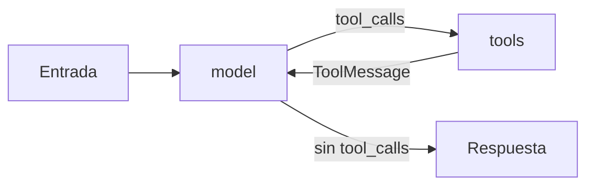

Al terminar esta lección tendrás el agente de soporte del nivel 40 funcionando con `create_agent`, sabrás leer lo que hizo paso a paso, le habrás puesto un tope de llamadas y podrás pedirle la respuesta final como un objeto Python validado. También tendrás el modelo simulado con el que se prueba todo el curso sin gastar tokens.

## La idea

`create_agent` es tu bucle de [[roadmap/40-primer-agente/02-el-bucle-agentico]] empaquetado. Por dentro compila un grafo de LangGraph con dos nodos, `model` y `tools`, más un nodo por cada gancho de middleware que añadas. El estado es la lista de mensajes; el bucle termina cuando el modelo responde sin `tool_calls`.



Lo que tu bucle hacía con `stop_reason`, aquí se decide mirando si el último `AIMessage` tiene `tool_calls`. Lo demás (`max_tokens`, `refusal`) llega como un `AIMessage` normal con su `stop_reason` en `response_metadata`, y **el agente para sin avisar**. Si tu bucle a mano lanzaba un error en esos casos, aquí tienes que mirarlo tú en la respuesta final.

## El agente

Las herramientas son las de la lección anterior (`herramientas.py`). El agente entero:

```python title="agente.py"
from langchain.agents import create_agent
from langchain.agents.middleware import ModelCallLimitMiddleware, ToolErrorMiddleware
from langchain.chat_models import init_chat_model

from herramientas import buscar_ayuda, ver_pedidos

MODEL = "anthropic:claude-sonnet-5-5"     # o "ollama:qwen3.6:27b"
SYSTEM = "Eres el asistente de soporte de una tienda online. Usa las herramientas para consultar datos; no los inventes."


def crear_agente(modelo=None):
    return create_agent(
        model=modelo or init_chat_model(MODEL, max_tokens=2048),
        tools=[ver_pedidos, buscar_ayuda],
        system_prompt=SYSTEM,
        middleware=[
            ToolErrorMiddleware(on_error=lambda exc, request: f"Error: {exc}"),   # is_error
            ModelCallLimitMiddleware(run_limit=10, exit_behavior="end"),           # max_pasos
        ],
    )


if __name__ == "__main__":
    agente = crear_agente()
    resultado = agente.invoke(
        {"messages": [{"role": "user", "content": "Soy ana@example.com. ¿Dónde está mi pedido y hasta cuándo puedo devolverlo?"}]}
    )
    for m in resultado["messages"]:          # la traza: human → ai(tool_calls) → tool → … → ai
        m.pretty_print()
```

Compáralo con tu versión a mano. Desaparecen el `for` de pasos, las ramas por `stop_reason`, el `try` que construía `is_error` y la lista de `tool_result`. Quedan dos decisiones que el framework no toma bien por ti: `max_tokens` en el modelo y el `ToolErrorMiddleware`. `on_error` es obligatorio: `ToolErrorMiddleware()` sin argumentos lanza `ValueError` al construirlo.

Para usar un modelo local cambia `MODEL` por `"ollama:qwen3.6:27b"` (con `langchain-ollama` y el modelo descargado). Si el modelo no llama a las herramientas, mira [[problemas/modelo-local-no-llama-herramientas]].

## Probar sin API: el modelo simulado

Para comprobar la lógica del agente sin clave usamos un [[glosario/modelo-simulado|modelo simulado]]: devuelve, en orden, los `AIMessage` que tú escribes. `GenericFakeChatModel` de `langchain-core` sirve, pero no implementa `bind_tools` y `create_agent` lo llama. Esta subclase lo resuelve y es la que usan todas las pruebas del curso:

```python title="_fakes.py"
"""Modelos de chat simulados para probar agentes de LangChain y LangGraph sin API."""
from langchain_core.language_models.fake_chat_models import GenericFakeChatModel
from langchain_core.messages import AIMessage


class FakeToolModel(GenericFakeChatModel):
    estructuradas: list = []          # objetos que devolverá with_structured_output, en orden

    def bind_tools(self, tools, **kwargs):   # create_agent lo llama; aquí no hace falta nada
        return self

    def with_structured_output(self, schema, **kwargs):
        from langchain_core.runnables import RunnableLambda
        cola = self.estructuradas
        return RunnableLambda(lambda _entrada: cola.pop(0))


def guion(*mensajes: AIMessage) -> FakeToolModel:
    return FakeToolModel(messages=iter(list(mensajes)))


def llamada(nombre: str, args: dict, id_: str) -> dict:
    return {"name": nombre, "args": args, "id": id_, "type": "tool_call"}
```

Las herramientas se ejecutan de verdad; solo el modelo está guionizado. Así pruebas lo que es tuyo: esquemas, errores, límites y el orden de los pasos.

## Leer la traza

`invoke` devuelve el estado final, con todos los mensajes. `stream(..., stream_mode="updates")` te da además **qué nodo produjo cada cosa**, que es la traza del bucle:

```python title="prueba_agente.py"
from langchain.messages import AIMessage

from _fakes import guion, llamada
from agente import crear_agente

modelo = guion(
    AIMessage(content="", tool_calls=[llamada("ver_pedidos", {"email": "ana@example.com"}, "c1"),
                                      llamada("buscar_ayuda", {"tema": "devoluciones"}, "c2")]),
    AIMessage(content="Tu pedido P-1001 se envió el 10 de septiembre; tienes 30 días desde la entrega para devolverlo."),
)
agente = crear_agente(modelo)
for parte in agente.stream({"messages": [("user", "Soy ana@example.com. ¿Y mi pedido?")]}, stream_mode="updates"):
    for nodo, cambio in parte.items():
        for m in (cambio or {}).get("messages", []):     # los nodos de middleware pueden no cambiar nada
            print(f"{nodo:6} →", type(m).__name__, [c["name"] for c in m.tool_calls] if m.type == "ai" and m.tool_calls else m.text[:70])
```

Salida real:

```text
model  → AIMessage ['ver_pedidos', 'buscar_ayuda']
tools  → ToolMessage [{"id": "P-1001", "estado": "enviado", "fecha": "2026-09-10"}]
tools  → ToolMessage Tienes 30 días desde la entrega para devolver un producto sin usar.
model  → AIMessage Tu pedido P-1001 se envió el 10 de septiembre; tienes 30 días desde la
```

Dos cosas que tu bucle no hacía. Las dos herramientas **se ejecutan en paralelo**, y sus `ToolMessage` pueden llegar en otro orden de una ejecución a otra (en una de nuestras pruebas `buscar_ayuda` llegó primero); el `tool_call_id` es lo que las empareja, no el orden. Y el grafo tiene más nodos de los que ves: `agente.get_graph().nodes` lista `model`, `tools`, `ModelCallLimitMiddleware.before_model` y `ModelCallLimitMiddleware.after_model`. Cada middleware que añades es un paso más. La lectura de trazas con detalle está en [[roadmap/40-primer-agente/06-depurar-con-trazas]] y la retomamos en la lección 11.

## Límites: dos contadores distintos

En el nivel 40 contabas pasos con `max_pasos`. Aquí hay dos mecanismos, y conviene usar los dos:

- **`ModelCallLimitMiddleware(run_limit=N)`** cuenta llamadas al modelo por invocación. Con `exit_behavior="end"` termina con un `AIMessage` cuyo texto es `Model call limits exceeded: run limit (10/10)`; con `"error"` lanza `ModelCallLimitExceededError`. `ToolCallLimitMiddleware(tool_name=…, run_limit=…)` hace lo mismo con una herramienta concreta y, al pasarse, devuelve al modelo «Tool call limit exceeded. Do not call 'buscar_ayuda' again.».
- **`recursion_limit`** es de LangGraph: cuenta *superpasos* del grafo (cada nodo ejecutado, middleware incluido), no llamadas al modelo, y al agotarse lanza `GraphRecursionError`. Se pasa en la configuración de cada llamada.

```python title="limites.py"
from langchain.agents import create_agent
from langchain.messages import AIMessage
from langgraph.errors import GraphRecursionError

from _fakes import guion, llamada
from agente import crear_agente
from herramientas import buscar_ayuda


def terco(n=50):                                       # un modelo que nunca deja de pedir herramientas
    return guion(*[AIMessage(content="", tool_calls=[llamada("buscar_ayuda", {"tema": "envíos"}, f"x{i}")])
                   for i in range(n)])


# 1) Límite de llamadas al modelo (middleware): termina con un mensaje, sin excepción
r = crear_agente(terco()).invoke({"messages": [("user", "¿Envíos?")]})
print("ModelCallLimit:", sum(m.type == "ai" for m in r["messages"]), "AIMessage ·", r["messages"][-1].text)

# 2) recursion_limit (LangGraph): cuenta superpasos y lanza excepción
for limite in (10, 25):
    try:
        create_agent(terco(), [buscar_ayuda]).invoke({"messages": [("user", "¿Envíos?")]}, {"recursion_limit": limite})
    except GraphRecursionError as e:
        print(f"recursion_limit={limite}:", str(e)[:58])
```

Salida real:

```text
ModelCallLimit: 11 AIMessage · Model call limits exceeded: run limit (10/10)
recursion_limit=10: Recursion limit of 10 reached without hitting a stop condi
recursion_limit=25: Recursion limit of 25 reached without hitting a stop condi
```

> [!aviso] Sin límite explícito no hay límite
> En `langgraph` 1.2.18 el `recursion_limit` por defecto es **10 007** (configurable con la variable `LANGGRAPH_DEFAULT_RECURSION_LIMIT`), no el 25 que verás en documentación antigua. Un modelo que entra en bucle puede hacer miles de llamadas antes de que nada lo pare. Pon siempre `ModelCallLimitMiddleware` y un `recursion_limit` como red de seguridad. Más en [[problemas/el-agente-no-para]].

## Salida estructurada al final

En el nivel 40 el agente devolvía texto. Con `response_format` le pides un objeto validado, que llega en `resultado["structured_response"]`:

```python title="respuesta.py"
from langchain.agents import create_agent
from langchain.agents.middleware import ToolErrorMiddleware
from langchain.agents.structured_output import ToolStrategy
from langchain.chat_models import init_chat_model
from pydantic import BaseModel, Field

from herramientas import buscar_ayuda, ver_pedidos

MODEL = "anthropic:claude-sonnet-5-5"


class Respuesta(BaseModel):
    """Respuesta final al cliente."""
    texto: str = Field(description="Respuesta para el cliente, en dos o tres frases")
    pedidos_citados: list[str] = Field(description="Ids de pedido que aparecen en la respuesta")
    escalar: bool = Field(description="True si hace falta una persona")


def crear_agente(modelo=None, estrategia=Respuesta):
    return create_agent(
        model=modelo or init_chat_model(MODEL, max_tokens=2048),
        tools=[ver_pedidos, buscar_ayuda],
        system_prompt="Eres el soporte de una tienda online. Usa las herramientas; no inventes datos.",
        middleware=[ToolErrorMiddleware(on_error=lambda exc, request: f"Error: {exc}")],
        response_format=estrategia,         # Respuesta, ToolStrategy(Respuesta) o ProviderStrategy(Respuesta)
    )
```

Hay dos estrategias:

- **`ProviderStrategy`** usa la salida estructurada nativa del proveedor. Con Claude se traduce a `output_config.format` (comprobado en la petición). Si pasas el esquema a secas, `create_agent` la elige cuando el perfil del modelo dice que la admite: con `claude-sonnet-5-5`, sí; con un `ChatOllama`, no.
- **`ToolStrategy`** añade una herramienta con el nombre del esquema (`Respuesta`) y toma como resultado sus argumentos. Sirve para modelos sin salida estructurada nativa, como muchos locales. Si los argumentos no validan, devuelve el error al modelo para que lo corrija (`handle_errors=True` por defecto). **Con Claude Sonnet 5.5 no la uses**: fuerza `tool_choice="any"` y la API responde 400 (`use output_config.format`). Comprobado contra el simulador de la API.

Con el modelo simulado puedes probar la segunda, porque basta guionizar una llamada a `Respuesta`. Es un ejemplo del mecanismo para modelos que no tienen otra opción; con Claude pasa `Respuesta` a secas:

```python title="prueba_respuesta.py"
from langchain.agents.structured_output import ToolStrategy
from langchain.messages import AIMessage

from _fakes import guion, llamada
from respuesta import Respuesta, crear_agente

modelo = guion(
    AIMessage(content="", tool_calls=[llamada("ver_pedidos", {"email": "ana@example.com"}, "c1")]),
    AIMessage(content="", tool_calls=[llamada("Respuesta", {"texto": "Tu pedido P-1001 está enviado.",
                                                            "pedidos_citados": ["P-1001"], "escalar": False}, "c2")]),
)
r = crear_agente(modelo, ToolStrategy(Respuesta)).invoke({"messages": [("user", "Soy ana@example.com, ¿y mi pedido?")]})
print(repr(r["structured_response"]))
```

```text
Respuesta(texto='Tu pedido P-1001 está enviado.', pedidos_citados=['P-1001'], escalar=False)
```

Sigue validando en tu código lo que importa (que los pedidos citados existan, por ejemplo): un esquema garantiza la forma, no la verdad.

## Errores frecuentes

- Pasar `model="anthropic:claude-sonnet-5-5"` como texto y quedarte con `max_tokens=128000`.
- No añadir `ToolErrorMiddleware` y descubrir en producción que un email mal escrito tumba el agente.
- Confiar en el `recursion_limit` por defecto.
- Ignorar el `stop_reason` del último mensaje: un `max_tokens` o un `refusal` terminan el agente igual que un `end_turn`.
- Usar `create_react_agent` de `langgraph.prebuilt`: está deprecado y se eliminará en la 2.0.

## Ejercicio

> [!ejercicio] El agente del nivel 40, con pruebas
> Rehaz con `create_agent` las cuatro herramientas del proyecto del nivel 40 (buscar cliente, ver pedidos, buscar en la ayuda y abrir incidencia, esta última sin aprobación por ahora). Escribe tres pruebas con el modelo simulado: una pregunta con dos herramientas en paralelo, un email inexistente y un modelo que nunca para.
>
> **Está bien si** las tres pruebas pasan sin red; en la del email inexistente hay un `ToolMessage` con `status="error"` y el agente sigue; en la del modelo terco la ejecución termina con el mensaje de límite y no con una excepción; y el agente comprueba al final el `stop_reason` del último mensaje y avisa si no es `end_turn`.

> [!ejercicio]- Pistas
> El último mensaje es `r["messages"][-1]`; con Claude, su `response_metadata["stop_reason"]`. En el modelo simulado puedes ponerlo tú: `AIMessage(content="…", response_metadata={"stop_reason": "max_tokens"})`.

## Resumen

- `create_agent(model, tools, system_prompt, middleware=…)` es el bucle del nivel 40; para cuando el modelo responde sin `tool_calls`.
- Siempre: modelo con `max_tokens`, `ToolErrorMiddleware` y un límite de llamadas.
- `stream_mode="updates"` te da la traza por nodos; las herramientas de un turno se ejecutan en paralelo.
- `response_format` devuelve un objeto validado; con Claude, `ProviderStrategy` usa `output_config.format`.
- Un modelo simulado prueba tu agente sin API.

## Para seguir

- [[cursos/langchain-y-langgraph/04-middleware]]
- [[recetas/probar-agentes-sin-api]]
- [[docs/frameworks/04-langchain]]
