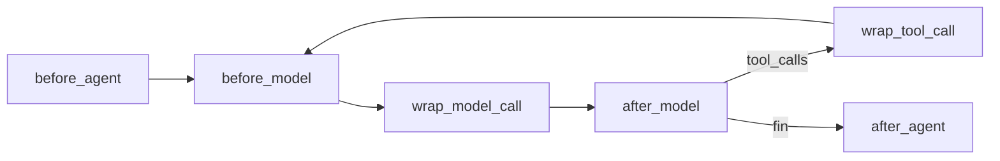

Al terminar esta lección sabrás meter tu propio código en cualquier punto del bucle de `create_agent` sin copiarlo ni reescribirlo: antes de llamar al modelo, alrededor de cada herramienta, al final. Usarás el middleware que ya trae LangChain y escribirás uno que impide reembolsos por encima de un umbral, decidido en código y no en el prompt.

## La idea

En tu bucle a mano, cuando querías comprobar algo antes de ejecutar una herramienta, metías un `if` dentro del `for`. Con `create_agent` no tienes ese `for`, así que LangChain te da **ganchos**: puntos con nombre donde se ejecuta tu código. Un [[glosario/middleware|middleware]] es un objeto que implementa uno o varios.



| Gancho | Cuándo corre | Para qué |
|---|---|---|
| `before_agent` / `after_agent` | Una vez, al empezar y al terminar la invocación | Cargar contexto, cerrar trazas |
| `before_model` | Antes de cada llamada al modelo | Recortar o resumir historial, contar pasos |
| `wrap_model_call` | Envuelve la llamada al modelo | Cambiar de modelo, reintentar, editar la petición |
| `after_model` | Tras cada respuesta | Revisar `tool_calls`, pausar para aprobación |
| `wrap_tool_call` | Envuelve cada ejecución de herramienta | Validar argumentos, bloquear, capturar errores |

Los `wrap_*` reciben la petición y un `handler`: si llamas a `handler(request)`, sigue la cadena; si devuelves otra cosa, la cortas. Es el mismo patrón que los *hooks* de un harness ([[roadmap/90-harness/03-permisos-y-hooks]]): una frontera determinista alrededor de lo que decide el modelo.

**El orden importa.** El primer middleware de la lista es el más externo: su `wrap_tool_call` envuelve al del segundo, y así. Cada gancho `before_*`/`after_*` añade además un nodo al grafo, que también cuenta para el `recursion_limit`.

## El middleware incluido

Todos en `langchain.agents.middleware` (nombres y parámetros comprobados en `langchain` 1.4.7):

| Middleware | Qué hace | Ejemplo |
|---|---|---|
| `ToolErrorMiddleware` | Convierte excepciones de herramientas en `ToolMessage` de error | `ToolErrorMiddleware(on_error=lambda exc, req: f"Error: {exc}")` |
| `ModelCallLimitMiddleware` | Tope de llamadas al modelo por invocación o por hilo | `ModelCallLimitMiddleware(run_limit=8, exit_behavior="end")` |
| `ToolCallLimitMiddleware` | Tope de llamadas a una herramienta | `ToolCallLimitMiddleware(tool_name="reembolsar", run_limit=1)` |
| `HumanInTheLoopMiddleware` | Pausa antes de herramientas sensibles | Lección 7 |
| `SummarizationMiddleware` | Resume el historial al pasar un umbral | `SummarizationMiddleware(modelo, trigger=("tokens", 60000), keep=("messages", 20))` |
| `PIIMiddleware` | Detecta datos personales y los redacta, enmascara, resume en un hash o bloquea | `PIIMiddleware("email", strategy="redact")` |
| `ModelRetryMiddleware` / `ToolRetryMiddleware` | Reintentos con espera exponencial | `ToolRetryMiddleware(max_retries=2, tools=["ver_pedido"])` |
| `ModelFallbackMiddleware` | Otro modelo si falla el primero | `ModelFallbackMiddleware(modelo_respaldo)` |
| `TodoListMiddleware` | Herramienta `write_todos` para planificar | Lección 9 |
| `LLMToolSelectorMiddleware` | Un modelo elige qué herramientas enseñar en cada paso | Para catálogos grandes |
| `ContextEditingMiddleware` | Limpia resultados de herramientas antiguos | `ContextEditingMiddleware(edits=[ClearToolUsesEdit()])` |

Y de `langchain_anthropic.middleware`, `AnthropicPromptCachingMiddleware(ttl="5m")`, que añade `cache_control` a la petición para aprovechar el [[glosario/prompt-caching|prompt caching]] de Claude (detalle de costes en [[roadmap/100-produccion/02-costes-y-prompt-caching]]).

Mira lo que hace cada uno antes de ponerlo. `SummarizationMiddleware` lleva un prompt de resumen de varios párrafos que se envía al modelo que le pases; el resumen sustituye a mensajes que ya no verás. `PIIMiddleware` cambia lo que ve el modelo, comprobado con un modelo que imprime lo que recibe:

```python title="pii.py"
from langchain.agents import create_agent
from langchain.agents.middleware import PIIMiddleware
from langchain.messages import AIMessage
from langchain_core.outputs import ChatGeneration, ChatResult

from _fakes import FakeToolModel

vistos = []


class Eco(FakeToolModel):                             # guarda lo que «ve» el modelo
    def _generate(self, messages, stop=None, run_manager=None, **kwargs):
        vistos.append(messages[-1].content)
        return ChatResult(generations=[ChatGeneration(message=AIMessage(content="ok"))])


for estrategia in ["redact", "mask", "hash"]:
    vistos.clear()
    agente = create_agent(Eco(messages=iter([])), [], middleware=[PIIMiddleware("email", strategy=estrategia)])
    agente.invoke({"messages": [("user", "Soy ana@example.com y quiero devolver algo")]})
    print(f"{estrategia:6} → {vistos[0]}")
```

```text
redact → Soy [REDACTED_EMAIL] y quiero devolver algo
mask   → Soy ana@****.com y quiero devolver algo
hash   → Soy <email_hash:8e43ca37> y quiero devolver algo
```

Con `strategy="block"` lanza `PIIDetectionError`. Y fíjate en la consecuencia: si tu agente busca pedidos **por email**, redactarlo le impide trabajar. La solución correcta es la del proyecto: la identidad del cliente la pone tu código desde la sesión y no viaja por el texto (lo verás en la lección 6).

## Tu propio middleware

Dos formas. Un **decorador** para un solo gancho, y una **clase** que hereda de `AgentMiddleware` cuando necesitas varios ganchos o guardar estado. Este archivo tiene las dos, más un prompt dinámico:

```python title="reembolsos.py"
from langchain.agents import create_agent
from langchain.agents.middleware import (AgentMiddleware, ModelCallLimitMiddleware, ToolErrorMiddleware,
                                         dynamic_prompt, wrap_tool_call)
from langchain.chat_models import init_chat_model
from langchain.messages import ToolMessage
from langchain.tools import tool

MODEL = "anthropic:claude-sonnet-5-5"
LIMITE_EUR = 100                                      # por encima, solo un supervisor


@tool
def ver_pedido(pedido_id: str) -> str:
    """Devuelve estado e importe de un pedido por su id (formato P-NNNN)."""
    return '{"id": "%s", "estado": "entregado", "importe_eur": 49.90}' % pedido_id


@tool
def reembolsar(pedido_id: str, importe_eur: float) -> str:
    """Emite un reembolso. Irreversible: solo tras comprobar el pedido con ver_pedido."""
    return f"Reembolso de {importe_eur} € emitido para {pedido_id}."


@wrap_tool_call                                       # envuelve cada ejecución de herramienta
def tope_de_reembolso(request, handler):
    llamada = request.tool_call
    if llamada["name"] == "reembolsar" and llamada["args"]["importe_eur"] > LIMITE_EUR:
        return ToolMessage(f"Rechazado: el máximo sin supervisor es {LIMITE_EUR} €.",
                           tool_call_id=llamada["id"], name="reembolsar", status="error")
    return handler(request)                           # sigue la cadena y ejecuta la herramienta


@dynamic_prompt                                       # el prompt de sistema se calcula en cada llamada
def prompt_con_fecha(request):
    return "Eres el agente de soporte de una tienda online. Hoy es 2026-10-30."


class Traza(AgentMiddleware):
    """Anota cada paso en una lista; en la lección 11 lo llevamos a JSONL."""

    def __init__(self):
        super().__init__()
        self.eventos = []

    def before_model(self, state, runtime):
        self.eventos.append(("modelo", len(state["messages"])))

    def after_model(self, state, runtime):
        self.eventos.append(("pide", [c["name"] for c in state["messages"][-1].tool_calls]))

    def wrap_tool_call(self, request, handler):
        resultado = handler(request)
        self.eventos.append(("herramienta", request.tool_call["name"], resultado.status))
        return resultado


def crear_agente(modelo=None, traza=None):
    return create_agent(
        model=modelo or init_chat_model(MODEL, max_tokens=2048),
        tools=[ver_pedido, reembolsar],
        middleware=[
            traza or Traza(),                         # el primero envuelve a todos los demás
            ToolErrorMiddleware(on_error=lambda exc, request: f"Error: {exc}"),
            tope_de_reembolso,
            prompt_con_fecha,
            ModelCallLimitMiddleware(run_limit=8, exit_behavior="end"),
        ],
    )
```

Detalles que importan:

- `tope_de_reembolso` devuelve un `ToolMessage` de error en lugar de llamar a `handler`: la herramienta no se ejecuta y el modelo recibe el motivo, igual que tu `is_error`. El umbral vive en código; el modelo no puede convencerlo.
- `prompt_con_fecha` **sustituye** al `system_prompt`: comprobado, el modelo recibe solo el texto que devuelve la función.
- `Traza` va primera, así su `wrap_tool_call` ve el resultado final de los que tiene dentro, incluido el rechazo del tope.

La prueba con el modelo simulado pide un reembolso de 450 €:

```python title="prueba_reembolsos.py"
from langchain.messages import AIMessage

from _fakes import guion, llamada
from reembolsos import Traza, crear_agente

modelo = guion(
    AIMessage(content="", tool_calls=[llamada("ver_pedido", {"pedido_id": "P-1001"}, "c1")]),
    AIMessage(content="", tool_calls=[llamada("reembolsar", {"pedido_id": "P-1001", "importe_eur": 450.0}, "c2")]),
    AIMessage(content="No puedo reembolsar 450 € sin un supervisor; lo escalo."),
)
traza = Traza()
r = crear_agente(modelo, traza).invoke({"messages": [("user", "Devolvedme 450 € del P-1001")]})
for evento in traza.eventos:
    print(evento)
print(r["messages"][-1].text)
```

Salida real:

```text
('modelo', 1)
('pide', ['ver_pedido'])
('herramienta', 'ver_pedido', 'success')
('modelo', 3)
('pide', ['reembolsar'])
('herramienta', 'reembolsar', 'error')
('modelo', 5)
('pide', [])
No puedo reembolsar 450 € sin un supervisor; lo escalo.
```

> [!consejo] Lo que es política va en código
> Límites de importe, titularidad de un pedido o plazos de devolución se comprueban en un `wrap_tool_call` o dentro de la herramienta, no en el prompt. El prompt explica la política para que el modelo proponga bien; el código la hace cumplir.

## En el proyecto

Añade a tu agente de soporte `ToolErrorMiddleware`, `ModelCallLimitMiddleware` y el tope de reembolso. En la lección 7 sustituiremos el rechazo automático por una pausa para que una persona decida, con `HumanInTheLoopMiddleware`, y el tope seguirá como segunda barrera.

## Errores frecuentes

- Poner el middleware en un orden que no envuelve lo que esperas (una traza al final de la lista no ve los rechazos de los anteriores).
- Usar `PIIMiddleware` sobre un dato que tus herramientas necesitan.
- Añadir `SummarizationMiddleware` sin pensar qué pierde el resumen: un id de pedido resumido es un id perdido.
- Olvidar llamar a `handler(request)` en un `wrap_*`: la herramienta o el modelo no se ejecutan nunca.
- Meter estado mutable compartido en un middleware que usan varias conversaciones a la vez.

## Ejercicio

> [!ejercicio] Un guardián para el agente
> Escribe un middleware con `@wrap_tool_call` que impida reembolsar el mismo pedido dos veces en una invocación, y otro con `@before_model` que corte la ejecución si la conversación supera 30 mensajes. Pruébalos con el modelo simulado: un guion que intenta reembolsar P-1001 dos veces y otro que no para nunca.
>
> **Está bien si** el segundo reembolso devuelve un `ToolMessage` con `status="error"` y el motivo, la herramienta solo se ejecuta una vez (cuéntalo en la propia herramienta) y el guion infinito termina sin excepción antes de 30 mensajes.

> [!ejercicio]- Pistas
> Para recordar qué pedidos se reembolsaron puedes mirar los `ToolMessage` de `request.state["messages"]` cuyo `name` sea `reembolsar` y su `status` sea `success`. Para cortar desde `before_model`, haz lo mismo que `ModelCallLimitMiddleware` con `exit_behavior="end"` en su código fuente: el gancho se declara con `@hook_config(can_jump_to=["end"])` (en la versión con decorador, `@before_model(can_jump_to=["end"])`) y devuelve `{"jump_to": "end", "messages": [AIMessage("…")]}`.

## Resumen

- El middleware se engancha en `before_agent`, `before_model`, `wrap_model_call`, `after_model`, `wrap_tool_call` y `after_agent`.
- El primero de la lista es el más externo; cada gancho `before`/`after` es un nodo más del grafo.
- Lo incluido cubre errores, límites, aprobación, resumen, PII, reintentos y caché; léelo antes de usarlo.
- Un `wrap_tool_call` que devuelve un `ToolMessage` de error es tu `is_error` decidido en código.

## Para seguir

- [[cursos/langchain-y-langgraph/05-langgraph-estado-nodos-y-aristas]]
- [[glosario/middleware]]
- [[docs/frameworks/04-langchain]]
