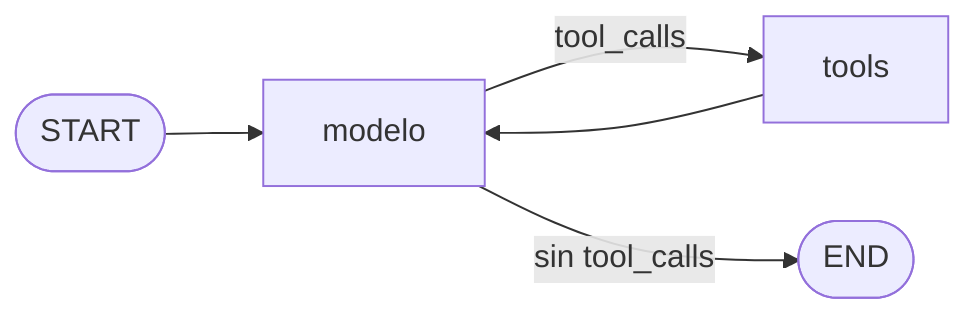

Al terminar esta lección sabrás escribir el bucle agéntico como un grafo de LangGraph: un estado tipado, un nodo que llama al modelo, otro que ejecuta herramientas y una arista que decide si seguir o terminar. Es lo que `create_agent` compila por ti; escribirlo una vez te da el control para añadir pasos propios, que es lo que harás en las lecciones siguientes.

## La idea

Un [[glosario/grafo-de-estado|grafo de estado]] tiene tres piezas:

- **Estado**: un diccionario tipado que viaja por el grafo. Es tu lista `messages` del nivel 40, más los campos que quieras.
- **Nodos**: funciones normales que reciben el estado y devuelven **solo lo que cambian**.
- **Aristas**: qué nodo va después. Fijas (`a → b`) o condicionales (una función que mira el estado y elige).

LangGraph ejecuta por *superpasos*: corre los nodos activos, fusiona sus cambios en el estado y decide los siguientes. Cada superpaso cuenta para el `recursion_limit` y, si hay un [[glosario/checkpointer|checkpointer]], se guarda (lección 6).

El agente de soporte, como grafo:



Es tu bucle a mano dibujado: el `for` se convierte en la arista `tools → modelo`, y el `if resp.stop_reason == "tool_use"` en la arista condicional.

## Estado y reductores

Cuando un nodo devuelve `{"campo": valor}`, el **reductor** del campo decide cómo se combina con lo que había:

- Sin reductor, el valor nuevo **sustituye** al anterior. Un campo `n: int` con valor 5 que un nodo devuelve como 1 queda en 1.
- `Annotated[list, add_messages]` **añade** mensajes, y si llega uno con un `id` que ya existe lo reemplaza. Es el reductor de `MessagesState`.
- `Annotated[int, operator.add]` o `Annotated[list, operator.add]` **suman o concatenan**.

El reductor no es un detalle: si dos nodos en paralelo escriben el mismo campo sin reductor, LangGraph falla con `InvalidUpdateError: At key 'resultados': Can receive only one value per step. Use an Annotated key to handle multiple values.` (comprobado). Lo verás en la lección 8 con `Send`.

## El bucle como grafo

```python title="grafo_soporte.py"
import operator
from typing import Annotated

from langchain.chat_models import init_chat_model
from langchain.messages import SystemMessage
from langchain.tools import tool
from langgraph.graph import END, START, MessagesState, StateGraph
from langgraph.prebuilt import ToolNode, tools_condition

MODEL = "anthropic:claude-sonnet-5-5"
PEDIDOS = {"ana@example.com": [{"id": "P-1001", "estado": "enviado", "fecha": "2026-09-10"}]}


@tool(parse_docstring=True)
def ver_pedidos(email: str) -> str:
    """Lista los pedidos de un cliente por su email.

    Args:
        email: Email del cliente.
    """
    pedidos = PEDIDOS.get(email.lower())
    if pedidos is None:
        raise ValueError(f"No hay ningún cliente con email {email}")
    return str(pedidos)


TOOLS = [ver_pedidos]
SYSTEM = SystemMessage("Eres el asistente de soporte de una tienda online. Usa las herramientas; no inventes datos.")


class Estado(MessagesState):                        # messages ya trae el reductor add_messages
    llamadas_modelo: Annotated[int, operator.add]  # cada nodo suma; no pisa


def construir(modelo=None, checkpointer=None):
    llm = (modelo or init_chat_model(MODEL, max_tokens=2048)).bind_tools(TOOLS)

    def modelo_(state: Estado):
        respuesta = llm.invoke([SYSTEM, *state["messages"]])
        return {"messages": [respuesta], "llamadas_modelo": 1}

    g = StateGraph(Estado)
    g.add_node("modelo", modelo_)
    # Por defecto ToolNode solo captura argumentos inválidos: el resto de excepciones se propaga.
    g.add_node("tools", ToolNode(TOOLS, handle_tool_errors=lambda e: f"Error: {e}"))
    g.add_edge(START, "modelo")
    g.add_conditional_edges("modelo", tools_condition)   # "tools" si hay tool_calls; si no, END
    g.add_edge("tools", "modelo")
    return g.compile(checkpointer=checkpointer)


if __name__ == "__main__":
    grafo = construir()
    out = grafo.invoke({"messages": [("user", "Soy ana@example.com, ¿dónde está mi pedido?")]},
                       {"recursion_limit": 12})
    print(out["messages"][-1].text, "| llamadas al modelo:", out["llamadas_modelo"])
```

Pieza a pieza:

- **`StateGraph(Estado)`** crea el grafo con ese esquema de estado. `MessagesState` ya define `messages`; heredamos de él para añadir un contador.
- **El nodo `modelo_`** es una función normal: llama al modelo con el prompt de sistema delante y devuelve solo los campos que cambia. No devuelve el historial entero: el reductor añade.
- **`ToolNode(TOOLS)`** ejecuta en paralelo todas las `tool_calls` del último `AIMessage` y devuelve un `ToolMessage` por cada una. Es la mitad del bucle que escribiste a mano.
- **`tools_condition`** es la arista condicional ya hecha: va a `"tools"` si el último mensaje tiene `tool_calls` y a `END` si no. Por eso el nodo de herramientas debe llamarse `tools`.
- **`compile()`** valida el grafo (nodos sin conexión, destinos inexistentes) y devuelve algo que se usa igual que el agente de la lección 3: `invoke`, `stream`, `get_state`.

`tools_condition` equivale a escribir tu propia función de enrutado, que es lo que harás cuando la decisión dependa de algo más:

```python title="enrutado.py"
from langgraph.graph import END


def decidir(state) -> str:
    return "tools" if state["messages"][-1].tool_calls else END

# g.add_conditional_edges("modelo", decidir, ["tools", END])   # la lista declara los destinos posibles
```

> [!peligro] ToolNode también deja pasar las excepciones
> Sin `handle_tool_errors`, `ToolNode` solo devuelve al modelo los errores de **validación de argumentos** (un campo que falta). Cualquier otra excepción de tu herramienta se propaga y rompe el grafo: es el mismo origen que la trampa de la lección 2. Con `handle_tool_errors=True` captura todo pero envía un texto propio en inglés con el `repr` de la excepción y «Please fix your mistakes.»; con una función, como aquí, decides tú el mensaje.

## Probarlo y verlo

Con el modelo simulado de la lección 3, primero con un email que no existe y después con el bueno:

```python title="prueba_grafo.py"
from langchain.messages import AIMessage

from _fakes import guion, llamada
from grafo_soporte import construir

modelo = guion(
    AIMessage(content="", tool_calls=[llamada("ver_pedidos", {"email": "nadie@example.com"}, "c1")]),
    AIMessage(content="", tool_calls=[llamada("ver_pedidos", {"email": "ana@example.com"}, "c2")]),
    AIMessage(content="Tu pedido P-1001 se envió el 10 de septiembre."),
)
grafo = construir(modelo)
for parte in grafo.stream({"messages": [("user", "Soy nadie@example.com, perdón, ana@example.com")]},
                          {"recursion_limit": 12}, stream_mode="updates"):
    for nodo, cambio in parte.items():
        m = cambio["messages"][-1]
        print(f"{nodo:6} {getattr(m, 'status', '') or '':7} {m.tool_calls[0]['args'] if m.type == 'ai' and m.tool_calls else m.text}")
```

Salida real:

```text
modelo         {'email': 'nadie@example.com'}
tools  error   Error: No hay ningún cliente con email nadie@example.com
modelo         {'email': 'ana@example.com'}
tools  success [{'id': 'P-1001', 'estado': 'enviado', 'fecha': '2026-09-10'}]
modelo         Tu pedido P-1001 se envió el 10 de septiembre.
```

Y el estado final lleva `llamadas_modelo: 3`, sumado por el reductor en cada paso por el nodo. `grafo.get_graph().draw_mermaid()` devuelve el diagrama Mermaid del grafo compilado (con `modelo -.-> tools`, `modelo -.-> __end__` y `tools --> modelo`), útil para comprobar que lo que construiste es lo que creías.

## Saltar con Command

A veces quieres que un nodo decida él mismo a dónde ir y además cambie el estado. Un nodo puede devolver `Command(goto="nodo", update={...})` (de `langgraph.types`) en lugar de un diccionario; al añadirlo declaras sus destinos con `add_node(..., destinations=("a", "b"))`. Lo usarás en la lección 7 para un nodo de aprobación que va a `tools` si la persona aprueba y vuelve a `modelo` si rechaza, y en la 8 para pasar el control entre agentes.

## Grafo o create_agent

Escribe tu grafo cuando necesites algo que no es «modelo, herramientas, repetir»:

- Pasos deterministas mezclados con pasos del modelo: validar un pedido en código antes de llamar al modelo, clasificar y después enrutar ([[patrones/04-enrutado]]).
- Un nodo de aprobación con lógica propia (lección 7) o ramas en paralelo (lección 8).
- Estado que no son mensajes: un plan, un contador, resultados parciales.

Si tu caso es el bucle de siempre con un par de controles, `create_agent` y su middleware se leen mejor y ya traen lo que escribirías. Y si son dos o tres llamadas seguidas, ni lo uno ni lo otro: funciones normales ([[patrones/01-workflows-vs-agentes]]).

## Errores frecuentes

- Devolver el historial entero desde un nodo (`{"messages": state["messages"] + [r]}`) con `add_messages`: funciona por los `id`, pero oculta errores y duplica trabajo. Devuelve solo lo nuevo.
- Llamar al nodo de herramientas de otra forma que `tools` y usar `tools_condition`.
- Usar `ToolNode` sin `handle_tool_errors`.
- Olvidar el `recursion_limit`: el grafo hereda el de 10 007 superpasos.
- Campos escritos desde nodos en paralelo sin reductor.

## Ejercicio

> [!ejercicio] Un paso determinista antes del modelo
> Añade a `grafo_soporte.py` un nodo `validar` entre `START` y `modelo` que, si el mensaje del usuario no contiene ningún email, responda directamente con un `AIMessage` pidiéndolo y vaya a `END` sin llamar al modelo. Usa una arista condicional o `Command`. Pruébalo con el modelo simulado.
>
> **Está bien si** con «¿Dónde está mi pedido?» el grafo termina con tu mensaje y `llamadas_modelo` vale 0; con un email, la ejecución es la de la salida de arriba; y `draw_mermaid()` muestra el nodo nuevo con sus dos salidas.

> [!ejercicio]- Pistas
> Inicializa `llamadas_modelo` a 0 en la entrada (`{"messages": [...], "llamadas_modelo": 0}`) o te encontrarás el campo sin definir. Un email se detecta con una expresión regular sencilla; no hace falta el modelo para eso.

## Resumen

- Un grafo es estado tipado, nodos que devuelven cambios y aristas fijas o condicionales.
- Los reductores deciden cómo se fusiona cada campo: sustituir, añadir mensajes, sumar.
- El bucle agéntico es `modelo → tools_condition → tools → modelo`; `ToolNode` necesita `handle_tool_errors`.
- Escribe tu grafo cuando el flujo no sea solo modelo y herramientas; si lo es, `create_agent`.

## Para seguir

- [[cursos/langchain-y-langgraph/06-memoria-y-persistencia]]
- [[docs/frameworks/05-langgraph]]
- [[glosario/grafo-de-estado]]
