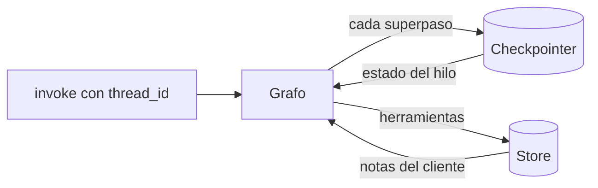

Al terminar esta lección tu agente recordará la conversación de cada cliente sin que tú guardes `messages`, sobrevivirá a un reinicio del proceso, podrás mirar y rebobinar lo que hizo paso a paso, y recordará preferencias del cliente de una conversación a otra. Son dos memorias distintas, y LangGraph tiene una pieza para cada una.

## La idea

En el nivel 40 el estado era tu lista `messages`: si querías continuar una conversación, la guardabas tú y la volvías a enviar. En [[roadmap/30-contexto-y-rag/06-memoria-entre-sesiones]] diste un paso más: un archivo con hechos del usuario que cargabas al empezar. LangGraph separa esas dos necesidades:

| Necesidad | Pieza | Clave | Vida |
|---|---|---|---|
| Seguir **esta** conversación (y reanudar tras una pausa o una caída) | [[glosario/checkpointer\|Checkpointer]] | `thread_id` | Lo que dure el hilo |
| Recordar al **cliente** en conversaciones distintas | *Store* | `namespace` + `key` | La que decidas |



El checkpointer guarda una foto del estado completo al final de cada superpaso. Es lo que hace posible la [[glosario/ejecucion-duradera|ejecución duradera]]: pausar, reanudar, recuperarse de un fallo y volver atrás.

## Hilos con thread_id

Mismo grafo de la lección 5, ahora con `InMemorySaver`. Fíjate en que en la segunda llamada **solo envías el mensaje nuevo**: el resto lo pone el checkpointer.

```python title="hilos.py"
from langchain.messages import AIMessage
from langgraph.checkpoint.memory import InMemorySaver

from _fakes import guion
from grafo_soporte import construir


def respuestas(*textos):
    return guion(*[AIMessage(content=t) for t in textos])


# Sin checkpointer, cada invoke empieza de cero
g = construir(respuestas("Hola, Ana.", "No sé cómo te llamas."))
g.invoke({"messages": [("user", "Soy Ana")]})
print("sin checkpointer:", len(g.invoke({"messages": [("user", "¿Cómo me llamo?")]})["messages"]), "mensajes")

# Con checkpointer, el estado vive por thread_id
g = construir(respuestas("Hola, Ana.", "Te llamas Ana.", "Hola, ¿en qué te ayudo?"), InMemorySaver())
ana = {"configurable": {"thread_id": "ticket-ana"}}
luis = {"configurable": {"thread_id": "ticket-luis"}}
g.invoke({"messages": [("user", "Soy Ana")]}, ana)
out = g.invoke({"messages": [("user", "¿Cómo me llamo?")]}, ana)   # solo envías lo nuevo
print("mismo hilo:", [m.type for m in out["messages"]], "·", out["messages"][-1].text)
print("otro hilo:", len(g.invoke({"messages": [("user", "Hola")]}, luis)["messages"]), "mensajes")

# Inspeccionar: estado actual e historial de checkpoints
estado = g.get_state(ana)
print("get_state:", estado.values["llamadas_modelo"], "llamadas · next:", estado.next)
for h in g.get_state_history(ana):                                   # del más reciente al más antiguo
    print(f"  paso {h.metadata['step']:>2} · {h.metadata['source']:5} · next={h.next} · mensajes={len(h.values.get('messages', []))}")
```

Salida real:

```text
sin checkpointer: 2 mensajes
mismo hilo: ['human', 'ai', 'human', 'ai'] · Te llamas Ana.
otro hilo: 2 mensajes
get_state: 2 llamadas · next: ()
  paso  4 · loop  · next=() · mensajes=4
  paso  3 · loop  · next=('modelo',) · mensajes=3
  paso  2 · input · next=('__start__',) · mensajes=2
  paso  1 · loop  · next=() · mensajes=2
  paso  0 · loop  · next=('modelo',) · mensajes=1
  paso -1 · input · next=('__start__',) · mensajes=0
```

Dos turnos dejaron seis *checkpoints*: uno al recibir cada entrada (`input`) y uno tras cada superpaso (`loop`). `next` dice qué nodo toca a continuación; vacío significa que el hilo terminó su turno. Cuando un hilo esté pausado esperando una aprobación (lección 7), `next` dirá dónde.

`create_agent` acepta el mismo `checkpointer=` y funciona igual: es un grafo.

> [!aviso] La conversación crece sin parar
> Con un checkpointer, cada turno del hilo reenvía al modelo todo el historial guardado. Un hilo de soporte que dura semanas acaba siendo caro y pierde calidad. Decide cuándo se cierra un hilo (un ticket, una sesión) y usa `SummarizationMiddleware` o recorta en un `before_model` si los hilos son largos. El porqué está en [[cursos/context-engineering/03-compactacion-y-memoria]].

## Volver atrás y editar

Cada checkpoint tiene su `config` con un `checkpoint_id`. Si invocas con esa config, el grafo **sigue desde ese punto** y crea una rama nueva en el mismo hilo. Sirve para depurar («¿qué habría hecho con otra respuesta?») y para corregir sin empezar de cero:

```python title="atras.py"
from langchain.messages import AIMessage
from langgraph.checkpoint.memory import InMemorySaver

from _fakes import guion
from grafo_soporte import construir

g = construir(guion(AIMessage(content="Hola, Ana."), AIMessage(content="Te llamas Ana."),
                    AIMessage(content="Entendido, Luis.")), InMemorySaver())
cfg = {"configurable": {"thread_id": "t1"}}
g.invoke({"messages": [("user", "Soy Ana")]}, cfg)
g.invoke({"messages": [("user", "¿Cómo me llamo?")]}, cfg)

# Volver al final del primer turno y seguir desde ahí: una rama nueva en el mismo hilo
fin_turno_1 = next(h for h in g.get_state_history(cfg) if h.metadata["step"] == 1)
out = g.invoke({"messages": [("user", "Corrijo: soy Luis")]}, fin_turno_1.config)
print("rama nueva:", [m.text for m in out["messages"]])

# Editar el estado a mano (p. ej., un operador añade una nota)
g.update_state(cfg, {"messages": [("user", "(nota del operador) cliente con incidencia abierta")]})
print("tras update_state:", g.get_state(cfg).values["messages"][-1].text)
```

```text
rama nueva: ['Soy Ana', 'Hola, Ana.', 'Corrijo: soy Luis', 'Entendido, Luis.']
tras update_state: (nota del operador) cliente con incidencia abierta
```

La pregunta «¿Cómo me llamo?» no está en la rama nueva: el grafo partió del estado del paso 1. `update_state` pasa los valores por los reductores, como si los hubiera devuelto un nodo.

## Persistir en disco con SQLite

`InMemorySaver` desaparece con el proceso. Para el proyecto usamos `SqliteSaver` (paquete `langgraph-checkpoint-sqlite`). Ojo con cómo se crea: **`SqliteSaver.from_conn_string("ruta.db")` es un gestor de contexto** y se usa con `with`; `SqliteSaver(conexion)` también existe, pero no es un gestor de contexto (`with SqliteSaver(conn)` da `TypeError`) y la conexión la cierras tú.

```python title="sqlite_reinicio.py"
from langchain.messages import AIMessage
from langgraph.checkpoint.sqlite import SqliteSaver

from _fakes import guion
from grafo_soporte import construir

cfg = {"configurable": {"thread_id": "ticket-123"}}

with SqliteSaver.from_conn_string("soporte.db") as cp:               # primer proceso
    construir(guion(AIMessage(content="Hola, Ana.")), cp).invoke({"messages": [("user", "Soy Ana")]}, cfg)

with SqliteSaver.from_conn_string("soporte.db") as cp:               # «otro proceso», mismo archivo
    out = construir(guion(AIMessage(content="Te llamas Ana.")), cp).invoke(
        {"messages": [("user", "¿Cómo me llamo?")]}, cfg)
    print([m.text for m in out["messages"]])
```

```text
['Soy Ana', 'Hola, Ana.', '¿Cómo me llamo?', 'Te llamas Ana.']
```

En producción con varios servidores, `PostgresSaver` (paquete `langgraph-checkpoint-postgres`) tiene la misma interfaz. Este fragmento no se ha ejecutado aquí porque necesita un PostgreSQL; consulta la documentación de LangGraph antes de usarlo:

```python nocheck title="postgres.py"
from langgraph.checkpoint.postgres import PostgresSaver

with PostgresSaver.from_conn_string("postgresql://…/soporte") as cp:
    cp.setup()                                   # crea las tablas la primera vez
    grafo = construir(checkpointer=cp)
```

El paso a paso para reanudar tras una caída, con las precauciones de idempotencia, está en [[recetas/reanudar-un-agente-tras-un-reinicio]].

## Memoria entre conversaciones con un store

El checkpointer no sirve para recordar al cliente en el ticket siguiente: otro `thread_id` es otro estado. Para eso está el *store*, un almacén clave-valor organizado por *namespaces* que las herramientas leen y escriben a través de `ToolRuntime`. En el proyecto, la identidad del cliente llega como **contexto** de la invocación, que pone tu código y el modelo no ve ni puede cambiar:

```python title="memoria_cliente.py"
from dataclasses import dataclass

from langchain.agents import create_agent
from langchain.agents.middleware import ToolErrorMiddleware
from langchain.chat_models import init_chat_model
from langchain.tools import ToolRuntime, tool
from langgraph.checkpoint.memory import InMemorySaver
from langgraph.store.memory import InMemoryStore

MODEL = "anthropic:claude-sonnet-5-5"


@dataclass
class Cliente:                              # lo pone tu código desde la sesión, nunca el modelo
    id: str
    email: str


@tool
def recordar(dato: str, runtime: ToolRuntime[Cliente]) -> str:
    """Guarda un dato duradero del cliente (preferencias de contacto, idioma). Nada sensible."""
    runtime.store.put(("clientes", runtime.context.id), "notas", {"texto": dato})
    return "Guardado."


@tool
def leer_notas(runtime: ToolRuntime[Cliente]) -> str:
    """Devuelve lo que se recuerda del cliente de conversaciones anteriores."""
    item = runtime.store.get(("clientes", runtime.context.id), "notas")
    return item.value["texto"] if item else "Sin notas."


def crear_agente(modelo=None, store=None):
    return create_agent(
        model=modelo or init_chat_model(MODEL, max_tokens=1024),
        tools=[recordar, leer_notas],
        system_prompt="Eres el soporte de una tienda. Al empezar, lee las notas del cliente.",
        context_schema=Cliente,              # tipo del contexto que recibe cada invocación
        middleware=[ToolErrorMiddleware(on_error=lambda exc, request: f"Error: {exc}")],
        checkpointer=InMemorySaver(),        # memoria de la conversación (por thread_id)
        store=store or InMemoryStore(),      # memoria entre conversaciones (por namespace)
    )
```

El parámetro `runtime` no aparece en el esquema que ve el modelo: LangChain lo inyecta. La prueba usa dos hilos distintos para el mismo cliente:

```python title="prueba_memoria.py"
from langchain.messages import AIMessage
from langgraph.store.memory import InMemoryStore

from _fakes import guion, llamada
from memoria_cliente import Cliente, crear_agente

store = InMemoryStore()
ana = Cliente(id="c-42", email="ana@example.com")

lunes = guion(AIMessage(content="", tool_calls=[llamada("recordar", {"dato": "Prefiere correo, no teléfono."}, "r1")]),
              AIMessage(content="Anotado."))
crear_agente(lunes, store).invoke({"messages": [("user", "Escribidme por correo, no me llaméis")]},
                                  {"configurable": {"thread_id": "ticket-1"}}, context=ana)

jueves = guion(AIMessage(content="", tool_calls=[llamada("leer_notas", {}, "l1")]), AIMessage(content="Hola, Ana."))
r = crear_agente(jueves, store).invoke({"messages": [("user", "Hola otra vez")]},
                                       {"configurable": {"thread_id": "ticket-2"}}, context=ana)
print("otro hilo lee:", [m.text for m in r["messages"] if m.type == "tool"])
print("en el store:", [(i.namespace, i.key, i.value) for i in store.search(("clientes", "c-42"))])

try:                                         # un email como etiqueta de namespace
    store.put(("clientes", ana.email), "notas", {"texto": "x"})
except Exception as e:
    print(type(e).__name__, str(e)[:95])
```

```text
otro hilo lee: ['Prefiere correo, no teléfono.']
en el store: [(('clientes', 'c-42'), 'notas', {'texto': 'Prefiere correo, no teléfono.'})]
InvalidNamespaceError Invalid namespace label 'ana@example.com' found in ('clientes', 'ana@example.com'). Namespace l
```

La última línea es una trampa que encontramos al montar el proyecto: **las etiquetas de un namespace no pueden contener puntos**, así que un email no sirve como clave. Usa un id interno. `InMemoryStore` también se pierde al cerrar el proceso; en producción, un store persistente como `PostgresStore`. Las reglas de qué guardar y qué no (nada sensible, sin duplicados, con fecha) son las de [[roadmap/30-contexto-y-rag/06-memoria-entre-sesiones]]: el store es solo el cajón.

## En el proyecto

Tu `soporte.py` pasa a crear el agente con `checkpointer=SqliteSaver…`, un `thread_id` por ticket, `context_schema=Cliente` y las herramientas `recordar` y `leer_notas`. La herramienta `ver_pedido` usa ahora `runtime.context.email` para comprobar que el pedido es del cliente, en lugar de aceptar el email como argumento. Lo verás entero en la lección siguiente.

## Errores frecuentes

- Reenviar el historial completo en cada `invoke` con checkpointer: los mensajes se duplican (o se reemplazan por `id`, según cómo los crees). Envía solo lo nuevo.
- Un `thread_id` fijo para todos los usuarios: todos comparten conversación.
- Usar `SqliteSaver(conn)` dentro de un `with` o no cerrar nunca la conexión.
- Guardar en el store datos que el usuario no espera que recuerdes, o claves con puntos.
- Pedir el id del cliente como argumento de una herramienta: el modelo podría poner otro.

## Ejercicio

> [!ejercicio] Un ticket que sobrevive
> Combina el grafo de la lección 5 con `SqliteSaver` y un `thread_id` por ticket. Ejecuta un primer turno en un script, ciérralo y lanza otro script que continúe el ticket. Añade una función `resumen_ticket(thread_id)` que, con `get_state_history`, imprima cuántos turnos, llamadas al modelo y herramientas hubo.
>
> **Está bien si** el segundo script ve los mensajes del primero sin que los reenvíes, si dos tickets distintos no se mezclan y si `resumen_ticket` cuenta bien los `ToolMessage` del hilo (compáralo con lo que imprime el *stream*).

> [!ejercicio]- Pistas
> El último checkpoint (`get_state`) ya tiene todos los mensajes del hilo; `get_state_history` te sirve si quieres los pasos. Los turnos son los checkpoints con `metadata["source"] == "input"`.

## Resumen

- Checkpointer + `thread_id` = memoria de la conversación, reanudable; store + namespace = memoria del cliente entre conversaciones.
- `get_state`, `get_state_history` y `update_state` para ver, rebobinar y corregir.
- `SqliteSaver.from_conn_string` con `with`; `PostgresSaver` cuando hay varios procesos.
- La identidad del cliente va en el contexto de la invocación, no en los argumentos de las herramientas.

## Para seguir

- [[cursos/langchain-y-langgraph/07-humano-en-el-bucle-con-interrupt]]
- [[recetas/reanudar-un-agente-tras-un-reinicio]]
- [[glosario/checkpointer]]
