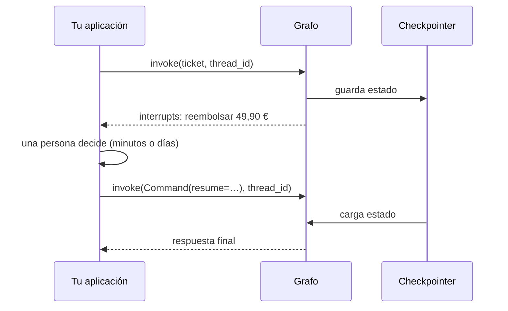
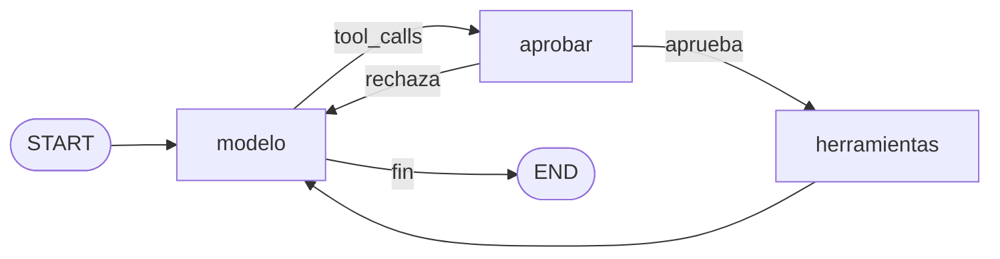

Al terminar esta lección tu agente de soporte se detendrá antes de cada reembolso, enseñará a una persona los argumentos exactos, esperará lo que haga falta (aunque el proceso se reinicie entre medias) y continuará con su decisión: aprobar, editar el importe o rechazar con un motivo. Lo harás de dos formas, con `interrupt()` en tu propio grafo y con el middleware de `create_agent`.

## La idea

En [[roadmap/100-produccion/05-humano-en-el-bucle]] montaste la pausa a mano: no ejecutar el `tool_use` sensible, guardar `messages`, los resultados ya calculados y los pendientes en tu base de datos, y al decidir la persona construir los `tool_result` y seguir. LangGraph lo reduce a una función:

- **`interrupt(valor)`**, dentro de un nodo, detiene el grafo. El checkpointer guarda el estado y `valor` llega al llamante.
- **`Command(resume=decision)`**, en un `invoke` posterior con el **mismo `thread_id`**, reanuda. El nodo vuelve a ejecutarse y esta vez `interrupt()` devuelve `decision`.



Lo que te ahorras es la parte delicada: no tienes que serializar el historial, los `tool_result` pendientes ni el punto exacto del bucle. Todo eso es el checkpoint.

## En tu grafo: un nodo de aprobación

Sobre el grafo de la lección 5 añadimos un nodo `aprobar` entre el modelo y las herramientas. Si alguna `tool_call` es sensible, pausa; si la persona rechaza, devuelve un `ToolMessage` de error **por cada** `tool_call` del turno, también las no sensibles, porque Claude exige un `tool_result` por cada `tool_use`.

```python title="grafo_aprobacion.py"
from langchain.chat_models import init_chat_model
from langchain.messages import SystemMessage, ToolMessage
from langchain.tools import tool
from langgraph.graph import END, START, MessagesState, StateGraph
from langgraph.prebuilt import ToolNode
from langgraph.types import Command, interrupt

MODEL = "anthropic:claude-sonnet-5-5"
SENSIBLES = {"reembolsar"}                     # herramientas que necesitan aprobación


@tool
def ver_pedido(pedido_id: str) -> str:
    """Devuelve estado e importe de un pedido por su id (formato P-NNNN)."""
    return '{"id": "%s", "estado": "entregado", "importe_eur": 49.90}' % pedido_id


@tool
def reembolsar(pedido_id: str, importe_eur: float) -> str:
    """Emite un reembolso. Acción irreversible: solo tras confirmar el pedido con ver_pedido."""
    return f"Reembolso de {importe_eur} € emitido para {pedido_id}."


TOOLS = [ver_pedido, reembolsar]
SYSTEM = SystemMessage("Eres un agente de soporte. Antes de reembolsar, comprueba el pedido.")


def construir(modelo=None, checkpointer=None):
    llm = (modelo or init_chat_model(MODEL, max_tokens=2048)).bind_tools(TOOLS)

    def llamar_modelo(state: MessagesState):
        respuesta = llm.invoke([SYSTEM, *state["messages"]])
        return {"messages": [respuesta]}           # add_messages lo añade al historial

    def decidir(state: MessagesState):
        return "aprobar" if state["messages"][-1].tool_calls else END

    def aprobar(state: MessagesState):
        llamadas = state["messages"][-1].tool_calls
        pendientes = [c for c in llamadas if c["name"] in SENSIBLES]
        if not pendientes:
            return Command(goto="herramientas")
        # Pausa aquí. Al reanudar, el nodo se ejecuta otra vez desde el principio
        # e interrupt() devuelve lo que pasaste en Command(resume=...).
        decision = interrupt({"pendientes": [{"name": c["name"], "args": c["args"]} for c in pendientes]})
        if decision == "aprobar":
            return Command(goto="herramientas")
        # Rechazo: un ToolMessage por cada tool_call (también las no sensibles) y vuelta al modelo.
        rechazos = [ToolMessage(content="Rechazado por un humano: no lo ejecutes otra vez.",
                                tool_call_id=c["id"], name=c["name"], status="error") for c in llamadas]
        return Command(goto="modelo", update={"messages": rechazos})

    g = StateGraph(MessagesState)
    g.add_node("modelo", llamar_modelo)
    g.add_node("aprobar", aprobar, destinations=("herramientas", "modelo"))
    g.add_node("herramientas", ToolNode(TOOLS, handle_tool_errors=lambda e: f"Error: {e}"))
    g.add_edge(START, "modelo")
    g.add_conditional_edges("modelo", decidir, ["aprobar", END])
    g.add_edge("herramientas", "modelo")
    return g.compile(checkpointer=checkpointer)
```



La prueba hace lo que pasará en producción: el ticket llega, el grafo se pausa y el proceso termina; horas después otro proceso abre el mismo SQLite y reanuda con la decisión.

```python title="prueba_aprobacion.py"
from langchain.messages import AIMessage
from langgraph.checkpoint.sqlite import SqliteSaver
from langgraph.types import Command

from _fakes import guion, llamada
from grafo_aprobacion import construir

modelo = guion(
    AIMessage(content="", tool_calls=[llamada("ver_pedido", {"pedido_id": "P-1001"}, "c1")]),
    AIMessage(content="", tool_calls=[llamada("reembolsar", {"pedido_id": "P-1001", "importe_eur": 49.9}, "c2")]),
    AIMessage(content="Entendido: no se reembolsa."),
)
config = {"configurable": {"thread_id": "ticket-123"}, "recursion_limit": 25}

with SqliteSaver.from_conn_string("aprobaciones.db") as cp:          # proceso 1: llega el ticket
    grafo = construir(modelo, cp)
    out = grafo.invoke({"messages": [("user", "Devolvedme P-1001, llegó roto")]}, config, version="v2")
    print("pausa:", out.interrupts[0].value, "| next:", grafo.get_state(config).next)

with SqliteSaver.from_conn_string("aprobaciones.db") as cp:          # proceso 2: horas después, decide una persona
    grafo = construir(modelo, cp)
    out = grafo.invoke(Command(resume="rechazar"), config, version="v2")
    for m in out.value["messages"]:
        if m.type == "tool":
            print(f"  {m.name}: {m.status} · {m.text[:50]}")
    print("final:", out.value["messages"][-1].text)
```

Salida real:

```text
pausa: {'pendientes': [{'name': 'reembolsar', 'args': {'pedido_id': 'P-1001', 'importe_eur': 49.9}}]} | next: ('aprobar',)
  ver_pedido: success · {"id": "P-1001", "estado": "entregado", "importe_e
  reembolsar: error · Rechazado por un humano: no lo ejecutes otra vez.
final: Entendido: no se reembolsa.
```

`next: ('aprobar',)` es lo que guarda el checkpointer: el hilo está detenido en ese nodo. Con `invoke(..., version="v2")` el resultado es un objeto con `.value` (el estado) y `.interrupts`; sin `version="v2"` recibes un diccionario con la clave `"__interrupt__"`. Las dos formas funcionan; el curso usa `version="v2"` porque se lee mejor.

> [!peligro] El nodo se repite entero al reanudar
> `interrupt()` funciona lanzando una excepción especial que el grafo captura. Al reanudar, **el nodo vuelve a ejecutarse desde la primera línea**. Lo comprobamos con un contador: el código anterior al `interrupt` se ejecutó dos veces. Si antes de pausar envías un correo, cobras o escribes en una base de datos, lo harás dos veces. Pon los efectos después del `interrupt` o en otro nodo, y no envuelvas `interrupt()` en un `try/except` genérico.

## En create_agent: HumanInTheLoopMiddleware

Si tu agente es el bucle normal, no hace falta escribir el nodo: `HumanInTheLoopMiddleware` pausa en su gancho `after_model` cuando el modelo pide una herramienta configurada. Este es el proyecto del curso completo, con todo lo de las lecciones anteriores:

```python title="soporte.py"
"""Agente de soporte con LangChain: el proyecto del curso.

pip install -U langchain langchain-anthropic langgraph-checkpoint-sqlite
"""
import json
from dataclasses import dataclass

from langchain.agents import create_agent
from langchain.agents.middleware import (HumanInTheLoopMiddleware, ModelCallLimitMiddleware,
                                         ToolErrorMiddleware)
from langchain.chat_models import init_chat_model
from langchain.tools import ToolRuntime, tool

MODEL = "anthropic:claude-sonnet-5-5"      # o "ollama:qwen3.6:27b" con Ollama en marcha

PEDIDOS = {"P-1001": {"cliente": "ana@example.com", "estado": "entregado", "importe_eur": 49.90}}
POLITICAS = {"devoluciones": "30 días desde la entrega, producto sin usar. Si llegó roto, reembolso completo."}


@dataclass
class Cliente:                              # lo pone tu código desde la sesión, nunca el modelo
    id: str
    email: str


@tool(parse_docstring=True)
def ver_pedido(pedido_id: str, runtime: ToolRuntime[Cliente]) -> str:
    """Devuelve estado e importe de un pedido del cliente.

    Args:
        pedido_id: Id del pedido, formato P-NNNN.
    """
    pedido = PEDIDOS.get(pedido_id)
    if pedido is None or pedido["cliente"] != runtime.context.email:
        raise ValueError(f"El cliente no tiene ningún pedido {pedido_id}")
    return json.dumps(pedido, ensure_ascii=False)


@tool(parse_docstring=True)
def buscar_politica(tema: str) -> str:
    """Busca la política de la tienda sobre un tema.

    Args:
        tema: devoluciones, envíos o pagos.
    """
    return POLITICAS.get(tema.lower(), "Sin resultados para ese tema.")


@tool(parse_docstring=True)
def reembolsar(pedido_id: str, importe_eur: float, motivo: str) -> str:
    """Emite un reembolso. Irreversible: solo tras comprobar el pedido con ver_pedido.

    Args:
        pedido_id: Id del pedido, formato P-NNNN.
        importe_eur: Importe en euros; nunca más de lo pagado.
        motivo: Motivo en una frase, para el registro.
    """
    return f"Reembolso de {importe_eur} € emitido para {pedido_id}."


@tool
def recordar(dato: str, runtime: ToolRuntime[Cliente]) -> str:
    """Guarda un dato duradero del cliente (preferencias de contacto, idioma). Nada sensible."""
    runtime.store.put(("clientes", runtime.context.id), "notas", {"texto": dato})
    return "Guardado."


@tool
def leer_notas(runtime: ToolRuntime[Cliente]) -> str:
    """Devuelve lo que se recuerda del cliente de conversaciones anteriores."""
    item = runtime.store.get(("clientes", runtime.context.id), "notas")
    return item.value["texto"] if item else "Sin notas."


SYSTEM = ("Eres el agente de soporte de una tienda online. Consulta los datos con las herramientas; "
          "no los inventes. Antes de reembolsar, comprueba el pedido y la política.")


def crear_agente(modelo=None, checkpointer=None, store=None):
    return create_agent(
        model=modelo or init_chat_model(MODEL, max_tokens=2048),
        tools=[ver_pedido, buscar_politica, reembolsar, recordar, leer_notas],
        system_prompt=SYSTEM,
        context_schema=Cliente,
        middleware=[
            ToolErrorMiddleware(on_error=lambda exc, req: f"Error: {exc}"),       # el equivalente a is_error
            ModelCallLimitMiddleware(run_limit=8, exit_behavior="end"),            # tope de llamadas por turno
            HumanInTheLoopMiddleware(interrupt_on={
                "reembolsar": {"allowed_decisions": ["approve", "edit", "reject"]},
            }),
        ],
        checkpointer=checkpointer,           # SqliteSaver en el proyecto: sobrevive a reinicios
        store=store,                         # memoria entre conversaciones
    )
```

`interrupt_on` admite por herramienta `True` (permite las cuatro decisiones), `False` (sin pausa) o un diccionario con `allowed_decisions`. Una decisión que no está permitida no se ignora: lanza `ValueError` al reanudar. Las cuatro, comprobadas:

| Decisión | Qué recibe el modelo |
|---|---|
| `{"type": "approve"}` | La herramienta se ejecuta tal cual |
| `{"type": "edit", "edited_action": {"name": "reembolsar", "args": {…}}}` | Se ejecuta con los argumentos editados; el `ToolMessage` empieza por «Note: a human reviewer replaced this tool call before it ran…» seguido de los argumentos usados y la respuesta |
| `{"type": "reject", "message": "Fuera de plazo."}` | Un `ToolMessage` con `status="error"`: «User rejected the tool call for `reembolsar` with reason: Fuera de plazo.» |
| `{"type": "respond", "message": "…"}` | No se ejecuta; el modelo recibe tu texto como resultado (solo si la permites) |

La reanudación lleva **una decisión por cada acción pendiente, en el mismo orden**: `Command(resume={"decisions": [...]})`. La petición que llega en `out.interrupts[0].value` tiene `action_requests` (nombre, argumentos y una descripción) y `review_configs` (qué decisiones caben). Con esos datos montas la pantalla del revisor: enseña los argumentos que salen de ahí, no un resumen escrito por el modelo.

El mismo recorrido con reinicio entre la pausa y la decisión:

```python title="prueba_soporte_reinicio.py"
from langchain.messages import AIMessage
from langgraph.checkpoint.sqlite import SqliteSaver
from langgraph.types import Command

from _fakes import guion, llamada
from soporte import Cliente, crear_agente

ANA = Cliente(id="c-42", email="ana@example.com")
config = {"configurable": {"thread_id": "ticket-123"}}
modelo = guion(
    AIMessage(content="", tool_calls=[llamada("reembolsar", {"pedido_id": "P-1001", "importe_eur": 49.9,
                                                             "motivo": "llegó roto"}, "c1")]),
    AIMessage(content="Hecho: te hemos reembolsado 49,90 €."),
)

with SqliteSaver.from_conn_string("soporte.db") as cp:
    out = crear_agente(modelo, cp).invoke({"messages": [("user", "P-1001 llegó roto")]}, config,
                                          context=ANA, version="v2")
    print("pausa:", out.interrupts[0].value["action_requests"][0]["args"])

with SqliteSaver.from_conn_string("soporte.db") as cp:               # tras reiniciar el servicio
    agente = crear_agente(modelo, cp)
    print("pendiente en:", agente.get_state(config).next)
    out = agente.invoke(Command(resume={"decisions": [{"type": "approve"}]}), config, context=ANA, version="v2")
    print("final:", out.value["messages"][-1].text)
```

```text
pausa: {'pedido_id': 'P-1001', 'importe_eur': 49.9, 'motivo': 'llegó roto'}
pendiente en: ('HumanInTheLoopMiddleware.after_model',)
final: Hecho: te hemos reembolsado 49,90 €.
```

## Qué hace falta y qué falla

Lo que necesita `interrupt` para funcionar es poco y estricto: **un checkpointer y el mismo `thread_id`** en la pausa y en la reanudación. Los fallos que hemos provocado a propósito, para que los reconozcas:

- **Sin checkpointer**, la pausa parece funcionar (el grafo devuelve la interrupción), pero reanudar lanza `RuntimeError: Cannot use Command(resume=...) without checkpointer`.
- **Con otro `thread_id`**, no hay error: el grafo arranca un hilo vacío, ejecuta el modelo sin historial y devuelve algo sin sentido, mientras el hilo original sigue pausado. Es el fallo más traicionero.
- **Enviar un mensaje nuevo en lugar de `Command`** («sí, apruébalo») tampoco da error: el agente sigue la conversación y la `tool_call` pendiente se queda sin su `ToolMessage` en el historial. Con Claude, la siguiente llamada fallará por un `tool_use` sin `tool_result` ([[problemas/tool-result-sin-tool-use]]).
- **Saltarte un `interrupt` según una condición** en un nodo con varios: se emparejan por posición, y al reanudar cada respuesta irá al que no toca.
- **Valores no serializables** en `interrupt(…)`: con un checkpointer en disco tienen que poder guardarse; usa tipos JSON.

El diagnóstico paso a paso está en [[problemas/langgraph-no-reanuda-tras-interrupt]] y la versión en forma de receta, en [[recetas/aprobacion-humana-con-langgraph]].

## Lo que sigue siendo tuyo

El framework guarda el estado; no decide por ti lo importante de [[roadmap/100-produccion/05-humano-en-el-bucle]]:

- **Qué acciones se aprueban.** La tabla de reversibilidad e impacto sigue valiendo; `interrupt_on` solo la aplica.
- **Idempotencia.** Si el revisor pulsa dos veces o tu servicio reintenta la reanudación, la herramienta de reembolso debe reconocer la operación. LangGraph no lo hace por ti.
- **Caducidad y registro.** Una aprobación de hace una semana puede no tener sentido; quién decidió, qué y cuándo lo guardas tú.

## Errores frecuentes

- Crear el agente con `InMemorySaver` en un servicio web: cada reinicio pierde todas las aprobaciones pendientes.
- Generar el `thread_id` de nuevo en la petición de reanudación en lugar de guardarlo con el ticket.
- Mostrar al revisor la explicación del modelo en lugar de `action_requests[…]["args"]`.
- Rechazar solo la `tool_call` sensible en tu nodo y olvidar las demás del mismo turno.
- Poner efectos secundarios antes de `interrupt()`.

## Ejercicio

> [!ejercicio] Reembolsos con supervisor
> En `soporte.py`, permite `edit` solo para bajar el importe: si el revisor edita y sube el importe, rechaza en código. Escribe un pequeño programa de línea de comandos que liste los tickets pausados de `soporte.db` con sus argumentos y permita aprobar, rechazar con motivo o editar el importe. Prueba los tres recorridos con el modelo simulado, cerrando el proceso entre la pausa y la decisión.
>
> **Está bien si** el reembolso nunca se ejecuta antes de la decisión, cada recorrido termina con una respuesta del agente, un intento de subir el importe acaba en rechazo con motivo y reanudar con un `thread_id` equivocado se detecta en tu programa (comprueba `get_state(config).next` antes de reanudar).

> [!ejercicio]- Pistas
> Un `wrap_tool_call` como el de la lección 4 sirve para comparar el importe editado con el del pedido, pero **el orden importa**: lo hemos comprobado y solo ve los argumentos editados si va después de `HumanInTheLoopMiddleware` en la lista; si va antes, ve los originales del modelo. Para listar hilos pausados, guarda tú los `thread_id` de los tickets en una tabla; no dependas de leer las tablas internas del checkpointer.

## Resumen

- `interrupt(valor)` pausa; `Command(resume=…)` con el mismo `thread_id` reanuda; el checkpointer es obligatorio.
- El nodo que pausa se repite entero al reanudar: nada de efectos antes del `interrupt`.
- `HumanInTheLoopMiddleware` hace lo mismo en `create_agent`, con decisiones `approve`, `edit`, `reject` y `respond`, una por acción y en orden.
- Otro `thread_id` o un mensaje nuevo en lugar de `Command` no dan error, pero rompen la reanudación.

## Para seguir

- [[cursos/langchain-y-langgraph/08-multiagente-con-langgraph]]
- [[recetas/aprobacion-humana-con-langgraph]]
- [[sistemas/soporte-con-aprobacion-humana]]
