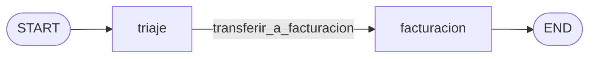
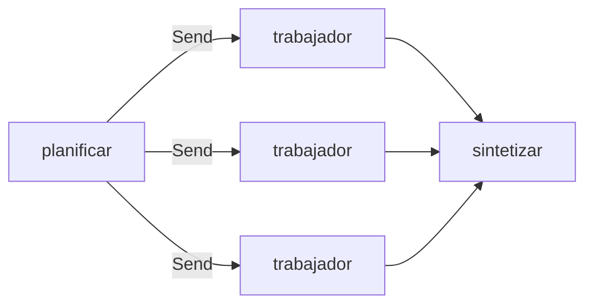

Al terminar esta lección sabrás montar con LangGraph las tres formas de repartir trabajo que viste en el [[roadmap/60-multiagente/index|nivel 60]]: un supervisor que delega en especialistas, un traspaso de la conversación de un agente a otro y un reparto en paralelo con síntesis final. Y sabrás qué cuesta cada una, porque multiplicar agentes multiplica llamadas.

## La idea

En [[roadmap/60-multiagente/02-orquestador-y-subagentes]] un subagente era un bucle con su propio `messages`, llamado desde una herramienta del orquestador. En LangGraph la idea es la misma con tres herramientas de construcción:

| Forma | Pieza de LangGraph | Quién decide el siguiente paso |
|---|---|---|
| Supervisor y especialistas | Subagentes creados con `create_agent`, envueltos en `@tool` | El modelo del supervisor |
| Traspaso (*handoff*) | Subgrafos como nodos y `Command(goto=…, graph=Command.PARENT)` | El agente que suelta la conversación |
| Map-reduce | `Send` con un reductor en el estado | Tu código |

> [!aviso] Antes de multiplicar agentes
> Cada subagente es otro bucle con sus propias llamadas al modelo. Un supervisor con dos especialistas hace como mínimo el doble de llamadas que un agente con las mismas herramientas, y pierde información en cada resumen. Repasa [[roadmap/60-multiagente/01-cuando-no-usar-multiagente]] y prueba antes un solo agente con buenas herramientas.

## Supervisor con subagentes como herramientas

Es la forma que recomienda hoy LangChain: el README de `langgraph-supervisor` dice que ahora aconsejan hacer el supervisor «directly via tools», y ni ese paquete ni `langgraph-swarm` tienen versiones nuevas desde finales de 2025. No necesitas ninguno de los dos:

```python title="supervisor.py"
from langchain.agents import create_agent
from langchain.chat_models import init_chat_model
from langchain.tools import tool

MODEL = "anthropic:claude-sonnet-5-5"
PEDIDOS = {"P-1001": {"estado": "entregado", "importe_eur": 49.90, "entregado": "2026-10-20"}}
POLITICAS = {"devoluciones": "30 días desde la entrega, producto sin usar. Defectuoso: reembolso completo."}


@tool
def ver_pedido(pedido_id: str) -> str:
    """Devuelve estado, importe y fecha de entrega de un pedido (formato P-NNNN)."""
    return str(PEDIDOS.get(pedido_id, "No existe ese pedido."))


@tool
def buscar_politica(tema: str) -> str:
    """Busca la política de la tienda sobre un tema: devoluciones, envíos o pagos."""
    return POLITICAS.get(tema.lower(), "Sin resultados.")


def crear_supervisor(modelo=None, modelo_pedidos=None, modelo_politicas=None):
    llm = modelo or init_chat_model(MODEL, max_tokens=2048)
    pedidos = create_agent(modelo_pedidos or llm, [ver_pedido], name="pedidos",
                           system_prompt="Consultas datos de pedidos. Devuelve solo hechos, en 2-3 frases.")
    politicas = create_agent(modelo_politicas or llm, [buscar_politica], name="politicas",
                             system_prompt="Respondes qué dice la política. Cita el texto exacto.")

    @tool
    def preguntar_a_pedidos(pregunta: str) -> str:
        """Delega una pregunta sobre un pedido concreto (estado, importe, fechas). Incluye el id del pedido."""
        r = pedidos.invoke({"messages": [("user", pregunta)]})   # contexto limpio: solo la pregunta
        return r["messages"][-1].text                            # al supervisor solo le llega el resumen

    @tool
    def preguntar_a_politicas(pregunta: str) -> str:
        """Delega una pregunta sobre las políticas de la tienda (devoluciones, envíos, pagos)."""
        r = politicas.invoke({"messages": [("user", pregunta)]})
        return r["messages"][-1].text

    return create_agent(llm, [preguntar_a_pedidos, preguntar_a_politicas], name="supervisor",
                        system_prompt="Eres el supervisor de soporte. Delega en los especialistas y responde al cliente.")
```

Lo importante está en los comentarios de las herramientas: cada especialista arranca **con contexto limpio** (solo la pregunta del supervisor) y devuelve **solo su respuesta final**, no su historial. Es lo que en el nivel 60 llamabas pasar contexto entre agentes ([[roadmap/60-multiagente/03-pasar-contexto-entre-agentes]]): la descripción de la herramienta es el contrato. Y como el supervisor puede pedir los dos especialistas en el mismo turno, `create_agent` los ejecuta en paralelo. Para que el ejemplo se lea, los agentes van sin middleware; en producción cada uno lleva su `ToolErrorMiddleware` y su `ModelCallLimitMiddleware`, porque un especialista que entra en bucle consume el presupuesto de todo el sistema.

```python title="prueba_supervisor.py"
from langchain.messages import AIMessage

from _fakes import guion, llamada
from supervisor import crear_supervisor

supervisor = guion(
    AIMessage(content="", tool_calls=[llamada("preguntar_a_pedidos", {"pregunta": "¿Cuándo se entregó P-1001?"}, "s1"),
                                      llamada("preguntar_a_politicas", {"pregunta": "¿Plazo de devolución?"}, "s2")]),
    AIMessage(content="Puedes devolver P-1001 hasta el 19 de noviembre."),
)
pedidos = guion(AIMessage(content="", tool_calls=[llamada("ver_pedido", {"pedido_id": "P-1001"}, "p1")]),
                AIMessage(content="P-1001 se entregó el 2026-10-20 (49,90 €)."))
politicas = guion(AIMessage(content="", tool_calls=[llamada("buscar_politica", {"tema": "devoluciones"}, "q1")]),
                  AIMessage(content="«30 días desde la entrega, producto sin usar.»"))

r = crear_supervisor(supervisor, pedidos, politicas).invoke({"messages": [("user", "¿Hasta cuándo puedo devolver P-1001?")]})
for m in r["messages"]:
    print(f"{m.type:5} {m.text or [c['name'] for c in m.tool_calls]}")
```

Salida real:

```text
human ¿Hasta cuándo puedo devolver P-1001?
ai    ['preguntar_a_pedidos', 'preguntar_a_politicas']
tool  P-1001 se entregó el 2026-10-20 (49,90 €).
tool  «30 días desde la entrega, producto sin usar.»
ai    Puedes devolver P-1001 hasta el 19 de noviembre.
```

Fíjate en lo que no aparece: las llamadas a `ver_pedido` y `buscar_politica` de los especialistas. Viven en sus propias ejecuciones. Para depurar, necesitas trazas de cada subagente (lección 11).

## Traspasar la conversación: handoffs

En un [[glosario/handoff|handoff]] un agente no pide un resumen a otro: le **pasa la conversación** y se retira. Encaja con el triaje de soporte: un agente general detecta que el problema es de facturación y lo deja en manos del especialista, que ve todo lo dicho.

En LangGraph, un agente compilado es un grafo, así que puede ser un **nodo** de otro grafo (un subgrafo). La herramienta de traspaso devuelve un `Command` que salta en el grafo padre:

```python title="handoff.py"
from langchain.agents import create_agent
from langchain.chat_models import init_chat_model
from langchain.messages import ToolMessage
from langchain.tools import ToolRuntime, tool
from langgraph.graph import END, START, MessagesState, StateGraph
from langgraph.types import Command

MODEL = "anthropic:claude-sonnet-5-5"


@tool
def transferir_a_facturacion(motivo: str, runtime: ToolRuntime) -> Command:
    """Pasa la conversación al agente de facturación: cobros duplicados, facturas, métodos de pago."""
    aviso = ToolMessage(f"Transferido a facturación: {motivo}", tool_call_id=runtime.tool_call_id)
    return Command(goto="facturacion", graph=Command.PARENT,               # salta en el grafo padre
                   update={"messages": [runtime.state["messages"][-1], aviso]})   # el tool_call y su resultado


@tool
def ver_cobros(email: str) -> str:
    """Lista los cobros de un cliente con importe y fecha."""
    return "2 cobros de 49,90 € el 2026-10-20"


def construir(modelo_triaje=None, modelo_facturacion=None):
    modelo_triaje = modelo_triaje or init_chat_model(MODEL, max_tokens=1024)
    modelo_facturacion = modelo_facturacion or init_chat_model(MODEL, max_tokens=1024)
    triaje = create_agent(modelo_triaje, [transferir_a_facturacion], name="triaje",
                          system_prompt="Atiendes dudas generales. Si es de cobros, transfiere a facturación.")
    facturacion = create_agent(modelo_facturacion, [ver_cobros], name="facturacion",
                               system_prompt="Resuelves cobros y facturas. Consulta los cobros antes de responder.")
    g = StateGraph(MessagesState)
    g.add_node("triaje", triaje, destinations=("facturacion",))          # un agente compilado es un subgrafo
    g.add_node("facturacion", facturacion)
    g.add_edge(START, "triaje")
    g.add_edge("facturacion", END)
    return g.compile()
```



```python title="prueba_handoff.py"
from langchain.messages import AIMessage

from _fakes import guion, llamada
from handoff import construir

triaje = guion(AIMessage(content="", tool_calls=[llamada("transferir_a_facturacion", {"motivo": "cobro duplicado"}, "t1")]))
facturacion = guion(AIMessage(content="", tool_calls=[llamada("ver_cobros", {"email": "ana@example.com"}, "f1")]),
                    AIMessage(content="Veo dos cobros iguales; abro la devolución de uno."))
r = construir(triaje, facturacion).invoke({"messages": [("user", "Me habéis cobrado dos veces")]})
for m in r["messages"]:
    print(f"{m.type:5} {m.name or '':25} {m.text or [c['name'] for c in m.tool_calls]}")
```

Salida real:

```text
human                           Me habéis cobrado dos veces
ai    triaje                    ['transferir_a_facturacion']
tool  transferir_a_facturacion  Transferido a facturación: cobro duplicado
ai    facturacion               ['ver_cobros']
tool  ver_cobros                2 cobros de 49,90 € el 2026-10-20
ai    facturacion               Veo dos cobros iguales; abro la devolución de uno.
```

> [!peligro] El traspaso puede dejar un tool_result huérfano
> Nuestra primera versión enviaba en `update` solo el `ToolMessage` del aviso. El grafo funcionaba, pero en el historial final **faltaba el `AIMessage` de triaje con la `tool_call`**: al saltar al padre, el estado del subgrafo no se copia solo. Con Claude, el siguiente turno fallaría con un `tool_result` sin su `tool_use`. Por eso `update` lleva `runtime.state["messages"][-1]` y el aviso, en ese orden.

## Map-reduce en paralelo con Send

Cuando el reparto lo decide tu código (una subtarea por documento, por ticket, por proveedor), no hace falta un supervisor que razone. `Send("nodo", estado_parcial)` lanza una ejecución del nodo por cada elemento, **en paralelo**, y un reductor junta lo que devuelven. Es el [[patrones/06-orquestador-trabajadores|orquestador y trabajadores]] con el plan hecho por el modelo y el reparto hecho por el grafo:

```python title="comparar.py"
import operator
from typing import Annotated, TypedDict

from langchain.chat_models import init_chat_model
from langgraph.graph import END, START, StateGraph
from langgraph.types import Send
from pydantic import BaseModel, Field

MODEL = "anthropic:claude-sonnet-5-5"
MAX_SUBTAREAS = 6


class Subtarea(BaseModel):
    objetivo: str
    contexto: str
    formato_respuesta: str


class Plan(BaseModel):
    subtareas: list[Subtarea] = Field(description="Subtareas independientes entre sí")


class Estado(TypedDict):
    tarea: str
    subtareas: list[Subtarea]
    resultados: Annotated[list[str], operator.add]   # cada trabajador añade; no se pisan
    respuesta: str


class EstadoTrabajador(TypedDict):                   # lo que recibe cada trabajador vía Send
    subtarea: Subtarea


def construir(modelo=None):
    llm = modelo or init_chat_model(MODEL, max_tokens=2048)
    planificador = llm.with_structured_output(Plan, method="json_schema")   # output_config.format

    def planificar(state: Estado):
        plan = planificador.invoke(
            f"Divide la tarea en como mucho {MAX_SUBTAREAS} subtareas independientes.\n<tarea>\n{state['tarea']}\n</tarea>")
        return {"subtareas": plan.subtareas[:MAX_SUBTAREAS]}     # el límite lo impone tu código

    def repartir(state: Estado):
        return [Send("trabajador", {"subtarea": s}) for s in state["subtareas"]]

    def trabajador(state: EstadoTrabajador):
        s = state["subtarea"]
        r = llm.invoke(f"Objetivo: {s.objetivo}\n<contexto>\n{s.contexto}\n</contexto>\n"
                       f"Formato de respuesta: {s.formato_respuesta}")
        return {"resultados": [f"<resultado objetivo='{s.objetivo}'>\n{r.text}\n</resultado>"]}

    def sintetizar(state: Estado):
        r = llm.invoke(f"<tarea>\n{state['tarea']}\n</tarea>\n" + "\n\n".join(state["resultados"])
                       + "\nSintetiza los resultados en una respuesta final.")
        return {"respuesta": r.text}

    g = StateGraph(Estado)
    g.add_node("planificar", planificar)
    g.add_node("trabajador", trabajador)
    g.add_node("sintetizar", sintetizar)
    g.add_edge(START, "planificar")
    g.add_conditional_edges("planificar", repartir, ["trabajador"])
    g.add_edge("trabajador", "sintetizar")            # sintetizar espera a todos los trabajadores
    g.add_edge("sintetizar", END)
    return g.compile()


if __name__ == "__main__":
    grafo = construir()
    out = grafo.invoke({"tarea": "Compara las condiciones de teletrabajo de los convenios de A, B y C."},
                       {"max_concurrency": 4})       # tope de trabajadores en paralelo
    print(out["respuesta"])
```



Tres detalles que deciden si funciona:

- **El reductor.** `resultados: Annotated[list[str], operator.add]`. Sin él, tres trabajadores escribiendo el mismo campo en el mismo superpaso dan `InvalidUpdateError` (lo viste en la lección 5).
- **El límite lo pone tu código.** El plan puede traer veinte subtareas; `[:MAX_SUBTAREAS]` y `max_concurrency` acotan cuántas y cuántas a la vez, que es también tu protección frente a los límites de tasa ([[problemas/error-429-limite-de-tasa]]).
- **Salida estructurada con `method="json_schema"`.** El ejemplo del que parte este código usaba `with_structured_output(Plan)` sin método. Con `claude-sonnet-5-5` eso intenta forzar una herramienta, que los modelos 5.5 no admiten, y acaba en `OutputParserException`. **Un modelo simulado no lo detecta**, porque no habla con la API: lo comprobamos inspeccionando la petición, que con `json_schema` lleva `output_config.format`.

La prueba sustituye el modelo por uno que tarda 0,2 s en cada llamada y anota en qué hilo corre:

```python title="prueba_comparar.py"
import threading
import time

from langchain_core.messages import AIMessage

from _fakes import FakeToolModel
from comparar import Plan, Subtarea, construir

hilos = set()


class Modelo(FakeToolModel):
    def invoke(self, entrada, *a, **k):
        hilos.add(threading.current_thread().name)
        time.sleep(0.2)
        texto = entrada if isinstance(entrada, str) else str(entrada)
        if texto.startswith("<tarea>"):
            return AIMessage(content=f"SÍNTESIS de {texto.count('<resultado')} resultados")
        return AIMessage(content="ficha de " + texto.split("\n")[0].removeprefix("Objetivo: "))


m = Modelo(messages=iter([]))
m.estructuradas = [Plan(subtareas=[Subtarea(objetivo=f"Convenio {x}", contexto="…", formato_respuesta="ficha")
                                   for x in "ABC"])]
t0 = time.time()
out = construir(m).invoke({"tarea": "Compara A, B y C"}, {"max_concurrency": 4})
print("resultados:", [r.split("\n")[1] for r in out["resultados"]])
print("respuesta:", out["respuesta"])
print(f"tiempo {time.time()-t0:.2f}s (3 trabajadores de 0.2s + síntesis) · hilos distintos: {len(hilos)}")
```

```text
resultados: ['ficha de Convenio A', 'ficha de Convenio B', 'ficha de Convenio C']
respuesta: SÍNTESIS de 3 resultados
tiempo 0.44s (3 trabajadores de 0.2s + síntesis) · hilos distintos: 4
```

Tres trabajadores de 0,2 s y una síntesis de 0,2 s en menos de medio segundo: los trabajadores corrieron a la vez. La receta completa, con fallos parciales, está en [[recetas/map-reduce-con-send]].

## Cuál elegir y cuánto cuesta

| | Supervisor | Handoff | Send |
|---|---|---|---|
| Úsalo cuando | Hay que combinar respuestas de especialistas | Un especialista debe llevar la conversación entera | El reparto es mecánico y las partes son independientes |
| Llamadas al modelo | Supervisor + cada especialista, por turno | Las del agente activo (más la del traspaso) | Plan + una por parte + síntesis |
| Contexto | Limpio por especialista; el supervisor ve resúmenes | Compartido: todo el historial | Limpio por trabajador |
| Riesgo típico | Resúmenes que pierden datos | `tool_result` huérfano, bucles de traspaso | Plan con demasiadas partes |

Mide antes de decidir: las llamadas y tokens por tarea de cada variante con la traza de la lección 11, como en [[roadmap/60-multiagente/05-coste-de-multiplicar-agentes]]. Si la versión de un solo agente resuelve lo mismo, quédate con ella.

## Errores frecuentes

- Devolver al supervisor el historial completo del especialista en lugar de su respuesta final.
- Herramientas de delegación con descripciones vagas («ayuda con pedidos»): el supervisor no sabe qué pasar.
- Traspasos sin el `AIMessage` de la `tool_call`.
- Un reparto con `Send` sin reductor o sin tope de partes.
- `with_structured_output` sin `method="json_schema"` en el planificador.

## Ejercicio

> [!ejercicio] Tres variantes, una tabla
> Implementa la consulta «¿Puedo devolver P-1001 y me reembolsáis el envío?» de tres formas: un solo agente con `ver_pedido` y `buscar_politica`, el supervisor de esta lección y una versión con `Send` que lance una subtarea por pregunta. Cuenta con un modelo simulado cuántas llamadas al modelo hace cada una para la misma conversación guionizada.
>
> **Está bien si** las tres llegan a la misma respuesta, tienes una tabla con las llamadas al modelo de cada variante, y justificas en dos frases cuál usarías en producción y por qué.

> [!ejercicio]- Pistas
> Para contar llamadas en el supervisor, pasa un modelo simulado distinto a cada especialista y cuenta los `AIMessage` de cada guion consumido. O usa un `BaseCallbackHandler` con `on_chat_model_start`, que verás en la lección 11.

## Resumen

- Supervisor: subagentes de `create_agent` envueltos en `@tool`, con contexto limpio y respuesta resumida.
- Handoff: un agente como subgrafo y `Command(goto=…, graph=Command.PARENT)` con el `AIMessage` y su `ToolMessage`.
- Map-reduce: `Send` por cada parte, reductor `operator.add` y tope en tu código.
- Cada agente más son más llamadas; compáralo con un solo agente antes de elegir.

## Para seguir

- [[cursos/langchain-y-langgraph/09-deep-agents]]
- [[patrones/06-orquestador-trabajadores]]
- [[sistemas/investigacion-multiagente]]
