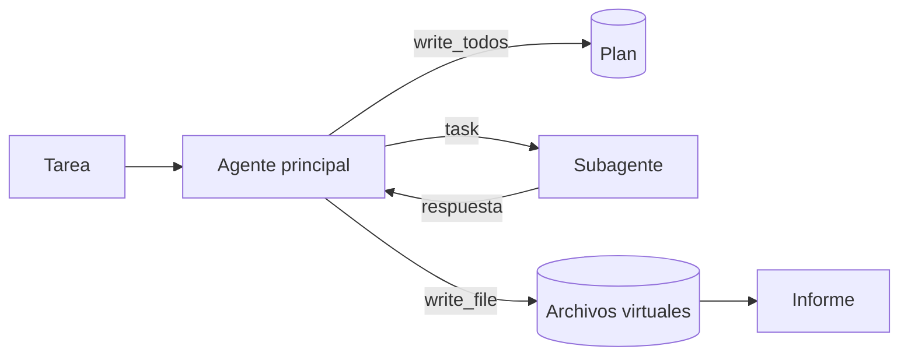

Al terminar esta lección sabrás montar con Deep Agents un agente para tareas largas que planifica, guarda su trabajo en archivos y delega partes en subagentes con contexto limpio. Sobre todo, sabrás qué mete el paquete en cada llamada, porque esa es la diferencia entre un buen arnés y uno caro.

## La idea

`deepagents` (MIT, en beta, versión 0.7.32) es el [[glosario/harness|harness]] de LangChain para agentes de larga duración, al estilo de los agentes de código. No es otro framework: es `create_agent` con un conjunto de middleware ya elegido. Lo que te da, comparado con lo que construiste en el roadmap:

| Pieza | En el roadmap | En Deep Agents |
|---|---|---|
| Plan revisable | Pedir un plan y mantenerlo ([[roadmap/40-primer-agente/04-planificar-antes-de-actuar]]) | Herramienta `write_todos`, con `TodoListMiddleware` |
| Memoria de trabajo | Archivos de progreso en disco | Sistema de archivos virtual en el estado: `ls`, `read_file`, `write_file`, `edit_file`, `delete`, `glob`, `grep` |
| Subagentes | Un bucle por subagente ([[roadmap/60-multiagente/02-orquestador-y-subagentes]]) | Herramienta `task` y un subagente `general-purpose` por defecto |
| Contexto largo | Compactación | Resumen automático y descarga a archivos de resultados enormes |



> [!aviso] write_todos ya no viene por defecto
> Desde la 0.7 (julio de 2026), la herramienta de planificación es opcional: según el blog del equipo, sus evals no mostraron una mejora significativa. Si la quieres, añade `TodoListMiddleware()`. Parte de la documentación del arnés todavía la lista como incluida; el código y las notas de versión dicen lo contrario, y es lo que hemos comprobado.

## Un analista de tickets

Un caso de soporte que sí es largo y abierto: revisar los tickets de la semana, encontrar problemas que se repiten y escribir un informe. El agente principal planifica y escribe; un subagente investiga cada problema con contexto limpio.

```python title="analista.py"
from deepagents import create_deep_agent
from langchain.agents.middleware import TodoListMiddleware
from langchain.chat_models import init_chat_model
from langchain.tools import tool
from langgraph.checkpoint.memory import InMemorySaver

MODEL = "anthropic:claude-sonnet-5-5"
TICKETS = {"T-1": "Cafetera llegó rota", "T-2": "Me cobrasteis dos veces", "T-3": "Cafetera rota al abrir la caja"}


@tool
def buscar_tickets(texto: str) -> str:
    """Busca tickets de la última semana que contengan el texto. Devuelve id y asunto."""
    return "\n".join(f"{k}: {v}" for k, v in TICKETS.items() if texto.lower() in v.lower()) or "Sin tickets."


INVESTIGADOR = {
    "name": "investigador",
    "description": "Analiza UN problema concreto en los tickets y devuelve causa probable y tickets afectados.",
    "system_prompt": "Analiza solo el problema que te dan. Devuelve causa probable y la lista de ids afectados.",
    "tools": [buscar_tickets],
}


def crear_analista(modelo=None):
    return create_deep_agent(
        model=modelo or init_chat_model(MODEL, max_tokens=4096),   # pásalo siempre: model=None está obsoleto
        tools=[buscar_tickets],
        system_prompt="Eres analista de soporte. Planifica con write_todos, delega cada problema "
                      "con task y escribe el informe final en /informe.md.",
        subagents=[INVESTIGADOR],
        middleware=[TodoListMiddleware()],                          # desde la 0.7, write_todos no viene solo
        checkpointer=InMemorySaver(),
    )


if __name__ == "__main__":
    out = crear_analista().invoke({"messages": [("user", "¿Qué problemas se repiten en los tickets de esta semana?")]},
                                  {"configurable": {"thread_id": "semana-44"}})
    print(out["files"]["/informe.md"]["content"])                  # los archivos viven en el estado
```

Tres cosas a notar:

- **`model` explícito.** Pasar `model=None` está obsoleto desde la 0.5.3 y avisa de que desaparecerá en la 1.0. Y, como siempre con Claude, con `max_tokens`.
- **Un subagente es un diccionario** con `name`, `description`, `system_prompt` y `tools` (admite también `model`, `middleware`, `interrupt_on` y alguna clave más). La `description` es lo que el agente principal lee para decidir a quién delegar: escríbela como la de una herramienta.
- **Los archivos viven en el estado** (`out["files"]`), no en tu disco. Cada archivo es un diccionario con `content`, `encoding` y fechas de creación y modificación. Si quieres que escriba en disco de verdad, hay *backends* (`FilesystemBackend(root_dir=…)`, que trabaja en modo virtual por defecto, `StoreBackend`, `CompositeBackend` para mezclar).

## Qué ve cada modelo

La prueba usa un único modelo simulado que responde distinto según quién le habla (el principal o el subagente) y anota las herramientas que recibe cada uno:

```python title="prueba_analista.py"
from langchain.messages import AIMessage
from langchain_core.outputs import ChatGeneration, ChatResult

from _fakes import FakeToolModel, llamada
from analista import crear_analista

vistas = []


class Guion(FakeToolModel):
    """Un solo modelo falso para el agente principal y el subagente: responde según quién le habla."""

    def bind_tools(self, tools, **kwargs):
        vistas.append(sorted(t["name"] if isinstance(t, dict) else t.name for t in tools))
        return self

    def _generate(self, messages, stop=None, run_manager=None, **kwargs):
        sistema = str(messages[0].content) if messages[0].type == "system" else ""
        hechas = sum(m.type == "tool" for m in messages)
        if "Analiza solo el problema" in sistema:                  # el subagente
            pasos = [AIMessage(content="", tool_calls=[llamada("buscar_tickets", {"texto": "rota"}, "s1")]),
                     AIMessage(content="Causa probable: embalaje. Afectados: T-1, T-3.")]
        else:                                                      # el agente principal
            pasos = [AIMessage(content="", tool_calls=[llamada("write_todos", {"todos": [
                         {"content": "Analizar cafeteras rotas", "status": "in_progress"},
                         {"content": "Escribir informe", "status": "pending"}]}, "p1")]),
                     AIMessage(content="", tool_calls=[llamada("task", {"subagent_type": "investigador",
                                                                        "description": "Cafeteras que llegan rotas"}, "p2")]),
                     AIMessage(content="", tool_calls=[llamada("write_file", {"file_path": "/informe.md",
                         "content": "Problema repetido: cafeteras rotas (T-1, T-3). Causa probable: embalaje."}, "p3")]),
                     AIMessage(content="Informe en /informe.md")]
        return ChatResult(generations=[ChatGeneration(message=pasos[min(hechas, len(pasos) - 1)])])


out = crear_analista(Guion(messages=iter([]))).invoke(
    {"messages": [("user", "¿Qué se repite esta semana?")]}, {"configurable": {"thread_id": "t"}})
print("principal ve:", vistas[0])
print("subagente ve:", next(v for v in vistas if "task" not in v))
print("todos:", [t["content"] for t in out["todos"]])
print("informe:", out["files"]["/informe.md"]["content"])
print("herramientas usadas:", [m.name for m in out["messages"] if m.type == "tool"])
```

Salida real:

```text
principal ve: ['buscar_tickets', 'delete', 'edit_file', 'glob', 'grep', 'ls', 'read_file', 'task', 'write_file', 'write_todos']
subagente ve: ['buscar_tickets', 'delete', 'edit_file', 'glob', 'grep', 'ls', 'read_file', 'write_file']
todos: ['Analizar cafeteras rotas', 'Escribir informe']
informe: Problema repetido: cafeteras rotas (T-1, T-3). Causa probable: embalaje.
herramientas usadas: ['write_todos', 'task', 'write_file']
```

Las diez herramientas del principal son las tuyas más siete de archivos, `task` y `write_todos`. El subagente no ve `task` (no puede delegar a su vez) ni `write_todos`. Y la respuesta de `task` es solo el texto final del subagente: «Causa probable: embalaje. Afectados: T-1, T-3.».

## Lo que cuesta

Cada pieza añade texto a cada llamada. En nuestra prueba, el prompt de sistema que recibió el modelo principal pasó de tu frase de una línea a unos 1 600 caracteres, porque cada middleware añade su sección de instrucciones (la de `write_todos`, por ejemplo), y a eso se suman los esquemas de diez herramientas. La propia LangChain contó en el blog de la 0.7 que redujo la entrada base por turno a unos 2 000 tokens, desde unos 6 000 en la 0.6. Para una tarea de tres pasos es mucho; para una de cincuenta, poco.

Úsalo cuando:

- La tarea es larga y abierta (investigar, analizar un repositorio, revisar muchos documentos) y los archivos como memoria de trabajo te ahorran contexto.
- Quieres subagentes con contexto limpio sin escribir la delegación.
- Te sirve un arnés con decisiones ya tomadas y lo vas a medir.

No lo uses cuando:

- La tarea es corta: `create_agent` con tus herramientas es más barato y más predecible.
- Necesitas controlar exactamente qué herramientas y qué texto ve el modelo.
- Vas a construir tu propio harness: entonces lo que te interesa es entender sus piezas, que es lo que hace el [[cursos/harness-engineering/index|curso de harness engineering]].

El paquete trae también `interrupt_on` (mismo formato que `HumanInTheLoopMiddleware`), `skills`, `memory` (archivos `AGENTS.md`) y `permissions`. El agente de terminal se llama `deepagents-code` (MIT); `deepagents-cli` está marcado como obsoleto. El despliegue gestionado de Deep Agents es parte de LangSmith, que es comercial. La referencia completa está en [[docs/frameworks/10-deep-agents]].

## Errores frecuentes

- Esperar `write_todos` sin añadir `TodoListMiddleware()`.
- Leer `out["files"]["/informe.md"]` como texto: es un diccionario, el texto está en `["content"]`.
- Descripciones de subagente vagas: el principal delega mal o no delega.
- Usar Deep Agents para tareas de dos herramientas y pagar el arnés en cada turno.
- Dar por hecho que `write_file` escribe en tu disco.

## Ejercicio

> [!ejercicio] ¿Compensa el arnés?
> Resuelve la misma tarea del analista con `create_agent` y solo `buscar_tickets` (sin archivos ni subagentes), pidiendo el informe como respuesta final. Con el modelo simulado, compara para las dos versiones: herramientas que ve el modelo, longitud del prompt de sistema que recibe y número de llamadas al modelo.
>
> **Está bien si** tienes una tabla con las tres medidas para cada versión, si has medido el prompt de sistema real (no el que escribiste) y si concluyes, con datos, a partir de qué tamaño de tarea usarías cada una.

> [!ejercicio]- Pistas
> En `_generate` del modelo simulado, el primer mensaje es el de sistema: guarda `len(str(messages[0].content))`. Las herramientas las recibes en `bind_tools`, como en la prueba de la lección.

## Resumen

- `create_deep_agent` es `create_agent` con middleware de archivos, subagentes (`task`) y resumen; `write_todos` exige `TodoListMiddleware()` desde la 0.7.
- Pasa siempre `model` con `max_tokens`; los archivos están en `out["files"][ruta]["content"]`.
- Cada middleware añade texto y herramientas a cada llamada: mide antes de adoptarlo.
- Encaja en tareas largas y abiertas; para tareas cortas, `create_agent`.

## Para seguir

- [[cursos/langchain-y-langgraph/10-mcp-en-langchain]]
- [[docs/frameworks/10-deep-agents]]
- [[cursos/harness-engineering/index]]
