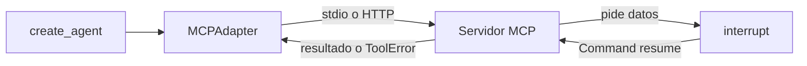

Al terminar esta lección tu agente de LangChain usará las herramientas de un servidor [[glosario/mcp|MCP]], local o remoto, como si fueran suyas. Verás qué le llega al modelo cuando el servidor falla y cómo una pregunta del servidor a mitad de una llamada («¿confirmas la cancelación?») se convierte en la misma pausa de la lección 7.

## La idea

En [[cursos/mcp-de-cero-a-servidor/02-usar-servidores-existentes]] escribiste un cliente que traducía las herramientas MCP a la API de Mensajes y los resultados de vuelta. LangChain hace esa traducción: lista las herramientas del servidor y las convierte en `BaseTool` que `create_agent` usa sin saber de dónde vienen.



Hay **dos caminos**, y en 2026 conviene el nuevo:

| | `langchain.mcp.MCPAdapter` | `langchain-mcp-adapters` |
|---|---|---|
| Instalación | `pip install "langchain[mcp]"` | `pip install langchain-mcp-adapters` |
| SDK `mcp` que arrastra | 2.x (vía FastMCP 4) | Exige `mcp<2` |
| Estado | Beta desde `langchain` 1.4.0 (septiembre de 2026); avisa con `LangChainBetaWarning` | Anterior; según el *changelog*, `MCPAdapter` lo sustituye |
| Elicitation | Se convierte en `interrupt()` | No |

El curso de MCP y la [[docs/estandares/01-mcp-2026-07-28|especificación sin estado]] usan el SDK `mcp` 2.x. Con `mcp` 2.x instalado, `langchain-mcp-adapters` **falla al importar** (`ImportError: cannot import name 'RequestContext' from 'mcp.shared.context'`). Si por algún motivo lo necesitas, ponlo en un entorno virtual aparte del servidor: el protocolo es el mismo y un cliente con mcp 1.x habla sin problemas con un servidor hecho con 2.x.

## El servidor

Un servidor de soporte hecho con `MCPServer` del SDK 2.x, con dos herramientas. `ver_pedido` falla con `ToolError` si el pedido no existe; `cancelar_pedido` **pide confirmación a una persona** antes de cancelar, con una *elicitation*. En la revisión `2026-07-28` del protocolo, el servidor ya no envía esa pregunta como una petición aparte: devuelve un resultado `input_required` y el cliente reintenta con la respuesta. En el SDK eso se escribe con `Resolve` y `Elicit`:

```python title="servidor_soporte.py"
from typing import Annotated

from pydantic import BaseModel, Field

from mcp.server.mcpserver import Elicit, ElicitationResult, MCPServer, Resolve
from mcp.server.mcpserver.exceptions import ToolError

mcp = MCPServer("soporte")
PEDIDOS = {"P-1001": {"cliente": "ana@example.com", "estado": "preparando", "importe_eur": 49.90}}


class Confirmacion(BaseModel):
    confirmar: bool = Field(description="¿Confirmas la cancelación?")


def pedir_confirmacion(pedido_id: str) -> Elicit[Confirmacion]:
    return Elicit(f"¿Cancelar el pedido {pedido_id}? No se puede deshacer.", Confirmacion)


@mcp.tool()
def ver_pedido(pedido_id: str) -> dict:
    """Devuelve estado, cliente e importe de un pedido por su id (formato P-NNNN)."""
    if pedido_id not in PEDIDOS:
        raise ToolError(f"No existe el pedido {pedido_id}. Pide al cliente el id de su correo de confirmación.")
    return PEDIDOS[pedido_id]


@mcp.tool()
def cancelar_pedido(
    pedido_id: str,
    respuesta: Annotated[ElicitationResult[Confirmacion], Resolve(pedir_confirmacion)],
) -> str:
    """Cancela un pedido que aún no ha salido del almacén. Una persona lo confirma antes."""
    if respuesta.action == "accept" and respuesta.data.confirmar:
        return f"Pedido {pedido_id} cancelado."
    return f"La persona no confirmó: el pedido {pedido_id} sigue activo."


if __name__ == "__main__":
    mcp.run()          # stdio
```

Lo comprobamos por las malas: con `await ctx.elicit(...)` dentro de la herramienta, la llamada falla con «Cannot send 'elicitation/create': this transport context has no back-channel for server-initiated requests». Con `Resolve(...)`, el parámetro `respuesta` ni siquiera aparece en el esquema que ve el modelo: solo `pedido_id`.

## El agente

```python title="agente_mcp.py"
import warnings
from pathlib import Path

from langchain.agents import create_agent
from langchain.agents.middleware import ModelCallLimitMiddleware
from langchain.chat_models import init_chat_model
from langchain_core._api import LangChainBetaWarning
from langgraph.checkpoint.memory import InMemorySaver

warnings.filterwarnings("ignore", category=LangChainBetaWarning)     # langchain.mcp avisa de que es beta
from langchain.mcp import MCPAdapter  # noqa: E402

MODEL = "anthropic:claude-sonnet-5-5"
SERVIDOR = Path(__file__).with_name("servidor_soporte.py")           # Path => stdio; un str solo puede ser URL


async def crear_agente(mcp: MCPAdapter, modelo=None):
    tools = await mcp.list_tools()                                    # cada tool MCP es un BaseTool asíncrono
    return create_agent(
        model=modelo or init_chat_model(MODEL, max_tokens=1024),
        tools=tools,
        system_prompt="Eres el soporte de una tienda. Usa las herramientas del servidor.",
        middleware=[ModelCallLimitMiddleware(run_limit=8, exit_behavior="end")],
        checkpointer=InMemorySaver(),                                 # hace falta para las elicitations
    )
```

Tres detalles:

- **El destino.** Un `Path` lanza el servidor como subproceso y habla por stdio; una URL `http(s)` usa Streamable HTTP. **Un `str` que no sea URL se rechaza a propósito** con `ValueError`: el código de `MCPAdapter` explica que un texto que llega de configuración o de un modelo no debe poder convertirse en silencio en un proceso local.
- **Las herramientas son asíncronas.** Usa `ainvoke`; `tool.invoke(...)` lanza `NotImplementedError: StructuredTool does not support sync invocation.`
- **El checkpointer.** Solo hace falta si el servidor pide datos, pero sin él no podrías reanudar la pausa.

## Errores y elicitations

```python title="prueba_mcp.py"
import asyncio

from langchain.messages import AIMessage
from langgraph.types import Command

from _fakes import guion, llamada
from agente_mcp import SERVIDOR, MCPAdapter, crear_agente


async def main():
    modelo = guion(
        AIMessage(content="", tool_calls=[llamada("ver_pedido", {"pedido_id": "P-9"}, "a")]),
        AIMessage(content="", tool_calls=[llamada("cancelar_pedido", {"pedido_id": "P-1001"}, "b")]),
        AIMessage(content="Hecho: P-1001 cancelado."),
    )
    async with MCPAdapter(SERVIDOR) as mcp:                         # lanza el servidor por stdio
        agente = await crear_agente(mcp, modelo)
        print("herramientas:", [t.name for t in await mcp.list_tools()])
        config = {"configurable": {"thread_id": "mcp-1"}}
        out = await agente.ainvoke({"messages": [("user", "Cancelad P-1001")]}, config, version="v2")
        error = next(m for m in out.value["messages"] if m.type == "tool")
        print("error del servidor:", error.status, "·", error.text[:85])
        pregunta = out.interrupts[0].value                            # el servidor pide confirmación
        print("pausa:", pregunta["type"], "·", pregunta["requests"][0]["message"])
        clave = pregunta["requests"][0]["key"]
        out = await agente.ainvoke(Command(resume={"responses": {clave: {"action": "accept",
                                                                         "content": {"confirmar": True}}}}),
                                   config, version="v2")
        print("tras confirmar:", [m.text for m in out.value["messages"] if m.type == "tool"][-1])
        print("final:", out.value["messages"][-1].text)


asyncio.run(main())
```

Salida real, con el servidor ejecutándose de verdad por stdio y el modelo simulado:

```text
herramientas: ['ver_pedido', 'cancelar_pedido']
error del servidor: error · Error executing tool ver_pedido: No existe el pedido P-9. Pide al cliente el id de su
pausa: mcp_elicitation · ¿Cancelar el pedido P-1001? No se puede deshacer.
tras confirmar: Pedido P-1001 cancelado.
final: Hecho: P-1001 cancelado.
```

- El `ToolError` llega como `ToolMessage` con `status="error"` y el texto prefijado con «Error executing tool ver_pedido:». Aquí no hace falta `ToolErrorMiddleware`: el error ya es un resultado del protocolo, no una excepción de Python. Por eso el mensaje del `ToolError` debe decir qué hacer, como aprendiste en [[cursos/mcp-de-cero-a-servidor/03-tu-primer-servidor]].
- La pregunta del servidor llega como interrupción de tipo `mcp_elicitation`, con el mensaje, el esquema que debe cumplir la respuesta y una `key`. Se reanuda con `Command(resume={"responses": {key: {"action": "accept", "content": {...}}}})`; las otras acciones son `"decline"` y `"cancel"`. Es la misma mecánica de la lección 7: mismo `thread_id`, mismo checkpointer.

`MCPAdapter` solo responde *elicitations*: si el servidor pide *sampling* o *roots* (deprecados en la revisión actual), lanza `NotImplementedError`.

## Un servidor remoto

El mismo servidor con `mcp.run(transport="streamable-http")` escucha por defecto en `http://127.0.0.1:8000/mcp`. Cambia solo el destino:

```python title="remoto.py"
import asyncio
import warnings

from langchain_core._api import LangChainBetaWarning

warnings.filterwarnings("ignore", category=LangChainBetaWarning)
from langchain.mcp import MCPAdapter  # noqa: E402

URL = "http://127.0.0.1:8000/mcp"       # el mismo servidor con mcp.run(transport="streamable-http")


async def main():
    async with MCPAdapter(URL) as mcp:
        tools = await mcp.list_tools()
        print([t.name for t in tools])
        print(await tools[0].ainvoke({"pedido_id": "P-1001"}))


asyncio.run(main())
```

```text
['ver_pedido', 'cancelar_pedido']
[{'type': 'text', 'text': '{\n  "cliente": "ana@example.com",\n  "estado": "preparando",\n  "importe_eur": 49.9\n}', 'id': 'lc_…'}]
```

Antes de exponer un servidor fuera de tu máquina, autenticación, límites y auditoría: [[cursos/mcp-de-cero-a-servidor/04-seguridad-y-despliegue]]. Y antes de conectar uno de terceros, recuerda que sus descripciones de herramientas entran en tu prompt ([[docs/seguridad/04-mcp-y-skills-de-terceros]]).

## Con el servidor del curso de MCP

El servidor de notas de [[cursos/mcp-de-cero-a-servidor/03-tu-primer-servidor]] es un `MCPServer` por stdio, así que se conecta igual: `MCPAdapter(Path("servidor.py"))`. Sus herramientas aparecen con el nombre y la descripción que escribiste. `list_tools()` trae solo herramientas: los *resources* y *prompts* del servidor no entran en el agente por esta vía.

## Errores frecuentes

- Instalar `langchain-mcp-adapters` en el mismo entorno que `mcp` 2.x.
- Pasar la ruta del servidor como `str`.
- Llamar a `agente.invoke` en lugar de `await agente.ainvoke` con herramientas MCP.
- Usar `ctx.elicit` en un servidor que habla la revisión sin estado del protocolo.
- Cerrar el bloque `async with MCPAdapter(...)` antes de terminar de usar el agente: la conexión con el servidor muere con él.

## Ejercicio

> [!ejercicio] Tu servidor en tu agente
> Conecta al agente de soporte el servidor que construiste en el curso de MCP (o `servidor_soporte.py`), junto con las herramientas locales de `soporte.py`. Añade al servidor una herramienta que pida, con `Elicit`, el motivo de una devolución. Prueba con el modelo simulado un recorrido completo: error de pedido inexistente, pausa por la pregunta del servidor y reanudación con la respuesta.
>
> **Está bien si** el agente ve a la vez herramientas locales y del servidor, el error llega como `ToolMessage` con `status="error"`, la pausa trae el mensaje y el esquema de la pregunta, y tras reanudar la herramienta del servidor recibe el motivo que pasaste.

> [!ejercicio]- Pistas
> `tools = [*await mcp.list_tools(), ver_pedido, buscar_politica]` mezcla las dos fuentes. Para una respuesta de texto, el esquema de `Elicit` puede ser un modelo de Pydantic con un solo campo `motivo: str`.

## Resumen

- `pip install "langchain[mcp]"` y `MCPAdapter(Path(...))` o `MCPAdapter("https://…")`; nunca un `str` que no sea URL.
- Las herramientas MCP son asíncronas: `ainvoke`.
- Un `ToolError` del servidor llega como `ToolMessage` de error; una elicitation, como `interrupt` que se reanuda con `Command`.
- `langchain-mcp-adapters` exige `mcp<2`: no lo mezcles con el SDK actual.

## Para seguir

- [[cursos/langchain-y-langgraph/11-observar-y-evaluar]]
- [[recetas/herramientas-mcp-en-un-agente-langchain]]
- [[cursos/mcp-de-cero-a-servidor/index]]
