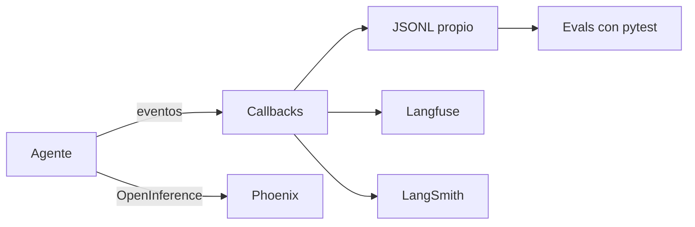

Al terminar esta lección cada ejecución de tu agente de soporte dejará una traza que puedes leer o mandar a una plataforma de [[glosario/observabilidad|observabilidad]], y tendrás una batería de pruebas que comprueba **cómo** trabaja el agente (qué herramientas usa, en qué orden, cuándo se detiene) y que corre en CI sin clave. Es el cierre del proyecto del curso.

## La idea

En [[roadmap/40-primer-agente/06-depurar-con-trazas]] metiste un registrador dentro de tu bucle. Con `create_agent` el bucle no es tuyo, pero LangChain emite **eventos** en cada paso (empieza una llamada al modelo, termina, empieza una herramienta, falla) y cualquier *callback* puede escucharlos. Sobre esos eventos se construyen todas las integraciones de trazas, abiertas o comerciales.



Los callbacks se pasan en la configuración de cada llamada, `config={"callbacks": [...]}`, junto con `tags` y `metadata` (un id de ticket, por ejemplo) que las plataformas usan para filtrar. Se propagan a todo lo que se ejecuta dentro, subagentes incluidos.

## Una traza propia con callbacks

Un `BaseCallbackHandler` con cinco métodos basta para reproducir el formato de traza del nivel 40:

```python title="traza_callbacks.py"
import json
import time
from pathlib import Path

from langchain_core.callbacks import BaseCallbackHandler


class TrazaJSONL(BaseCallbackHandler):
    """Escribe un evento por línea: cada llamada al modelo y cada herramienta."""

    def __init__(self, ruta: str):
        self.f = Path(ruta).open("a", encoding="utf-8")
        self.inicio = {}

    def _escribir(self, **evento):
        self.f.write(json.dumps({"t": round(time.time(), 3), **evento}, ensure_ascii=False) + "\n")
        self.f.flush()

    def on_chat_model_start(self, serialized, messages, *, run_id, **kwargs):
        self.inicio[run_id] = time.perf_counter()

    def on_llm_end(self, response, *, run_id, **kwargs):
        msg = response.generations[0][0].message
        uso = msg.usage_metadata or {}
        self._escribir(tipo="modelo", ms=round((time.perf_counter() - self.inicio.pop(run_id, time.perf_counter())) * 1000),
                       stop_reason=msg.response_metadata.get("stop_reason") or msg.response_metadata.get("done_reason"),
                       tokens_entrada=uso.get("input_tokens"), tokens_salida=uso.get("output_tokens"),
                       herramientas=[c["name"] for c in msg.tool_calls], texto=msg.text[:200])

    def on_tool_start(self, serialized, input_str, *, run_id, **kwargs):
        self.inicio[run_id] = (time.perf_counter(), serialized.get("name"), input_str)

    def _herramienta(self, run_id, es_error, salida):
        t0, nombre, entrada = self.inicio.pop(run_id)
        self._escribir(tipo="herramienta", nombre=nombre, entrada=entrada[:200], es_error=es_error,
                       ms=round((time.perf_counter() - t0) * 1000), salida=salida[:200])

    def on_tool_end(self, output, *, run_id, **kwargs):   # output es el ToolMessage
        self._herramienta(run_id, getattr(output, "status", "success") == "error", str(getattr(output, "content", output)))

    def on_tool_error(self, error, *, run_id, **kwargs):  # la excepción, antes de ToolErrorMiddleware
        self._herramienta(run_id, True, repr(error))
```

Dos detalles de los eventos que hemos comprobado. En `on_tool_end` llega el `ToolMessage` ya construido, con su `status`. Y `on_tool_error` llega con la excepción **antes** de que `ToolErrorMiddleware` la convierta en resultado: tu traza registra el error real aunque el modelo reciba el texto del middleware. Los nombres de los eventos y su orden los fija `langchain-core`; si cambias de versión mayor, revísalos.

```python title="prueba_traza.py"
from langchain.messages import AIMessage

from _fakes import guion, llamada
from agente import crear_agente
from traza_callbacks import TrazaJSONL

uso = {"input_tokens": 812, "output_tokens": 64, "total_tokens": 876}
modelo = guion(
    AIMessage(content="", tool_calls=[llamada("ver_pedidos", {"email": "nadie@example.com"}, "c1")],
              usage_metadata=uso, response_metadata={"stop_reason": "tool_use"}),
    AIMessage(content="", tool_calls=[llamada("ver_pedidos", {"email": "ana@example.com"}, "c2")],
              usage_metadata=uso, response_metadata={"stop_reason": "tool_use"}),
    AIMessage(content="Tu pedido P-1001 se envió el 10 de septiembre.",
              usage_metadata={"input_tokens": 1020, "output_tokens": 31, "total_tokens": 1051},
              response_metadata={"stop_reason": "end_turn"}),
)
config = {"callbacks": [TrazaJSONL("traza.jsonl")], "tags": ["soporte"], "metadata": {"ticket": "T-77"}}
crear_agente(modelo).invoke({"messages": [("user", "Soy nadie@... digo, ana@example.com")]}, config)
```

Contenido real de `traza.jsonl` (sin el campo `t`):

```json
{"tipo": "modelo", "ms": 1, "stop_reason": "tool_use", "tokens_entrada": 812, "tokens_salida": 64, "herramientas": ["ver_pedidos"], "texto": ""}
{"tipo": "herramienta", "nombre": "ver_pedidos", "entrada": "{'email': 'nadie@example.com'}", "es_error": true, "ms": 0, "salida": "ValueError('No hay ningún cliente con email nadie@example.com')"}
{"tipo": "modelo", "ms": 0, "stop_reason": "tool_use", "tokens_entrada": 812, "tokens_salida": 64, "herramientas": ["ver_pedidos"], "texto": ""}
{"tipo": "herramienta", "nombre": "ver_pedidos", "entrada": "{'email': 'ana@example.com'}", "es_error": false, "ms": 1, "salida": "[{\"id\": \"P-1001\", \"estado\": \"enviado\", \"fecha\": \"2026-09-10\"}]"}
{"tipo": "modelo", "ms": 0, "stop_reason": "end_turn", "tokens_entrada": 1020, "tokens_salida": 31, "herramientas": [], "texto": "Tu pedido P-1001 se envió el 10 de septiembre."}
```

Con eso puedes responder las preguntas del nivel 40: cuántos pasos, cuántos tokens, qué herramienta falló y con qué entrada. Los tokens salen de `usage_metadata`, que `ChatAnthropic` rellena con el `usage` de la API; el `stop_reason`, de `response_metadata`.

> [!peligro] Las trazas llevan datos de clientes
> Emails, pedidos y lo que escriba el usuario acaban en la traza, y con una plataforma externa, en servidores de otro. Recorta, enmascara lo sensible, decide cuánto guardas y lee a dónde envía los datos cada integración antes de activarla.

## Llevarlas a una plataforma

Tres opciones habituales con agentes de LangChain, con lo que es cada una:

| | Langfuse | Arize Phoenix | LangSmith |
|---|---|---|---|
| Qué es | Trazas, *prompts*, datasets y evals | Trazas OpenInference/OpenTelemetry y evals | Trazas, evals y despliegue de LangChain |
| Licencia | SDK MIT; servidor autoalojable (revisa su licencia y la de sus partes empresariales) | Servidor Elastic-2.0 (*source-available*, no OSI); paquete `arize-phoenix-otel` Apache-2.0 | Servicio comercial; el cliente `langsmith` es MIT |
| Integración | `CallbackHandler` de `langfuse.langchain` | Instrumentador OpenInference de LangChain | Variables de entorno |
| Dónde viven los datos | Donde lo despliegues, o en su nube | En tu máquina con `phoenix serve` | En la nube de LangSmith |

**Langfuse** (SDK 5.x, basado en OpenTelemetry). Lo puedes levantar en tu infraestructura; la receta paso a paso está en [[recetas/trazas-con-langfuse]].

```python title="con_langfuse.py"
# export LANGFUSE_PUBLIC_KEY=… LANGFUSE_SECRET_KEY=… LANGFUSE_BASE_URL=http://localhost:3000   (autoalojado)
from langfuse import get_client
from langfuse.langchain import CallbackHandler

from agente import crear_agente

agente = crear_agente()
config = {"callbacks": [CallbackHandler()], "metadata": {"ticket": "T-77"}}
r = agente.invoke({"messages": [("user", "Soy ana@example.com, ¿y mi pedido?")]}, config)
print(r["messages"][-1].text)
get_client().flush()                       # en scripts cortos, vacía el búfer antes de salir
```

Hemos comprobado que el agente funciona igual con el `CallbackHandler` puesto. Sin claves, Langfuse avisa de que el cliente queda desactivado y no envía nada.

**Phoenix** instrumenta LangChain con OpenInference y recibe las trazas por OTLP en su servidor local (`phoenix serve`, interfaz en `http://localhost:6006`). Este fragmento sigue la API de `arize-phoenix-otel` del informe de infraestructura; no lo hemos ejecutado aquí porque necesita el servidor:

```python nocheck title="con_phoenix.py"
# pip install arize-phoenix-otel openinference-instrumentation-langchain
from phoenix.otel import register

register(project_name="soporte", endpoint="http://localhost:6006/v1/traces",
         auto_instrument=True)          # instrumenta las librerías con instrumentador OpenInference instalado

from agente import crear_agente        # a partir de aquí, cada invoke deja una traza
```

**LangSmith** no necesita código: el cliente lee `LANGSMITH_TRACING=true` y `LANGSMITH_API_KEY` (también acepta los nombres antiguos con prefijo `LANGCHAIN_`). Es cómodo y es de pago: tus trazas, con los datos de tus clientes, van a su servicio.

```bash
export LANGSMITH_TRACING=true
export LANGSMITH_API_KEY=...          # servicio comercial: revisa precio y dónde se guardan los datos
```

Si prefieres no casarte con ninguna, las [[glosario/convenciones-genai-otel|convenciones GenAI de OpenTelemetry]] (`gen_ai.operation.name`, `gen_ai.usage.input_tokens`, `gen_ai.tool.name`…) te permiten emitir *spans* estándar desde tu callback y exportarlos por OTLP a cualquier *backend*: [[docs/produccion/04-opentelemetry-genai]].

## Depurar sin plataforma

Antes de montar nada, LangGraph ya te da dos herramientas que has usado en el curso: `stream(..., stream_mode="updates")` para ver qué nodo hizo qué (lección 3) y `get_state_history(config)` para recorrer los checkpoints de un hilo (lección 6). `stream_mode="debug"` añade además el detalle de cada tarea y cada checkpoint.

## Evals de trayectoria sin API

La [[glosario/trayectoria|trayectoria]] es lo que distingue al agente que acierta bien del que acierta por suerte ([[roadmap/80-evals/04-evals-de-trayectoria]]). Con modelos simulados la puedes fijar en pruebas: el guion dice qué haría el modelo, y la prueba comprueba lo que es tuyo (que las herramientas reciben bien los datos, que el reembolso **no** se ejecuta sin aprobación, que un pedido ajeno vuelve como error, que el límite corta). Estas son las pruebas del proyecto, sobre el `soporte.py` de la lección 7:

```python title="test_soporte.py"
import pytest
from langchain_core.messages import AIMessage
from langgraph.checkpoint.memory import InMemorySaver
from langgraph.store.memory import InMemoryStore
from langgraph.types import Command

from _fakes import guion, llamada
from soporte import Cliente, crear_agente

ANA = Cliente(id="c-42", email="ana@example.com")


def trayectoria(mensajes):
    return [c["name"] for m in mensajes if m.type == "ai" for c in m.tool_calls]


def ejecutar(modelo, texto, thread="t1", contexto=ANA):
    agente = crear_agente(modelo, checkpointer=InMemorySaver(), store=InMemoryStore())
    config = {"configurable": {"thread_id": thread}}
    return agente, config, agente.invoke({"messages": [("user", texto)]}, config, context=contexto, version="v2")


def test_reembolso_pausa_antes_de_ejecutar():
    modelo = guion(
        AIMessage(content="", tool_calls=[llamada("ver_pedido", {"pedido_id": "P-1001"}, "a"),
                                          llamada("buscar_politica", {"tema": "devoluciones"}, "b")]),
        AIMessage(content="", tool_calls=[llamada("reembolsar", {"pedido_id": "P-1001", "importe_eur": 49.9,
                                                                 "motivo": "llegó roto"}, "c")]),
        AIMessage(content="Reembolso emitido."),
    )
    agente, config, out = ejecutar(modelo, "P-1001 llegó roto")
    assert trayectoria(out.value["messages"]) == ["ver_pedido", "buscar_politica", "reembolsar"]
    assert out.interrupts, "debe pausar antes de reembolsar"
    assert not any(m.type == "tool" and m.name == "reembolsar" for m in out.value["messages"])
    out = agente.invoke(Command(resume={"decisions": [{"type": "approve"}]}), config, context=ANA, version="v2")
    assert out.value["messages"][-1].text == "Reembolso emitido."


def test_pedido_ajeno_vuelve_como_error():
    modelo = guion(AIMessage(content="", tool_calls=[llamada("ver_pedido", {"pedido_id": "P-1001"}, "a")]),
                   AIMessage(content="No encuentro ese pedido a tu nombre."))
    _, _, out = ejecutar(modelo, "¿Y P-1001?", contexto=Cliente(id="c-77", email="eva@example.com"))
    tool = [m for m in out.value["messages"] if m.type == "tool"][0]
    assert tool.status == "error" and "no tiene ningún pedido" in tool.content


@pytest.mark.parametrize("decision,esperado", [({"type": "reject", "message": "Fuera de plazo."}, "error"),
                                               ({"type": "approve"}, "success")])
def test_decisiones_humanas(decision, esperado):
    modelo = guion(AIMessage(content="", tool_calls=[llamada("reembolsar", {"pedido_id": "P-1001", "importe_eur": 49.9,
                                                                            "motivo": "roto"}, "c")]),
                   AIMessage(content="Fin."))
    agente, config, out = ejecutar(modelo, "Reembolsadme")
    out = agente.invoke(Command(resume={"decisions": [decision]}), config, context=ANA, version="v2")
    tool = [m for m in out.value["messages"] if m.type == "tool" and m.name == "reembolsar"][0]
    assert tool.status == esperado


def test_limite_de_llamadas():
    bucle = guion(*[AIMessage(content="", tool_calls=[llamada("buscar_politica", {"tema": "envíos"}, f"x{i}")])
                    for i in range(20)])
    _, _, out = ejecutar(bucle, "Dime algo de envíos")
    assert "Model call limits exceeded" in out.value["messages"][-1].text
```

```text
$ pytest -q test_soporte.py
.....                                                                    [100%]
5 passed in 0.93s
```

Cinco pruebas, sin red y en un par de segundos, que puedes poner en CI ([[roadmap/80-evals/05-regresiones-en-ci]]). Lo que **no** prueban: si Claude elegiría esas herramientas. Eso necesita evals con el modelo real sobre un conjunto de casos, más lentas y caras, que conviene correr antes de cada cambio de prompt o de modelo y no en cada *commit*. Las dos capas se complementan; la receta de la primera está en [[recetas/probar-agentes-sin-api]].

> [!aviso] Lo que un modelo simulado no ve
> Las pruebas con modelos falsos no hablan con la API, así que no detectan errores de la petición: un `with_structured_output` sin `method="json_schema"` o un `temperature` en `claude-sonnet-5-5` pasan aquí y fallan con el modelo real. Añade al menos una prueba de humo con el modelo real, marcada para que solo corra cuando haya clave.

## El proyecto, terminado

Con esta lección, tu agente de soporte tiene todo lo que prometía la ficha del curso: herramientas con esquema completo, errores que vuelven al modelo, límites, aprobación humana de reembolsos, estado en SQLite, memoria del cliente, trazas JSONL y pruebas sin API. Compara el `soporte.py` final con tu agente del nivel 40: el bucle ha desaparecido, y lo que queda son decisiones tuyas.

## Errores frecuentes

- Activar LangSmith por una variable de entorno olvidada en un servidor con datos reales.
- Callbacks con estado compartido entre peticiones concurrentes (usa `run_id` como clave, como en `TrazaJSONL`).
- Guardar entradas y salidas completas sin recortar ni enmascarar.
- Evals que solo miran la respuesta final.
- Creer que las pruebas con modelos simulados validan el comportamiento del modelo real.

## Ejercicio

> [!ejercicio] Cierra el proyecto
> Añade `TrazaJSONL` a `soporte.py` con el id del ticket en `metadata`, y amplía `test_soporte.py` con tres pruebas: que un reembolso editado se ejecuta con el importe editado, que la traza registra un evento por herramienta con `es_error` correcto, y que un ticket pausado sobrevive a reabrir el `SqliteSaver`. Escribe además una prueba con el modelo real que se salte si no hay `ANTHROPIC_API_KEY`.
>
> **Está bien si** `pytest` pasa sin red con ocho pruebas o más, la prueba real se marca como saltada sin clave, y al leer la traza de una ejecución puedes decir en un minuto cuántas llamadas al modelo y cuántos tokens hubo.

> [!ejercicio]- Pistas
> `pytest.mark.skipif(not os.environ.get("ANTHROPIC_API_KEY"), reason="sin clave")` para la prueba real. Para la del SQLite, usa la carpeta temporal `tmp_path` que te da `pytest`.

## Resumen

- Los callbacks escuchan cada paso del agente; con cinco métodos tienes tu traza JSONL.
- Langfuse (SDK MIT, autoalojable), Phoenix (servidor Elastic-2.0, local) y LangSmith (comercial) se conectan sin tocar el agente.
- Las convenciones GenAI de OpenTelemetry evitan casarte con una plataforma.
- Las evals de trayectoria con modelos simulados prueban tu código en CI; las del modelo real, su comportamiento.

## Para seguir

- [[roadmap/80-evals/index]]
- [[docs/produccion/01-observabilidad]]
- [[docs/frameworks/02-equivalencias]]
