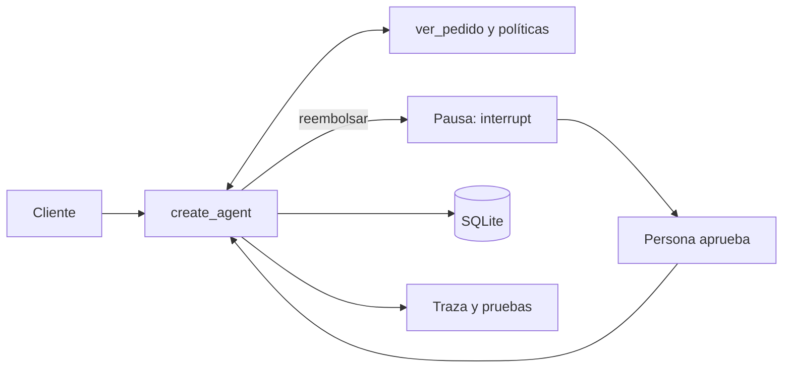

En el [[roadmap/40-primer-agente/index|nivel 40]] escribiste el [[glosario/bucle-agentico|bucle agéntico]] a mano: llamar al modelo, mirar `stop_reason`, ejecutar herramientas, devolver un `tool_result` por cada `tool_use` y repetir con un límite. Este curso construye **el mismo agente** con el ecosistema abierto más usado en Python: LangChain para el bucle hecho y LangGraph para el grafo explícito que hay debajo. Cada lección rehace algo que ya sabes y te dice qué esconde el framework y dónde suele morder.

## Objetivo

Al terminar sabrás montar un agente con `create_agent`, controlarlo con [[glosario/middleware|middleware]], dibujar tu propio [[glosario/grafo-de-estado|grafo de estado]] cuando el bucle no basta, persistirlo con un [[glosario/checkpointer|checkpointer]], pausarlo para que una persona apruebe, repartir trabajo entre varios agentes, conectar servidores MCP y medir lo que hace con trazas y pruebas que no gastan ni un token.

## Para quién

Para quien ha hecho el nivel 40 y quiere decidir con criterio si un framework le compensa. No necesitas saber nada de LangChain: empezamos por sus piezas mínimas. Si vienes de LangChain 0.x, verás que la 1.x es otra librería: `create_agent` sustituye a las cadenas y al `create_react_agent` de LangGraph, que está deprecado.

## Requisitos

- [[roadmap/40-primer-agente/index]]: el bucle, las condiciones de parada y las trazas. Cada lección se apoya en ese código.
- [[roadmap/20-herramientas/03-errores-e-is-error]]: entender `is_error` es clave para la trampa de la lección 2.
- Python 3.11 o superior y un entorno virtual. Una clave de la API de Claude o [Ollama](https://ollama.com) con un modelo que admita herramientas. Las pruebas del curso no necesitan ninguna de las dos.

```bash
pip install -U langchain langchain-anthropic langgraph langgraph-checkpoint-sqlite
pip install -U langchain-ollama deepagents "langchain[mcp]"    # lecciones 2, 9 y 10
```

Versiones con las que se ha comprobado todo el código (29 de octubre de 2026): `langchain` 1.4.7, `langchain-core` 1.7.2, `langchain-anthropic` 1.7.7, `langgraph` 1.2.18, `langgraph-checkpoint-sqlite` 3.1.2, `deepagents` 0.7.32 y `mcp` 2.3.0.

## Temario

1. [[cursos/langchain-y-langgraph/01-cuando-usar-un-framework]]. Qué te da y qué te quita un framework, el mapa de LangChain, LangGraph, Deep Agents y LangSmith, y qué parte es open source.
2. [[cursos/langchain-y-langgraph/02-modelos-mensajes-y-herramientas]]. `init_chat_model`, mensajes, `@tool(parse_docstring=True)`, `tool_calls` y `ToolMessage` frente a `tool_use` y `tool_result`, y la trampa de las excepciones.
3. [[cursos/langchain-y-langgraph/03-tu-primer-agente-con-create-agent]]. El agente del nivel 40 en veinte líneas, cómo leer su traza, límites de pasos y salida estructurada.
4. [[cursos/langchain-y-langgraph/04-middleware]]. Los ganchos del bucle, el middleware incluido y uno propio que bloquea reembolsos altos.
5. [[cursos/langchain-y-langgraph/05-langgraph-estado-nodos-y-aristas]]. El bucle como grafo: estado tipado, reductores, nodos, aristas condicionales.
6. [[cursos/langchain-y-langgraph/06-memoria-y-persistencia]]. `thread_id`, `SqliteSaver`, historial, volver atrás y memoria entre conversaciones con un *store*.
7. [[cursos/langchain-y-langgraph/07-humano-en-el-bucle-con-interrupt]]. `interrupt`, `Command(resume=…)`, aprobar, editar o rechazar un reembolso, y los errores que impiden reanudar.
8. [[cursos/langchain-y-langgraph/08-multiagente-con-langgraph]]. Supervisor con subagentes como herramientas, *handoffs*, subgrafos y map-reduce con `Send`.
9. [[cursos/langchain-y-langgraph/09-deep-agents]]. Planificación, archivos virtuales y subagentes listos, y cuándo compensa su coste.
10. [[cursos/langchain-y-langgraph/10-mcp-en-langchain]]. Herramientas de un servidor MCP con `MCPAdapter` y las peticiones del servidor convertidas en interrupciones.
11. [[cursos/langchain-y-langgraph/11-observar-y-evaluar]]. Trazas con *callbacks*, Langfuse, Phoenix o LangSmith, y evals de trayectoria con modelos simulados.

## Qué construyes

El agente de soporte de pedidos del nivel 40, en versión framework. Consulta pedidos y políticas, **pide aprobación a una persona antes de cada reembolso**, guarda su estado en SQLite para reanudar aunque reinicies el proceso, recuerda preferencias del cliente entre conversaciones, deja una traza JSONL por ejecución y tiene una batería de pruebas con `pytest` y [[glosario/modelo-simulado|modelos simulados]] que corre en CI sin clave. Lo vas montando lección a lección en un único archivo, `soporte.py`, y en la lección 11 lo cierras con sus pruebas.



> [!nota] Abierto y comercial
> LangChain, LangGraph, sus *checkpointers* y Deep Agents son open source con licencia MIT. **LangSmith** (trazas, evals y despliegue) es un servicio comercial, y el servidor de despliegue de LangGraph (Agent Server, paquete `langgraph-api`) usa la licencia Elastic-2.0, que permite leer el código pero no es una licencia open source OSI. Nada de este curso necesita ninguno de los dos.

Para una comparación con otros frameworks, mira [[docs/frameworks/01-elegir-framework]] y la tabla de [[docs/frameworks/02-equivalencias]].
