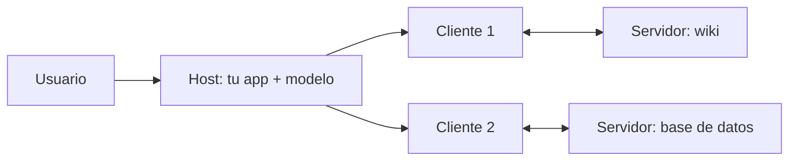

Al terminar esta lección podrás explicar qué hace cada pieza de MCP y leer una conversación del protocolo mensaje a mensaje. Es la base para el resto del curso: cuando algo falle en tu servidor, sabrás si el problema está en el descubrimiento, en el listado o en la llamada.

## La idea

Sin un estándar, cada aplicación de IA integra cada sistema a su manera. Si tienes tres aplicaciones (un chat interno, un agente de código, un asistente de soporte) y cinco sistemas (GitHub, la base de datos, la wiki, el CRM, el calendario), acabas manteniendo hasta quince integraciones distintas, cada una con su forma de describir herramientas, autenticar y devolver errores.

[[glosario/mcp|Model Context Protocol]] define una interfaz común. Cada sistema se expone una vez como **servidor MCP** y cada aplicación implementa una vez un **cliente MCP**. Las quince integraciones pasan a ser cinco servidores y tres clientes. La especificación es abierta y está en [modelcontextprotocol.io](https://modelcontextprotocol.io). La creó Anthropic y hoy la gobierna un proyecto de la Linux Foundation, dentro de la Agentic AI Foundation. Por eso se le llama a menudo «el USB-C de la IA»: un conector común para que cualquier agente hable con cualquier sistema sin un adaptador a medida para cada pareja.

MCP no cambia cómo el modelo usa herramientas. El modelo sigue recibiendo definiciones con nombre, descripción y esquema, y sigue emitiendo bloques `tool_use` como viste en [[roadmap/20-herramientas/01-ciclo-tool-use]]. MCP estandariza **cómo llegan esas definiciones a tu aplicación y cómo se ejecutan**.

El autor lo explica con una comparación que ayuda: un servidor MCP se parece a una API. En una API llamas a un *endpoint* y detrás hay una función que hace lo que haya que hacer. En MCP, el «endpoint» es el nombre de una herramienta, acompañado de una descripción y un esquema para que el modelo entienda para qué sirve y qué parámetros lleva. Cuando el modelo decide usarla, el host envía la petición al servidor, y el servidor ejecuta una función de código normal: una cuenta, una consulta a una base de datos, una llamada a otro servicio. Todo lo que puedes programar se puede exponer como herramienta. Así, un agente de código que antes solo tocaba archivos y lanzaba comandos puede, conectado a un servidor MCP de tu gestor de tareas, mover una tarjeta a «Hecho» cuando se lo pides en lenguaje natural. Su bucle no cambia: tiene más herramientas entre las que elegir.

## Host, cliente y servidor



- **Host**: la aplicación con la que interactúa el usuario (un IDE, un chat, tu agente). Contiene el modelo, decide qué servidores conectar y aplica la política de permisos.
- **Cliente**: el componente dentro del host que mantiene **una conexión con un servidor**. Un host con tres servidores tiene tres clientes.
- **Servidor**: un programa que expone capacidades de un sistema. No sabe qué modelo hay detrás ni ve la conversación completa; solo recibe las peticiones que le llegan.

Esa última propiedad importa para la seguridad: el servidor ve poco, y el host es quien decide qué se ejecuta. Lo retomarás en la [[cursos/mcp-de-cero-a-servidor/04-seguridad-y-despliegue|lección 4]].

## Las tres primitivas del servidor

La diferencia entre ellas está en **quién decide usarlas**.

| Primitiva | Quién la controla | Para qué | Ejemplo |
|---|---|---|---|
| *Tools* | el modelo | acciones y consultas que el modelo invoca cuando las necesita | `buscar_pedidos(cliente_id)`, `crear_issue(titulo, cuerpo)` |
| *Resources* | la aplicación | datos que el host puede leer y meter en el contexto | `file:///proyecto/README.md`, `notas://reunion-lunes` |
| *Prompts* | el usuario | plantillas que el usuario elige, a menudo como comandos | «Resumir esta nota», «Revisar este PR» |

Regla práctica: si el modelo debe decidir cuándo usarlo, es una *tool*. Si es contexto que el usuario o la aplicación adjuntan, es un *resource*. Si es un flujo de trabajo que el usuario lanza a propósito, es un *prompt*. Muchos hosts solo aprovechan las *tools*; si tu caso depende de *resources* o *prompts*, comprueba antes qué soporta tu host.

En revisiones anteriores el cliente también ofrecía capacidades al servidor: *sampling* (el servidor pide al host una respuesta del modelo), *roots* (el cliente indica qué carpetas puede tocar el servidor) y *elicitation* (el servidor pide un dato al usuario). En la revisión `2026-07-28` **Roots, Sampling y Logging están deprecados** (se mantienen un mínimo de 12 meses para no romper a nadie). Cuando un servidor necesita un dato del usuario a mitad de una llamada, ya no inicia él una petición: devuelve un resultado `input_required` y el cliente reintenta con la respuesta ([[glosario/mrtr|MRTR]], *Multi Round-Trip Requests*). No diseñes servidores nuevos que dependan de *sampling* o *roots*.

## El protocolo por dentro

Los mensajes son JSON-RPC 2.0: peticiones con `id`, respuestas con el mismo `id` y notificaciones sin `id`. La revisión vigente de la especificación, `2026-07-28`, es **sin estado**: no hay saludo inicial ni sesión de protocolo. Cada petición lleva en `_meta` la versión, la identidad y las capacidades del cliente, y el servidor puede atenderla sin recordar nada de la anterior. Eso permite poner varios servidores detrás de un balanceador sin sesiones pegajosas.

Estos son los mensajes reales que intercambian el cliente `mcp.Client` y un servidor `MCPServer` del SDK de Python 2.3, capturados en la entrada y salida estándar (solo hemos cambiado el nombre del cliente e indentado para leerlos). El cliente empieza preguntando al servidor qué sabe hacer con `server/discover`:

```json title="1. El cliente descubre el servidor"
{"jsonrpc": "2.0", "id": 1, "method": "server/discover",
 "params": {"_meta": {
   "io.modelcontextprotocol/protocolVersion": "2026-07-28",
   "io.modelcontextprotocol/clientInfo": {"name": "mi-agente", "version": "0.1.0"},
   "io.modelcontextprotocol/clientCapabilities": {}}}}
```

```json title="2. El servidor anuncia versiones y capacidades"
{"jsonrpc": "2.0", "id": 1,
 "result": {"resultType": "complete",
            "supportedVersions": ["2026-07-28"],
            "capabilities": {"tools": {"listChanged": true},
                             "resources": {"listChanged": true, "subscribe": true},
                             "prompts": {"listChanged": true}},
            "ttlMs": 0, "cacheScope": "private",
            "_meta": {"io.modelcontextprotocol/serverInfo": {"name": "notas", "version": "0.1.0"}}}}
```

Después lista y llama. Cada petición repite el mismo `_meta` (lo omitimos a partir de aquí):

```json title="3. Listar las herramientas"
{"jsonrpc": "2.0", "id": 2, "method": "tools/list", "params": {"_meta": {"…": "…"}}}
```

```json title="4. Llamar a una herramienta"
{"jsonrpc": "2.0", "id": 3, "method": "tools/call",
 "params": {"name": "buscar_notas", "arguments": {"consulta": "presupuesto 2027"},
            "_meta": {"…": "…"}}}
```

```json title="5. Resultado de la llamada"
{"jsonrpc": "2.0", "id": 3,
 "result": {"resultType": "complete",
            "content": [{"type": "text", "text": "reunion-lunes.md: …presupuesto 2027…"}],
            "isError": false}}
```

Todos los resultados llevan `resultType`: `complete` cuando hay respuesta, `input_required` cuando el servidor necesita algo más. Las listas traen `ttlMs` y `cacheScope` para que el cliente sepa cuánto puede cachear el catálogo; la especificación recomienda además devolver las herramientas en un orden fijo, lo que también ayuda al [[glosario/prompt-caching|prompt caching]] del modelo.

> [!nota] Versiones ≤ 2025-11-25: el saludo `initialize`
> Hasta la revisión `2025-11-25` las conexiones empezaban con una negociación. El cliente enviaba `{"method": "initialize", "params": {"protocolVersion": "2025-06-18", "capabilities": {...}, "clientInfo": {...}}}`, el servidor respondía con sus capacidades, el cliente cerraba con la notificación `notifications/initialized` y a partir de ahí había una sesión (en HTTP, con la cabecera `Mcp-Session-Id`). Lo verás en muchos tutoriales y servidores antiguos. El cliente del SDK de Python 2.x prueba primero `server/discover` y, si el servidor no lo entiende, vuelve solo a este saludo.

Fíjate en el paralelismo con la API de Mensajes. Cada herramienta del listado trae `name`, `description` e `inputSchema`, que pasas al modelo como `name`, `description` e `input_schema`. El resultado trae `content` e `isError`, que conviertes en un bloque `tool_result` con `is_error`. El cliente hace de traductor; lo programarás en la [[cursos/mcp-de-cero-a-servidor/02-usar-servidores-existentes|lección 2]].

Para *resources* y *prompts* hay métodos equivalentes: `resources/list`, `resources/read`, `prompts/list`, `prompts/get`. Y el servidor puede avisar de que cambió su catálogo (`notifications/tools/list_changed`); en la revisión sin estado esos avisos llegan por un canal que el cliente abre a propósito con `subscriptions/listen`. El detalle completo de la revisión está en [[docs/estandares/01-mcp-2026-07-28]].

## Transportes

| Transporte | Cómo funciona | Cuándo |
|---|---|---|
| `stdio` | el host lanza el servidor como proceso hijo y hablan por la entrada y salida estándar | servidores locales: archivos, herramientas de desarrollo, scripts |
| *Streamable HTTP* | el servidor escucha en una URL; el cliente envía peticiones HTTP y puede recibir respuestas en streaming | servidores remotos y compartidos por varios usuarios |

El transporte antiguo HTTP+SSE está deprecado; si un servidor solo lo ofrece, trátalo como legado.

Con `stdio`, el servidor hereda los permisos del usuario que lo lanza y no hay red de por medio. Con HTTP aparecen autenticación, multiusuario y exposición a internet. Por eso empezarás en local y dejarás lo remoto para el final.

## Cuándo no compensa MCP

- **Una sola aplicación con dos herramientas propias.** Defínelas directamente en tu llamada a la API; un servidor añade un proceso y un protocolo sin beneficio.
- **Lógica que depende de la conversación completa.** El servidor no ve el historial; esa lógica pertenece al host.
- **Flujos fijos sin decisión del modelo.** Un [[glosario/workflow|workflow]] que llama siempre a la misma API no necesita descubrir herramientas.

MCP compensa cuando la misma capacidad se usa desde varias aplicaciones, cuando quieres reutilizar servidores ya escritos por otros o cuando un equipo mantiene el sistema y otro el agente.

## Ejercicio

> [!ejercicio] Diseña la interfaz MCP de un sistema tuyo
> Elige un sistema que uses a diario (tu gestor de tareas, una base de datos, una carpeta de documentos). Escribe en una tabla qué expondrías como tools, qué como resources y qué como prompts, con nombre, descripción en una frase y quién lo controla.
>
> Está bien si hay al menos tres tools, un resource y un prompt; si cada tool tiene un esquema de entrada esbozado; y si puedes justificar cada elección con la regla de quién decide usarla.

> [!ejercicio]- Pistas
> Si dudas entre tool y resource, pregúntate si el modelo necesita decidir en mitad de una tarea que le hace falta ese dato. Si sí, es una tool (puede ser de solo lectura). Si el usuario lo adjunta al empezar, es un resource.

## Resumen

- MCP estandariza cómo una aplicación descubre y ejecuta capacidades de sistemas externos.
- El host contiene el modelo y decide; cada cliente mantiene una conexión con un servidor.
- Tools las controla el modelo, resources la aplicación y prompts el usuario.
- Los mensajes son JSON-RPC 2.0 sin estado: `server/discover`, listado y llamada, con versión y capacidades en `_meta`.
- Roots, Sampling y Logging están deprecados en la revisión 2026-07-28; el saludo `initialize` es de las versiones ≤ 2025-11-25.
- `stdio` para local, Streamable HTTP para remoto.

## Para seguir

- [[cursos/mcp-de-cero-a-servidor/02-usar-servidores-existentes]]
- [[docs/herramientas/02-mcp]]
- [[glosario/servidor-mcp]]
