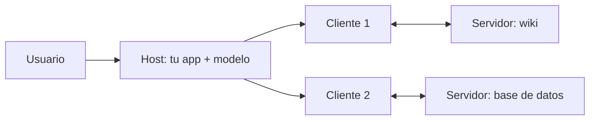

Al terminar esta lección podrás explicar qué hace cada pieza de MCP y leer una sesión del protocolo mensaje a mensaje. Es la base para el resto del curso: cuando algo falle en tu servidor, sabrás si el problema está en la negociación, en el listado o en la llamada.

## La idea

Sin un estándar, cada aplicación de IA integra cada sistema a su manera. Si tienes tres aplicaciones (un chat interno, un agente de código, un asistente de soporte) y cinco sistemas (GitHub, la base de datos, la wiki, el CRM, el calendario), acabas manteniendo hasta quince integraciones distintas, cada una con su forma de describir herramientas, autenticar y devolver errores.

[[glosario/mcp|Model Context Protocol]] define una interfaz común. Cada sistema se expone una vez como **servidor MCP** y cada aplicación implementa una vez un **cliente MCP**. Las quince integraciones pasan a ser cinco servidores y tres clientes. La especificación es abierta y está en [modelcontextprotocol.io](https://modelcontextprotocol.io).

MCP no cambia cómo el modelo usa herramientas. El modelo sigue recibiendo definiciones con nombre, descripción y esquema, y sigue emitiendo bloques `tool_use` como viste en [[roadmap/20-herramientas/01-ciclo-tool-use]]. MCP estandariza **cómo llegan esas definiciones a tu aplicación y cómo se ejecutan**.

## Host, cliente y servidor



- **Host**: la aplicación con la que interactúa el usuario (un IDE, un chat, tu agente). Contiene el modelo, decide qué servidores conectar y aplica la política de permisos.
- **Cliente**: el componente dentro del host que mantiene **una conexión con un servidor**. Un host con tres servidores tiene tres clientes.
- **Servidor**: un programa que expone capacidades de un sistema. No sabe qué modelo hay detrás ni ve la conversación completa; solo recibe las peticiones que le llegan.

Esa última propiedad importa para la seguridad: el servidor ve poco, y el host es quien decide qué se ejecuta. Lo retomarás en la [[cursos/mcp-de-cero-a-servidor/04-seguridad-y-despliegue|lección 4]].

## Las tres primitivas del servidor

La diferencia entre ellas está en **quién decide usarlas**.

| Primitiva | Quién la controla | Para qué | Ejemplo |
|---|---|---|---|
| *Tools* | el modelo | acciones y consultas que el modelo invoca cuando las necesita | `buscar_pedidos(cliente_id)`, `crear_issue(titulo, cuerpo)` |
| *Resources* | la aplicación | datos que el host puede leer y meter en el contexto | `file:///proyecto/README.md`, `notas://reunion-lunes` |
| *Prompts* | el usuario | plantillas que el usuario elige, a menudo como comandos | «Resumir esta nota», «Revisar este PR» |

Regla práctica: si el modelo debe decidir cuándo usarlo, es una *tool*. Si es contexto que el usuario o la aplicación adjuntan, es un *resource*. Si es un flujo de trabajo que el usuario lanza a propósito, es un *prompt*. Muchos hosts solo aprovechan las *tools*; si tu caso depende de *resources* o *prompts*, comprueba antes qué soporta tu host.

Además, el cliente puede ofrecer capacidades al servidor. Las más citadas son *sampling* (el servidor pide al host una respuesta del modelo), *roots* (el cliente indica qué carpetas o recursos puede tocar el servidor) y *elicitation* (el servidor pide un dato al usuario a través del host). Son opcionales; consulta la especificación para ver cuáles están estables en la versión que uses.

## El protocolo por dentro

Los mensajes son JSON-RPC 2.0: peticiones con `id`, respuestas con el mismo `id` y notificaciones sin `id`. Una sesión empieza con una negociación en la que cada parte declara qué sabe hacer.

```json title="1. El cliente inicia la sesión"
{"jsonrpc": "2.0", "id": 1, "method": "initialize",
 "params": {"protocolVersion": "2025-06-18",
            "capabilities": {"roots": {}},
            "clientInfo": {"name": "mi-agente", "version": "0.1.0"}}}
```

```json title="2. El servidor responde con sus capacidades"
{"jsonrpc": "2.0", "id": 1,
 "result": {"protocolVersion": "2025-06-18",
            "capabilities": {"tools": {}, "resources": {}, "prompts": {}},
            "serverInfo": {"name": "notas", "version": "0.1.0"}}}
```

`protocolVersion` es una fecha que identifica la revisión de la especificación; la de arriba es un ejemplo. El cliente cierra la negociación con la notificación `notifications/initialized` y a partir de ahí puede listar y llamar:

```json title="3. Listar y llamar a una herramienta"
{"jsonrpc": "2.0", "id": 2, "method": "tools/list"}

{"jsonrpc": "2.0", "id": 3, "method": "tools/call",
 "params": {"name": "buscar_notas", "arguments": {"consulta": "presupuesto 2027"}}}
```

```json title="4. Resultado de la llamada"
{"jsonrpc": "2.0", "id": 3,
 "result": {"content": [{"type": "text", "text": "reunion-lunes.md: …presupuesto 2027…"}],
            "isError": false}}
```

Fíjate en el paralelismo con la API de Mensajes. Cada herramienta del listado trae `name`, `description` e `inputSchema`, que pasas al modelo como `name`, `description` e `input_schema`. El resultado trae `content` e `isError`, que conviertes en un bloque `tool_result` con `is_error`. El cliente hace de traductor; lo programarás en la [[cursos/mcp-de-cero-a-servidor/02-usar-servidores-existentes|lección 2]].

Para *resources* y *prompts* hay métodos equivalentes: `resources/list`, `resources/read`, `prompts/list`, `prompts/get`. Y el servidor puede avisar con notificaciones como `notifications/tools/list_changed` cuando cambia su catálogo.

## Transportes

| Transporte | Cómo funciona | Cuándo |
|---|---|---|
| `stdio` | el host lanza el servidor como proceso hijo y hablan por la entrada y salida estándar | servidores locales: archivos, herramientas de desarrollo, scripts |
| *Streamable HTTP* | el servidor escucha en una URL; el cliente envía peticiones HTTP y puede recibir respuestas en streaming | servidores remotos y compartidos por varios usuarios |

Con `stdio`, el servidor hereda los permisos del usuario que lo lanza y no hay red de por medio. Con HTTP aparecen autenticación, multiusuario y exposición a internet. Por eso empezarás en local y dejarás lo remoto para el final.

## Cuándo no compensa MCP

- **Una sola aplicación con dos herramientas propias.** Defínelas directamente en tu llamada a la API; un servidor añade un proceso y un protocolo sin beneficio.
- **Lógica que depende de la conversación completa.** El servidor no ve el historial; esa lógica pertenece al host.
- **Flujos fijos sin decisión del modelo.** Un [[glosario/workflow|workflow]] que llama siempre a la misma API no necesita descubrir herramientas.

MCP compensa cuando la misma capacidad se usa desde varias aplicaciones, cuando quieres reutilizar servidores ya escritos por otros o cuando un equipo mantiene el sistema y otro el agente.

## Ejercicio

> [!ejercicio] Diseña la interfaz MCP de un sistema tuyo
> Elige un sistema que uses a diario (tu gestor de tareas, una base de datos, una carpeta de documentos). Escribe en una tabla qué expondrías como tools, qué como resources y qué como prompts, con nombre, descripción en una frase y quién lo controla.
>
> Está bien si hay al menos tres tools, un resource y un prompt; si cada tool tiene un esquema de entrada esbozado; y si puedes justificar cada elección con la regla de quién decide usarla.

> [!ejercicio]- Pistas
> Si dudas entre tool y resource, pregúntate si el modelo necesita decidir en mitad de una tarea que le hace falta ese dato. Si sí, es una tool (puede ser de solo lectura). Si el usuario lo adjunta al empezar, es un resource.

## Resumen

- MCP estandariza cómo una aplicación descubre y ejecuta capacidades de sistemas externos.
- El host contiene el modelo y decide; cada cliente mantiene una conexión con un servidor.
- Tools las controla el modelo, resources la aplicación y prompts el usuario.
- Los mensajes son JSON-RPC 2.0: negociación, listado y llamada.
- `stdio` para local, Streamable HTTP para remoto.

## Para seguir

- [[cursos/mcp-de-cero-a-servidor/02-usar-servidores-existentes]]
- [[docs/herramientas/02-mcp]]
- [[glosario/servidor-mcp]]
