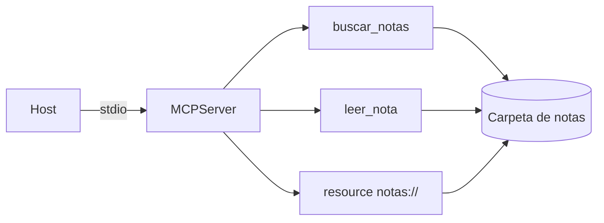

Al terminar tendrás un servidor MCP funcionando sobre una carpeta de notas en Markdown, conectado a tu agente y probado con el Inspector. Más importante que el código, que es corto, es lo que lo rodea: cómo describir las herramientas para que el modelo las use bien y cómo fallar de forma que el modelo pueda corregirse.

## La idea

Un servidor MCP es una función de traducción: recibe peticiones del protocolo y las convierte en llamadas a tu sistema. Los SDK se ocupan del protocolo (negociación, listado, serialización), así que tu trabajo se reduce a tres cosas:

1. **Elegir la interfaz**: qué herramientas, con qué nombres y parámetros. Pocas y con un propósito claro funcionan mejor que muchas y genéricas.
2. **Describirla**: la descripción y el esquema son lo único que el modelo sabe de tu herramienta. Escríbelos para alguien listo que no conoce tu sistema.
3. **Fallar bien**: un error debe decir qué pasó y qué hacer distinto.

El artículo de Anthropic [*Writing effective tools for agents*](https://www.anthropic.com/engineering/writing-tools-for-agents) desarrolla estos principios; aquí los aplicas.



## El servidor en Python

Instala el SDK con su CLI: `uv add "mcp[cli]"` (o `pip install "mcp[cli]"`), que instala la serie 2.x. Con `MCPServer`, el *docstring* de cada función es la descripción, las anotaciones de tipo generan el `inputSchema` y lo que devuelves se convierte en el contenido del resultado. En la serie 1.x la clase se llamaba `FastMCP`; lo verás en tutoriales antiguos.

```python tab="Python" title="servidor.py"
import logging, os, pathlib, sys
from typing import Annotated
from pydantic import Field
from mcp.server.mcpserver import MCPServer
from mcp.server.mcpserver.exceptions import ToolError

logging.basicConfig(stream=sys.stderr, level=logging.INFO)   # nunca a stdout con stdio
log = logging.getLogger("notas")

RAIZ = pathlib.Path(os.environ.get("NOTAS_DIR", "./notas")).resolve()
mcp = MCPServer("notas")

def ruta_segura(nombre: str) -> pathlib.Path:
    p = (RAIZ / nombre).resolve()
    if not p.is_relative_to(RAIZ) or p.suffix != ".md":
        raise ToolError(f"Nombre no válido: {nombre!r}. Usa un nombre devuelto por buscar_notas.")
    if not p.exists():
        raise ToolError(f"No existe la nota {nombre!r}. Usa buscar_notas para ver las disponibles.")
    return p

@mcp.tool()
def buscar_notas(
    consulta: Annotated[str, Field(description="Palabra o frase a buscar, sin comillas.")],
    limite: Annotated[int, Field(description="Máximo de resultados (1-20).", ge=1, le=20)] = 5,
) -> str:
    """Busca texto en las notas de la carpeta y devuelve el nombre de cada nota con un
    extracto alrededor de la coincidencia. Úsala antes de leer_nota para saber qué existe.
    No distingue mayúsculas. Si no hay resultados, prueba con sinónimos o una sola palabra."""
    q = consulta.lower()
    hits = []
    for p in sorted(RAIZ.rglob("*.md")):
        texto = p.read_text(encoding="utf-8", errors="replace")
        i = texto.lower().find(q)
        if i >= 0:
            extracto = texto[max(0, i - 80): i + 120].replace("\n", " ")
            hits.append(f"{p.relative_to(RAIZ)}: …{extracto}…")
        if len(hits) >= limite:
            break
    log.info("buscar_notas %r -> %d", consulta, len(hits))
    return "\n".join(hits) or "Sin resultados. Prueba con otra palabra clave."

@mcp.tool()
def leer_nota(
    nombre: Annotated[str, Field(description="Nombre relativo tal como lo devuelve buscar_notas, p. ej. 'reuniones/lunes.md'.")],
) -> str:
    """Devuelve el contenido completo de una nota en Markdown. Solo lectura."""
    return ruta_segura(nombre).read_text(encoding="utf-8", errors="replace")

@mcp.resource("notas://{+nombre}")   # {+nombre} admite «/», para notas en subcarpetas
def nota(nombre: str) -> str:
    """Una nota como recurso, para que el host la adjunte al contexto."""
    return ruta_segura(nombre).read_text(encoding="utf-8", errors="replace")

@mcp.prompt()
def resumir_nota(nombre: str) -> str:
    """Resume una nota con decisiones, tareas y responsables."""
    return (f"Lee la nota {nombre} con la herramienta leer_nota y resúmela en tres apartados: "
            "decisiones, tareas (con responsable si aparece) y preguntas abiertas.")

if __name__ == "__main__":
    mcp.run()          # stdio por defecto
```

```ts tab="TypeScript" title="servidor.ts"
import { McpServer } from "@modelcontextprotocol/sdk/server/mcp.js";
import { StdioServerTransport } from "@modelcontextprotocol/sdk/server/stdio.js";
import { z } from "zod";
import { readdir, readFile } from "node:fs/promises";
import path from "node:path";

const RAIZ = path.resolve(process.env.NOTAS_DIR ?? "./notas");
const server = new McpServer({ name: "notas", version: "0.1.0" });

function rutaSegura(nombre: string): string {
  const p = path.resolve(RAIZ, nombre);
  if (!p.startsWith(RAIZ + path.sep) || !p.endsWith(".md")) {
    throw new Error(`Nombre no válido: ${nombre}. Usa un nombre devuelto por buscar_notas.`);
  }
  return p;
}

server.registerTool(
  "buscar_notas",
  {
    description:
      "Busca texto en las notas y devuelve nombre y extracto de cada coincidencia. " +
      "Úsala antes de leer_nota. Si no hay resultados, prueba con sinónimos.",
    inputSchema: {
      consulta: z.string().describe("Palabra o frase a buscar, sin comillas."),
      limite: z.number().int().min(1).max(20).default(5).describe("Máximo de resultados."),
    },
  },
  async ({ consulta, limite }) => {
    const q = consulta.toLowerCase();
    const hits: string[] = [];
    const nombres = (await readdir(RAIZ, { recursive: true })).filter((n) => n.endsWith(".md"));
    for (const n of nombres.sort()) {
      const texto = await readFile(path.join(RAIZ, n), "utf8");
      const i = texto.toLowerCase().indexOf(q);
      if (i >= 0) hits.push(`${n}: …${texto.slice(Math.max(0, i - 80), i + 120).replace(/\n/g, " ")}…`);
      if (hits.length >= limite) break;
    }
    return { content: [{ type: "text", text: hits.join("\n") || "Sin resultados. Prueba con otra palabra clave." }] };
  },
);

server.registerTool(
  "leer_nota",
  {
    description: "Devuelve el contenido completo de una nota en Markdown. Solo lectura.",
    inputSchema: { nombre: z.string().describe("Nombre relativo tal como lo devuelve buscar_notas.") },
  },
  async ({ nombre }) => {
    try {
      return { content: [{ type: "text", text: await readFile(rutaSegura(nombre), "utf8") }] };
    } catch (e) {
      return { content: [{ type: "text", text: String(e) }], isError: true };
    }
  },
);

await server.connect(new StdioServerTransport());   // proyecto ESM ("type": "module")
```

La versión en TypeScript usa `@modelcontextprotocol/sdk` y `zod` para los esquemas. La API para registrar herramientas ha cambiado entre versiones del SDK (en versiones antiguas era `server.tool(...)`); si tu versión no reconoce `registerTool`, revisa el README del paquete.

## Por qué está escrito así

**Descripciones que guían.** `buscar_notas` dice cuándo usarla («antes de leer_nota»), cómo se comporta («no distingue mayúsculas») y qué hacer si falla. `leer_nota` explica el formato exacto del parámetro con un ejemplo. Son las preguntas que el modelo no puede hacerte.

**Errores accionables.** Si `leer_nota` recibe un nombre que no existe, el error dice cómo arreglarlo. En Python lanzas `ToolError` y el SDK lo convierte en un resultado con `isError: true` y tu mensaje como texto (con cualquier otra excepción el texto es genérico y no dice qué hacer); en TypeScript lo devuelves tú. El modelo lee ese texto y normalmente corrige en el siguiente paso.

**Salidas acotadas.** `buscar_notas` devuelve extractos y un límite, no notas enteras. Una herramienta que devuelve 50 000 tokens llena el contexto y degrada todo lo que viene después.

**Ruta segura.** `ruta_segura` resuelve la ruta y comprueba que sigue dentro de la carpeta. Sin eso, `leer_nota("../../.ssh/id_rsa")` funcionaría. Es el error de seguridad más común en servidores de archivos, y el modelo puede llegar a pedirlo sin mala intención si un documento se lo sugiere.

**Registros a `stderr`.** Con `stdio`, `stdout` es el canal del protocolo. Un `print()` suelto rompe la sesión con errores difíciles de rastrear.

> [!consejo] Herramientas de solo lectura primero
> Empieza con lectura. Cuando añadas escritura, hazlo en herramientas separadas y con nombres que lo dejen claro (`crear_nota`, no `gestionar_nota` con un parámetro `accion`). El host podrá pedir confirmación solo para esas. La receta [[recetas/servidor-mcp-de-solo-lectura]] parte de esta idea.

## Probarlo

**Con el Inspector.** Es una interfaz web de depuración mantenida por el proyecto MCP. Lánzalo con tu servidor como argumento:

```bash
npx @modelcontextprotocol/inspector uv run servidor.py
# o, con la CLI del SDK de Python:
uv run mcp dev servidor.py
```

Comprueba que aparecen las dos herramientas con sus esquemas, llama a cada una con argumentos buenos y malos, lee el recurso `notas://` de una nota y obtén el prompt.

**Con tu cliente.** Cambia `SERVIDOR` en el cliente de la [[cursos/mcp-de-cero-a-servidor/02-usar-servidores-existentes|lección 2]]:

```python
SERVIDOR = StdioServerParameters(command="uv", args=["run", "servidor.py"],
                                 env={"NOTAS_DIR": "/home/yo/notas"})
```

**Con pruebas unitarias.** Con el decorador de `MCPServer`, las funciones siguen siendo funciones de Python normales: pruébalas con `pytest` llamándolas directamente, incluidos los casos de ruta maliciosa.

```text
# salida de ejemplo del agente
Pregunta: ¿Qué se decidió sobre el presupuesto de 2027?
→ buscar_notas {"consulta": "presupuesto 2027"}
→ leer_nota {"nombre": "reuniones/lunes.md"}
Respuesta: En la reunión del lunes se acordó congelar contrataciones hasta marzo…
```

## Errores frecuentes

- **Nombres genéricos** (`run`, `query`, `do_action`). El modelo no sabe cuándo usarlas y se confunde con otras de otros servidores.
- **Parámetros con significado implícito.** Si `fecha` espera `AAAA-MM-DD`, dilo en la descripción del campo.
- **Devolver trazas de pila como error.** Gastan tokens y no dicen qué hacer; registra la traza en `stderr` y devuelve una frase útil.
- **Una herramienta multiusos con parámetro `accion`.** Dificulta los permisos y la elección del modelo.

## Ejercicio

> [!ejercicio] Tu servidor sobre tus datos
> Adapta el servidor a una fuente tuya (otra carpeta, una base SQLite, una API interna de solo lectura). Expón al menos dos tools, un resource y un prompt. Escribe cinco pruebas con `pytest`, dos de ellas con entradas maliciosas o mal formadas.
>
> Está bien si el Inspector muestra todas las primitivas con descripciones completas, si las cinco pruebas pasan, si el agente de la lección 2 responde tres preguntas reales usando tus herramientas y si al menos una vez se recupera de un error leyendo tu mensaje.

> [!ejercicio]- Pistas
> Para provocar una recuperación, pide al agente algo que le haga adivinar un nombre de nota. Si no se recupera, revisa que el mensaje de error diga qué herramienta usar. Para SQLite, abre la conexión en modo de solo lectura (`file:datos.db?mode=ro` con `uri=True`).

## Resumen

- `MCPServer` genera el esquema de los tipos y la descripción del *docstring*; en TypeScript lo das con `zod`.
- La descripción es tu única forma de explicarle la herramienta al modelo: incluye cuándo usarla y qué hacer si falla.
- Errores con instrucciones, salidas acotadas y rutas comprobadas.
- Con `stdio`, los registros van a `stderr`.
- Prueba con el Inspector, con tu cliente y con pruebas unitarias.

## Para seguir

- [[cursos/mcp-de-cero-a-servidor/04-seguridad-y-despliegue]]
- [[disciplinas/diseno-de-herramientas]]
- [[recetas/servidor-mcp-de-solo-lectura]]
