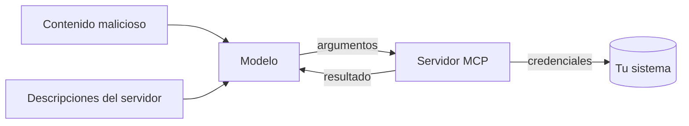

Al terminar sabrás qué puede salir mal con un servidor MCP, tanto en tu máquina como expuesto en la red, y tendrás tu servidor de la lección 3 preparado para desplegarse con autenticación, límites y auditoría. Esta lección se centra en MCP; el marco general está en el curso [[cursos/seguridad-y-prompt-injection/index]].

## La idea

Un servidor MCP está en una posición delicada. Por un lado, **recibe órdenes de un modelo**, y el modelo puede haber leído texto malicioso. Por otro, **tiene credenciales reales** sobre tus sistemas. Cualquier diseño seguro parte de suponer que los argumentos de una llamada pueden venir de un atacante, aunque el usuario sea legítimo.

Las amenazas cambian con el transporte. En local (`stdio`) el riesgo principal es lo que el servidor puede hacer con tus permisos. En remoto (HTTP) se añade quién puede conectarse, con qué identidad y qué datos de quién ve.



## Amenazas propias de MCP

| Amenaza | Cómo ocurre | Defensa principal |
|---|---|---|
| Argumentos maliciosos | un documento leído por el modelo le sugiere `leer_nota("../../.env")` o una consulta SQL dañina | validar cada argumento en el servidor; listas de permitidos; consultas parametrizadas |
| Descripciones envenenadas ([[glosario/envenenamiento-de-herramientas|*tool poisoning*]]) | un servidor de terceros incluye instrucciones ocultas en la descripción de una herramienta | revisar descripciones completas al instalar y al actualizar; fijar versiones |
| Cambio tras la aprobación ([[glosario/rug-pull|*rug pull*]]) | un servidor cambia sus descripciones o su comportamiento después de que lo revisaste | fijar versiones; guardar un hash de cada descripción y alertar cuando cambia `tools/list` |
| Sombra entre servidores (*shadowing*) | la descripción de un servidor da instrucciones sobre cómo usar las herramientas de otro | fronteras entre servidores; no mezclar servidores de confianza y ajenos en la misma tarea |
| Inyección en resultados | el servidor devuelve contenido de terceros (correos, webs, issues) con instrucciones | tratar los resultados como datos no fiables en el host; ver [[cursos/seguridad-y-prompt-injection/02-inyeccion-directa-e-indirecta]] |
| Exceso de permisos | el servidor usa un token con más alcance del que necesita la tarea | credenciales de [[glosario/minimo-privilegio|mínimo privilegio]] por servidor |
| Suplantación (*confused deputy*) | un servidor remoto actúa con sus propios privilegios en nombre de un usuario que no los tiene | autorizar por usuario, no por servidor; consentimiento por cliente en proxies OAuth |
| Secuestro de *handles* | el servidor guarda estado entre llamadas en identificadores que el modelo pasa como argumentos, y alguien usa uno ajeno | handles impredecibles y ligados al usuario; comprobar el dueño en cada llamada |
| Ejecución de comandos | una herramienta concatena argumentos en un comando de shell | nunca `shell=True`; argumentos como lista; mejor aún, no ejecutar comandos |
| Consumo sin límite | bucles del agente que llaman miles de veces o piden respuestas enormes | límites de tasa, de tiempo y de tamaño |

El envenenamiento de descripciones, el *rug pull* y el *shadowing* los documentó Invariant Labs ([*MCP Security Notification: Tool Poisoning Attacks*](https://invariantlabs.ai/blog/mcp-security-notification), 1 abr. 2025), y siguen siendo la forma más directa de atacar a un agente con servidores ajenos. Las *Security Best Practices* de la especificación añaden los riesgos de la parte remota. Una nota sobre las sesiones: la revisión `2026-07-28` no tiene sesiones de protocolo, así que el secuestro de sesión que verás en guías antiguas se aplica a servidores ≤ 2025-11-25; su equivalente actual son los *handles* de la tabla. El panorama completo de servidores y skills de terceros está en [[docs/seguridad/04-mcp-y-skills-de-terceros]].

## Endurecer las herramientas

Antes de pensar en red, endurece cada herramienta. Este decorador añade a una función de `MCPServer` un registro de auditoría, un límite de tamaño en la salida y un tiempo máximo de ejecución.

```python title="endurecer.py"
import asyncio, functools, json, logging, sys, time, uuid
from mcp.server.mcpserver.exceptions import ToolError

audit = logging.getLogger("audit")
audit.addHandler(logging.FileHandler("auditoria.jsonl"))
audit.setLevel(logging.INFO)

MAX_SALIDA = 20_000          # caracteres
TIMEOUT_S = 10

def endurecida(fn):
    @functools.wraps(fn)
    async def envoltura(*args, **kwargs):
        llamada = {"id": uuid.uuid4().hex[:8], "tool": fn.__name__, "args": kwargs, "t": time.time()}
        try:
            res = await asyncio.wait_for(asyncio.to_thread(fn, *args, **kwargs), TIMEOUT_S)
            if isinstance(res, str) and len(res) > MAX_SALIDA:
                res = res[:MAX_SALIDA] + "\n[recortado: pide un fragmento más concreto]"
            llamada["ok"] = True
            return res
        except asyncio.TimeoutError:
            llamada["ok"] = False
            raise ToolError(f"{fn.__name__} superó {TIMEOUT_S} s. Prueba con una consulta más acotada.")
        except Exception as e:
            llamada["ok"], llamada["error"] = False, str(e)
            raise
        finally:
            audit.info(json.dumps(llamada, ensure_ascii=False, default=str))
    return envoltura

# uso: el decorador de MCP va por fuera
# @mcp.tool()
# @endurecida
# def leer_nota(nombre: str) -> str: ...
```

`functools.wraps` conserva el nombre, el *docstring* y la firma, de los que `MCPServer` genera el esquema. Comprueba con el Inspector que el esquema sigue igual tras decorar. El registro de auditoría guarda argumentos: si pueden contener datos personales, decide qué se enmascara y cuánto tiempo se conserva.

La especificación permite además **anotaciones** en las herramientas para que el host decida cuándo pedir confirmación: `readOnlyHint`, `destructiveHint`, `idempotentHint` y `openWorldHint` (si toca sistemas externos). En Python: `@mcp.tool(annotations=ToolAnnotations(read_only_hint=True))`, con `ToolAnnotations` de `mcp.types`. Son pistas para el host, no garantías: un servidor malicioso puede mentir en ellas.

## Desplegar en remoto

Para servir a varios usuarios o a agentes que corren en otra máquina, cambia a *Streamable HTTP*. En `MCPServer` es un argumento de `run`:

```python title="servidor_http.py"
from servidor import mcp      # el mismo servidor de la lección 3

if __name__ == "__main__":
    mcp.run(transport="streamable-http")   # consulta host, puerto y ruta en la documentación del SDK
```

Como la revisión `2026-07-28` no tiene sesiones, cada petición HTTP se atiende sola: puedes poner varias réplicas detrás de un balanceador sin afinidad de sesión. Si necesitas recordar algo entre llamadas, guárdalo tú (en una base de datos) y devuélvelo al modelo como *handle*; la receta [[recetas/servidor-mcp-sin-estado-con-handles]] lo desarrolla. Las peticiones llevan las cabeceras obligatorias `Mcp-Method` y `Mcp-Name`, útiles para registrar y limitar en el proxy sin leer el cuerpo.

Ese proceso no debe quedar expuesto tal cual a internet. La arquitectura mínima:

1. **Proxy inverso con TLS** delante (nginx, Caddy o el balanceador de tu nube). El servidor escucha solo en `127.0.0.1` o en la red interna.
2. **Autorización.** Para transportes HTTP, la especificación de MCP define un flujo basado en OAuth 2.1 en el que el servidor actúa como servidor de recursos y valida los tokens que emite un servidor de autorización. La revisión `2026-07-28` trae cambios que conviene conocer:
   - Los clientes se identifican con **CIMD** (*Client ID Metadata Documents*): un documento de metadatos publicado en una URL que hace de `client_id`. El registro dinámico de clientes (DCR) queda **deprecado**.
   - El cliente debe **validar el `iss`** de la respuesta de autorización (RFC 9207), para no aceptar un código emitido por otro servidor de autorización (*mix-up*).
   - Las credenciales quedan **ligadas al emisor** que las dio, y el cliente indica su `application_type`.
   - Hay extensiones oficiales para casos sin usuario delante (*OAuth Client Credentials*) y para empresas que gestionan el acceso desde su proveedor de identidad (*Enterprise-Managed Authorization*).
   
   Lee la sección de autorización de [modelcontextprotocol.io](https://modelcontextprotocol.io) y usa el soporte del SDK o una biblioteca de OAuth probada; no implementes criptografía ni validación de tokens a mano. Cuidado también con el descubrimiento de metadatos OAuth: si tu cliente sigue URLs que le da el servidor, bloquea direcciones privadas para evitar SSRF.
3. **Identidad por usuario.** Cada llamada debe ejecutarse con los permisos del usuario que la origina, no con una cuenta de servicio que lo ve todo.
4. **Límites de tasa** por usuario y por herramienta, y tamaño máximo de petición en el proxy.
5. **Registros centralizados** con el id de usuario en cada entrada de auditoría.

> [!peligro] No reenvíes el token del cliente
> Si tu servidor llama a otra API, no reutilices el token que te envió el cliente. La especificación lo prohíbe expresamente: ese token se emitió para tu servidor y reenviarlo rompe la cadena de autorización y facilita la suplantación. Obtén credenciales propias para el servicio de destino con el alcance mínimo.

> [!aviso] Servidores HTTP en local
> Si ejecutas un servidor HTTP en tu máquina para desarrollo, escucha solo en `127.0.0.1` (nunca en `0.0.0.0`) y valida la cabecera `Origin`. Sin eso, una página web abierta en tu navegador podría hablar con tu servidor local.

## Lista de comprobación antes de publicar

- [ ] Cada argumento se valida en el servidor (tipos, rangos, rutas, listas de permitidos).
- [ ] Ninguna herramienta construye comandos de shell o SQL concatenando texto.
- [ ] Las herramientas de escritura están separadas de las de lectura y marcadas para confirmación.
- [ ] Credenciales de mínimo privilegio, fuera del código y rotables.
- [ ] Límites de tiempo, de tamaño de salida y de tasa.
- [ ] Auditoría de cada llamada con usuario, herramienta, argumentos y resultado.
- [ ] TLS, autorización según la especificación (CIMD, validación de `iss`) y sin reenvío de tokens.
- [ ] Dependencias y servidores de terceros con versión fijada, revisados y con hash de sus descripciones.
- [ ] Pruebas con entradas maliciosas en la batería de tests.

## Errores frecuentes

- **Confiar en que el modelo «no pedirá eso».** El modelo hace lo que el texto de su contexto le lleva a hacer; valida igual.
- **Una cuenta de servicio con acceso total** para un servidor multiusuario.
- **Exponer el puerto directamente** sin proxy, TLS ni autorización «porque es interno».
- **Auditar solo errores.** Las llamadas exitosas son las que necesitas para investigar un incidente.

## Ejercicio

> [!ejercicio] Prepara tu servidor para producción
> Aplica `endurecida` a todas las herramientas de tu servidor, añade tres pruebas de ataque (ruta fuera de la carpeta, salida enorme, llamada que tarda demasiado) y arráncalo con Streamable HTTP en `127.0.0.1` detrás de un proxy local con TLS.
>
> Está bien si las tres pruebas producen errores con mensaje útil y quedan en `auditoria.jsonl`, si el Inspector conecta por HTTP a través del proxy y si la lista de comprobación tiene cada punto marcado o con una nota de por qué no aplica.

> [!ejercicio]- Pistas
> Para la prueba de tiempo, crea una herramienta temporal que haga `time.sleep(30)`. Para TLS en local, Caddy genera certificados de desarrollo automáticamente. La autorización completa puede quedar como nota si aún no tienes servidor de identidad; no la sustituyas por una contraseña fija en el código.

## Resumen

- Supón que los argumentos de cualquier llamada pueden venir de un atacante.
- Revisa y fija las versiones de servidores de terceros; sus descripciones entran en el contexto.
- Endurece cada herramienta con validación, límites y auditoría antes de pensar en red.
- En remoto: proxy con TLS, autorización según la especificación (CIMD en lugar de DCR, `iss` validado), permisos por usuario.
- Nunca reenvíes el token del cliente a otra API.

## Para seguir

- [[cursos/seguridad-y-prompt-injection/index]]
- [[docs/seguridad/04-mcp-y-skills-de-terceros]]
- [[sistemas/asistente-de-datos-con-mcp]]
- [[roadmap/100-produccion/06-despliegue]]
