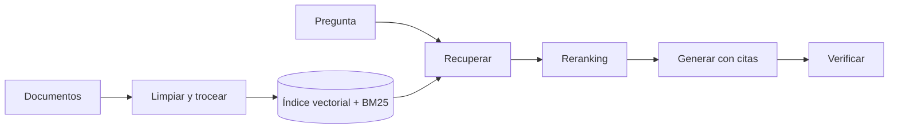

Al terminar esta lección tendrás un mapa mental de todas las piezas de un [[glosario/rag|RAG]] y un esqueleto de código que registra lo que pasa en cada una. Con eso, cuando una respuesta salga mal, podrás decir en qué etapa se torció en lugar de tocar el prompt a ciegas.

## La idea

Un RAG son dos programas que comparten un índice. El primero, la **tubería de indexación**, corre fuera de línea: toma documentos, los limpia, los trocea, calcula [[glosario/embeddings|embeddings]] y los guarda en un [[glosario/vector-store|vector store]] y en un índice léxico. El segundo, la **tubería de consulta**, corre con cada pregunta: recupera fragmentos, los ordena, monta el contexto y pide al modelo una respuesta anclada en ellos.

La idea original viene de Lewis et al. (2020), [*Retrieval-Augmented Generation for Knowledge-Intensive NLP Tasks*](https://arxiv.org/abs/2005.11401). Lo que cambió desde entonces es la parte de ingeniería: hoy el modelo generador es muy bueno, así que **la calidad de un RAG la decide sobre todo lo que le llega al contexto**.



## Las etapas y lo que decide cada una

Cada etapa toma una decisión que limita a las siguientes. Si un fragmento no entra en el índice, ningún reranking lo salvará.

| Etapa | Decide | Fallo típico |
|---|---|---|
| Ingesta y limpieza | qué texto existe para el sistema | tablas convertidas en sopa de números, menús de navegación repetidos en cada página |
| Troceado | qué unidad se recupera | la respuesta queda partida entre dos fragmentos |
| Metadatos | qué se puede filtrar y citar | no sabes de qué versión del manual sale un dato |
| Indexado | cómo se puede encontrar | un código de producto no aparece por búsqueda vectorial |
| Reescritura de consulta | qué se busca de verdad | «¿y en Francia?» se busca sin el contexto de la conversación |
| Recuperación | qué candidatos entran | el fragmento correcto está en la posición 40 y cortas en 20 |
| Reranking | qué candidatos llegan al modelo | el reranker premia fragmentos largos y genéricos |
| Ensamblado del contexto | orden, formato y cantidad | demasiados fragmentos y el dato clave queda en medio |
| Generación | qué se afirma y con qué cita | el modelo completa con lo que «sabe» en vez de con lo recuperado |
| Verificación | qué se entrega al usuario | una cita apunta a un fragmento que no respalda la frase |

El problema del ensamblado tiene un nombre en la literatura: Liu et al. (2023) mostraron en [*Lost in the Middle*](https://arxiv.org/abs/2307.03172) que los modelos usan peor la información situada en mitad de contextos largos. Por eso más fragmentos no siempre es mejor, aunque tengas [[glosario/contexto-largo|contexto largo]] disponible.

## Recuperación o generación: la primera pregunta al depurar

Ante una respuesta mala, pregunta primero: **¿el fragmento que contiene la respuesta llegó al modelo?**

- **No llegó**: es un fallo de recuperación. Mira por qué: no existe en el índice (ingesta), está partido (troceado), existe pero no sale entre los candidatos (indexado o consulta) o sale pero el reranker lo descarta.
- **Llegó**: es un fallo de generación. El modelo lo ignoró, lo malinterpretó o mezcló con conocimiento propio. Aquí sí tocan el prompt, el orden de los fragmentos o la instrucción de abstenerse.

Esta separación ahorra semanas. Es frecuente ver equipos reescribiendo el [[glosario/prompt-de-sistema|prompt de sistema]] para corregir lo que en realidad era un PDF mal extraído. Para responder a la pregunta necesitas guardar qué fragmentos recuperó cada etapa: eso es lo que hace el esqueleto de abajo.

## Un esqueleto con trazas

El código separa las etapas en funciones y guarda una traza por consulta. `embed` es abstracta: usa el proveedor de embeddings que prefieras. El índice es una clase mínima en memoria para que el ejemplo se ejecute; en las lecciones siguientes la sustituyes.

```python title="rag_esqueleto.py"
import json, math, time
from dataclasses import dataclass, field, asdict
import anthropic

MODEL = "claude-sonnet-5-5"
client = anthropic.Anthropic()

def embed(textos: list[str]) -> list[list[float]]:
    # usa el proveedor de embeddings que prefieras
    raise NotImplementedError

@dataclass
class Fragmento:
    id: str
    texto: str
    fuente: str

@dataclass
class Traza:
    pregunta: str
    candidatos: list[str] = field(default_factory=list)   # ids tras recuperar
    contexto: list[str] = field(default_factory=list)     # ids que llegan al modelo
    respuesta: str = ""
    stop_reason: str = ""
    ms: dict = field(default_factory=dict)

def coseno(a, b):
    num = sum(x * y for x, y in zip(a, b))
    return num / (math.sqrt(sum(x * x for x in a)) * math.sqrt(sum(y * y for y in b)))

class IndiceMemoria:
    def __init__(self, fragmentos: list[Fragmento]):
        self.fragmentos = fragmentos
        self.vectores = embed([f.texto for f in fragmentos])

    def buscar(self, consulta: str, k: int) -> list[Fragmento]:
        q = embed([consulta])[0]
        orden = sorted(range(len(self.fragmentos)),
                       key=lambda i: coseno(q, self.vectores[i]), reverse=True)
        return [self.fragmentos[i] for i in orden[:k]]

SISTEMA = (
    "Responde solo con la información de los fragmentos. "
    "Cita cada afirmación con el id entre corchetes, por ejemplo [doc3#2]. "
    "Si los fragmentos no contienen la respuesta, di que no lo sabes."
)

def responder(indice: IndiceMemoria, pregunta: str, k_rec=20, k_ctx=5) -> Traza:
    t = Traza(pregunta=pregunta)
    t0 = time.perf_counter()
    candidatos = indice.buscar(pregunta, k_rec)
    t.candidatos = [f.id for f in candidatos]
    seleccion = candidatos[:k_ctx]          # aquí irá el reranking (lección 3)
    t.contexto = [f.id for f in seleccion]
    t.ms["recuperar"] = round((time.perf_counter() - t0) * 1000)

    bloques = "\n\n".join(
        f'<fragmento id="{f.id}" fuente="{f.fuente}">\n{f.texto}\n</fragmento>'
        for f in seleccion)
    t0 = time.perf_counter()
    resp = client.messages.create(
        model=MODEL, max_tokens=1024, system=SISTEMA,
        messages=[{"role": "user",
                   "content": f"<fragmentos>\n{bloques}\n</fragmentos>\n\nPregunta: {pregunta}"}],
    )
    t.ms["generar"] = round((time.perf_counter() - t0) * 1000)
    t.stop_reason = resp.stop_reason
    t.respuesta = "".join(b.text for b in resp.content if b.type == "text")
    if resp.stop_reason == "max_tokens":
        t.respuesta += "\n[respuesta truncada]"
    return t

def guardar(traza: Traza, ruta="trazas.jsonl"):
    with open(ruta, "a", encoding="utf-8") as f:
        f.write(json.dumps(asdict(traza), ensure_ascii=False) + "\n")
```

Fíjate en tres detalles. Los fragmentos van dentro de etiquetas con su id, para que el modelo cite algo comprobable. La traza guarda **dos listas** (candidatos y contexto), que te dicen si el fallo está antes o después del corte. Y se comprueba `stop_reason`: una respuesta truncada por `max_tokens` parece una respuesta incompleta del modelo si no lo registras (ver [[glosario/stop-reason]]).

Con este archivo de trazas, depurar es una consulta: «para las preguntas mal respondidas, ¿estaba el fragmento correcto en `candidatos`? ¿y en `contexto`?».

## RAG como herramienta de un agente

En un [[glosario/agente|agente]], la recuperación suele ser una herramienta (`buscar_docs`) que el modelo invoca cuando lo necesita, a veces varias veces con consultas distintas. Las etapas son las mismas; cambia quién decide la consulta. Eso añade un modo de fallo: el modelo no busca cuando debería o busca con términos pobres. La traza tiene que guardar también las consultas que generó el modelo. El patrón base está en [[patrones/02-llamada-aumentada]].

## Errores frecuentes

- **Optimizar la generación primero.** Cambiar de modelo o de prompt cuando el fragmento correcto nunca llegó al contexto.
- **Un solo número de «calidad».** Sin métricas por etapa no sabes qué arreglar. La lección 4 lo resuelve.
- **No guardar la versión del índice.** Si reindexas y cambian los resultados, necesitas saber con qué índice se generó cada traza.
- **Meter más fragmentos para «asegurar».** Sube el coste, la [[glosario/latencia|latencia]] y el riesgo de que el dato clave se pierda en medio.

## Ejercicio

> [!ejercicio] Diagnostica cinco fallos
> Toma tu RAG actual (o el esqueleto con 50 fragmentos de tus documentos) y reúne cinco preguntas que responde mal. Para cada una, registra la traza y clasifica el fallo en una de las diez etapas de la tabla.
>
> Está bien si para cada pregunta puedes señalar el id del fragmento que debería haber llegado, decir si estaba en `candidatos`, si estaba en `contexto`, y nombrar la etapa responsable con una frase de justificación.

> [!ejercicio]- Pistas
> Si no encuentras el fragmento correcto en el índice, busca la frase literal en los documentos originales y luego en los fragmentos: verás si se perdió al limpiar o al trocear. Si el fragmento está pero sale tarde, prueba la misma pregunta reformulada con las palabras exactas del documento.

## Resumen

- Un RAG tiene una tubería de indexación y otra de consulta que comparten índice.
- Cada etapa limita a las siguientes: lo que no se indexa no se puede recuperar.
- La primera pregunta al depurar es si el fragmento correcto llegó al modelo.
- Registra candidatos y contexto por separado en cada traza.
- Más fragmentos no es más calidad: el orden y la cantidad importan.

## Para seguir

- [[cursos/rag-a-fondo/02-indexar-bien]]
- [[roadmap/40-primer-agente/06-depurar-con-trazas]]
- [[docs/contexto/03-rag]]
