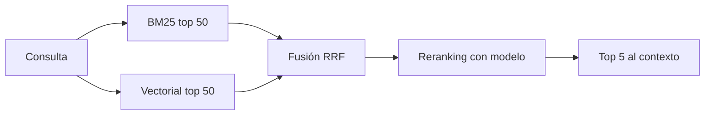

Al terminar esta lección tu recuperador combinará búsqueda léxica y vectorial, reordenará los candidatos con un modelo y trabajará sobre fragmentos enriquecidos con contexto del documento. En el roadmap viste [[roadmap/30-contexto-y-rag/03-busqueda-hibrida|la búsqueda híbrida]] y [[roadmap/30-contexto-y-rag/04-reranking|el reranking]] por separado; aquí los montas juntos y añades la técnica que más ataca el problema de raíz: que el fragmento no diga de qué habla.

## La idea

La recuperación tiene dos fases con objetivos distintos:

- **Fase amplia** (barata, sobre todo el índice): que el fragmento correcto esté entre los primeros 50 o 100 candidatos. Se mide con recall@k.
- **Fase fina** (cara, sobre pocos candidatos): que el fragmento correcto quede entre los primeros 5 que llegan al modelo. Se mide con MRR o recall@5.

Mezclar ambos objetivos en una sola etapa obliga a elegir entre barato e impreciso o preciso e inasumible. Separarlos te deja usar lo mejor de cada técnica.



## Fusión con RRF

[[glosario/bm25|BM25]] encuentra coincidencias exactas (códigos, nombres propios, siglas); los [[glosario/embeddings|embeddings]] encuentran paráfrasis. Sus puntuaciones no son comparables, así que no las sumes. **Reciprocal Rank Fusion** combina posiciones en lugar de puntuaciones: cada documento suma `1 / (k + posición)` en cada lista donde aparece. Con `k = 60`, un valor habitual, ningún ranking domina por tener puntuaciones en otra escala.

```python title="fusion.py"
from collections import defaultdict

def rrf(rankings: list[list[str]], k: int = 60, top: int = 50) -> list[str]:
    puntos = defaultdict(float)
    for ranking in rankings:
        for pos, doc_id in enumerate(ranking, start=1):
            puntos[doc_id] += 1.0 / (k + pos)
    return sorted(puntos, key=puntos.get, reverse=True)[:top]

def recuperar(indice, consulta: str, filtros: dict | None = None) -> list[str]:
    lexico = indice.bm25(consulta, k=50, filtros=filtros)       # ids
    vector = indice.vectorial(consulta, k=50, filtros=filtros)  # ids
    return rrf([lexico, vector])
```

Los **filtros por metadatos** se aplican dentro de cada búsqueda, no después: si filtras tras cortar en 50, puedes quedarte sin ningún candidato válido. Aquí es donde rentan los metadatos de la [[cursos/rag-a-fondo/02-indexar-bien|lección anterior]] (`version`, `idioma`, `acl`).

## Reranking con modelo

Un reranker lee la consulta y cada candidato juntos, así que juzga relevancia con más finura que la similitud entre vectores calculados por separado. Puedes usar un modelo especializado (un *cross-encoder*) o un LLM. La versión con LLM es fácil de montar y de ajustar con instrucciones; su coste crece con el número de candidatos, por eso solo se aplica a la lista fusionada.

```python title="rerank.py"
import json
import anthropic

MODEL = "claude-sonnet-5-5"
client = anthropic.Anthropic()

ESQUEMA = {
    "type": "object",
    "properties": {
        "puntuaciones": {
            "type": "array",
            "items": {
                "type": "object",
                "properties": {"id": {"type": "string"}, "relevancia": {"type": "integer"}},
                "required": ["id", "relevancia"],
                "additionalProperties": False,
            },
        }
    },
    "required": ["puntuaciones"],
    "additionalProperties": False,
}

def rerank(consulta: str, candidatos: list[dict], top: int = 5) -> list[dict]:
    lista = "\n\n".join(f'<c id="{c["id"]}">\n{c["texto"][:1500]}\n</c>' for c in candidatos)
    resp = client.messages.create(
        model=MODEL, max_tokens=2048,
        system=("Puntúa de 0 a 3 cuánto ayuda cada fragmento a responder la consulta. "
                "3 = contiene la respuesta; 2 = parte de ella; 1 = tema relacionado; 0 = irrelevante."),
        messages=[{"role": "user", "content": f"Consulta: {consulta}\n\n{lista}"}],
        output_config={"format": {"type": "json_schema", "schema": ESQUEMA}},
    )
    if resp.stop_reason != "end_turn":
        return candidatos[:top]                       # degradar con elegancia
    datos = json.loads(next(b.text for b in resp.content if b.type == "text"))
    nota = {p["id"]: p["relevancia"] for p in datos["puntuaciones"]}
    validos = [c for c in candidatos if c["id"] in nota]   # ignora ids inventados
    validos.sort(key=lambda c: nota[c["id"]], reverse=True)
    return [c for c in validos if nota[c["id"]] > 0][:top]
```

El esquema garantiza la forma del JSON ([[glosario/salida-estructurada]]), pero sigues validando en tu código: el modelo podría devolver un id que no estaba en la lista. El orden estable de `sort` conserva el orden de RRF entre empates. Si el reranker devuelve todo con 0, no envíes nada al modelo y deja que el sistema se abstenga.

## Recuperación contextual

Muchos fragmentos no dicen de qué hablan. «Los ingresos crecieron un 3 % respecto al trimestre anterior» no menciona empresa ni trimestre; ninguna búsqueda lo asociará a «ingresos de ACME en el T2». Anthropic publicó en septiembre de 2024 el método [*Contextual Retrieval*](https://www.anthropic.com/news/contextual-retrieval): antes de indexar, un modelo escribe para cada fragmento una o dos frases que lo sitúan dentro de su documento, y ese contexto se antepone al fragmento **tanto en el índice vectorial como en el BM25**. El artículo informa de reducciones claras en los fallos de recuperación, sobre todo al combinarlo con reranking; consulta allí sus cifras y su configuración.

La objeción obvia es el coste: hay que enviar el documento entero una vez por fragmento. Con [[glosario/prompt-caching|prompt caching]] el documento se cachea en la primera llamada y las siguientes lo leen de caché, que es mucho más barato y rápido.

```python title="contextual.py"
PROMPT_FRAGMENTO = (
    "Este es el fragmento que queremos situar dentro del documento:\n"
    "<fragmento>\n{fragmento}\n</fragmento>\n"
    "Escribe un contexto breve (1-2 frases) que sitúe el fragmento en el documento "
    "para mejorar su recuperación en búsquedas. Responde solo con el contexto."
)

def contextualizar(documento: str, fragmentos: list[str]) -> list[str]:
    salida = []
    for frag in fragmentos:
        resp = client.messages.create(
            model=MODEL, max_tokens=200,
            messages=[{"role": "user", "content": [
                {"type": "text", "text": f"<documento>\n{documento}\n</documento>",
                 "cache_control": {"type": "ephemeral"}},     # se cachea el documento
                {"type": "text", "text": PROMPT_FRAGMENTO.format(fragmento=frag)},
            ]}],
        )
        contexto = "".join(b.text for b in resp.content if b.type == "text").strip()
        salida.append(f"{contexto}\n\n{frag}")
        # resp.usage.cache_read_input_tokens > 0 a partir del segundo fragmento
    return salida
```

Puntos prácticos:

- El bloque cacheado va **primero** y es idéntico en todas las llamadas del mismo documento; lo variable va después. Si cambias un carácter del documento, se invalida la caché.
- Procesa los fragmentos de un documento seguidos: la caché tiene un TTL corto por defecto (se renueva al usarse). Hay un mínimo de tokens para cachear que depende del modelo; documentos muy cortos no se cachean, pero tampoco cuestan mucho.
- Comprueba `usage.cache_read_input_tokens` para confirmar que la caché funciona. Si siempre es 0, algo en el prefijo cambia.
- Para documentos que no caben en la ventana, usa la sección o el capítulo como «documento».
- Guarda el contexto generado como campo aparte: para citar al usuario muestra el fragmento original, no el contexto inventado por el modelo.

## Qué técnica añadir según el fallo

| Síntoma en las trazas | Técnica |
|---|---|
| Fallan consultas con códigos, siglas o nombres exactos | añadir BM25 y fusión |
| El fragmento correcto aparece en el top 50 pero no en el top 5 | reranking |
| El fragmento correcto no aparece en el top 50 aunque contiene la respuesta | recuperación contextual |
| Las preguntas de seguimiento («¿y para empresas?») fallan | reescribir la consulta con el historial antes de buscar |
| Aparecen resultados de versiones o idiomas equivocados | filtros por metadatos |

No añadas todo a la vez. Cada técnica tiene coste y latencia; mide con el banco de la [[cursos/rag-a-fondo/04-evaluar-un-rag|lección 4]] y quédate con lo que mueve la aguja en tus datos.

## Errores frecuentes

- **Sumar puntuaciones de BM25 y coseno.** Tienen escalas distintas; usa RRF o normaliza con cuidado.
- **Filtrar después de cortar.** Los filtros van dentro de cada búsqueda.
- **Rerankear 500 candidatos.** Dispara coste y latencia; el reranker trabaja sobre la lista fusionada.
- **Mostrar el contexto generado como si fuera del documento.** Es una ayuda para buscar, no una fuente.

## Ejercicio

> [!ejercicio] Monta el recuperador completo
> Añade a tu índice BM25 y fusión RRF, luego reranking y por último recuperación contextual. Después de cada paso, ejecuta las 5 preguntas problemáticas de la lección 1 y anota en qué posición aparece el fragmento correcto.
>
> Está bien si tienes una tabla con la posición del fragmento correcto para cada pregunta en las cuatro variantes (solo vectorial, híbrida, híbrida + reranking, híbrida + reranking + contexto) y si en la recuperación contextual `cache_read_input_tokens` es mayor que 0 desde el segundo fragmento de cada documento.

> [!ejercicio]- Pistas
> Si la caché no se lee, imprime los primeros caracteres del bloque cacheado en dos llamadas y compáralos: una fecha o un id en el texto basta para romperla. Si el reranker empeora resultados, revisa que el texto de cada candidato no esté recortado justo antes de la parte relevante.

## Resumen

- Separa una fase amplia (recall) de una fase fina (precisión).
- Fusiona léxico y vectorial por posiciones con RRF; filtra dentro de cada búsqueda.
- Rerankea pocos candidatos y valida los ids que devuelve el modelo.
- La recuperación contextual antepone a cada fragmento su contexto en el documento; el prompt caching la hace asumible.
- Elige técnicas según el síntoma y mide cada cambio.

## Para seguir

- [[cursos/rag-a-fondo/04-evaluar-un-rag]]
- [[recetas/busqueda-hibrida-con-bm25]]
- [[docs/contexto/02-prompt-caching]]
- [[glosario/recuperacion-contextual]]
