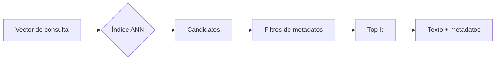

Al terminar sabrás qué pasa dentro de un [[glosario/vector-store|vector store]] cuando le pides los 10 vecinos más cercanos, por qué la respuesta puede no ser exacta y qué perillas mueven el equilibrio entre recall, latencia y memoria. Con eso podrás configurar pgvector o Qdrant con criterio y detectar cuándo un fallo de recuperación viene del índice y no de los embeddings.

## La idea

Una base vectorial guarda tres cosas por fragmento: **el vector** (para encontrarlo), **el texto** (para dárselo al modelo) y **los metadatos** (para filtrar y citar). Y hace una sola operación difícil: dado un vector de consulta, devolver los más parecidos.

Conviene tener claro lo que no hace. **La base no entiende el lenguaje**: ve listas de números y calcula distancias. La semántica la pone el modelo de [[glosario/embeddings|embeddings]]; la base solo busca relaciones entre números. Tampoco razona, ni verifica hechos, ni decide permisos por sí sola: si un filtro de permisos no se lo pasas tú, no existe ([[cursos/rag-a-fondo/07-permisos-y-multi-tenant]]).



## Por qué no comparar uno a uno

La búsqueda exacta compara la consulta con todos los vectores: N productos escalares de D dimensiones y ordenar. Con 10.000 fragmentos es instantánea, y es lo que hace [[recetas/rag-minimo-viable]] con numpy. Con decenas de millones, cada consulta recorre gigas de memoria.

Los índices **[[glosario/ann|ANN]]** (*Approximate Nearest Neighbor*) examinan solo una parte del espacio y devuelven vecinos muy cercanos, no necesariamente los exactos. El precio se mide con el **recall frente a la búsqueda exacta**: de los 10 vecinos verdaderos, ¿cuántos devuelve el índice? Es otra cosa que el [[glosario/recall-at-k|recall@k]] de tu evaluación (que mide si el fragmento *relevante* aparece), pero se suman: un índice que pierde el vecino correcto hace fallar una consulta que tus embeddings habrían acertado.

## HNSW: un grafo por capas

**[[glosario/hnsw|HNSW]]** (*Hierarchical Navigable Small World*, Malkov y Yashunin, [arXiv 1603.09320](https://arxiv.org/abs/1603.09320)) conecta cada vector con sus vecinos cercanos y forma un grafo. Encima pone capas cada vez más dispersas, como una red de autopistas sobre las calles. La búsqueda entra por la capa más alta, avanza en cada capa hacia el nodo más cercano a la consulta y baja; en la capa de abajo explora con una lista de candidatos y se queda con los mejores.

Tres parámetros lo gobiernan:

- **`m`**: vecinos por nodo. Más vecinos, mejor recall y más memoria y tiempo de construcción.
- **`ef_construction`** (en Qdrant, `ef_construct`): tamaño de la lista de candidatos al construir. Más alto, grafo de mejor calidad y construcción más lenta.
- **`ef_search`** (en Qdrant, `hnsw_ef`): tamaño de la lista al buscar. Es la perilla de cada consulta: más alto, más recall y más latencia. Se cambia sin reconstruir.

HNSW es el índice principal de pgvector, Qdrant y Chroma: da buen recall sin entrenamiento previo y admite inserciones. Su coste es la memoria: el grafo ocupa además de los vectores, y rinde mejor si todo cabe en RAM.

## IVF: listas y sondas

**[[glosario/ivf|IVF]]** (*Inverted File Index*) agrupa los vectores con k-means en `lists` grupos. Al buscar, compara la consulta con los centroides, visita las `probes` listas más cercanas y solo compara con los vectores de esas listas. Construye rápido y ocupa poco, pero necesita datos para entrenar los centroides (por eso se crea **después** de cargar) y pierde calidad si los datos cambian mucho sin reconstruir.

El código siguiente lo implementa a mano en numpy sobre 20.000 vectores de 128 dimensiones con estructura de grupos, y mide el recall frente a la búsqueda exacta. También implementa PQ, que verás en el siguiente apartado.

```python title="ann_a_mano.py"
import numpy as np

rng = np.random.default_rng(0)
N, D, K = 20_000, 128, 10

# vectores con estructura (200 grupos que se solapan) y normalizados: coseno = producto escalar
centros = rng.normal(size=(200, D)).astype(np.float32)
X = centros[rng.integers(0, 200, N)] + 1.2 * rng.normal(size=(N, D)).astype(np.float32)
X /= np.linalg.norm(X, axis=1, keepdims=True)
Q = X[rng.choice(N, 200, replace=False)] + 0.5 * rng.normal(size=(200, D)).astype(np.float32)
Q /= np.linalg.norm(Q, axis=1, keepdims=True)


def exacta(q, k=K):
    return np.argpartition(-(X @ q), k)[:k]          # N productos escalares: la referencia


verdad = [set(exacta(q)) for q in Q]
recall = lambda ids, v: len(set(ids) & v) / K


# --- IVF: k-means en "listas" y buscar solo en las más cercanas a la consulta ---
def kmeans(datos, n, iters=10):
    c = datos[rng.choice(len(datos), n, replace=False)].copy()
    for _ in range(iters):
        asign = np.argmax(datos @ c.T, axis=1)
        for j in range(n):
            if (asign == j).any():
                c[j] = datos[asign == j].mean(0)
        c /= np.linalg.norm(c, axis=1, keepdims=True)
    return c, np.argmax(datos @ c.T, axis=1)


LISTS = int(np.sqrt(N))
centroides, asign = kmeans(X, LISTS)
listas = [np.where(asign == j)[0] for j in range(LISTS)]


def ivf(q, probes, k=K):
    cand = np.concatenate([listas[j] for j in np.argsort(-(centroides @ q))[:probes]])
    return cand[np.argsort(-(X[cand] @ q))[:k]], len(cand)


print(f"N={N} D={D} listas={LISTS}")
for probes in (1, 4, 16, 64):
    res = [ivf(q, probes) for q in Q]
    r = np.mean([recall(ids, v) for (ids, _), v in zip(res, verdad)])
    vistos = np.mean([n for _, n in res]) / N
    print(f"IVF probes={probes:>3}  recall@10={r:.3f}  vectores comparados={vistos:6.1%}")

# --- PQ: 16 subvectores de 8 dims, cada uno sustituido por el id (1 byte) de uno de 256 centroides ---
M, sub = 16, D // 16
libros, codigos = [], np.empty((N, M), dtype=np.uint8)
for m in range(M):
    trozo = X[:, m * sub:(m + 1) * sub]
    c = trozo[rng.choice(N, 256, replace=False)].copy()
    for _ in range(8):
        a = np.concatenate([np.argmin(((trozo[i:i + 5000, None] - c[None]) ** 2).sum(-1), 1)
                            for i in range(0, N, 5000)])
        for j in range(256):
            if (a == j).any():
                c[j] = trozo[a == j].mean(0)
    libros.append(c)
    codigos[:, m] = a


def pq(q, k=K, reordenar=0):
    tabla = np.stack([libros[m] @ q[m * sub:(m + 1) * sub] for m in range(M)])   # M x 256
    aprox = tabla[np.arange(M), codigos].sum(1)       # producto escalar aproximado, sin tocar X
    if not reordenar:
        return np.argsort(-aprox)[:k]
    cand = np.argpartition(-aprox, reordenar)[:reordenar]
    return cand[np.argsort(-(X[cand] @ q))[:k]]       # reordena pocos con el vector completo


print(f"PQ: {D * 4} B -> {M} B por vector  recall@10={np.mean([recall(pq(q), v) for q, v in zip(Q, verdad)]):.3f}")
print(f"PQ + reordenar 100 con el vector completo  "
      f"recall@10={np.mean([recall(pq(q, reordenar=100), v) for q, v in zip(Q, verdad)]):.3f}")

a, b = X[0], X[1]
print(f"coseno={a @ b:.4f}  L2²={((a - b) ** 2).sum():.4f}  2-2·coseno={2 - 2 * (a @ b):.4f}")
```

Salida real (tarda en torno a un minuto, casi todo en el k-means de PQ):

```text
N=20000 D=128 listas=141
IVF probes=  1  recall@10=0.230  vectores comparados=  0.8%
IVF probes=  4  recall@10=0.468  vectores comparados=  2.8%
IVF probes= 16  recall@10=0.760  vectores comparados= 11.4%
IVF probes= 64  recall@10=0.976  vectores comparados= 45.4%
PQ: 512 B -> 16 B por vector  recall@10=0.260
PQ + reordenar 100 con el vector completo  recall@10=0.708
coseno=-0.0240  L2²=2.0479  2-2·coseno=2.0479
```

Lee la tabla de IVF como lo que es: **una curva de recall contra trabajo**. Con una sonda comparas el 0,8 % de los vectores y pierdes tres de cada cuatro vecinos; con 64 recuperas casi todos comparando menos de la mitad. Los números exactos dependen de tus datos (estos son sintéticos y con grupos que se solapan mucho); la forma de la curva es la que verás siempre, y la única manera de elegir el punto es medirla con tus vectores.

## PQ: comprimir los vectores

La **[[glosario/cuantizacion-de-producto|cuantización de producto]]** (Jégou, Douze y Schmid, [*Product quantization for nearest neighbor search*](https://hal.univ-grenoble-alpes.fr/inria-00514462v1), IEEE TPAMI 2011) corta cada vector en M subvectores y sustituye cada uno por el número (un byte) de su centroide más cercano entre 256. En el ejemplo, 512 bytes pasan a 16. La distancia se aproxima con una tabla precalculada, sin tocar los vectores originales.

La compresión cuesta precisión: solo con PQ el recall cae a 0,26. La práctica habitual es usar la versión comprimida para elegir candidatos y **reordenar unos pocos con el vector completo**, y así sube a 0,71. Las bases combinan PQ con IVF (IVF-PQ) o con HNSW. Hay cuantizaciones más suaves: escalar a int8 (4 veces menos memoria, poca pérdida) y binaria (32 veces menos, mucha pérdida si no reordenas).

## Cuánta memoria ocupa

Un vector de D dimensiones en `float32` ocupa D × 4 bytes. Sin contar texto, metadatos, grafo ni réplicas:

| Dimensiones | float32 | float16 | 1 M de vectores en float32 |
|---|---|---|---|
| 384 | 1.536 B | 768 B | 1,4 GiB |
| 768 | 3.072 B | 1.536 B | 2,9 GiB |
| 1024 | 4.096 B | 2.048 B | 3,8 GiB |
| 1536 | 6.144 B | 3.072 B | 5,7 GiB |
| 3072 | 12.288 B | 6.144 B | 11,4 GiB |

**Más dimensiones no significa mejor**: cuenta la calidad del modelo en tu idioma y tu tarea. Algunos modelos dejan elegir la dimensión (Qwen3-Embedding admite de 32 a 4096; sentence-transformers trunca con `truncate_dim` en modelos entrenados para ello) y la decisión pasa a ser de coste. Compara con tus preguntas antes de quedarte con la más grande ([[docs/modelos-abiertos/04-embeddings-y-rerankers]]).

## Normalizar y elegir la métrica

Normalizar un vector es dividirlo por su norma para que mida 1. Con vectores normalizados, el coseno es el producto escalar y la distancia euclídea al cuadrado es `2 - 2·coseno` (la última línea de la salida lo comprueba): **las tres métricas ordenan igual**. Sin normalizar no es así. Usa la métrica que indica la documentación del modelo y configura el índice con ella; elegirla al azar es un error frecuente. Los modelos que distinguen consulta y documento (con instrucciones o funciones distintas) también hay que usarlos como dice su documentación ([[glosario/similitud-coseno]]).

## pgvector y Qdrant con parámetros reales

En **pgvector** (extensión de PostgreSQL), HNSW usa por defecto `m = 16`, `ef_construction = 64` y `hnsw.ef_search = 40`. Para IVFFlat, la documentación recomienda `lists` = filas / 1000 hasta un millón de filas y √filas por encima, y empezar con `probes` = √lists (por defecto es 1). Este SQL está ejecutado en PGlite (PostgreSQL 18.6 con pgvector 0.8.7):

```sql title="indices.sql"
CREATE EXTENSION IF NOT EXISTS vector;
CREATE TABLE fragmentos (id bigserial PRIMARY KEY, contenido text NOT NULL, embedding vector(3) NOT NULL);
INSERT INTO fragmentos (contenido, embedding)
  SELECT 'f' || i, ARRAY[random(), random(), random()]::vector FROM generate_series(1, 5000) i;

-- HNSW: grafo por capas. m = vecinos por nodo, ef_construction = candidatos al construir
CREATE INDEX fr_hnsw ON fragmentos USING hnsw (embedding vector_cosine_ops) WITH (m = 16, ef_construction = 64);
SET hnsw.ef_search = 100;          -- candidatos al buscar (por defecto 40); por sesión o transacción

-- IVFFlat: listas de k-means. Créalo DESPUÉS de cargar los datos
CREATE INDEX fr_ivf ON fragmentos USING ivfflat (embedding vector_cosine_ops) WITH (lists = 5);  -- filas/1000
SET ivfflat.probes = 3;            -- listas que se visitan (por defecto 1); empieza por √lists

-- halfvec: el índice en media precisión ocupa la mitad; la consulta debe repetir el cast
CREATE INDEX fr_half ON fragmentos USING hnsw ((embedding::halfvec(3)) halfvec_cosine_ops);
SELECT id FROM fragmentos ORDER BY embedding::halfvec(3) <=> '[0.1,0.9,0.1]'::halfvec(3) LIMIT 5;
```

Detalles que muerden: `vector` indexa hasta 2000 dimensiones y `halfvec` hasta 4000; con tablas pequeñas PostgreSQL hace un recorrido secuencial y no usa el índice (compruébalo con `EXPLAIN` sobre datos reales); y **el filtro `WHERE` se aplica después del índice aproximado**, así que un filtro muy selectivo puede devolver menos filas de las pedidas. Para eso está `SET hnsw.iterative_scan = relaxed_order` (o `strict_order`). Más en [[herramientas/pgvector]].

En **Qdrant**, la configuración por defecto del servidor 1.20 es `m = 16` y `ef_construct = 100`, y `hnsw_ef` se pasa en cada búsqueda. Con `exact=True` obtienes la búsqueda exhaustiva, que es tu referencia para medir el recall del índice:

```python title="qdrant_hnsw.py"
import numpy as np
from qdrant_client import QdrantClient, models

rng = np.random.default_rng(1)
vectores = rng.normal(size=(2_000, 1024)).astype(np.float32)   # la dimensión de tu modelo

client = QdrantClient(":memory:")            # en producción: QdrantClient(url="http://localhost:6333")
client.create_collection(
    "fragmentos",
    vectors_config=models.VectorParams(size=1024, distance=models.Distance.COSINE),
    hnsw_config=models.HnswConfigDiff(m=16, ef_construct=100),           # los valores por defecto
    quantization_config=models.ScalarQuantization(                       # int8: 4 veces menos memoria
        scalar=models.ScalarQuantizationConfig(type=models.ScalarType.INT8, always_ram=True)),
)
client.upsert("fragmentos", points=models.Batch(ids=list(range(len(vectores))), vectors=vectores.tolist()))

q = vectores[0] + 0.3 * rng.normal(size=1024).astype(np.float32)
aprox = client.query_points("fragmentos", query=q.tolist(), limit=10,
                            search_params=models.SearchParams(hnsw_ef=128))   # ef de búsqueda
exacta = client.query_points("fragmentos", query=q.tolist(), limit=10,
                             search_params=models.SearchParams(exact=True))   # sin índice: la referencia
ids = lambda r: {p.id for p in r.points}
print("recall@10 frente a la exacta:", len(ids(aprox) & ids(exacta)) / 10)
```

En modo local (`":memory:"`) el cliente avisa de que la búsqueda es siempre exhaustiva: «Local mode performs exact (brute-force) search, so `search_params` has no effect». Por eso el recall sale 1,0. El código sirve para probar la configuración; la curva de recall contra `hnsw_ef` mídela contra el servidor. Más en [[herramientas/qdrant]] y en la comparativa de [[docs/modelos-abiertos/05-bases-vectoriales]].

> [!consejo] Mide el índice por separado
> Guarda 100 consultas reales, calcula sus vecinos con búsqueda exacta una vez y compara cada configuración del índice contra esa lista. Si el recall del índice es bajo, subir `ef_search` o `probes` arregla consultas que ningún cambio de embeddings arreglaría.

## Errores frecuentes

- **Culpar a los embeddings de lo que pierde el índice.** Compara siempre con la búsqueda exacta antes de cambiar de modelo.
- **Crear IVFFlat con la tabla vacía.** Los centroides se entrenan con lo que hay; sin datos, las listas no sirven.
- **Filtrar sin pensar en el índice.** Un filtro selectivo después del ANN deja resultados vacíos o cortos.
- **Mezclar métricas.** Indexar con coseno y consultar con L2, o no normalizar cuando el modelo lo espera.
- **Dimensionar por la memoria de los vectores.** El grafo, el texto, los metadatos y las réplicas también ocupan.
- **Elegir base antes que necesidad.** Con unos miles de fragmentos, numpy basta; con Postgres ya en casa, pgvector suele bastar.

## Ejercicio

> [!ejercicio] Tu curva de recall
> Toma tus fragmentos reales (o 20.000 vectores de tu modelo) y 100 consultas. Calcula los 10 vecinos exactos de cada una. Después mide el recall@10 frente a esa referencia con pgvector HNSW para `ef_search` = 10, 40, 100 y 200, y anota la latencia media de cada valor.
>
> Está bien si tienes una tabla con recall y latencia por valor, si eliges un `ef_search` justificando el punto de la curva y si compruebas con `EXPLAIN` que la consulta usa el índice.

> [!ejercicio]- Pistas
> Para la referencia exacta en pgvector, desactiva los índices en la sesión (`SET enable_indexscan = off`) o calcula los vecinos con numpy. Si con pocos miles de filas `EXPLAIN` no muestra el índice, es normal: el planificador prefiere el recorrido secuencial.

## Resumen

- La base guarda vector, texto y metadatos, y solo calcula distancias: la semántica viene del modelo.
- ANN cambia exactitud por velocidad; mídelo como recall frente a la búsqueda exacta.
- HNSW (grafo por capas) se ajusta con `m`, `ef_construction` y `ef_search`; IVF, con `lists` y `probes`.
- PQ y la cuantización comprimen vectores; reordena unos pocos candidatos con el vector completo.
- Memoria ≈ N × D × bytes por valor, más grafo, texto y metadatos. Más dimensiones no es mejor por defecto.

## Para seguir

- [[cursos/rag-a-fondo/05-tecnicas-avanzadas-de-recuperacion]]
- [[docs/modelos-abiertos/05-bases-vectoriales]]
- [[recetas/rag-local-con-pgvector]]
- [[herramientas/qdrant]]
