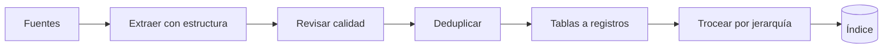

Al terminar sabrás revisar un corpus antes de indexarlo y arreglar lo que más daño hace: copias que se comen el top-k, PDF que salen desordenados, páginas escaneadas sin texto y tablas convertidas en sopa de números. En la [[cursos/rag-a-fondo/02-indexar-bien|lección 2]] limpiaste y troceaste por estructura documentos razonables; aquí te enfrentas a los que no lo son.

## La idea

**Un RAG no puede ser mejor que sus fuentes.** Si los documentos tienen errores, versiones obsoletas, contradicciones u OCR defectuoso, la recuperación devuelve basura con mucha seguridad. Y si la extracción destroza el contenido, el RAG está roto antes de llegar a los [[glosario/embeddings|embeddings]]: ningún modelo ni reranker recupera una cifra que no existe en el texto extraído.

La calidad de los datos es parte del sistema, con su propio trabajo y su propia revisión.



## Duplicados

Los corpus reales tienen `manual.pdf`, `manual_copia.pdf`, `manual_v2.pdf`, `manual_final.pdf` y `manual_final2.pdf`. Si los indexas todos, una pregunta recupera cinco copias del mismo párrafo: desperdician puestos del top-k, tokens y la oportunidad de que entre otra fuente. Peor aún: si las versiones difieren en un dato, el modelo recibe dos respuestas.

Hay dos niveles. Los **idénticos** se detectan con un hash del texto normalizado. Los **casi iguales** (otra versión, una errata corregida) se detectan comparando *shingles*, secuencias de cinco palabras, con la similitud de Jaccard:

```python title="duplicados.py"
import hashlib
import re
import unicodedata
from itertools import combinations


def normalizar(texto: str) -> str:
    texto = unicodedata.normalize("NFKD", texto.lower())
    texto = "".join(c for c in texto if not unicodedata.combining(c))
    return re.sub(r"\s+", " ", re.sub(r"[^\w\s]", " ", texto)).strip()


def huella(texto: str) -> str:
    return hashlib.sha256(normalizar(texto).encode()).hexdigest()


def tejas(texto: str, n: int = 5) -> set[str]:
    """Shingles: secuencias de n palabras. Dos versiones casi iguales comparten casi todas."""
    p = normalizar(texto).split()
    return {" ".join(p[i:i + n]) for i in range(max(1, len(p) - n + 1))}


def jaccard(a: set, b: set) -> float:
    return len(a & b) / len(a | b) if a | b else 1.0


def informe(docs: dict[str, str], umbral: float = 0.8) -> None:
    por_huella: dict[str, list[str]] = {}
    for nombre, texto in docs.items():
        por_huella.setdefault(huella(texto), []).append(nombre)
    for grupo in por_huella.values():
        if len(grupo) > 1:
            print("idénticos:", grupo)
    t = {n: tejas(x) for n, x in docs.items()}
    for a, b in combinations(docs, 2):
        s = jaccard(t[a], t[b])
        if umbral <= s < 1:
            print(f"casi iguales ({s:.2f}): {a} ~ {b}")


if __name__ == "__main__":
    base = ("Cada empleado dispone de 23 días laborables de vacaciones al año. Las vacaciones se solicitan "
            "en el portal de RRHH con al menos 15 días de antelación y las aprueba el responsable directo "
            "en un plazo de 5 días laborables. Los días no disfrutados pueden trasladarse hasta el 31 de marzo.")
    informe({
        "manual.pdf": base,
        "manual_copia.pdf": base.replace("  ", " ") + "\n",
        "manual_final2.pdf": base.replace("31 de marzo", "30 de abril"),
        "soporte.pdf": "El horario de soporte es de 9:00 a 18:00 de lunes a viernes.",
    })
```

```text
idénticos: ['manual.pdf', 'manual_copia.pdf']
casi iguales (0.88): manual.pdf ~ manual_final2.pdf
casi iguales (0.88): manual_copia.pdf ~ manual_final2.pdf
```

Los idénticos se eliminan sin más. Los casi iguales piden una **decisión de negocio**: ¿cuál es el vigente? `manual_final2.pdf` cambia el plazo del 31 de marzo al 30 de abril, y eso no lo decide un algoritmo. Indexa solo la versión vigente, o indexa todas con `version` y fechas de vigencia y filtra en la consulta ([[cursos/rag-a-fondo/08-mantener-el-indice]]). Comparar todos con todos es cuadrático: para miles de documentos usa MinHash con LSH, que aproxima lo mismo sin comparar cada par.

## PDF difíciles

Un PDF no es texto: es una lista de instrucciones para pintar caracteres en posiciones. Extraer «el texto» es reconstruir el orden de lectura, y falla con:

- **columnas**: el extractor lee de lado a lado y mezcla frases de dos columnas;
- **cabeceras y pies** repetidos en cada página que se cuelan en mitad de un párrafo;
- **tablas**, **diagramas** e **imágenes** con texto que no está en la capa de texto;
- **texto escaneado**: la página es una imagen y no hay capa de texto.

Para PDF simples basta un extractor de texto. Para maquetaciones complejas usa una herramienta que reconstruya la estructura y exporte Markdown con encabezados y tablas. Opciones abiertas verificadas a octubre de 2026 (detalle en [[docs/modelos-abiertos/06-ingesta-de-documentos]]):

| Herramienta | Licencia | Para qué |
|---|---|---|
| [[herramientas/docling\|Docling]] | código MIT; los modelos, con las suyas | PDF con maquetación, orden de lectura, tablas y fórmulas; DOCX, PPTX, HTML; OCR. `DocumentConverter().convert(ruta).document.export_to_markdown()` |
| PyMuPDF 2.0 | **AGPL-3.0** o comercial | rápido; `to_markdown()`, tablas y OCR con Tesseract. La AGPL obliga a publicar tu código si lo ofreces como servicio en red |
| Unstructured | Apache-2.0 | particionado de muchos formatos |
| marker | código Apache-2.0; **pesos con licencia OpenRAIL-M modificada** (con límite de uso comercial) | PDF a Markdown con modelos |
| MinerU | licencia propia basada en Apache 2.0 con condiciones | PDF complejos, tablas y fórmulas |

Lee la licencia antes de elegir: «se puede descargar» no significa «se puede usar en tu producto». El paso a paso con Docling está en [[recetas/pdf-a-markdown-con-docling]].

## OCR

Si una página es una imagen, hace falta OCR, y su calidad pasa directamente a la recuperación: «so1icitan» con un uno no coincide con «solicitan» ni en BM25 ni, a menudo, en el vector. Docling y PyMuPDF traen OCR. Lo importante es **detectar qué páginas lo necesitan y cuáles salieron mal**, con señales baratas sobre el texto extraído:

```python title="necesita_ocr.py"
import re


def calidad_texto(texto: str) -> dict:
    """Señales baratas de que una página necesita OCR o se extrajo mal."""
    palabras = re.findall(r"\w+", texto)
    letras = sum(c.isalpha() for c in texto)
    raras = sum(1 for c in texto if not (c.isalnum() or c.isspace() or c in ".,;:¿?¡!()-%€/'\"«»"))
    cortadas = len(re.findall(r"\w-\s*\n\s*\w", texto))
    return {
        "palabras": len(palabras),
        "sin_capa_de_texto": len(palabras) < 5,           # página escaneada: no hay capa de texto
        "proporcion_rara": round(raras / max(1, len(texto)), 3),
        "palabras_de_1_letra": round(sum(len(p) == 1 for p in palabras) / max(1, len(palabras)), 2),
        "guiones_de_corte": cortadas,
        "proporcion_letras": round(letras / max(1, len(texto)), 2),
    }


print(calidad_texto("Las vaca- \nciones se so1icitan c0n 15 d í a s de anteIación ~~ ¦¦ ▯▯"))
print(calidad_texto(""))
```

```text
{'palabras': 13, 'sin_capa_de_texto': False, 'proporcion_rara': 0.088, 'palabras_de_1_letra': 0.31, 'guiones_de_corte': 1, 'proporcion_letras': 0.6}
{'palabras': 0, 'sin_capa_de_texto': True, 'proporcion_rara': 0.0, 'palabras_de_1_letra': 0.0, 'guiones_de_corte': 0, 'proporcion_letras': 0.0}
```

La segunda página no tiene texto: va a OCR. La primera tiene texto, pero con un 31 % de palabras de una letra («d í a s») y casi un 9 % de símbolos raros: es un OCR malo que conviene repetir con otra configuración o revisar a mano. Calcula estas señales para todo el corpus, ordena por la peor y lee las 20 primeras. Los umbrales los fijas tú mirando tus documentos.

## Tablas

Una tabla aplanada en una línea («Básico 5 correo 20 € Pro 20 24 h 60 €») pierde la relación entre celda y cabecera, y ninguna búsqueda responde «¿cuánto cuesta el plan Pro?». Hay dos estrategias:

- **Tablas pequeñas**: mantenlas en Markdown dentro de un único fragmento, sin partirlas. El modelo lee bien las tablas en Markdown.
- **Tablas grandes o consultadas por celda**: convierte cada fila en un registro que repite las cabeceras y el contexto de la tabla.

```python title="tablas.py"
def tabla_a_registros(md: str, contexto: str) -> list[str]:
    """Convierte una tabla Markdown en un texto por fila que repite las cabeceras."""
    filas = [l.strip().strip("|").split("|") for l in md.strip().splitlines()]
    cabecera = [c.strip() for c in filas[0]]
    registros = []
    for fila in filas[2:]:                              # filas[1] es la línea |---|---|
        celdas = [c.strip() for c in fila]
        pares = ", ".join(f"{h}: {v}" for h, v in zip(cabecera[1:], celdas[1:]))
        registros.append(f"{contexto}. {cabecera[0]} {celdas[0]}: {pares}.")
    return registros


tabla = """
| Plan | Usuarios | Soporte | Precio mensual |
|---|---:|---|---:|
| Básico | 5 | correo | 20 € |
| Pro | 20 | 24 h | 60 € |
"""
for r in tabla_a_registros(tabla, "Tarifas 2026, sección Planes"):
    print(r)
```

```text
Tarifas 2026, sección Planes. Plan Básico: Usuarios: 5, Soporte: correo, Precio mensual: 20 €.
Tarifas 2026, sección Planes. Plan Pro: Usuarios: 20, Soporte: 24 h, Precio mensual: 60 €.
```

Cada registro se entiende solo, se encuentra por el nombre del plan y lleva la cifra junto a su significado. Si los usuarios hacen preguntas agregadas («¿qué plan es el más barato con soporte 24 h?»), la tabla quizá debería estar en una base de datos y consultarse con SQL ([[cursos/rag-a-fondo/09-cuando-el-rag-vectorial-no-basta]]).

## Jerarquía documental

Documento, capítulo, sección, subsección y párrafo: esa jerarquía es información. Consérvala en los metadatos de cada fragmento (`doc_id`, `ruta` de encabezados, `seccion_padre`, página) y aprovéchala de cuatro formas: **recuperar** (la ruta antepuesta al texto da contexto al vector y a BM25), **ampliar** (subir del fragmento a su sección), **citar** («Manual de RRHH, 3.2 Solicitud, pág. 12») y **navegar** (enlazar al original). La función `secciones()` de la lección 2 ya guarda la ruta; si tus PDF no la tienen, es la razón principal para usar un extractor con estructura.

## Elegir cómo trocear

| Estrategia | Cómo corta | Úsala cuando |
|---|---|---|
| Tamaño fijo con solape | cada N tokens, repitiendo un margen | texto sin estructura; punto de partida |
| Por estructura | por encabezados, párrafos y listas, subdividiendo lo largo | documentos con títulos (lo normal en empresa) |
| Semántico | donde cae la similitud entre frases consecutivas | texto largo sin títulos que cambia de tema (transcripciones, actas) |
| Padre-hijo | busca en trozos pequeños, devuelve la sección | fragmentos precisos que necesitan su contexto ([[recetas/chunks-padre-hijo]]) |

No hay un tamaño correcto universal: depende del tipo de documento, de la longitud de las preguntas, del modelo de embeddings y del contexto que puedes permitirte. El **troceado semántico** calcula el embedding de cada frase y corta cuando la similitud con la anterior baja de un umbral; cuesta un embedding por frase y el umbral hay que calibrarlo, así que pruébalo solo si el troceado por estructura no tiene estructura en la que apoyarse.

Una variante reciente es el *[[glosario/late-chunking|late chunking]]* (Günther et al., Jina AI, [arXiv 2409.04701](https://arxiv.org/abs/2409.04701)): pasa el documento entero por un modelo de embeddings de contexto largo y trocea **después**, al agrupar los vectores de los tokens, de modo que cada fragmento conserva información de su entorno. Necesita un modelo y una integración que lo soporten.

> [!aviso] Lee lo que has extraído
> Antes de medir nada, abre 20 documentos extraídos y léelos. Es la revisión más barata del curso y la que más fallos encuentra: columnas mezcladas, páginas sin texto, tablas aplanadas.

## Errores frecuentes

- **Medir la recuperación sin haber mirado la extracción.** Las métricas no te dicen que el PDF salió desordenado.
- **Indexar todas las versiones sin metadatos.** El modelo recibe dos respuestas y elige una.
- **Partir tablas por la mitad** con un troceado de tamaño fijo.
- **Elegir extractor sin leer la licencia** (AGPL, pesos con límites comerciales).
- **Confiar en el OCR por defecto** en documentos escaneados de mala calidad.

## Ejercicio

> [!ejercicio] Auditoría de tu corpus
> Pasa tu corpus por `informe()` de duplicados y `calidad_texto()` por página. Decide qué hacer con cada grupo de casi duplicados, envía a OCR las páginas sin texto y convierte a registros las tres tablas más consultadas.
>
> Está bien si tienes una lista de duplicados con la decisión tomada para cada uno, el número de páginas reprocesadas con OCR y, para cinco preguntas sobre tablas, el fragmento correcto en el top-5 después del cambio (y anotado si lo estaba antes).

> [!ejercicio]- Pistas
> Ajusta el umbral de Jaccard mirando pares reales: por encima de 0,9 suelen ser la misma versión con erratas; entre 0,6 y 0,9, versiones distintas que alguien tiene que revisar. Para las tablas, guarda el registro y la tabla original en los metadatos: recuperas por registro y puedes mostrar la tabla completa.

## Resumen

- La calidad del corpus limita todo lo demás: revísala antes que los embeddings.
- Deduplica idénticos por hash y casi iguales por shingles; las versiones las decide el negocio.
- Usa extractores con estructura para PDF complejos y revisa su licencia.
- Detecta con señales baratas qué páginas necesitan OCR y cuáles salieron mal.
- Convierte tablas en registros con cabeceras y conserva la jerarquía en los metadatos.

## Para seguir

- [[cursos/rag-a-fondo/07-permisos-y-multi-tenant]]
- [[recetas/pdf-a-markdown-con-docling]]
- [[recetas/chunks-padre-hijo]]
- [[docs/modelos-abiertos/06-ingesta-de-documentos]]
