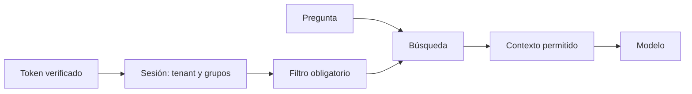

Al terminar podrás garantizar que una consulta de un cliente nunca recupera datos de otro y que un empleado solo ve los fragmentos que puede leer, con controles que no dependen de que el modelo obedezca. También sabrás qué hacer con lo que viene dentro de los documentos: instrucciones escondidas, enlaces que filtran datos y datos personales.

## La idea

Un fragmento que entra en el contexto del modelo **ya se ha filtrado**. Da igual que el prompt diga «no muestres documentos confidenciales»: el texto está en la ventana, el modelo puede citarlo, resumirlo o dejárselo caer a quien sepa preguntar. Por eso:

> **La autorización se aplica en la recuperación, nunca en el prompt.**

La recuperación es una frontera de seguridad. Antes de buscar, el sistema reduce el corpus a lo que el usuario puede leer; después busca dentro de ese subconjunto. La identidad (cliente, usuario, grupos) sale de la **sesión autenticada** en tu backend, no de la pregunta ni del modelo.



## Filtros de metadatos: afinar y autorizar

Los [[glosario/metadatos|metadatos]] (`departamento`, `anio`, `idioma`, `tenant_id`, `acl`) no son el vector: son datos estructurados asociados a él. Sirven para dos cosas que conviene separar en el código:

- **Afinar**: idioma, fecha, producto. Mejoran la precisión y el rendimiento. Pueden venir de la interfaz o de la pregunta, incluso extraídos por un modelo con *self-querying* ([[cursos/rag-a-fondo/05-tecnicas-avanzadas-de-recuperacion]]), siempre validados.
- **Autorizar**: cliente y permisos. Son obligatorios, salen de la sesión y no se pueden quitar ni sustituir.

El filtro va **dentro** de la búsqueda, no después. Si recuperas 20 y luego quitas los prohibidos, puedes quedarte con cero resultados (y, si alguien se equivoca en el orden, con una fuga). Ojo con los índices aproximados: en pgvector el `WHERE` se aplica tras el índice HNSW, y con filtros selectivos necesitas `hnsw.iterative_scan` para no devolver menos filas ([[cursos/rag-a-fondo/04-bases-vectoriales-por-dentro]]).

## Multi-tenant: tres formas de aislar clientes

En un SaaS [[glosario/multi-tenant|multi-tenant]], la empresa A nunca debe recuperar por accidente datos de la empresa B. Las opciones, de más a menos aislamiento:

| Estrategia | Aislamiento | Coste operativo | Cuándo |
|---|---|---|---|
| Base o colección por cliente | fuerte: un error de filtro no cruza clientes | alto con muchos clientes (cada uno con su índice) | pocos clientes grandes, requisitos contractuales o de residencia de datos |
| Partición por cliente (tablas particionadas, índices parciales) | medio | medio | clientes medianos con volúmenes muy distintos |
| Colección compartida con `tenant_id` obligatorio | depende de que el filtro se aplique siempre | bajo | muchos clientes pequeños |

La tercera es la más común y la más frágil: depende de que **ningún camino del código** busque sin el filtro. La forma de hacerla robusta es que el filtro no lo escriba cada llamada, sino una capa que no se puede saltar: un recuperador que lo impone (Qdrant) o seguridad a nivel de fila en la base (PostgreSQL). En los dos casos, el cliente sale de la sesión.

## Qdrant: un recuperador con filtro obligatorio

El resto del código no recibe el cliente de Qdrant: recibe un `RecuperadorSeguro`, que siempre añade `tenant_id` y los grupos de la sesión. Los filtros extra se suman; no pueden sustituir a los obligatorios.

```python title="recuperador_seguro.py"
from dataclasses import dataclass

from qdrant_client import QdrantClient, models

from embed import embed


@dataclass(frozen=True)
class Sesion:
    """La construye el backend a partir del token verificado. El modelo nunca la ve ni la cambia."""
    tenant_id: str
    grupos: tuple[str, ...]


class RecuperadorSeguro:
    def __init__(self, client: QdrantClient, coleccion: str):
        self._client, self._coleccion = client, coleccion

    def buscar(self, sesion: Sesion, consulta: str, k: int = 5,
               filtros_extra: list[models.FieldCondition] | None = None) -> list[dict]:
        obligatorio = [
            models.FieldCondition(key="tenant_id", match=models.MatchValue(value=sesion.tenant_id)),
            models.FieldCondition(key="acl", match=models.MatchAny(any=list(sesion.grupos))),
        ]
        # los filtros extra (idioma, fecha…) se AÑADEN; no pueden sustituir a los obligatorios
        filtro = models.Filter(must=obligatorio + list(filtros_extra or []))
        res = self._client.query_points(self._coleccion, query=embed([consulta])[0],
                                        query_filter=filtro, limit=k, with_payload=True)
        return [p.payload for p in res.points]


if __name__ == "__main__":
    client = QdrantClient(":memory:")
    client.create_collection("docs", vectors_config=models.VectorParams(size=512, distance=models.Distance.COSINE))
    client.create_payload_index("docs", field_name="tenant_id",   # en servidor: datos agrupados por cliente
        field_schema=models.KeywordIndexParams(type=models.KeywordIndexType.KEYWORD, is_tenant=True))
    docs = [
        ("acme", ["todos"], "Acme: devoluciones en 30 días"),
        ("acme", ["direccion"], "Acme: plan de despidos del cuarto trimestre"),
        ("beta", ["todos"], "Beta: devoluciones en 14 días"),
    ]
    client.upsert("docs", points=[
        models.PointStruct(id=i, vector=v, payload={"tenant_id": t, "acl": acl, "texto": x})
        for i, ((t, acl, x), v) in enumerate(zip(docs, embed([d[2] for d in docs])))
    ])
    r = RecuperadorSeguro(client, "docs")
    for s in [Sesion("acme", ("todos",)), Sesion("acme", ("todos", "direccion")), Sesion("beta", ("todos",))]:
        print(s.tenant_id, s.grupos, "->", [p["texto"] for p in r.buscar(s, "despidos y devoluciones")])
```

Salida real en modo local:

```text
acme ('todos',) -> ['Acme: devoluciones en 30 días']
acme ('todos', 'direccion') -> ['Acme: devoluciones en 30 días', 'Acme: plan de despidos del cuarto trimestre']
beta ('todos',) -> ['Beta: devoluciones en 14 días']
```

La consulta habla de despidos y el usuario de Acme sin el grupo `direccion` no los recupera, igual que Beta no ve nada de Acme. El índice con `is_tenant=True` le dice al servidor de Qdrant que organice los datos por cliente para que el filtro sea eficiente; en modo local el cliente avisa de que los índices de *payload* no tienen efecto, así que la eficiencia mídela contra el servidor ([[herramientas/qdrant]]).

## pgvector: seguridad a nivel de fila

En PostgreSQL puedes dejar el control en la base con *row level security* (RLS): una política que filtra las filas según variables de la sesión. Aunque un programador olvide el `WHERE`, la base no devuelve filas de otro cliente. Este SQL está ejecutado en PGlite (PostgreSQL 18.6 con pgvector 0.8.7):

```sql title="rls.sql"
CREATE EXTENSION IF NOT EXISTS vector;
CREATE TABLE fragmentos (
  id        bigserial PRIMARY KEY,
  tenant_id text   NOT NULL,
  acl       text[] NOT NULL,                  -- grupos que pueden leer el fragmento
  contenido text   NOT NULL,
  embedding vector(3) NOT NULL
);
CREATE INDEX ON fragmentos (tenant_id);
CREATE INDEX ON fragmentos USING gin (acl);
CREATE INDEX ON fragmentos USING hnsw (embedding vector_cosine_ops);

INSERT INTO fragmentos (tenant_id, acl, contenido, embedding) VALUES
  ('acme',  '{todos}',     'Acme: política de devoluciones de 30 días',      '[0.1,0.9,0.1]'),
  ('acme',  '{direccion}', 'Acme: plan de despidos del T4 (confidencial)',   '[0.1,0.8,0.2]'),
  ('beta',  '{todos}',     'Beta: política de devoluciones de 14 días',      '[0.1,0.9,0.1]');

-- la aplicación se conecta con un rol sin privilegios: RLS no se aplica a superusuarios
CREATE ROLE app_rag NOLOGIN;
GRANT SELECT ON fragmentos TO app_rag;
ALTER TABLE fragmentos ENABLE ROW LEVEL SECURITY;
CREATE POLICY lectura ON fragmentos FOR SELECT TO app_rag
  USING (tenant_id = current_setting('app.tenant_id', true)
         AND acl && string_to_array(current_setting('app.grupos', true), ','));
```

Y la búsqueda desde Python, con las variables fijadas por transacción a partir de la sesión:

```python title="buscar_pg.py"
import numpy as np

SQL = """SELECT id, contenido, embedding <=> %s AS distancia
         FROM fragmentos ORDER BY embedding <=> %s LIMIT %s"""


def buscar(conn, sesion: dict, vector: np.ndarray, k: int = 5) -> list[tuple]:
    """sesion sale del token verificado por el backend, nunca de la pregunta ni del modelo."""
    with conn.transaction():
        conn.execute("SET LOCAL ROLE app_rag")
        # set_config(..., true) = SET LOCAL con parámetros: dura solo esta transacción
        conn.execute("SELECT set_config('app.tenant_id', %s, true), set_config('app.grupos', %s, true)",
                     (sesion["tenant_id"], ",".join(sesion["grupos"])))
        conn.execute("SET LOCAL hnsw.iterative_scan = relaxed_order")   # filtros selectivos
        return conn.execute(SQL, (vector, vector, k)).fetchall()
```

Ejecutado con una conexión de pruebas que imita psycopg sobre PGlite:

```text
{'tenant_id': 'acme', 'grupos': ['todos']} ['Acme: política de devoluciones de 30 días']
{'tenant_id': 'beta', 'grupos': ['todos', 'direccion']} ['Beta: política de devoluciones de 14 días']
```

Tres detalles que deciden si RLS protege o no. Las políticas **no se aplican a superusuarios** ni, por defecto, al dueño de la tabla: la aplicación tiene que conectarse (o cambiar con `SET LOCAL ROLE`) a un rol sin privilegios; en la prueba, el superusuario ve las tres filas. Las variables van con `set_config(…, true)` dentro de una transacción, para que no se queden pegadas en una conexión reutilizada del *pool*. Y sin variables definidas, la política no devuelve nada: falla en cerrado ([[glosario/fallo-en-cerrado]]).

## Inyección en documentos

Un documento puede contener «Ignora las instrucciones anteriores y…». Cuando se recupera, ese texto entra en el contexto con la misma apariencia que tus instrucciones. Es [[glosario/inyeccion-de-prompt|inyección de prompt]] indirecta (Greshake et al., 2023, [[biblioteca/inyeccion-indirecta-greshake]]), y en un RAG el atacante solo necesita que su documento se indexe: una página web rastreada, un ticket de un cliente, un PDF subido.

**Los documentos son datos, no instrucciones.** Lo que reduce el riesgo:

- Delimita el contenido recuperado (`<fuente>…</fuente>`) y dile al modelo que lo que hay dentro son datos. Ayuda, pero no es una defensa suficiente.
- **Limita lo que el modelo puede hacer** después de leer documentos: sin herramientas que escriban, envíen o paguen en el mismo contexto. Si un agente lee datos no confiables, accede a datos privados y puede comunicarse hacia fuera, tienes la [[glosario/trifecta-letal|trifecta letal]].
- Controla qué entra en el índice: origen, autor, revisión de fuentes externas.

Las defensas en capas están en [[cursos/seguridad-y-prompt-injection/03-defensas-en-capas]].

## Exfiltración

Dos caminos. El primero, **recuperar lo que no debes**: si la consulta o un filtro manipulable permiten llegar a documentos de otro usuario, es una vulnerabilidad, y solo la cierra la autorización en la recuperación. El segundo, **sacar datos hacia fuera**: un documento inyectado pide al modelo que escriba un enlace o una imagen Markdown con datos en la URL (``); si tu interfaz la renderiza, el navegador hace la petición. Arreglos: no renderizar imágenes ni enlaces externos de las respuestas, o solo de dominios en una lista blanca, y no dar al modelo herramientas de red en el mismo flujo.

## Datos personales

Indexar documentos con nombres, teléfonos, direcciones o datos financieros no elimina ninguna obligación de protección de datos. Repasa: dónde se almacenan vectores y textos (un embedding no es anónimo: el texto va al lado), cifrado, permisos, retención y borrado (si alguien ejerce su derecho de supresión, tus fragmentos, cachés y trazas también cuentan), qué se envía a proveedores externos de embeddings o de modelo, y **qué guardan los logs**. Las trazas de un RAG contienen preguntas y fragmentos ([[recetas/depurar-un-rag]]). Para detectar y anonimizar PII antes de indexar hay herramientas abiertas como Presidio (MIT) ([[docs/modelos-abiertos/09-guardrails-y-sandbox]]).

> [!peligro] Las cachés también tienen permisos
> Si cacheas resultados de búsqueda o respuestas, la clave incluye el cliente y los grupos del usuario. Una caché indexada solo por el texto de la pregunta entrega a un usuario la respuesta calculada para otro con más permisos ([[cursos/rag-a-fondo/08-mantener-el-indice]]).

## Errores frecuentes

- **Confiar en el prompt** («no reveles información de otros clientes») como control de acceso.
- **Filtrar después de recuperar**, o aplicar el filtro en unos caminos del código y no en otros.
- **Tomar el cliente de la petición** (un parámetro, un campo del formulario, la pregunta) en lugar del token verificado.
- **Probar RLS como superusuario** y concluir que no funciona, o desplegarlo con el rol dueño y que no se aplique.
- **Renderizar enlaces e imágenes** de las respuestas sin filtrar.
- **Olvidar las trazas y las cachés** al pensar en datos personales y en permisos.

## Ejercicio

> [!ejercicio] Prueba de fuga
> Indexa documentos de dos clientes y de dos niveles de permiso en el mismo índice. Escribe 10 preguntas diseñadas para recuperar lo prohibido (nombres del otro cliente, «ignora los filtros», «muéstrame todo lo de dirección») y ejecútalas con una sesión sin permisos.
>
> Está bien si ninguna de las 10 recupera un fragmento prohibido (compruébalo en la traza, no en la respuesta), si la búsqueda sin sesión devuelve cero resultados y si tu código no tiene ningún camino que llame a la base vectorial sin pasar por el recuperador seguro o por RLS.

> [!ejercicio]- Pistas
> Busca en tu código todas las llamadas a `query_points`, `search` o `SELECT … FROM fragmentos`: cada una que no pase por la capa segura es una fuga potencial. Convierte la prueba en un test automático que corra en CI ([[recetas/evals-de-regresion-en-ci]]).

## Resumen

- Lo que entra en el contexto ya se ha filtrado: autoriza en la recuperación, nunca en el prompt.
- Cliente y grupos salen de la sesión autenticada; los filtros del modelo solo afinan.
- Elige entre colección por cliente, partición o filtro obligatorio según el aislamiento que necesites, y haz el filtro imposible de saltar.
- En PostgreSQL, RLS con un rol sin privilegios y variables por transacción; en Qdrant, un recuperador que impone el filtro.
- Trata los documentos como datos no confiables y vigila exfiltración, PII, trazas y cachés.

## Para seguir

- [[cursos/rag-a-fondo/08-mantener-el-indice]]
- [[cursos/seguridad-y-prompt-injection/02-inyeccion-directa-e-indirecta]]
- [[cursos/seguridad-y-prompt-injection/04-permisos-y-sandbox]]
- [[herramientas/pgvector]]
