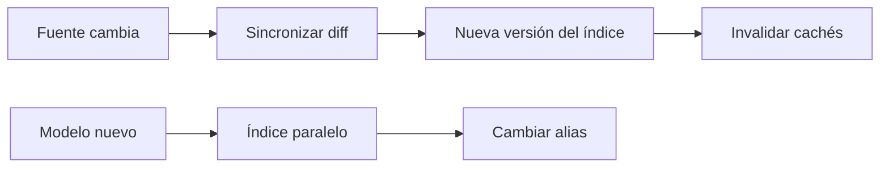

Al terminar sabrás mantener un RAG al día sin reindexarlo todo cada noche, sin servir respuestas viejas desde una caché y sin cortar el servicio cuando cambies de modelo de embeddings. La lección cierra un hueco que casi ningún tutorial cubre: el día 2, cuando los documentos empiezan a cambiar.

## La idea

Un índice es una foto del corpus en un momento. Los documentos cambian, se borran, aparecen versiones nuevas y el modelo de embeddings se queda viejo. **RAG no garantiza frescura por sí mismo**: la respuesta es tan reciente como la última vez que reindexaste, menos lo que tarde en caducar tu caché. Mantener el índice vivo es un proceso con cuatro piezas: sincronizar cambios, invalidar cachés, versionar el modelo y modelar la vigencia.



## Qué cachear y cómo invalidarlo

Hay tres cosas que cachear, de más barata a más arriesgada:

- **El embedding de la consulta.** Misma pregunta normalizada, mismo vector. Solo depende del modelo: casi sin riesgo.
- **Los resultados de la búsqueda.** Dependen de la consulta, de los filtros, de los **permisos** del usuario y del estado del índice.
- **La respuesta final.** Depende de todo lo anterior más el prompt y el modelo generador.

Si miles de usuarios preguntan «¿cuál es la política de vacaciones?», reutilizar trabajo tiene sentido. Pero la clave tiene que incluir todo lo que cambia el resultado. Si olvidas los grupos del usuario, entregas a alguien sin permisos una respuesta calculada para dirección; si olvidas la versión del índice, sigues sirviendo la política de 2025 después de reindexar.

```python title="cache.py"
import hashlib
import json
import time


class CacheRecuperacion:
    """Cachea resultados de búsqueda. La clave incluye todo lo que cambia la respuesta."""
    def __init__(self, ttl_s: int = 600):
        self.ttl_s, self._datos = ttl_s, {}

    @staticmethod
    def clave(consulta: str, tenant_id: str, grupos: list[str], version_indice: str, filtros: dict) -> str:
        bruto = json.dumps([" ".join(consulta.lower().split()), tenant_id, sorted(grupos),
                            version_indice, filtros], sort_keys=True, ensure_ascii=False)
        return hashlib.sha256(bruto.encode()).hexdigest()

    def obtener(self, clave: str):
        hit = self._datos.get(clave)
        if hit and time.monotonic() - hit[0] < self.ttl_s:
            return hit[1]
        self._datos.pop(clave, None)
        return None

    def guardar(self, clave: str, valor) -> None:
        self._datos[clave] = (time.monotonic(), valor)


cache = CacheRecuperacion()
a = cache.clave("¿Política de vacaciones?", "acme", ["todos"], "docs_v2@2026-10-29T08:00", {})
b = cache.clave("¿política  de vacaciones?", "acme", ["todos"], "docs_v2@2026-10-29T08:00", {})
c = cache.clave("¿Política de vacaciones?", "acme", ["todos", "direccion"], "docs_v2@2026-10-29T08:00", {})
d = cache.clave("¿Política de vacaciones?", "acme", ["todos"], "docs_v2@2026-10-29T09:00", {})
print(a == b, a == c, a == d)   # misma pregunta normalizada · otros permisos · índice actualizado
```

```text
True False False
```

La misma pregunta con otra capitalización y espacios comparte entrada; otros permisos o un índice actualizado, no. La versión del índice (aquí, colección más marca de tiempo de la última sincronización) es la forma más simple de invalidar: no borras nada, la clave nueva no encuentra las viejas y el TTL las limpia. No confundas esta caché con el [[glosario/prompt-caching|prompt caching]] del proveedor, que abarata el prefijo repetido de cada llamada ([[docs/contexto/02-prompt-caching]]) y es compatible con todo lo anterior.

## Qué pasa cuando cambia un documento

`politica_vacaciones.pdf` versión 2025 se sustituye por la versión 2026. Hay dos estrategias:

- **Reemplazar**: borrar los fragmentos antiguos e insertar los nuevos. Simple, y el índice solo tiene lo vigente.
- **Versionar**: conservar los dos con `version`, `vigente_desde` y `vigente_hasta`, y filtrar en la consulta. Necesario si alguien pregunta por el pasado o si tienes que auditar qué decía el sistema en una fecha.

En ambos casos lo que no puede pasar es lo que ocurre por defecto con un indexador ingenuo: que la versión nueva se añada y la vieja se quede, sin metadatos para distinguirlas.

## Indexación incremental

No hace falta reindexar todo. Cada documento está **nuevo** (indexar), **modificado** (reindexar solo lo que cambió), **eliminado** (borrar con sus fragmentos) o **sin cambios** (nada). Las piezas son las de la [[cursos/rag-a-fondo/02-indexar-bien|lección 2]]: un id estable por fragmento, un hash del documento para saltarse los que no cambian y un hash por fragmento para recalcular solo los embeddings necesarios. Se completa con dos cosas que se olvidan: **borrar los huérfanos** (secciones que desaparecieron de la versión nueva) y **purgar los documentos eliminados** de la fuente, con una protección para que una fuente vacía por error no vacíe el índice.

La implementación completa con pgvector, con el esquema, la transacción y la reutilización de vectores de texto idéntico, está en [[recetas/reindexado-incremental]]. Allí, cambiar «23 días» por «25 días» en una sección recalcula un embedding y borra un huérfano; repetir la sincronización sin cambios no hace nada.

## Cambiar de modelo de embeddings

Vectores de dos modelos distintos **no son comparables**, aunque tengan la misma dimensión: viven en espacios diferentes. Cambiar de modelo implica reindexar todo el corpus. Dos reglas:

1. **Registra qué modelo y qué dimensión generaron cada índice** (y cada fragmento). El indexador debe negarse a escribir con otro modelo en un índice existente; la receta lo hace con una tabla `indice_config`.
2. **Construye el índice nuevo en paralelo** y cambia cuando esté completo y evaluado. La aplicación consulta un nombre estable (un alias en Qdrant, una vista o un nombre de tabla en configuración en PostgreSQL) y el cambio es atómico.

```python title="doble_indice.py"
from qdrant_client import QdrantClient, models

from embed import embed            # el modelo "v1"; en la vida real, dos modelos distintos


def crear_indice(client, nombre: str, dim: int, modelo: str, fragmentos: list[dict], embed_fn) -> None:
    client.create_collection(nombre, vectors_config=models.VectorParams(size=dim, distance=models.Distance.COSINE))
    client.upsert(nombre, points=[
        models.PointStruct(id=i, vector=v, payload={**f, "modelo_embeddings": modelo})
        for i, (f, v) in enumerate(zip(fragmentos, embed_fn([f["texto"] for f in fragmentos])))
    ])


def apuntar_alias(client, alias: str, coleccion: str) -> None:
    """Cambia el alias de colección en una sola operación: las consultas nunca ven un índice a medias."""
    acciones = [models.CreateAliasOperation(create_alias=models.CreateAlias(collection_name=coleccion,
                                                                            alias_name=alias))]
    if any(a.alias_name == alias for a in client.get_aliases().aliases):
        acciones.insert(0, models.DeleteAliasOperation(delete_alias=models.DeleteAlias(alias_name=alias)))
    client.update_collection_aliases(change_aliases_operations=acciones)


if __name__ == "__main__":
    client = QdrantClient(":memory:")
    frags = [{"texto": "Las vacaciones se solicitan con 15 días de antelación."},
             {"texto": "El soporte atiende de 9:00 a 18:00."}]
    crear_indice(client, "docs_v1", 512, "juguete@1", frags, embed)
    apuntar_alias(client, "docs", "docs_v1")                      # la aplicación solo conoce "docs"

    embed_v2 = lambda textos: [v[:256] for v in embed(textos)]   # un "modelo nuevo" de 256 dimensiones
    crear_indice(client, "docs_v2", 256, "juguete@2", frags, embed_v2)   # se construye en paralelo
    # ...aquí: evaluar docs_v2 con el banco de preguntas antes de cambiar...
    apuntar_alias(client, "docs", "docs_v2")
    p = client.query_points("docs", query=embed_v2(["¿cómo pido vacaciones?"])[0], limit=1, with_payload=True)
    print(p.points[0].payload)
    print([(a.alias_name, a.collection_name) for a in client.get_aliases().aliases])
```

Salida real en modo local:

```text
{'texto': 'Las vacaciones se solicitan con 15 días de antelación.', 'modelo_embeddings': 'juguete@2'}
[('docs', 'docs_v2')]
```

Entre construir `docs_v2` y mover el alias va el paso que justifica todo el montaje: **pasar el banco de evaluación** con el índice nuevo y comparar [[glosario/recall-at-k|recall@k]] con el viejo ([[cursos/rag-a-fondo/10-evaluar-un-rag]]). Si empeora, no cambias el alias y no has roto nada. Mantén el índice viejo unos días para poder volver atrás; luego bórralo. Recuerda que la consulta también cambia de modelo: el vector de la pregunta debe calcularse con el modelo del índice al que apunta el alias en ese momento, así que guarda el modelo junto al alias, no en una constante suelta.

## Frescura y RAG temporal

La frescura depende de cuándo se actualizó el documento, cuándo se reindexó, cuánto vive la caché y si alguna fuente se consulta en vivo. Mídela: guarda la fecha de modificación en la fuente y la fecha de indexación, y vigila el retraso entre las dos. Para datos que cambian cada minuto (stock, estado de un pedido), no indexes: consulta la fuente con una herramienta en el momento ([[cursos/rag-a-fondo/09-cuando-el-rag-vectorial-no-basta]]).

Algunas preguntas dependen del tiempo: «¿cuál era la política en enero de 2025?». La similitud no sabe de fechas: las dos versiones de la sección son casi idénticas como texto. La recuperación tiene que **filtrar por vigencia**, no quedarse con el documento más parecido:

```python title="vigencia.py"
from qdrant_client import QdrantClient, models

from embed import embed

client = QdrantClient(":memory:")
client.create_collection("politicas", vectors_config=models.VectorParams(size=512, distance=models.Distance.COSINE))
versiones = [  # misma sección, dos versiones; la vieja no se borra, se cierra su vigencia
    {"texto": "Cada empleado dispone de 23 días de vacaciones.", "version": "2025",
     "vigente_desde": "2025-01-01T00:00:00Z", "vigente_hasta": "2025-12-31T23:59:59Z"},
    {"texto": "Cada empleado dispone de 25 días de vacaciones.", "version": "2026",
     "vigente_desde": "2026-01-01T00:00:00Z", "vigente_hasta": "2100-01-01T00:00:00Z"},
]
client.upsert("politicas", points=[models.PointStruct(id=i, vector=v, payload=p)
                                   for i, (p, v) in enumerate(zip(versiones, embed([x["texto"] for x in versiones])))])


def vigente_en(fecha: str) -> models.Filter:
    return models.Filter(must=[
        models.FieldCondition(key="vigente_desde", range=models.DatetimeRange(lte=fecha)),
        models.FieldCondition(key="vigente_hasta", range=models.DatetimeRange(gte=fecha)),
    ])


q = embed(["¿Cuántos días de vacaciones tengo?"])[0]
for fecha in ["2025-01-15T00:00:00Z", "2026-10-29T00:00:00Z"]:
    p = client.query_points("politicas", query=q, query_filter=vigente_en(fecha), limit=1, with_payload=True)
    print(fecha[:10], "->", p.points[0].payload["version"], p.points[0].payload["texto"])
```

```text
2025-01-15 -> 2025 Cada empleado dispone de 23 días de vacaciones.
2026-10-29 -> 2026 Cada empleado dispone de 25 días de vacaciones.
```

Por defecto, filtra por la fecha actual; si la pregunta menciona otra, extráela (con *self-querying*, [[cursos/rag-a-fondo/05-tecnicas-avanzadas-de-recuperacion]]) y úsala en el filtro. Cuando dos documentos vigentes se contradicen, eso ya no es un problema de frescura sino de contradicciones, y lo ves en la lección siguiente.

## Errores frecuentes

- **Cachear por el texto de la pregunta sin permisos ni versión del índice.** Fuga de datos y respuestas viejas a la vez.
- **Insertar versiones nuevas sin retirar ni marcar las viejas.**
- **Mezclar vectores de dos modelos** en el mismo índice durante una migración «gradual».
- **Cambiar de modelo sin evaluar antes de mover el alias.**
- **Confiar en la similitud para preguntas temporales.** Las versiones se parecen; las fechas, no.
- **Indexar datos que caducan en minutos.** Mejor una herramienta que consulte en vivo.

## Ejercicio

> [!ejercicio] Un día de cambios
> Sobre tu índice: modifica una sección de un documento, borra otro documento entero, añade uno nuevo y cambia de modelo de embeddings (o simúlalo truncando vectores, como en el ejemplo) con un doble índice y un alias.
>
> Está bien si la sincronización recalcula solo los fragmentos afectados y borra los huérfanos y el documento eliminado, si la caché no sirve resultados anteriores al cambio, si el alias solo se mueve después de pasar el banco de evaluación y si una pregunta con fecha pasada recupera la versión vigente en esa fecha.

> [!ejercicio]- Pistas
> Usa la marca de tiempo de la última sincronización como parte de la versión del índice y, por tanto, de la clave de caché. Para la vigencia, guarda las fechas como ISO 8601 con zona horaria y usa una fecha lejana como «vigente hasta» de la versión actual.

## Resumen

- RAG no garantiza frescura: depende de la sincronización, la caché y las fuentes en vivo.
- Las claves de caché incluyen cliente, permisos, filtros y versión del índice.
- Indexa de forma incremental con hashes, upsert, huérfanos y purga protegida.
- Cambiar de modelo es reindexar todo: hazlo en paralelo, evalúa y cambia el alias.
- Las preguntas temporales se resuelven filtrando por vigencia, no por similitud.

## Para seguir

- [[recetas/reindexado-incremental]]
- [[cursos/rag-a-fondo/09-cuando-el-rag-vectorial-no-basta]]
- [[cursos/rag-a-fondo/10-evaluar-un-rag]]
