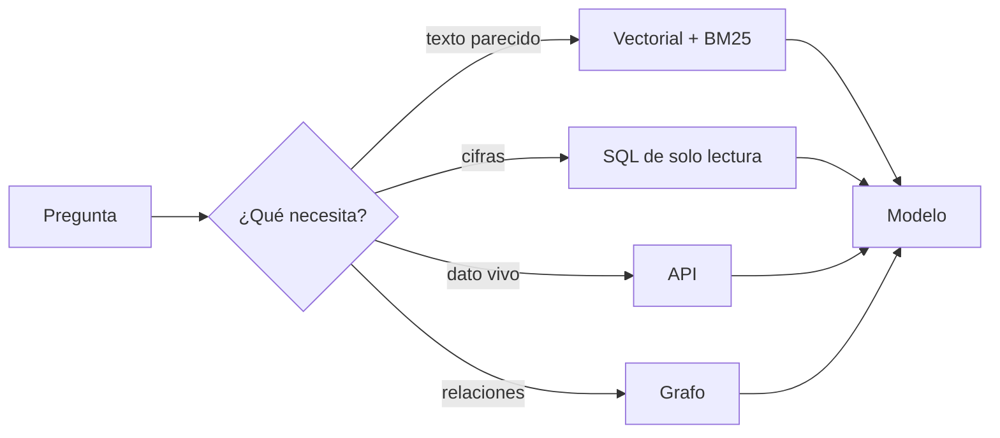

Al terminar sabrás detectar cuándo una pregunta no es para un top-k vectorial y qué poner en su lugar: SQL, búsqueda léxica, un grafo, un agente que decide qué buscar o, a veces, meter todo en el contexto. También sabrás por qué un umbral de similitud fijo engaña y cómo calibrarlo.

## La idea

La búsqueda vectorial responde a una pregunta muy concreta: **¿qué textos se parecen a este?** Muchas preguntas reales no son esa: «¿cuántos pedidos hubo ayer?» es una agregación; «¿qué dice la factura 123456?» es una coincidencia exacta; «¿quién dirigía el departamento cuando se aprobó la política X?» son tres búsquedas encadenadas; «¿cuál es el estado del pedido?» cambia cada minuto. Forzarlas por embeddings da respuestas que parecen razonables y están mal.

El sistema maduro combina componentes y elige por pregunta: vectores, BM25, SQL, APIs, grafos, búsqueda web o reglas.



## Datos estructurados: SQL con límites

Pedidos, ventas, inventario o métricas viven en tablas. Indexar filas como texto para buscarlas por similitud es un error: el modelo recibe cinco filas parecidas y «suma» de cabeza. Lo correcto es consultar la base. Hay dos formas:

- **Herramientas con parámetros** (`pedidos_por_estado(fecha, estado)`): consultas fijas que tú escribes; el modelo solo rellena argumentos. Es la opción segura y la primera que deberías probar.
- **Text-to-SQL**: el modelo escribe la consulta. Más flexible y mucho más arriesgado.

Si usas text-to-SQL, pon barreras de verdad, y la principal no es un `if` sobre el texto, es **una conexión de solo lectura** con un usuario que solo ve las tablas permitidas:

```python title="sql_seguro.py"
import re
import sqlite3

TABLAS_PERMITIDAS = {"pedidos"}
MAX_FILAS = 200


def preparar_bd(ruta: str = "tienda.db") -> None:
    with sqlite3.connect(ruta) as c:
        c.execute("DROP TABLE IF EXISTS pedidos")
        c.execute("CREATE TABLE pedidos (id INTEGER, fecha TEXT, importe REAL, estado TEXT)")
        c.executemany("INSERT INTO pedidos VALUES (?, ?, ?, ?)", [
            (1, "2026-10-28", 40.0, "enviado"), (2, "2026-10-28", 15.5, "pendiente"),
            (3, "2026-10-27", 99.0, "enviado")])


def consultar(sql: str, ruta: str = "tienda.db") -> list[tuple]:
    """Ejecuta SQL generado por un modelo con varias barreras. La principal es la conexión de solo lectura."""
    limpio = sql.strip().rstrip(";")
    if ";" in limpio or not re.match(r"(?is)^\s*select\b", limpio):
        raise ValueError("Solo se admite una sentencia SELECT")
    tablas = set(t.lower() for t in re.findall(r"(?i)\b(?:from|join)\s+([a-z_][\w]*)", limpio))
    if not tablas or not tablas <= TABLAS_PERMITIDAS:
        raise ValueError(f"Tablas no permitidas: {sorted(tablas - TABLAS_PERMITIDAS) or 'ninguna'}")
    conn = sqlite3.connect(f"file:{ruta}?mode=ro", uri=True, timeout=5)   # solo lectura en la conexión
    try:
        return conn.execute(f"SELECT * FROM ({limpio}) LIMIT {MAX_FILAS}").fetchall()
    finally:
        conn.close()


if __name__ == "__main__":
    preparar_bd()
    print(consultar("SELECT count(*) FROM pedidos WHERE fecha = '2026-10-28'"))
    for malo in ["DELETE FROM pedidos", "SELECT * FROM usuarios", "SELECT 1; DROP TABLE pedidos"]:
        try:
            consultar(malo)
        except ValueError as e:
            print("rechazado:", e)
```

```text
[(2,)]
rechazado: Solo se admite una sentencia SELECT
rechazado: Tablas no permitidas: ['usuarios']
rechazado: Solo se admite una sentencia SELECT
```

Las comprobaciones de texto son una capa más, fáciles de esquivar; lo que protege es que la conexión no pueda escribir (aquí `mode=ro`; en PostgreSQL, un rol con solo `SELECT` sobre vistas concretas y `statement_timeout`), el límite de filas y, si hay varios clientes, la seguridad a nivel de fila de [[cursos/rag-a-fondo/07-permisos-y-multi-tenant]]. El caso completo con un servidor MCP está en [[sistemas/asistente-de-datos-con-mcp]].

## Umbrales de similitud

No siempre hay que devolver K resultados. Con `score >= umbral` el sistema puede decir «no he encontrado contexto suficientemente relevante», que es mejor que rellenar el prompt con basura. El problema: **los scores no son probabilidades**. Un 0,80 no significa «80 % de relevancia», y no es comparable entre modelos, dominios, métricas ni configuraciones. Un umbral copiado de un tutorial no vale para tu sistema.

Calíbralo con tu banco de evaluación: para cada pregunta, el score del mejor fragmento y si el corpus tenía respuesta.

```python title="umbral.py"
import numpy as np

# score del mejor fragmento para preguntas etiquetadas: ¿tenía respuesta en el corpus?
# (datos inventados; usa los de tu banco de evaluación y tu modelo)
scores = np.array([0.82, 0.79, 0.77, 0.74, 0.71, 0.70, 0.68, 0.66, 0.64, 0.61, 0.58, 0.55])
tiene_respuesta = np.array([1, 1, 1, 0, 1, 1, 0, 1, 0, 0, 0, 0], dtype=bool)

print("umbral  responde  acierta_al_responder  abstenciones_correctas")
for u in (0.60, 0.65, 0.70, 0.75):
    responde = scores >= u
    precision = (responde & tiene_respuesta).sum() / max(1, responde.sum())
    abst = (~responde & ~tiene_respuesta).sum() / max(1, (~tiene_respuesta).sum())
    print(f"{u:.2f}    {responde.sum():>2}/12     {precision:.2f}                  {abst:.2f}")
```

```text
umbral  responde  acierta_al_responder  abstenciones_correctas
0.60    10/12     0.60                  0.33
0.65     8/12     0.75                  0.67
0.70     6/12     0.83                  0.83
0.75     3/12     1.00                  1.00
```

Subir el umbral mejora la precisión cuando responde y las abstenciones, pero a 0,75 deja sin responder cuatro preguntas que sí tenían respuesta. El punto lo elige el negocio (¿cuesta más un «no lo sé» o una respuesta equivocada?), y se recalibra cada vez que cambias de modelo de embeddings. Combínalo con la abstención del propio modelo ([[cursos/rag-a-fondo/10-evaluar-un-rag]]).

## Números, entidades y negaciones

Un embedding resume el significado general y es poco sensible a cambios pequeños que lo cambian todo:

```python title="numeros.py"
import numpy as np
from rank_bm25 import BM25Okapi

from embed import embed     # de juguete; repite la prueba con tu modelo real

pares = [("se permiten 20 días de teletrabajo", "se permiten 30 días de teletrabajo"),
         ("Factura 123456 pendiente de pago", "Factura 123457 pendiente de pago"),
         ("el reembolso está permitido", "el reembolso no está permitido")]
for a, b in pares:
    va, vb = np.array(embed([a, b]), dtype=np.float32)
    print(f"{float(va @ vb):.3f}  {a!r} ~ {b!r}")

docs = ["Factura 123456 pendiente de pago", "Factura 123457 pendiente de pago",
        "Factura 120001 pagada", "Albarán 123456 entregado", "Horario de soporte técnico",
        "Política de devoluciones", "Alta de proveedores", "Calendario laboral", "Gastos de viaje"]
bm25 = BM25Okapi([d.lower().split() for d in docs])
print("BM25 'factura 123456':", [round(float(s), 2) for s in bm25.get_scores("factura 123456".split())])
```

```text
0.938  'se permiten 20 días de teletrabajo' ~ 'se permiten 30 días de teletrabajo'
0.929  'Factura 123456 pendiente de pago' ~ 'Factura 123457 pendiente de pago'
0.964  'el reembolso está permitido' ~ 'el reembolso no está permitido'
BM25 'factura 123456': [1.43, 0.51, 0.66, 1.17, 0.0, 0.0, 0.0, 0.0, 0.0]
```

El embed de juguete exagera el efecto (compara trozos de palabras), pero la debilidad existe también en los modelos reales con números, códigos, identificadores, términos raros y negaciones: repite la prueba con el tuyo. BM25 pone primero la factura exacta. Para información precisa combina **semántica, léxica y reranking** ([[recetas/fusionar-rankings-con-rrf]]), y para identificadores que el usuario escribe tal cual, un filtro exacto por metadato es aún mejor.

## Cuándo no usar RAG vectorial puro

| Pregunta | Mejor herramienta |
|---|---|
| Cifras, recuentos, agregados | SQL o una API de analítica |
| Estado actual (pedido, stock, incidencia) | API en vivo como herramienta |
| Identificadores exactos | filtro por metadato o BM25 |
| Relaciones entre entidades, preguntas globales del corpus | grafo |
| Reglas cerradas (elegibilidad, tarifas) | código o reglas, con el documento como cita |
| Corpus pequeño que cabe en el contexto | todo en el prompt con caché |

Lo último merece atención. Anthropic recomienda que, si tu base de conocimiento es menor de unos 200.000 tokens, la metas entera en el prompt con [[glosario/prompt-caching|prompt caching]] antes de montar un RAG ([*Contextual Retrieval*](https://www.anthropic.com/news/contextual-retrieval), 2024). La comparación académica entre RAG y [[glosario/contexto-largo|contexto largo]] no da un ganador universal: Li et al. ([arXiv 2407.16833](https://arxiv.org/abs/2407.16833)) encuentran que el contexto largo gana de media cuando hay recursos y que RAG es mucho más barato, y LaRA ([arXiv 2502.09977](https://arxiv.org/abs/2502.09977), ICML 2025) concluye que depende del modelo, la longitud, la tarea y la calidad de la recuperación. Recuerda también que más contexto degrada el uso de la información ([[glosario/context-rot]]). Decide con tus evals ([[modelos/10-prompting-rag-o-fine-tuning]]).

## Grafos: relaciones y preguntas globales

El vector encuentra contenido parecido; un grafo de conocimiento representa relaciones (`Persona —trabaja_en→ Empresa —tiene→ Proyecto`). Un flujo combinado: recuperación semántica, extracción de entidades, recorrido del grafo y contexto enriquecido. Sirve en dominios con relaciones complejas: organigramas, contratos con partes y cláusulas, dependencias técnicas.

**[[glosario/graphrag|GraphRAG]]** (Edge et al., Microsoft, [arXiv 2404.16130](https://arxiv.org/abs/2404.16130)) construye con un modelo un grafo de entidades del corpus y resúmenes de sus comunidades, y responde preguntas **globales** («¿cuáles son los temas principales de estos 5.000 informes?») que un top-k nunca cubriría. **LightRAG** (Guo et al., [arXiv 2410.05779](https://arxiv.org/abs/2410.05779)) propone una indexación en grafo más ligera con recuperación local y global. El coste está en la indexación: muchas llamadas al modelo para extraer entidades y resumir. Úsalos cuando tus preguntas sean de ese tipo, no por defecto.

## Multi-hop y RAG agéntico

Una pregunta [[glosario/multi-hop|multi-hop]] necesita encadenar evidencias: recuperar la política X, leer su fecha y buscar quién dirigía el departamento en esa fecha. La segunda búsqueda depende del resultado de la primera, así que no se puede planificar de antemano. La solución es dejar que el modelo decida: el **[[glosario/rag-agentico|RAG agéntico]]** (revisión en Singh et al., [arXiv 2501.09136](https://arxiv.org/abs/2501.09136)) pone la recuperación como herramientas dentro de un [[glosario/bucle-agentico|bucle agéntico]] y el modelo elige cuándo, qué y con qué herramienta buscar.

```python title="rag_agentico.py"
import json

import anthropic

from sql_seguro import consultar

MODEL = "claude-sonnet-5-5"
client = anthropic.Anthropic()
MAX_PASOS = 6

DOCS = {
    "pol-envios#1": "Los pedidos pendientes más de 48 horas se escalan al equipo de logística.",
    "pol-envios#2": "Los envíos a Canarias tardan entre 5 y 7 días laborables.",
}


def buscar_docs(consulta: str) -> str:
    # aquí iría tu recuperador (híbrido, con filtros de la sesión); este es de juguete
    palabras = set(consulta.lower().split())
    hits = [{"id": i, "texto": t} for i, t in DOCS.items() if palabras & set(t.lower().split())]
    return json.dumps(hits[:3], ensure_ascii=False)


HERRAMIENTAS = [
    {"name": "buscar_docs",
     "description": "Busca en las políticas y manuales internos. Úsala para normas, procedimientos y plazos. "
                    "Devuelve fragmentos con id para citar.",
     "input_schema": {"type": "object", "properties": {"consulta": {"type": "string"}}, "required": ["consulta"]}},
    {"name": "consultar_pedidos",
     "description": "Ejecuta un SELECT de solo lectura sobre la tabla pedidos(id, fecha, importe, estado). "
                    "Úsala para cifras y recuentos; nunca estimes un número que puedas consultar.",
     "input_schema": {"type": "object", "properties": {"sql": {"type": "string"}}, "required": ["sql"]}},
]
SISTEMA = ("Respondes a preguntas internas de operaciones. Decide qué herramienta necesitas: documentos para "
           "normas, SQL para datos. Puedes encadenar búsquedas. Cita los fragmentos con su id entre corchetes. "
           "Si no encuentras la información, dilo.")


def ejecutar(nombre: str, entrada: dict) -> tuple[str, bool]:
    try:
        if nombre == "buscar_docs":
            return buscar_docs(entrada["consulta"]), False
        if nombre == "consultar_pedidos":
            return json.dumps(consultar(entrada["sql"])), False
        return f"Herramienta desconocida: {nombre}", True
    except Exception as e:                       # el error vuelve al modelo, que puede corregir la consulta
        return f"Error: {e}", True


def agente(pregunta: str) -> str:
    mensajes = [{"role": "user", "content": pregunta}]
    for _ in range(MAX_PASOS):
        resp = client.messages.create(model=MODEL, max_tokens=2048, system=SISTEMA,
                                      tools=HERRAMIENTAS, messages=mensajes)
        if resp.stop_reason == "tool_use":
            mensajes.append({"role": "assistant", "content": resp.content})
            resultados = []
            for b in resp.content:
                if b.type == "tool_use":
                    salida, es_error = ejecutar(b.name, b.input)
                    resultados.append({"type": "tool_result", "tool_use_id": b.id,
                                       "content": salida, "is_error": es_error})
            mensajes.append({"role": "user", "content": resultados})
            continue
        if resp.stop_reason == "pause_turn":
            mensajes.append({"role": "assistant", "content": resp.content})
            continue
        texto = "".join(b.text for b in resp.content if b.type == "text")
        if resp.stop_reason in ("end_turn", "stop_sequence"):
            return texto
        return f"[sin respuesta completa: {resp.stop_reason}] {texto}"   # max_tokens, refusal…
    return "[límite de pasos alcanzado]"


if __name__ == "__main__":
    print(agente("¿Cuántos pedidos pendientes hubo ayer y qué hay que hacer con ellos?"))
```

Con el simulador de la API pidiendo primero el recuento por SQL, después la política y por último respondiendo:

```text
Ayer hubo 1 pedido pendiente. Si sigue pendiente más de 48 horas, se escala al equipo de logística [pol-envios#1].
```

Lo esencial del bucle: un `tool_result` por cada `tool_use`, los errores de herramienta vuelven al modelo con `is_error` para que corrija la consulta, se trata cada `stop_reason` y hay un **límite de pasos**. A cambio de la flexibilidad pagas latencia y coste variables (varias llamadas por pregunta) y un modo de fallo nuevo: el modelo no busca cuando debería o busca con malos términos. Registra cada consulta que genera ([[cursos/rag-a-fondo/01-anatomia-de-un-rag]]). Los filtros de permisos siguen fuera del alcance del modelo: la herramienta los aplica con la sesión.

## Multimodal, código y conversaciones

- **Multimodal.** Imágenes, diagramas, tablas escaneadas, audio o vídeo: embeddings multimodales o, más a menudo, convertir a texto en la ingesta (descripción de la imagen, transcripción) y pasar la imagen original a un modelo que la lea cuando se recupera.
- **Código.** Se puede indexar por archivo, símbolo, función o clase, trocear siguiendo la sintaxis y buscar con embeddings. Pero los agentes de código actuales recuperan sobre todo **sin embeddings**: búsqueda de texto (grep), análisis sintáctico y archivos de contexto; así lo documenta el análisis de 11 arneses de Barbaste et al. ([arXiv 2609.00006](https://arxiv.org/abs/2609.00006)). Para código, empieza por ahí.
- **Conversaciones.** Indexar mensajes anteriores sirve como memoria, pero separa historial, memoria, documentos y estado actual: no todo el historial debe convertirse en memoria permanente ([[roadmap/30-contexto-y-rag/06-memoria-entre-sesiones]]).

## Contradicciones entre documentos

El manual de 2025 dice 23 días; el de 2026, 25. Si los dos llegan al contexto, el modelo elige uno (o los mezcla). Un RAG debe **priorizar la versión correcta, usar metadatos de vigencia, detectar el conflicto y citar la fuente**. Modela `version`, `vigente_desde`, `vigente_hasta` y `estado` (borrador, vigente, derogado), filtra por vigencia ([[cursos/rag-a-fondo/08-mantener-el-indice]]) y, cuando aun así lleguen fuentes contradictorias (dos documentos vigentes que no coinciden), instruye al modelo para **mostrar el conflicto con las dos citas** en lugar de elegir en silencio. Ese caso es también un aviso para el dueño de los documentos.

## Errores frecuentes

- **Indexar tablas para preguntas de cifras.** El modelo no debe sumar de cabeza.
- **Text-to-SQL con una conexión que puede escribir.** Las comprobaciones de texto no bastan.
- **Un umbral copiado de otro sistema** o interpretado como probabilidad.
- **Montar un RAG para 100 páginas** que caben en el contexto con caché.
- **GraphRAG por moda** para preguntas que un top-k resuelve.
- **Bucles agénticos sin límite de pasos** ni registro de las consultas.

## Ejercicio

> [!ejercicio] Clasifica tu tráfico
> Toma 50 preguntas reales de tus usuarios y clasifica cada una: texto parecido, cifra, dato vivo, identificador exacto, relación o multi-hop, o global. Para las que no sean «texto parecido», comprueba qué devuelve tu RAG actual.
>
> Está bien si tienes la tabla de clasificación con el porcentaje de cada tipo, al menos tres ejemplos de respuestas incorrectas por usar búsqueda vectorial donde no tocaba y una propuesta concreta (herramienta SQL, filtro, API o bucle agéntico) para el tipo más frecuente después de «texto parecido».

> [!ejercicio]- Pistas
> Las preguntas con «cuántos», «total», «media», «último» o una fecha concreta suelen ser de datos. Las que contienen un código con números y letras, de identificador exacto. Si más del 30 % no son de texto parecido, plantéate un enrutado o un agente antes que mejorar los embeddings.

## Resumen

- La búsqueda vectorial responde «qué se parece a esto»; muchas preguntas no son eso.
- Cifras y datos vivos van por SQL o APIs, con una conexión de solo lectura y límites.
- Los scores no son probabilidades: calibra el umbral con tu banco y recalíbralo al cambiar de modelo.
- Números, identificadores y negaciones piden BM25, filtros exactos o reranking.
- Grafos para relaciones y preguntas globales; RAG agéntico para multi-hop; vigencia y conflicto visible para contradicciones.

## Para seguir

- [[cursos/rag-a-fondo/10-evaluar-un-rag]]
- [[sistemas/asistente-de-datos-con-mcp]]
- [[patrones/08-agente-autonomo]]
- [[recetas/depurar-un-rag]]
