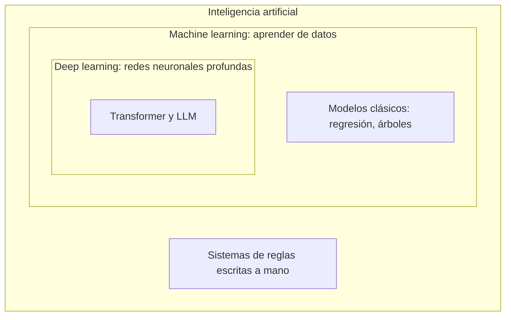

Al terminar esta fase sabrás colocar en un mismo mapa la [[glosario/aprendizaje-automatico|IA, el machine learning]] y el [[glosario/aprendizaje-profundo|deep learning]], y tendrás una primera vuelta completa por cómo se usa hoy la IA para programar. Es la fase que ordena la jerga: sin ella, cada término nuevo de las fases siguientes se acumula suelto.

## Qué vas a ver

| Vídeo | Canal | Duración | Idioma | Profundidad |
|---|---|---|---|---|
| [«¿Qué es el Machine Learning?¿Y Deep Learning? Un mapa conceptual»](https://www.youtube.com/watch?v=KytW151dpqU) | DotCSV | 7:47 | español | a fondo |
| [«¿Qué es el Aprendizaje Supervisado y No Supervisado?»](https://www.youtube.com/watch?v=oT3arRRB2Cw) | DotCSV | 10:06 | español | a fondo |
| [«Modelos para entender una realidad caótica»](https://www.youtube.com/watch?v=Sb8XVheowVQ) | DotCSV | 10:15 | español | a fondo |
| [Curso de IA para programadores (vídeo completo)](https://www.youtube.com/watch?v=2aN_-m1uU4k) | midudev | 1:39:57 | español | a fondo |
| [«Introducción a la IA para Developers» (el mismo curso, por lecciones)](https://midu.dev/curso/intro-ia-para-devs) | midudev | — | español | alternativa al vídeo |
| [Cursos de machine learning de Google](https://developers.google.com/machine-learning?hl=es-419): [introducción](https://developers.google.com/machine-learning/intro-to-ml?hl=es-419), [curso intensivo](https://developers.google.com/machine-learning/crash-course?hl=es-419) y [enmarcar problemas](https://developers.google.com/machine-learning/problem-framing?hl=es-419) | Google for Developers | — | español (es-419) | extra |

Los títulos entre comillas son los que recoge el autor en sus notas; el resto describe el contenido. «—» indica una duración sin confirmar. El tiempo de la lección suma los vídeos que no son extra (128 minutos, contando el curso de midudev una sola vez) y 10 minutos de lectura.

## Lo que importa

La nota del autor sobre los vídeos de DotCSV va al origen: esto es la base de la IA de antes del auge de ChatGPT y de los [[glosario/llm|LLM]]. Un LLM es, al final, una [[glosario/red-neuronal|red neuronal]] muy grande, así que conviene saber cómo funcionan por dentro aunque no domines las matemáticas. El orden histórico ayuda: primero existían modelos que aprendían de datos (machine learning); después aparecieron arquitecturas nuevas, es decir, formas distintas de construir esos modelos; y de una de ellas, el [[glosario/transformer|Transformer]], salieron los LLM.

La idea que más rinde de estos tres vídeos es el cambio de enfoque. Un programa clásico sigue reglas que alguien escribió. Un modelo de machine learning ajusta sus [[glosario/parametros|parámetros]] a partir de ejemplos y devuelve una predicción con cierta probabilidad. Piensa en un filtro de spam: escribir reglas para cada truco de los remitentes no acaba nunca; un modelo que aprende de miles de correos etiquetados generaliza a casos que nadie listó. El tercer vídeo trata justo eso: la realidad tiene demasiadas excepciones para cubrirlas con reglas, y un modelo probabilístico las absorbe. Esa misma idea explica, tres fases después, por qué un LLM da la respuesta más probable y no una respuesta garantizada.

Para el autor, con los vídeos de DotCSV basta. Los cursos de Google son para quien quiera profundizar de verdad en cómo se crean modelos y redes neuronales; avisa de que piden saber Python y conviene conocer TensorFlow.

Sobre el curso de midudev, su criterio es distinto. Es un inicio rápido, lo que casi todo el mundo ve para meterse en la IA que se usa hoy: qué es la IA, cómo se entrena (por encima), qué son los LLM y los [[glosario/token|tokens]], y las herramientas, que es lo que más atrae. Es un resumen de la base actual y se entiende mejor si antes has visto cómo funcionan los modelos. Incluye temas avanzados que volverás a ver en las fases 3 a 7, y aun así el autor recomienda hacerlo entero y tomar apuntes: tener el mapa completo desde el principio hace que cada fase posterior encaje en un hueco conocido.

## Cómo verlo

1. **Los tres vídeos de DotCSV, en orden y seguidos.** Son cortos. Al acabar cada uno, escribe dos líneas con tus palabras: qué es y un ejemplo que no salga en el vídeo.
2. **El curso de midudev en una o dos sesiones.** Si prefieres lecciones cortas, usa la versión de midu.dev; si prefieres el vídeo, este es su mapa aproximado:

| Tramo | Tema |
|---|---|
| 0:00–9:30 | Qué es un LLM y cómo se entrena |
| 9:30–17:30 | Contexto, prompt de sistema e inyección de prompt |
| 17:30–24:30 | Tokens |
| 24:30–56:30 | Herramientas para programar y agentes en el editor |
| 56:30–1:11:55 | Claude Code |
| 1:11:55–1:26:17 | MCP y Agent Skills |
| 1:26:17–1:33:20 | IA en local (Ollama, OpenCode) |
| 1:33:20–1:39:57 | NotebookLM para estudiar |

Volverás a varios tramos en las fases siguientes; apunta en qué minuto está cada tema.

3. **Qué apuntar:** las definiciones de modelo, entrenamiento, parámetro, token, contexto, agente, MCP y skill. Son el vocabulario de toda la ruta.
4. **Qué saltarte:** los nombres concretos de modelos, los precios y los créditos que aparecen en pantalla. Cambian cada pocos meses; el concepto queda.
5. **Google, solo si vas a crear modelos.** Si tu objetivo es usar LLM y construir agentes, déjalos para más adelante.

> [!consejo] Apuntes que te sirvan dentro de seis meses
> Si tomas apuntes en Obsidian u otra herramienta de notas, la receta [[recetas/apuntes-de-video-con-ia]] explica el método del autor para convertir un vídeo en apuntes estructurados, con la plantilla [[plantillas/prompt-apuntes-de-video]]. Úsalos para ti: no republiques el contenido ajeno.

## Practícalo en MoreContext

- [[cursos/la-ia-por-dentro/01-ia-machine-learning-y-deep-learning]]: el mapa IA, ML y DL explicado por escrito, con un ejemplo mínimo en Python.
- [[cursos/la-ia-por-dentro/02-aprendizaje-supervisado-y-no-supervisado]]: supervisado, no supervisado y por refuerzo, y por qué el preentrenamiento de un LLM es autosupervisado.
- [[cursos/la-ia-por-dentro/03-de-las-reglas-a-las-probabilidades]]: la idea del tercer vídeo llevada hasta cómo genera texto un LLM.
- [[roadmap/00-fundamentos/01-que-es-un-llm]] y [[roadmap/00-fundamentos/06-como-se-entrena-un-llm]]: lo mismo que cuenta midudev, pero desde el código y con preentrenamiento, ajuste con instrucciones y [[glosario/rlhf|RLHF]] por separado.
- Glosario de la fase: [[glosario/aprendizaje-supervisado]], [[glosario/aprendizaje-no-supervisado]], [[glosario/preentrenamiento]].

## Ejercicio

> [!ejercicio] Tu mapa en una página
> Sin mirar los vídeos, escribe una página con estos términos: inteligencia artificial, machine learning, deep learning, red neuronal, Transformer, LLM, token, agente. Para cada uno, una definición de una frase y un ejemplo de uso real. Añade un párrafo que explique, con un ejemplo tuyo, por qué un problema se resuelve mejor aprendiendo de datos que escribiendo reglas.
>
> Está bien si cada definición está con tus palabras, si el LLM queda dentro del deep learning y no al lado, si tu ejemplo de reglas frente a datos no es el del spam y si terminas con tres dudas concretas que esperas resolver en las fases 1 a 3.

> [!ejercicio]- Pistas
> Para el ejemplo de reglas frente a datos, piensa en algo con muchas excepciones: reconocer la letra manuscrita, recomendar una canción, estimar el precio de un piso. Si te sale una regla limpia que lo resuelve todo, el ejemplo no sirve.

## Resumen

- IA es el campo; machine learning, aprender de datos; deep learning, hacerlo con redes neuronales profundas; los LLM son redes de tipo Transformer.
- Un modelo da predicciones probables, no reglas garantizadas: esa idea vuelve en todas las fases.
- Los tres vídeos de DotCSV bastan para la base; los cursos de Google son para quien vaya a crear modelos.
- El curso de midudev da el mapa completo de la IA para programar; hazlo entero y apunta en qué minuto está cada tema.

## Para seguir

- [[cursos/ruta-en-video/02-fase-1-redes-neuronales]]
- [[cursos/la-ia-por-dentro/index]]
- [[roadmap/00-fundamentos/index]]
